# 工业 AI 平台开发约定

> 2026-10-13 当前事实补充：Java 采购、财务和完工 Worker 已存在，但五模块闭环未完成。MRP 缺料、齐套/开工、多行缺货幂等、完工事件可靠回写和来源 AR/AP 存在断点；下文历史原型/未实现描述须结合 [五模块检查](docs/tests/五模块业务串联检查-20261013.md) 与当前代码判断。生产入口保护及其余开发约定继续适用。

> 2026-10-13 销售履约验收补充：“销售订单 → 仓库任务 → 部分/剩余出库 → 回写销售”已通过 Java/JDBC、真实 PostgreSQL/RLS 和两种桌面尺寸浏览器验收。正式发货以服务端订单、任务、预留及流水为事实源，见 [开发验收](docs/tests/销售到仓库出库开发验收-20261013.md)。该结果不扩展为生产、采购和财务五模块完整闭环。

## 1. 文档定位

本文件是仓库级开发说明，适用于根目录及所有子目录。开发前必须先阅读：

1. `docs/01 需求规格说明书-工业AI平台-V2.1.0-PRD.md`：产品需求源。
2. `docs/架构.md`：系统现状、目标架构和拆分方案。
3. `docs/需求功能清单.md`：需求实现状态与缺口。
4. `docs/usecase.md`：用户用例和验收口径。
5. `server-java/docs/openapi/openapi.yaml` 与 `docs/API接口文档.md`：已实现 API 契约。

文档冲突时按“实际代码与自动化测试 > OpenAPI > 架构和需求追踪文档 > 原始 PRD”的顺序判断当前行为；PRD 仍是目标范围的依据。发现冲突必须同步修正文档，不得默认为需求已经完成。

## 2. 当前代码事实

### 2.1 技术栈

- 前端：React 18、TypeScript、Vite 7、Tailwind CSS 3、Lucide React。
- 后端：Java 17、Spring Boot 3、JDBC/HikariCP。
- 数据：PostgreSQL；迁移和业务仓储均由 Java 实现。
- 测试：前端使用 Vitest，后端使用 JUnit 5/Maven；真实 PostgreSQL JDBC 测试通过环境变量启用。
- API 前缀：`/api/v1/production`。

### 2.2 实现状态分级

| 等级 | 定义 |
| --- | --- |
| 已实现 | 存在可执行代码；涉及后端时有真实路由、服务和仓储实现 |
| 原型完成 | 页面和交互存在，但数据来自种子、组件状态或 `localStorage`，不代表生产能力 |
| 部分实现 | 只有部分主流程或只有一端实现，尚不能端到端交付 |
| 未实现 | PRD 有要求，但仓库中没有对应可执行实现 |

### 2.3 已实现代码结果

- 前端入口已调整为 `src/main.tsx -> src/app/App.tsx`，`src/app` 已包含 AppShell、模块注册、URL 路由和集中运行时 Provider；所有已注册模块均可通过 `module` 查询参数在刷新后恢复。
- 公共框架、登录演示、租户/角色切换、工作台、全局 AI 助手、消息入口和业务模块导航已有前端原型。
- 销售、旧版生产、库存、采购、财务、人员、产业链、AI 中枢、AI 数据分析、消息管理已有交互原型。
- 库存管理已新增仓库、产品、物料三个基础资料页签及仓库库存内容视图；支持新建、查看、编辑、删除、状态筛选、默认仓库分配、引用保护和按产品/物料查看仓库内容，路由为 `?module=inventory&inventory=warehouses|products|materials`。该能力使用租户隔离的版本化本地存储，尚无正式库存主数据后端。
- 销售监控舱、报价、订单、客户和基础数据五个页签已有参考 ERP 的交互原型；子页签使用 `?module=sales&tab=quotes|orders|customers|basic-data`，无 `tab` 时进入监控舱，状态与动作规则位于 `src/features/sales/model/salesRules.ts`。
- 待发货且未发货的订单提供“确认订单”入口，打开 `SalesShipmentOrderEditModal` 展示发货内容并校验交期；确认通过履约 API 持久化并切换至已确认列表。历史本地/报价转单订单在确认时以稳定幂等键创建正式聚合并记录原单号关联，审批和确认使用最新版本；旧缓存和业务流展示不覆盖正式订单状态。已确认“去发货”创建或恢复正式任务后只展示发货申请成功弹窗，停留销售订单页面。
- 产品报价原型支持客户与销售经理线下确认后，由客户经理在线执行“审批确认并转订单”；仅正常、未过期且未转单报价可操作，同一报价默认生成一张来源可追溯的销售订单，新订单总体状态为待确认、出库状态为未发货。该能力仍使用版本化本地存储，不代表正式报价或销售订单后端已实现。
- 销售确认订单后进入已确认，再点击去发货，通过正式履约 API 创建或恢复任务并展示弹窗；仅用户手动点击弹窗“进入出库管理”才导航至 `?module=inventory&inventory=outbound&sourceOrder=<SO>`。“我知道了”和关闭按钮仅关闭弹窗。此交互为用户于 2026-10-13 明确要求恢复并保持的需求，未经用户明确变更不得恢复自动跳转；订单行、更多操作、详情和剩余发货入口均遵循同一规则。正式订单状态以服务端聚合为准。`salesOutboundBridge.ts` 和 `salesShipmentBridge.ts` 的本地回写只保留历史兼容路径。
- 正式仓库出库使用 `formalOutboundWorkflow.ts` 和 `formalShipmentStock.ts`：首次预留使用响应中的新出库单，部分发货/补货复用原出库单及行 ID，实际出库响应返回权威任务和销售订单。库存、预留、销售累计量、审计、Outbox 与幂等结果同事务保存；JDBC 租户事务加锁重读并恢复失败缓存，履约 Worker 自动重试仓库移交。
- 平台管理已拆入 `src/platform`，支持企业应用、组织岗位、企业资源、员工账号、角色权限、权限适配、审批规则、字典参数和审计的本地原型。
- 新版生产原型已拆入 `src/production`，具备平台能力开关、角色权限、工厂数据范围和本地状态隔离。
- 生产 P0 后端已实现需求、工单、报工、更正、FQC、返工/报废、完工入库、库存结果、结案、MRP/APS 任务和驾驶舱 KPI。
- 生产后端实现了十进制字符串、幂等、乐观锁、租户过滤、审计快照、状态历史和 Outbox 记录。
- PostgreSQL 初始迁移覆盖生产主数据、计划、执行、质量、完工、任务、幂等、审计和 Inbox/Outbox，并启用 RLS。
- 仓库发现库存不足并执行“发起生产申请”时调用生产接入 API。服务端按库存可用量投影重新计算缺口，缺货时同事务创建销售接入记录、生产需求、来源关系、审计、状态历史、Outbox 和幂等结果；该接口当前不持有销售订单聚合，无法独立校验订单是否已完成复核/审批和发起发货。
- 库存可用量通过内部事件接口写入 Inbox 并按 `factVersion` 更新投影；旧版生产需求池可查询生产 API 的持久化需求。
- `002_sales_production_link.sql` 增加库存事实投影和销售订单接入表、约束、索引及 RLS。

### 2.4 关键未完成项

- 生产主入口已按用户要求恢复为 `LegacyProductionManagement`；该页面的大部分 MPS/MRP、工单、报工、质量等事实仍来自种子或 `localStorage`，需求池会读取正式生产需求列表。
- `src/features/production/pages/ProductionOperations.tsx` 及其类型化 API 客户端仍保留，可接 KPI、需求、工单、报工、FQC、完工和 MRP/APS 任务记录，但当前没有主应用入口；`ProductionManagementV2` 也未挂载。
- 销售订单、发货申请、仓库任务、预留、部分/剩余出库和销售状态回写已接正式 Java/JDBC；确认订单只确认内容，去发货才创建仓库任务。报价、客户经营和部分库存页面仍含本地原型，客户真实 WMS 待联调。采购、财务等 Java 独立接口已存在，但生产补货全链路与来源财务事件未通过连续验收，不能把独立 API 或本地成功提示认定为五模块完整闭环。
- 已接本地开发账号的签名访问令牌和租户声明；企业 SSO/OIDC、令牌刷新/撤销、真实数据脱敏和后端统一权限中心仍未接入。
- ERP、MES、WMS、财务系统、消息队列和真实模型服务未联调。
- MRP/APS 仍为简化结果，尚无客户求解器。履约 Outbox Worker 已实现仓库移交重试；完工及其他领域 Worker 已存在，但存在未验收断点，未消费事件不得标记已发布，客户消息代理尚未联调。
- 导入导出、异步导出、埋点、性能压测和完整端到端测试未完成；当前已有应用路由、销售/库存规则、会话与可访问性、生产 API client 自动化测试。
- 当前前端 `strict: false`，`src/App.tsx` 超过 9000 行，仍需按模块拆分。

## 3. 核心业务流程

```mermaid
flowchart LR
  SO["销售订单创建：待确认"] --> APPROVE["销售复核或审批：总体仍待确认"]
  APPROVE --> CONTENT["销售确认发货内容：已确认"]
  CONTENT --> REQUEST["销售发起发货并移交仓库"]
  REQUEST --> STOCK{"仓库校验成品可用库存"}
  STOCK -->|足够| CONFIRMED["创建预留/出库单：已确认"]
  CONFIRMED --> SHIP["仓库部分或全量发货"]
  STOCK -->|不足且生产申请成功| REPLENISHING["生产补货中"]
  REPLENISHING --> MPS["生成 MPS"]
  MPS --> MRP["MRP 展算"]
  MRP --> SHORTAGE{"是否存在缺料"}
  SHORTAGE -->|是| PR["采购申请 PR"]
  PR --> PO["审批并生成 PO"]
  PO --> RECEIPT["采购到货与入库"]
  RECEIPT --> KITTING["齐套检查"]
  SHORTAGE -->|否| KITTING
  KITTING --> WO["工单排产与下达"]
  WO --> REPORT["开工、报工、暂停或恢复"]
  REPORT --> FQC["FQC 检验"]
  FQC -->|不合格| DISPOSITION{"返工或报废"}
  DISPOSITION -->|返工| REPORT
  FQC -->|合格| FG["成品完工入库"]
  FG --> RECHECK["按新库存事实重新校验"]
  RECHECK --> STOCK
  SHIP --> FIN["生成应收、收款、发票与凭证状态"]
  FIN --> CLOSED["订单履约闭环"]
```



当前销售流程为“复核/审批 → 确认销售发货内容进入已确认 → 去发货移交仓库 → 校验和预留 → 部分/剩余出库回写销售”。该段已有正式 API、数据库事务、Inbox/Outbox、自动化和真实浏览器验收。生产补货、MPS/MRP 求解、采购、完工入库和财务连线仍须分别完成可靠集成验收；流程图中这些连线是目标范围。

## 4. 架构边界

### 4.1 当前入口

```text
src/main.tsx
  -> src/app/App.tsx
     -> AppRuntimeProvider
     -> src/App.tsx（现有业务模块宿主）
        -> src/app/AppShell.tsx
        -> src/app/moduleRegistry.ts + routing.ts
        -> 多数业务模块的内联组件
        -> src/features/sales/model/salesRules.ts（销售页签、报价有效期与订单动作规则）
        -> src/features/sales/components/SalesShipmentOrderEditModal.tsx（去发货前订单交期确认）
        -> src/features/inventory/pages/InventoryMasterDataPanel.tsx（库存主数据与仓库内容原型）
        -> src/features/inventory/model/inventoryMasterData.ts（租户隔离的本地主数据模型）
        -> src/features/inventory/model/salesOutboundBridge.ts（销售出库本地任务契约）
        -> src/features/sales/model/salesShipmentBridge.ts（销售发货结果本地回写动作）
        -> src/platform/PlatformManagement.tsx
        -> LegacyProductionManagement（当前生产入口，旧版本地原型）

server-java/src/main/java/com/wanshen/platform/IndustrialAiApiApplication.java
  -> web/ 控制器与请求上下文
     -> 各业务模块 Controller / Service
        -> Jdbc*Store 与 PostgreSQL 存储
```

### 4.2 生产管理入口保护

- 当前且唯一允许挂载的生产管理主入口是 `LegacyProductionManagement`。
- 未取得用户对“整体替换生产管理模块”的明确批准，不得把主入口改为 `ProductionOperations`、`ProductionManagementV2` 或其他整页组件，也不得在旧版页签中暗挂上述整页替代入口。
- 生产新能力默认以保留原页面结构的局部增量方式接入；需要新增页签、替换导航结构或改变整模块信息架构时，必须先取得用户明确批准。
- `src/app/tests/productionEntryPolicy.test.ts` 是入口保护门禁。没有用户明确批准时不得删除、跳过或弱化该测试；获批变更时必须同步更新本文件、`docs/架构.md`、`docs/需求功能清单.md`、`docs/usecase.md` 和任务台账。

### 4.3 目标前端拆分

新增或重构前端功能时遵循以下目标，不再向 `src/App.tsx` 追加大型业务页面：

```text
src/
  app/                 # AppShell、模块注册、路由、会话与全局 Provider
  shared/              # 通用 UI、hooks、类型、工具和 API 基础设施
  features/
    workbench/
    sales/
    production/
    inventory/
    procurement/
    finance/
    personnel/
    supply-chain/
    ai-hub/
    analytics/
    messages/
    platform/
  api/                 # 按 OpenAPI 契约组织的客户端
```

每个 `features/<domain>` 内按 `pages`、`components`、`model`、`api`、`tests` 拆分。模块间通过明确的 DTO、事件或应用层 action 协作，不直接导入对方页面内部状态。

### 4.4 目标后端拆分

生产域继续保持 HTTP、应用服务、领域规则和基础设施分离；新增业务域不得继续堆入生产服务：

```text
server-java/src/main/java/com/wanshen/platform/
  web/                 # 请求上下文、异常映射
  storage/             # JDBC、迁移器、通用模块存储
  production/
  fulfillment/
  procurement/
  finance/
  personnel/
  supplychain/
  message/
  ai/
  auth/
  platform/
  workbench/
```

后端模块不得引用 React 原型种子。平台资源使用稳定 ID；跨域写入使用 API 或事件契约，不共享可变内存对象。

### 4.5 模块默认首页保护

- 用户点击左侧主导航或通过移动端模块选择进入模块时，始终打开该模块第一个页面；有监控舱的模块默认打开监控舱。重复点击当前模块、离开后返回均执行同一规则，不保留上次子页签或单据定位。
- 无监控舱的模块保持既有第一页面，如 AI 智能中枢的工业 Copilot 助手、消息管理的统一收件箱、平台管理的企业应用入口。
- 主导航由 `navigateModule` 统一生成默认 URL 并更新 `moduleNavigationRevision`，业务内容据此重新初始化；不得仅因模块名称或 URL 未变化就忽略再次点击。
- 后台数据加载、历史计划恢复和 `businessFlow` 同步只能更新业务事实，不得改变当前页签。需要跳转的用户业务动作必须显式传递目标页签和单据查询参数。
- 合法业务深链接、刷新和浏览器前进/后退按 URL 恢复目标页面，不执行主导航首页重置。
- `routing.test.ts`、`moduleNavigation.test.tsx` 和 `scripts/verify-module-navigation.mjs` 保护此规则；后续导航或业务流改动须执行相关回归，不得弱化测试来适配非预期行为。

## 5. UI 设计要素

- 产品定位：制造业运营后台，信息密度优先，页面应安静、清晰、可扫描。
- 主色：蓝色用于主操作和选中态；Slate 用于结构和正文；Emerald、Amber、Rose 分别表示成功、等待/风险、失败/阻断。
- 背景：应用背景 `#F5F7FA`/浅 Slate，内容面板白色，避免大面积渐变和装饰性图形。
- 圆角：普通控件 8-12px，面板 12-16px；避免无意义的超大圆角和卡片嵌套。
- 字号：正文/表格 12-14px，模块标题 20-22px；数字使用等宽或 tabular numerals。
- 图标：优先使用 `lucide-react`；图标按钮必须有 `aria-label` 或 `title`。
- 表格：支持横向滚动、稳定列宽、悬停态、空状态；状态必须同时有文字，不能只靠颜色。
- 表单：标签、必填标记、帮助文本和字段错误必须靠近输入框；提交中禁用重复操作。
- 弹窗：使用明确标题、影响说明、取消/确认；危险动作需要二次确认和原因。
- 面向业务用户的页面不得展示“原型数据”“本地存储”“接口是否接入”等内部实现说明或研发免责声明；技术边界应记录在需求、架构、测试和验收文档中。只有会直接影响用户当前操作的业务限制、风险或失败原因，才在对应控件附近展示。
- 可访问性：保留键盘焦点、语义化按钮/表单、`aria-live` 提示，支持 `prefers-reduced-motion`。
- 响应式：最低目标 1280x720；窄屏允许表格滚动，固定工具条和文字不得重叠。

## 6. 编程规范

### 6.1 通用

- 使用 TypeScript；新增代码不得引入无必要的 `any`。
- 命名体现业务含义；状态枚举和权限码集中定义，不散落魔法字符串。
- 只修改任务涉及的模块，避免顺手重写无关原型数据。
- 日期使用 ISO 8601；数量和金额不得使用浮点数承担业务精度。
- 关键写操作必须可追踪：租户、操作者、请求/Trace ID、前后版本和原因。
- 新增依赖前先确认现有库不能满足需求，并同步更新锁文件。

### 6.2 前端

- 页面组件负责组合，业务状态和副作用进入 domain hook/store；API 调用进入 `api` 层。
- 组件 Props、服务响应和表单数据必须声明类型。
- 不使用 `setTimeout` 伪装后端成功；演示行为要明确标识为模拟。
- 不直接在组件中拼接跨模块业务状态；使用应用层流程服务或后端状态。
- URL 状态使用统一路由方案；新增模块不得继续扩展 `activeModule` 字符串分发。
- 本地持久化需要版本、租户命名空间、解析失败兜底和迁移策略。

### 6.3 后端

- 路由层只做上下文解析、输入校验、HTTP 状态和响应头。
- `service`/application 层承载权限、状态机、事务、幂等和业务不变量。
- 仓储接口不泄漏 HTTP 类型；所有查询显式限定 `tenant_id`。
- 写操作必须在事务中同时保存业务事实、状态历史、审计和 Outbox。
- 更新聚合使用 `If-Match`/版本号；冲突返回明确的 409/412 类业务错误。
- 外部系统结果未知时保持处理中，不把超时当成功或明确失败。
- OpenAPI 必须与路由同时修改；新增接口必须补充正常、校验、权限和幂等测试。

## 7. 质量门槛

常用命令：

```bash
npm ci
npm run typecheck
npm test
npm run build
npm run dev
npm run dev:all
```

当前仓库未安装依赖时，后四项会因找不到本地命令而失败。完成代码修改的最低要求：

- TypeScript 检查通过。
- 相关单元/API 测试通过。
- 前端构建通过。
- UI 变更检查 1280x720 和 1920x1080，且无文本重叠。
- API 变更同步更新 `server-java/docs/openapi/openapi.yaml`、`server-java/java-routes.json` 和 `docs/API接口文档.md`。
- 需求状态变化同步更新 `docs/需求功能清单.md` 和相关用例。

## 8. 禁止误报

- 有页面不等于有后端，有 Toast 不等于业务动作成功。
- `localStorage` 数据不等于数据库持久化。
- 已创建异步任务不等于任务已执行成功。
- 有 Outbox 表不等于消息已发布。
- 有权限隐藏逻辑不等于服务端鉴权完成。
- 未运行测试时不得写“测试通过”。

## 9. Git 版本留存

- 用户已授权：每次完成代码修改并通过相关验证后，创建 Git 提交，写清修改内容，再推送到项目配置的远程仓库。
- 提交前检查差异，只包含当前任务涉及的修改；用户明确要求保存当前项目快照时，保存当前完整源码状态，包括已有修改。
- 验证、提交或推送失败时必须明确告知用户原因，区分本地已提交与远程已备份。
- 未配置远程仓库时，保留本地提交，并告知用户需要提供远程仓库地址。
- 本地环境配置与生成的部署包保存在本地备份中，不将真实密钥提交到 Git；部署环境模板可纳入版本管理。
- 未经用户明确授权，不使用强制推送或破坏性的 Git 命令。
