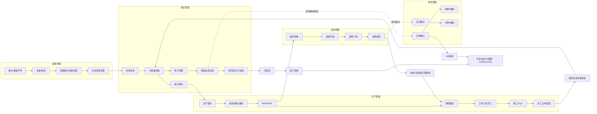
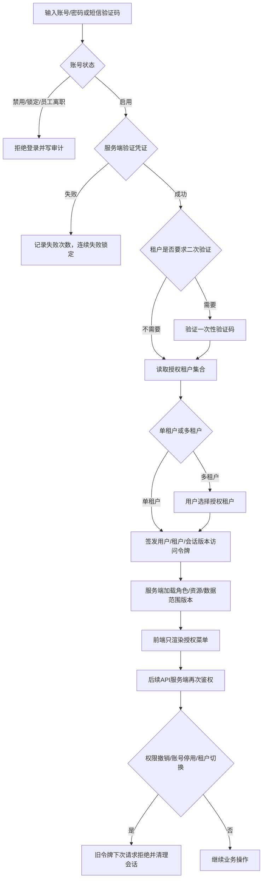
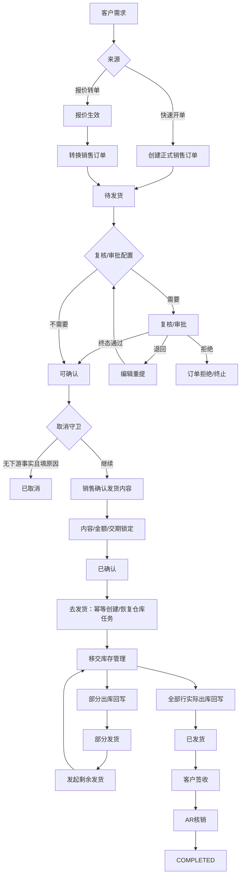
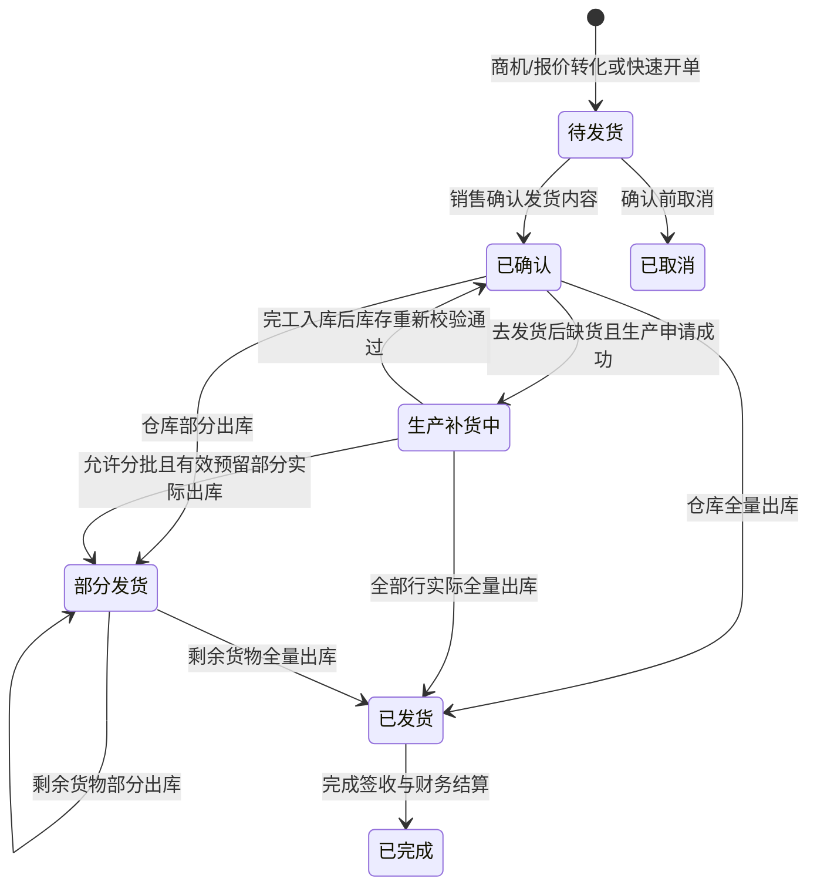
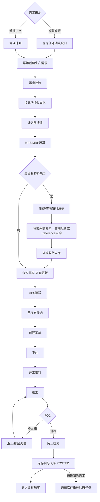
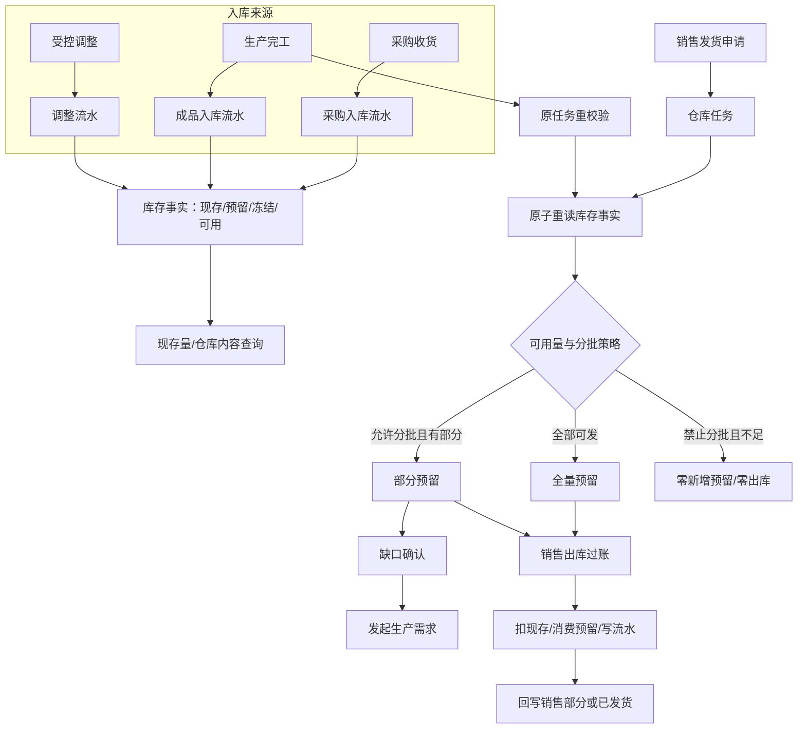
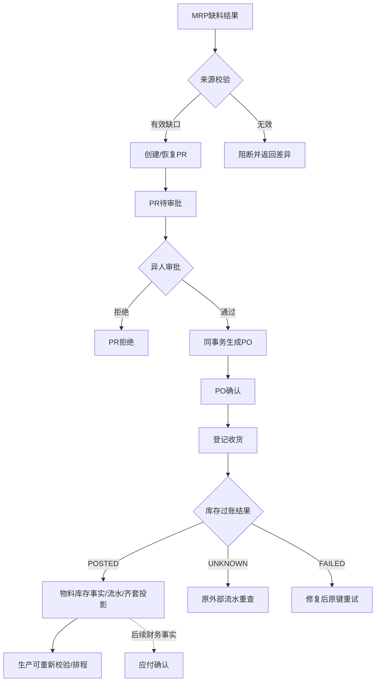
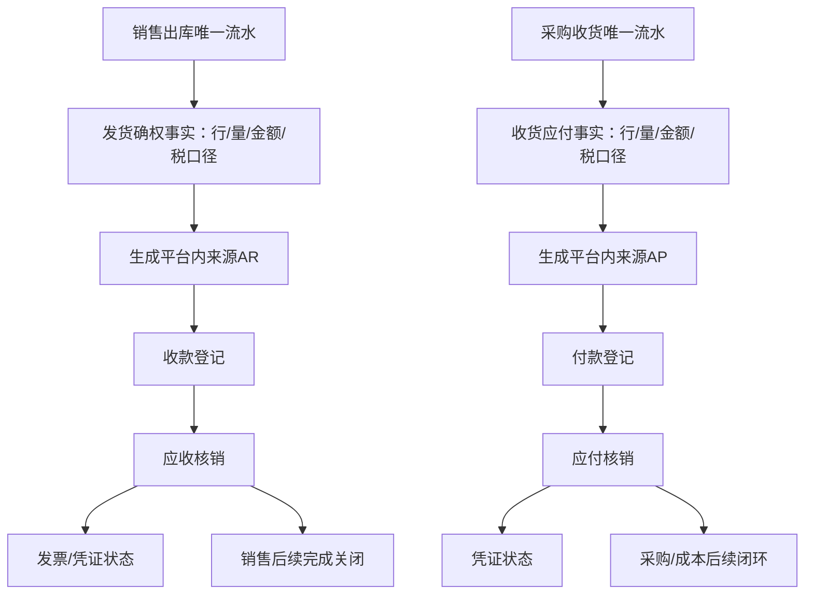
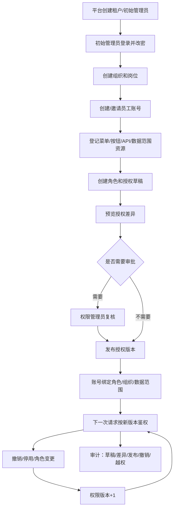
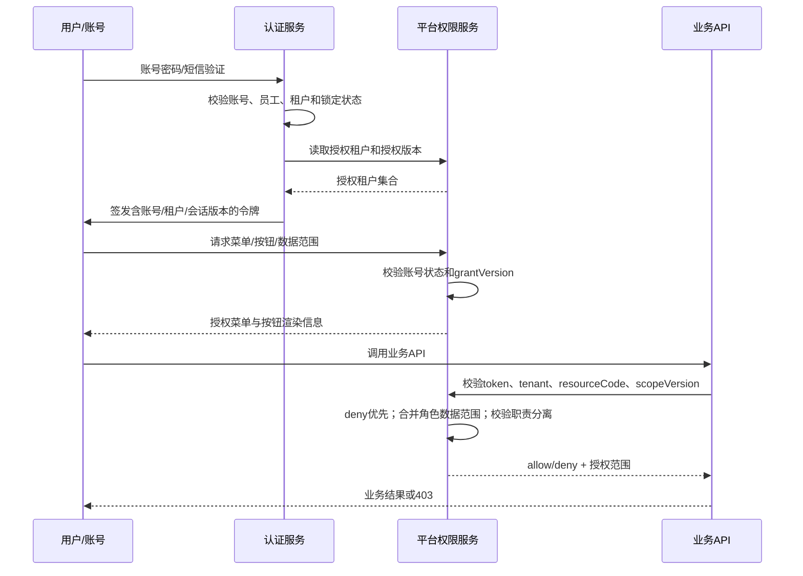

# 工业AI平台 V2.1.0 需求规格说明书（PRD）

> 2026-10-13 用户确认变更：制单人拥有平台管理发布的主生产计划菜单授权即可审批本人生产需求，老板拥有最高权限。菜单授权覆盖需求创建、校验、审批、接收、MRP/APS 和工单创建；明确拒绝操作仍阻断。销售缺货由真实销售订单的仓库任务发起，禁止普通计划表单生成随机销售关联。两类订单须完成执行、FQC、真实库存入账和结案，销售缺货还须完成原订单发货。此规则覆盖本文较早的生产需求制单审批分离要求；采购、报废及结案各自复核规则保持。

> 2026-10-14 阻断评审修订：本次只修订需求与验收基线，不代表实现已完成。首期验收以第 3.6 节和第 13.1.1 节为准；销售确认内容进入已确认，随后去发货才创建仓库任务。首期确认后锁定，不提供退回编辑或撤回。部分发货以有效预留和实际过账量为准；预留消耗后重新计算可用量；已部分发货的订单在剩余补货期间保持部分发货。修订记录保留历史，不作为现行守卫。

> 2026-10-14 工作台需求补充：工作台完整能力同版实现，不分首期/后续两套验收。指标按角色矩阵和授权范围展示；营收拆分订单金额、确认收入和发货确权金额；排产指标采用交期达成量；低水位统计授权仓库内的物料。业务预警只展示来源业务状态，实时动态只读来源业务事件。无 `workbench.dashboard.read` 权限时隐藏工作台入口并拒绝直达。核心岗出勤率、人员考勤和排班需求移除。

> 2026-10-14 工作台实施口径冻结（已被2026-10-15修订扩展）：工作台金额指标采用“权威事实投影 + 缺失不伪造”策略，不做财务反算；缺失事实显示“-”，精确非零财务金额生成规则和验收暂缓至财务专项。工作台API字段、错误码、首批事件目录、角色组/IAM映射、预警阈值、待办逾期和刷新缓存规则同步冻结。当前工作台P0以 `AC-PH1-040~060` 为准；完整平台闭环P0以 `AC-PH1-001~082` 为准；`AC-DEFER-WBFIN-001~003` 仅保留外部财务专项口径。

> 2026-10-15 工作台与销售管理完善：工作台能力纳入P0，但采购、财务等来源模块未接入时，相关卡片、待办、预警和动态必须显示 `SOURCE_PENDING`，不要求伪造数据；API支持分区刷新、搜索、趋势和权限资源登记。销售管理补充复核/审批状态机、金额计算、数量守恒、锁定/取消和报价客户唯一性规则。`AC-PH1-040~065` 为首期P0。

> 2026-10-15 进销存财流程与权限治理补全：补充销售、库存、生产、采购、财务模块业务流程图，进销存财端到端流转、模块职责、业务问题清单、注册/登录/会话和平台权限发布闭环。`AC-PH1-066~071` 覆盖租户初始化、注册登录、授权发布、多角色范围和职责分离。

> 2026-10-15 残余缺口补全（已被开发就绪基线扩展）：统一老板/租户所有者权限、客户租户唯一性、采购供应商/金额/税额规则、财务AR/AP/收付款状态机、信用占用展示、销售退货边界、生产成本边界、消息状态同步、审计保留和模块级非功能指标。平台内采购/财务来源已按第17章纳入开发；外部系统适配仍按专项处理，不伪造业务事实。

> 2026-10-15 开发就绪基线：关闭影响首期开发的开放问题，冻结P0范围、禁用能力、默认业务决策、聚合数据契约、内部API清单、事件契约、回归数据和开发完成标准。采购/财务按平台内最小事实闭环开发；外部ERP/SRM/财务系统、AI生产化和移动端保持禁用或后续适配。

# 1. 文档概览
## 1.1 文档目的
本文档用于定义《工业AI平台》V2.1.0 迭代版本的产品需求范围、业务规则、功能细节、权限体系、数据规则、非功能要求、埋点统计、接口依赖、验收标准和风险应对方案。文档面向研发、测试、设计、实施、运营和业务验收团队，作为需求评审、技术设计、测试用例编写、上线验收和后续运维培训的统一依据。

## 1.2 适用范围
本文档适用于 AI 工业 Web 端 V2.1.0 迭代，包括公共框架、工作台、AI 助手、AI智能中枢、AI数据分析、销售管理、生产管理、库存管理、采购管理、财务管理、人员管理、产业链管理、消息管理、平台管理，以及销售到财务结算的跨模块业务闭环。本文件不描述移动端原生 App、真实后端代码实现、数据库物理表设计和第三方系统私有协议细节。

## 1.3 预期阅读对象
| 阅读对象 | 阅读目的 | 重点章节 |
| --- | --- | --- |
| 产品经理 | 确认需求边界、业务规则、状态流转、验收口径 | 全篇 |
| 研发负责人 | 拆解前后端开发任务、确认接口和数据规则 | 第 5、6、7、9、12 章 |
| 测试负责人 | 编写功能、异常、权限、性能、兼容性测试用例 | 第 7、8、10、13 章 |
| UI/UX 设计师 | 确认页面结构、弹窗、提示、空状态、交互反馈 | 第 4、7、10 章 |
| 实施顾问 | 配置角色、组织、菜单、业务基础数据并支持上线 | 第 3、8、9、14 章 |
| 运营/业务管理员 | 理解使用流程、权限范围、待办处理和上线风险 | 第 2、4、5、11、15 章 |

## 1.4 文档修订记录
| 版本号 | 修订日期 | 修订人 | 修订内容 | 备注 |
| --- | --- | --- | --- | --- |
| V2.1.0-PRD-RECEIPT-CONTRACT-R20261015 | 2026年10月15日 | 产品评审修订 | 新增客户签收聚合、签收事件、销售完成关闭事实；补充RMA权限/接口字段、核心域API字段契约和P0权限资源总表；清理历史金额/来源待确认表述 | 文档修订；不修改业务代码，不声明实现或UAT通过 |
| V2.1.0-PRD-DEVBASE-R20261015 | 2026年10月15日 | 产品评审修订 | 关闭Q-001～Q-012对P0开发的阻断；冻结平台内AR/AP确权默认值、采购全量收货边界、销售完成关闭条件、禁用模块、聚合数据契约、内部API/事件清单、回归数据和DoR/DoD | 文档修订；不修改业务代码，不声明实现或UAT通过。外部系统适配仍为后续 |
| V2.1.0-PRD-GAP-R20261015 | 2026年10月15日 | 产品评审修订 | 补齐老板角色、权限资源判定、客户租户唯一性、采购供应商/金额/税额、财务AR/AP/收付款/核销/冲销状态、销售信用展示、退货边界、生产成本边界、消息同步契约、审计保留和模块级NFR；新增后续目标验收 `AC-TARGET-016~024` | 文档修订；不修改业务代码，不声明实现或UAT通过 |
| V2.1.0-PRD-FLOW-IAM-R20261015 | 2026年10月15日 | 产品评审修订 | 新增进销存财全景流程、五模块业务流程图、模块职责边界、业务问题清单；补充租户初始化、注册登录、权限资源、授权版本发布、运行时鉴权和职责分离；新增 `AC-PH1-066~071` | 文档修订；不修改业务代码，不声明实现或UAT通过 |
| V2.1.0-PRD-WB3-SAL-R20261015 | 2026年10月15日 | 产品评审修订 | 增加工作台来源可用性矩阵、分区刷新/搜索、权限资源登记、事件目录版本/事件类型、趋势契约；修正销售复核审批闭环。新增销售审批状态机、金额计算、数量守恒、取消/锁定与报价客户唯一性验收 `AC-PH1-060~065` | 文档修订；不修改业务代码，不声明实现或UAT通过 |
| V2.1.0-PRD-WB2-R20261014 | 2026年10月14日 | 产品评审修订 | 冻结工作台金额缺失策略、API字段/错误码、首批事件目录、角色组/IAM映射、预警阈值、待办逾期和刷新缓存规则；新增 `AC-PH1-053~059` 与 `AC-DEFER-WBFIN-001~003` | 不修改业务代码；来源财务事实生成规则仍由 Q-009/Q-012 跟踪 |
| V2.1.0-PRD-WB-R20261014 | 2026年10月14日 | 产品评审修订 | 工作台完整能力纳入本期P0；新增角色×指标矩阵、营收三项金额、排产交期达成量、物料低水位、来源业务预警、待办目录、业务动态契约和无权限隐藏规则；删除核心岗出勤率和人员考勤/排班需求 | 文档修订；不代表实现完成；工作台验收由 `AC-PH1-040~052` 承载 |
| V2.1.0-PRD-R20261014 | 2026年10月14日 | 产品评审修订 | 修正 B01～B07：交付阶段与验收映射、确认/移交分离、确认后锁定、部分可发守卫、实际过账数量、预留消费账及补货状态回写；增加逐项验收 ID 和数值例。同日补充 R01～R05、R09：异常结果三分法、生产审批现行规则、两类生产来源、采购状态拆分、数量/金额精度及历史能力表口径 | 文档修订号，不新增产品发布版本；本次未修改业务代码，未声明客户 UAT 通过。R06～R08保留待确认 |
| V2.1.9 | 2026年10月11日 | 产品/研发协同 | 补齐生产主计划订单完整闭环：明确待校验、待审批、待接收、待展算、已推展算、已展算、已排程、已建工单、执行中、待入库、入库完成和已结案的前端口径；禁止把任务受理、报工完成、FQC 通过或完工提交直接显示为库存可用 | 任务受理不等于计算成功；生产完成不等于入库完成；入库完成才触发原缺货发货任务重校验 |
| V2.1.8 | 2026年10月11日 | 产品/研发协同 | 生产需求审批路由落地：审批通过进入 `PRODUCTION_PLANNER` 接收池并发布审批事件；计划员/MPS 负责人使用 `production.demand.claim` 接收后进入待展算；MRP 执行前校验接收事实，任务成功且结果覆盖需求后才置为 `PLANNED/已展算`。平台权限资源补齐校验、审批、接收、MRP/APS 执行五个真实权限码 | 审批人与制单人分离；接收人由平台角色授权控制，车间执行仍从工单下达后开始 |
| V2.1.7 | 2026年10月11日 | 产品/研发协同 | 重构发货弹窗仓库口径：默认“请选择发货仓库”，未选仓不展示明细且阻断提交；选仓后加载真实可用量、缺口和库存事实版本，动态切换“确认发货 / 确认部分发货 / 去生产”；正式缺口由服务端按剩余待发量与选定仓库可用量重算，幂等创建生产需求并联动生产需求池、MPS/MRP 和完工后重校验 | 覆盖 V2.1.5 的默认选仓旧口径，正式闭环以库存事实和生产域为准 |
| V2.1.6 | 2026年10月10日 | 产品/研发协同 | AI 助手主数据导入权限体系：新增 6 个导入权限资源（ai.import.use + 5 个实体级），按角色分配可导入数据类型；前端上传按钮按权限可见/隐藏，导入面板按权限过滤可选类型；后端逐行创建时校验实体权限；AI 助手能力问答感知当前角色权限 | 修复后端 requirePermission 与平台权限资源脱节的断层 |
| V2.1.5 | 2026年10月10日 | 产品/研发协同 | 出库发货/部分发货弹窗增加发货仓库选择：仓库人员可查看当前任务默认仓库及各产品在选定仓库下的可用量和缺口，可切换到其他启用仓库后重新校验库存；确认后系统从选定仓库扣减库存并过账。列表行库存标注仓库来源。后端 checkAndReserve 支持可选 warehouseId 覆盖 | 不修改销售订单 fulfillmentWarehouseId，仅覆盖本次出库任务仓库 |
| V2.1.4 | 2026年7月28日 | 产品/研发协同 | 修复出库管理5项功能缺陷：①部分发货后联动回写销售订单并导航 ②部分发货后按钮状态更新和出库明细展示 ③正常发货后订单回写销售订单 ④去生产自动创建MPS记录 ⑤下载出库凭证功能落地 | 验收以功能联调、状态回写和页面验证为准 |
| V2.1.3 | 2026年7月28日 | 产品/研发协同 | 完善出库发货确认弹窗规格：正常发货弹窗补充全部产品明细行展示；部分发货弹窗可编辑条件修正为 availQty>0、新增已发货和剩余待发列、默认值和上限为 min(剩余待发,实际可用)、修复 shippedQty 累加和全量完成判断；新增已确认订单退回待发货编辑能力 | 验收以弹窗交互、状态回写和单元测试为准 |
| V2.1.2 | 2026年7月27日 | 产品/研发协同 | 补齐库存产品“补货申请”、库存物料发起采购申请、生产缺料发起物料出库三类执行入口；明确产品补货直接流转生产主计划，并补充来源追溯、数量校验、单据状态和跨模块回写 | 页面按钮必须生成可恢复的业务任务，不得仅显示 Toast 或监控舱建议 |
| V2.1.1 | 2026年7月27日 | 产品/研发协同 | 调整销售订单发货前置流程：待发货执行“确认订单”只确认销售发货内容并进入已确认；已确认订单执行“去发货”后才创建仓库发货任务。修复确认阶段提前调用出库、字段校验失败和订单 ID 不一致问题 | 以正式确认接口、状态机测试和页面复测为验收证据 |
| V2.1.0-PH1.1 | 2026年7月26日 | 产品/研发协同 | 依据 `BUG-WF-20260726-001~006` 补齐销售确认边界、正式 MPS/MRP/排程、完工后库存重校验、来源单据一致性、部分/剩余发货和生产需求来源追溯要求 | 不改变现有整体 UI 设计；缺陷关闭以代码、测试和 UAT 证据为准 |
| V2.1.0 | 2026年7月26日 | 产品/研发协同 | 增加库存域仓库、产品、物料主数据维护，以及按仓库查看产品/物料和库存数量的需求、校验、权限、异常及验收口径 | 先交付前端交互确认，再实施后端与联调 |
| V2.1.0-PH1 | 2026年7月26日 | 产品/研发协同 | 冻结首期销售—库存—生产—发货范围、库存公式、分批预留、WMS 权威、审批、撤回边界和角色权限口径；首期终点为已发货，采购和财务退出验收 | 详细契约见首期交付基线第 10、13~18 节 |
| V2.1.0 | 2026年7月26日 | 产品/研发协同 | 合并《销售管理.docx》需求，细化销售监控舱、产品报价、销售订单、客户管理、基础数据、产销库存联动、状态机、权限和异常验收口径；按销售订单实际页面和状态机补全待确认、已确认、生产补货中、部分发货、已发货、已完成和已取消的操作与风控口径；明确仓库缺货后手工发起生产申请、完工入库后恢复发货 | 销售状态机与仓库生产申请专项补充 |
| V2.1.0 | 2026年6月23日 | 产品经理 | 按 ToB 后台 PRD 标准重构需求规格说明书，补充公共功能、模块级功能、权限、数据、异常、埋点、接口、验收和风险章节 | 本次交付版本 |
| V1.0 | 2026年6月23日 | 项目交付组 | 形成项目交付版需求规格说明书 | 历史版本 |

## 1.5 术语与缩略词定义
| 术语 / 缩写 | 全称 | 详细解释 |
| --- | --- | --- |
| PRD | Product Requirement Document | 产品需求文档，描述需求背景、范围、功能规则、验收标准和上线依赖。 |
| MPS | Master Production Schedule | 主生产计划，用于根据订单、库存、产能形成生产排程。 |
| MRP | Material Requirements Planning | 物料需求计划，用于根据 BOM、库存和计划计算缺料与采购需求。 |
| PR | Purchase Requisition | 采购申请，由库存低水位、MRP 缺料或人工补货触发。 |
| PO | Purchase Order | 采购订单，采购申请审批后向供应商下达的正式订单。 |
| AR | Accounts Receivable | 应收款，仓库确认销售出库发货后形成的客户应收。 |
| AP | Accounts Payable | 应付款目标上由采购入库或验收事实形成；具体确认时点、生成粒度和金额公式待 Q-009 冻结。 |
| 业务闭环 | Business Closed Loop | 同一业务单据从销售发起，经库存、生产、采购、发货、财务结算完成的全链路状态闭环。 |
| AI 工业助手 | Industrial AI Assistant | 面向工业业务场景的智能问答与辅助分析入口，支持右侧抽屉对话。 |
| AI 数据员工 | AI Data Agent | 面向特定业务主题的自动分析能力，用于识别风险、生成建议和辅助运营。 |

# 2. 需求背景与目标
## 2.1 业务现状详细描述
上海万申信息股份产业有限公司当前需要通过统一 Web 平台承载制造型企业的经营监控、业务协同、AI 预警和平台治理能力。现有系统原型已具备左侧导航、顶部系统栏、工作台、业务模块、AI 助手和平台管理框架，但需求规格层面的颗粒度不足，无法直接支撑研发拆分、测试覆盖和上线验收。本次 V2.1.0 迭代将以“订单驱动的业务闭环”和“AI 辅助经营决策”为主线，将公共功能和各业务模块拆解到按钮、字段、弹窗、状态、异常、权限和验收标准。

## 2.2 现存痛点逐条拆解
| 痛点编号 | 现存问题 | 问题影响 | 数据支撑 / 观察依据 |
| --- | --- | --- | --- |
| P-001 | 销售、生产、库存、采购、财务模块之间缺少可执行级状态规则 | 研发难以判断按钮点击后应跳转哪个模块、生成什么状态、是否允许回退 | 当前原型有业务流节点，但文档未细化触发条件、前置限制、后续结果。 |
| P-002 | 需求文档停留在模块概述，字段、校验、弹窗、提示文案不足 | 测试无法编写完整用例，验收时容易出现口径争议 | 旧版需求文档仅列出功能点和少量说明。 |
| P-003 | 按钮行为未统一，有些只做 Toast，有些跳转或弹窗 | 用户无法形成稳定预期，运营培训成本增加 | 前期需求已明确按钮需支持弹窗页面、跳转页面、居中明显 Toast。 |
| P-004 | 平台管理和 AI 中枢属于高权限功能，但权限边界不清晰 | 上线后可能出现普通用户误操作配置、AI 数据越权展示 | 平台管理涉及组织、用户、角色、菜单按钮、审计等系统级能力。 |
| P-005 | 业务预警和业务待办之间缺少处理闭环 | 预警只能展示，无法追踪处理状态和责任人 | 工作台已有预警卡片和待办列表，但未定义处理状态和完成规则。 |

## 2.3 用户调研与诉求汇总
| 用户类型 | 核心诉求 | 典型原话归纳 | 转化需求 |
| --- | --- | --- | --- |
| 经营管理层 | 打开首页即可看到今日经营风险和关键指标 | 不希望进入多个系统才能判断今天哪里有问题 | 工作台按角色矩阵展示营收三项金额、排产交期、低水位物料、来源业务预警、待办和实时业务流。 |
| 业务操作员 | 待办可直接跳转到处理页面 | 看到任务后要知道点哪里、处理完是否成功 | 待办、快捷入口和预警按钮必须绑定跳转、弹窗和明确反馈。 |
| 生产计划员 | 仓库提交的销售缺货申请能进入排产与缺料流程 | 不要靠微信群传缺料信息 | 定义仓库生产申请、MPS/MRP、PR/PO 状态流转。 |
| 仓库管理员 | 低库存、采购入库、成品入库、销售出库和缺货申请要有清晰入口 | 库存变化要能影响生产和发货 | 库存管理明确入出库字段、库存校验、生产申请、状态和回写规则。 |
| 财务人员 | 发货和采购入库后可以追溯应收应付来源 | 财务单据要知道从哪张业务单来的 | 财务模块要求 AR/AP 关联 SO、PO、出入库单。 |
| 系统管理员 | 权限要能按角色、菜单、按钮、数据范围配置 | 不能所有人都看到平台管理和配置按钮 | 平台管理权限矩阵和审计规则必须落地。 |

## 2.4 本次迭代核心目标
### 2.4.1 业务目标
- 建立销售订单到财务结算的跨模块业务闭环，确保每个节点有触发条件、处理人、状态和后续结果。
- 提升工作台经营可视性，使操作员和管理层在首屏识别营收、排产、库存、业务预警和待办事项。
- 建立 AI 工业助手和 AI 数据员工的配置与使用入口，支撑工业业务问答、风险分析和经营洞察。
- 补齐平台管理能力，支撑组织、用户、角色、租户、菜单按钮、系统参数和审计治理。

### 2.4.2 产品目标
- 形成可直接交付研发、测试、运营团队的 PRD，所有页面具备字段、按钮、校验、弹窗、状态、异常和提示文案。
- 统一所有监控舱布局，保证用户在不同模块中获得一致的认知结构。
- 统一全局按钮反馈方式，按钮操作必须落到页面跳转、弹窗或居中 Toast，不允许无反馈。
- 统一品牌名称为工业AI平台，消除旧名称和旧图标残留。

### 2.4.3 可量化成功指标
| 指标名称 | 当前基线 | 目标值 | 统计口径 |
| --- | --- | --- | --- |
| 核心模块需求覆盖率 | 旧文档约 40% | 100% | 公共功能和 11 个模块均覆盖 7.1-7.11 子项。 |
| 首期 P0 功能验收通过率 | 未形成统一口径 | 100% | 第 13.1.1 节全部 `AC-PH1-*` 用例通过数 / 该节用例总数；后续目标用例不纳入分母，未执行不计通过。 |
| 工作台首屏信息完整率 | 部分区域已实现 | 100% | 标题、Logo、消息、AI助手入口、授权指标、来源业务预警、待办、动态均可见。 |
| 平台内闭环场景通过率 | 演示链路存在但规则不完整 | 100% | 第 13.1.1 节充足、缺货补产、部分/剩余发货、客户签收、AR/AP/核销和完成关闭场景均以原销售订单、来源可追溯和服务端事实为通过条件，不以按钮、Toast 或模拟数据代替。 |
| 全量业务闭环完成率 | 待确认真实业务基线与统计窗口 | 待业务确认 | 后续目标：完成履约且结算关闭订单数 / 纳入统计的已确认订单数；分母、窗口及排除规则未冻结前不用于首期验收。 |
| 无权限误操作率 | 未定义 | 0 | 无权限账号不可见或不可操作受限按钮。 |
| 关键操作反馈覆盖率 | 不一致 | 100% | 新增、编辑、删除、审批、导入、导出、跳转均有明确反馈。 |

## 2.5 需求价值与收益说明
本次迭代的核心价值在于将现有 AI 工业 Web 端原型从“可展示”推进到“可落地”。研发团队可依据模块和状态拆分任务，测试团队可依据字段、校验、异常和验收标准编写用例，运营和实施团队可依据角色、权限、提示文案和流程规则开展培训与上线支持。业务层面，平台将减少跨部门信息断点，提高订单交付、库存补货、生产齐套、采购履约和财务结算的处理透明度。

# 3. 需求范围界定
## 3.1 需求范围总述
本期范围覆盖 AI 工业 Web 端的公共框架、工作台、全局 AI 助手、业务模块、平台管理、权限、数据、埋点、第三方依赖和验收标准。系统以 Web 页面为主要交互载体，以销售订单业务闭环为主线，以来源业务预警和待办为辅助，以平台管理承载权限和基础配置。

V2.1.0 按用户确认的“全部实现、不分期”组织需求：开发基线覆盖“销售订单待发货 → 复核/审批 → 确认内容进入已确认 → 去发货移交仓库 → 库存校验/预留 → 缺口生产 → 缺料采购/补料 → 采购收货 → 生产完工入库 → 重新校验 → 部分/全量发货 → 发货确权AR → 收款核销 → 客户签收 → 销售完成”的平台内最小完整闭环。采购PR/PO/收货、平台内AR/AP、收付款核销和销售完成不再作为独立后续分期；外部ERP/SRM/MES/WMS/财务系统对接、AI生产化、移动端和真实大模型仍保持禁用或后续适配。完整开发边界、默认决策和完成标准见第17章。

## 3.2 P0 核心必做功能
本表 P0 表示对应交付阶段的优先级，不表示所有目标模块都须在首期上线。

| 功能 | 核心作用 | 首期必交子集 | 后续目标子集 |
| --- | --- | --- | --- |
| 公共导航与顶部栏 | 进入授权模块、会话和路由恢复 | 认证、租户隔离、授权导航、刷新及深链接恢复 | 全局搜索与完整消息展示 |
| 工作台首页 | 角色化经营指标、来源业务预警、快捷功能、待办和业务动态 | 完整工作台能力同版交付；无工作台权限时不展示入口 | 无分期后续子集；新角色或新事件须另行扩展评审 |
| 全局 AI 助手抽屉 | 公共问答、快捷问题和拖拽 | 无，不作为首期退出条件 | AI 交互与业务能力 |
| 销售管理 | 报价、客户、订单与发货协同 | 最小订单/行、复核/审批、确认内容、去发货、部分/剩余发货及追踪 | 正式报价、客户经营、监控舱及结算投影 |
| 生产管理 | 需求、计划、工单、执行和成品入库 | 销售缺货需求、校验/审批/接收、正式 MPS/MRP 和排程候选、工单、FQC、完工入库及结案 | 完整主数据维护、委外及客户优化器 |
| 库存管理 | 库存校验、预留、入出库和补货 | 权威库存事实、原子预留、销售出库、缺货申请、完工重校验及流水 | 完整主数据维护、调拨、盘点、低水位补货及完整采购入库 |
| 采购管理 | PR、审批、PO、供应商送货 | MRP缺料创建PR、异人审批生成PO、多次部分/全量收货、按需来料质检、采购退货、供应商/价格/税额快照、AP事实 | 供应商寻源、合同、询比价和ERP/SRM对接 |
| 财务管理 | 应收应付、收付款、发票与凭证 | 平台内来源AR/AP、收付款登记/确认、部分/全额核销、红字冲销、销售完成关闭事实 | 外部财务凭证、税务申报、银行直连和多账簿 |
| 消息管理 | 审批、通知、预警和待办 | 履约审批、接收及异常任务的最小处理/追踪入口 | 完整消息中心及 AI 预警 |
| 平台管理 | 租户、组织、账号、角色、资源、数据范围和审计 | 租户初始化、邀请/注册审批、账号-员工绑定、权限资源登记、授权草稿/发布/撤销、多角色范围、deny优先、职责分离和关键操作审计 | 完整组织、资源、参数及配置生产化 |

## 3.3 P1 次要优化功能
本节均为后续目标，不进入首期通过率和退出条件；后续纳入具体版本时单独冻结需求及验收清单。

| 功能 | 核心作用 |
| --- | --- |
| AI 数据员工配置 | 按业务域配置 AI 分析能力，辅助识别风险和输出建议。 |
| 监控舱趋势图 | 统一各模块趋势分析展示，提升经营分析可读性。 |
| 导入导出 | 提升业务批量处理效率，支持模板下载、预校验和结果导出。 |
| 异步导出任务 | 处理超过 5000 行的数据导出，避免页面长时间阻塞。 |
| 供应商寻源建议 | 采购晚交或高风险时提供备选供应商方向。 |

## 3.4 P2 后续规划功能（本期暂不实现）
| 规划功能 | 暂不实现原因 | 后续触发条件 |
| --- | --- | --- |
| 真实大模型私有化部署 | 需单独评估算力、模型、知识库和安全方案 | AI 中枢进入生产化阶段。 |
| ERP/MES/WMS 双向实时写回 | 依赖外部系统接口协议和主数据治理 | 接口规范和测试环境确认后。 |
| 原生移动端 App | 本期定位 Web 端 | 扫码报工、PDA 入库出库需求稳定后。 |
| 复杂工作流引擎 | 当前流程可通过状态机满足 | 审批分支和组织规则显著复杂化后。 |
| 银行直连与税控开票 | 涉及资质、安全和合规 | 财务系统对接范围扩大后。 |

## 3.5 本期明确不做范围
| 不做项 | 说明 | 规避原因 |
| --- | --- | --- |
| 不替代 ERP/MES/WMS | 本期聚焦 AI 工业平台前端和业务闭环原型 | 避免需求蔓延到核心生产系统重构。 |
| 不实现外部财务系统真实总账入账 | 平台内保存AR/AP、收付款、核销、冲销和销售完成事实；外部凭证、税务申报、银行直连和多账簿后续专项处理 | 真实总账入账需财务系统接口和合规审核。 |
| 不实现真实银行支付 | 不接入银行网银、银企直连、付款审批链 | 涉及资金安全与法务合规。 |
| 不实现移动端适配到生产可用 | 仅保证 Web 端主流分辨率 | 移动端需单独设计。 |
| 不开放无权限自助授权 | 用户无权限时只能申请或联系管理员 | 防止越权扩散。 |

## 3.6 首期需求与验收准入映射

| 需求 ID | 阶段/优先级 | 交付边界 | 验收入口 | 首期必过 |
| --- | --- | --- | --- | --- |
| `PH1-SESSION` | 首期/P0 | 会话、导航、租户与数据范围 | `AC-PH1-001`、`AC-PH1-034`、第 13.3～13.5 节的首期适用项 | 是 |
| `PH1-IDENTITY-PLATFORM` | 首期/P0 | 租户初始化、注册/邀请、登录会话、权限资源、授权发布、多角色范围、职责分离和审计 | `AC-PH1-066~071` | 是 |
| `PH1-WORKBENCH` | 首期/P0 | 角色×指标矩阵、金额事实缺失策略、来源门控、排产交期达成量、授权仓库物料低水位、来源业务预警、待办目录、首批事件目录、业务动态、API/错误码、权限映射、刷新缓存、搜索和趋势 | `AC-PH1-040~060` | 是 |
| `PH1-SALES` | 首期/P0 | 最小订单、复核/审批、内容确认、移交、确认后锁定与取消 | `AC-PH1-002~008`、`AC-PH1-028` | 是 |
| `PH1-SALES-CONTROL` | 首期/P0 | 复核/审批状态机、金额/税口径、数量守恒、确认锁定、取消补偿和报价/客户唯一性 | `AC-PH1-061~065` | 是 |
| `PH1-STOCK` | 首期/P0 | 校验、部分/全量预留、实际出库、剩余申请、库存流水与权威事实 | `AC-PH1-009~019`、`AC-PH1-026~027`、`AC-PH1-029~033` | 是 |
| `PH1-PRODUCTION` | 首期/P0 | 来源需求、计划接收、正式计划/排程、工单、质量、完工和结案 | `AC-PH1-020~023`、`AC-PH1-035~036` | 是 |
| `PH1-RECOVERY` | 首期/P0 | 来源一致性、幂等、并发、未知结果、事件与补偿 | `AC-PH1-024~025`、`AC-PH1-037~039`、第 13.4～13.5 节的首期适用项 | 是 |
| `PH1-FULL-LOOP` | 首期/P0 | 采购PR/PO/多次收货/质检/退货、平台内AR/AP/收付款/核销/冲销、客户签收、销售RMA/完成关闭、生产成本归集和五模块集成闭环 | `AC-PH1-072~082` | 是 |
| `TARGET-FULL` | 后续/P0或P1 | 首期之外的报价、客户经营、完整主数据、库存补货优化、供应商经营、外部ERP/SRM/MES/WMS/财务对接、AI、人员与产业链等能力 | 第 13.1.2 节 `AC-TARGET-002~024`；后续新增能力另行补用例 | 否 |

第 13.1.1 节每条用例均为首期/P0，未执行、失败或证据缺失均不得计为通过；其中 `AC-PH1-001~039` 为履约链路用例，`AC-PH1-040~060` 为工作台用例，`AC-PH1-061~065` 为销售控制用例，`AC-PH1-066~071` 为账号与平台权限治理用例，`AC-PH1-072~082` 为进销存财完整闭环用例。原 `AC-TARGET-001` 已迁入工作台首期用例，目标用例保留 `002~024` 原编号以便追踪。`AC-DEFER-WBFIN-*` 仅验收外部财务专项口径，不阻塞平台内最小AR/AP闭环。第 13.2～13.5 节仅对首期授权页面、接口与链路执行；不以未纳入首期的模块失败判首期失败，也不得因此免除首期性能、安全、可靠性或客户 WMS 联调要求。文档修订、Reference 演示和历史通过报告均不等于本修订的客户 UAT 已通过。

# 4. 用户角色与场景分析
## 4.1 用户角色定义
| 角色名称 | 角色描述 | 核心诉求 | 使用频次 |
| --- | --- | --- | --- |
| 老板/租户所有者 | 租户最高管理角色，可查看授权租户全量经营数据并督办跨模块风险 | 掌握经营风险、交付异常和资金风险 | 每日 |
| 操作员 | 日常处理工作台待办和跨模块任务的一线用户 | 快速看到任务、进入页面、完成处理、获得反馈 | 每日多次 |
| 销售主管 | 负责客户、报价、订单审批和交付风险跟进 | 订单能及时审批并触发后续履约 | 每日多次 |
| 生产主管 | 负责排产、工单、报工、质检和产能协调 | 缺料、齐套、工单状态清晰可控 | 每日多次 |
| 仓库管理员 | 负责库存、入库、出库、调拨和盘点；销售出库缺货时核对缺口并发起生产申请 | 库存数量准确，缺货不误发，生产补货和恢复发货可追踪 | 每日多次 |
| 采购经理 | 负责采购申请审批、采购订单和供应商交付 | 缺料需求可转 PR/PO，晚交可预警 | 每日多次 |
| 财务会计 | 负责应收应付、收付款、发票和凭证状态 | 财务单据来源可追溯，逾期风险可识别 | 每日 |
| 系统管理员 | 负责组织、账号、权限、参数和审计 | 权限可控，操作可审计，配置可恢复 | 每周多次 |

## 4.2 核心业务场景
| 场景 | 场景描述 | 触发条件 | 用户目标 | 操作流程 |
| --- | --- | --- | --- | --- |
| 销售订单履约闭环 | 客户订单完成复核/审批后确认发货内容，再从已确认订单去发货；库存不足由仓库发起生产申请，再经过采购、生产和财务完成 | 销售订单复核/审批通过 | 确保订单可交付并完成结算 | 待发货确认订单→已确认去发货→仓库库存校验→缺货生产申请→MRP→PR/PO→入库→生产→成品入库→仓库发货→财务结算 |
| 库存低水位处理 | 物料低于安全库存后触发预警和采购补货 | 库存可用量小于安全库存 | 避免生产停线和交付延误 | 工作台预警→库存详情→生成 PR→采购审批→采购入库 |
| AI 助手问数 | 用户通过顶部 AI 助手咨询库存、排产、销售或财务问题 | 点击 AI 助手按钮 | 快速获取分析建议和下一步动作 | 打开抽屉→输入问题→查看回复→跳转模块处理 |
| 平台权限配置 | 管理员配置角色、菜单、按钮和数据范围 | 组织或岗位发生变化 | 保证用户只看见和操作授权数据 | 进入平台管理→选择角色→配置权限→保存→审计记录 |

## 4.3 次要业务场景
| 场景 | 说明 | 触发条件 | 处理方式 |
| --- | --- | --- | --- |
| 批量导入客户或物料 | 通过模板批量维护基础数据 | 业务数据初始化或批量调整 | 下载模板、上传文件、预校验、确认导入。 |
| 导出筛选结果 | 运营或管理人员导出当前查询结果 | 需要线下分析或汇报 | 按当前筛选条件导出，超过阈值转异步任务。 |
| 查看操作日志 | 管理员追溯权限或业务动作 | 发生争议、异常或审计要求 | 进入审计日志按人、模块、动作、时间查询。 |
| 处理系统通知 | 查看发布、备份、参数变更通知 | 系统产生通知 | 进入消息管理标记已读或查看详情。 |

## 4.4 边缘 / 异常场景
| 异常场景 | 触发条件 | 系统处理 | 用户处理 |
| --- | --- | --- | --- |
| 无权限访问 | URL 直达或点击无权限按钮 | 阻止访问并提示无权限 | 联系管理员申请权限。 |
| 重复提交 | 用户连续点击提交按钮 | 按钮置灰并拦截重复请求 | 等待请求完成。 |
| 状态被他人变更 | 多人同时处理同一单据 | 提示状态已变化并要求刷新 | 刷新后按最新状态处理。 |
| 关联数据冲突 | 删除或作废已被下游引用的数据 | 禁止删除并展示关联单号 | 先处理下游单据或改为作废。 |
| 网络异常 | 接口超时或断网 | 保留当前输入并提示重试 | 检查网络后重试。 |
| AI 无权限数据 | 问题涉及用户无权查看数据 | 不返回敏感数据并说明原因 | 申请权限或换有权限账号。 |

## 4.5 场景 - 功能对应关系
| 业务场景 | 对应功能 | 关键页面 | 验收点 |
| --- | --- | --- | --- |
| 销售订单履约闭环 | 订单复核/审批、发货申请、库存校验、MRP、PR/PO、入库、发货、财务结算 | 销售、库存、生产、采购、财务 | 状态按主流程推进且可追溯。 |
| 库存低水位处理 | 来源业务预警、库存详情、生成 PR、采购入库 | 工作台、库存、采购 | 低水位数量、PR、入库状态一致。 |
| AI 助手问数 | 右侧抽屉、快捷问题、问题输入、模块跳转 | 全局顶部栏、AI智能中枢 | 抽屉可打开、输入可提交、回复可查看。 |
| 平台权限配置 | 角色权限、菜单按钮权限、数据权限、审计 | 平台管理 | 权限变更即时生效并有审计。 |

# 5. 整体业务与系统流程
## 5.1 整体业务流转逻辑
系统以销售订单作为主业务线索。`PENDING_CONFIRMATION` 的正式中文名称为“待发货”，历史页面中的“待确认”是同一状态的兼容显示，不是额外节点。创建订单及复核/审批通过均保持待发货。销售执行“确认订单”固化客户、产品、数量、价格、优惠和交期后进入已确认，不创建仓库任务、不预留；此后首期锁定内容，不提供退回编辑。已确认执行“去发货”才创建或恢复仓库任务，成功弹窗及手动进入出库规则见 7.3.5.2。

库存域校验并预留；订单及全部申请行都允许分批时可按有效预留部分出库，否则本次申请全量满足或零预留、零出库。库存不足只阻断未预留的缺口，仓库显式发起生产申请。零已发订单在生产申请成功后进入生产补货中；已有实际出库的订单始终保持部分发货，补货进度由任务独立展示。正式需求经过校验/审批、计划员接收、成功 MPS/MRP、齐套和已发布排程候选后创建正式工单；MRP缺料按第17章生成平台内PR/PO，收货检验合格后回补物料可用量。

完工入库产生权威库存事实并重校验原任务。零已发订单在缺口归零且预留成功后回到已确认；已有实际出库的订单保持部分发货；仍有缺口时仅允许合法预留部分继续出库。仓库按本次实际数量过账、消耗预留、重算可用量并累计各行已发量。全部订单行 `shippedQty = orderedQty` 进入已发货；随后完成客户签收、平台内AR确认、收款核销和无争议校验后进入已完成。外部财务系统推送不属于平台内闭环。每个节点记录稳定 ID、来源版本、责任人、操作时间、Correlation ID 和 Trace ID。

## 5.2 核心主流程步骤拆解
| 步骤 | 触发条件 | 前置限制 | 系统动作 | 后续结果 |
| --- | --- | --- | --- | --- |
| 1. 创建销售订单 | 销售录入客户需求或由有效报价转单 | 客户和产品有效 | 生成 SO 编号和订单快照 | 订单进入待确认。 |
| 2. 订单复核/审批 | 授权销售复核；启用审批时由销售主管审批通过 | 订单字段完整、金额大于 0 且版本未变化 | 记录独立的复核/审批状态、处理人和时间 | 订单总体状态仍为待发货，允许确认订单。 |
| 3. 确认销售发货内容 | 销售人员在待发货列表执行“确认订单” | 已完成复核/审批，客户、产品、数量、价格、优惠和交期有效 | 固化发货内容、交期、版本、审计和确认事件，不创建仓库任务 | 订单进入已确认，在已确认列表显示“去发货”。 |
| 4. 去发货与库存校验 | 销售在已确认列表执行“去发货”，仓库随后校验库存 | 订单为已确认，尚无冲突的活动发货任务 | 销售生成/恢复任务；仓库随后原子重读事实、预留并计算缺口 | 全量预留或允许分批的有效预留部分可出库；未预留缺口禁止出库。 |
| 5. 仓库发起生产申请 | 仓库确认库存不足并执行“发起生产申请” | 库存事实有效，产品和操作权限有效 | 以来源订单行、缺口、库存事实版本和幂等键创建生产需求 | 零已发订单进入生产补货中；已有实际出库的订单保持部分发货；等待 MPS/MRP。 |
| 6. MPS/MRP 与排程 | 生产需求已接入且完成校验/审批 | 成品、BOM、工艺路线、库存事实、工厂和来源销售链路有效 | 以正式需求 ID 创建可查询任务，持久化 MPS 行、物料缺口、求解器版本和排程候选 | 只有成功结果覆盖目标需求时才能进入工单创建；任务受理不等于计算成功。 |
| 7. 采购申请与订单 | MRP 产生缺料 | 缺料物料、来源需求、工厂、仓库和数量可追溯 | 生成 PR 并由异人审批生成 PO；保存物料、数量、价格、税率和交期快照 | PR/PO、审计和事件同事务可追溯；阻断无来源补料。 |
| 8. 采购收货入库 | 供应商到货 | PO 有效且未关闭；要求质检的物料检验合格 | 登记到货、质检和入库，生成唯一库存流水 | 回写库存和齐套状态；同步生成平台内AP输入事实。 |
| 9. 生产执行与完工入库 | 物料齐套 | 工单引用覆盖来源需求的正式排程候选并已下达 | 记录开工、报工、质检、完工分配和成品入库 | 合格入库产生新库存事实并触发原销售出库任务重校验。 |
| 10. 仓库出库发货 | 原任务存在有效预留可出库量 | 订单未取消；按 7.5.9 守卫允许部分/全量出库 | 按逐行本次实际过账量扣现存、消费预留、累计已发并回写 | 有已发且有剩余保持部分发货；全部行全量出库进入已发货，并按出库行确权AR。 |
| 11. 签收、AR核销与完成 | 订单已发货 | 客户签收、AR/AP/收付款事实有效 | 登记客户签收，确认AR，核销收款，校验退货/争议后关闭订单 | 全部前置满足后进入已完成；外部财务凭证为可选投影。 |

## 5.3 分支流程说明

本表覆盖目标场景全集。本版本适用第17章平台内采购和财务闭环分支；跨仓调拨完整优化仍为后续范围，外部系统事实不属于平台内闭环完成条件。

| 分支 | 触发条件 | 处理规则 | 回归主流程 |
| --- | --- | --- | --- |
| 库存足够 | 本任务有效预留及可新增分配量覆盖全部任务剩余 | 原子补足原任务预留和出库单，跳过补货；零已发为已确认，已有实际出库保持部分发货 | 等待仓库按实际量出库。 |
| 库存不足但可调拨 | 其他仓库有可用库存 | 本版本不启用跨仓调拨完整流程；按缺料生产或人工备料后的权威库存事实处理 | 库存满足后进入发货或生产。 |
| 库存不足需生产 | 有未预留缺口且无法及时补足 | 禁止缺口出库；允许分批时有效预留部分可先发。仓库确认缺口后幂等建需；零已发进入生产补货中，已部分出库保持部分发货 | 完工入库后按新事实重校验原任务；已部分发货不降级为已确认或生产补货中。 |
| 采购晚交 | 预计到货日 > 需求日期 | 按来源状态生成业务预警，采购经理处理催交或寻源 | 到货后继续入库。 |
| 质检不合格 | 检验结果为不合格 | 阻止成品入库，生成返工、隔离或报废选项 | 返工合格后进入成品入库。 |
| 财务逾期 | 应收超过账期未收款 | 生成财务风险预警和催收待办 | 收款登记后关闭预警。 |

## 5.4 逆向流程（撤销、退回、作废、回退）完整规则
| 逆向动作 | 允许状态 | 触发角色 | 规则 | 后续结果 |
| --- | --- | --- | --- | --- |
| 撤销复核/审批 | 待发货且尚未确认内容、无活动履约事实 | 创建人/审批人 | 只撤销复核/审批结果并保留历史；不撤销已完成的内容确认 | 编辑后须重新复核或审批；已确认后不适用。 |
| 审批退回 | 待确认且审批中 | 审批人 | 必须填写退回原因 | 审批状态变为已退回，订单仍为待确认。 |
| 取消订单 | 待确认且未发起发货 | 有权销售人员/销售主管 | 客户反悔等发货前终止场景允许取消；必须填写原因 | 订单进入已取消，作为废单保留。 |
| 退回编辑/撤回（非首期） | 已确认及之后的履约状态 | 有权销售人员/销售主管 | 首期不提供入口；即使尚未创建任务或尚无已发量，也不退回待发货。异常必须走仓库拦截、预留释放和双人审批补偿 | 不删除任务、明细或流水，不自动解除订单锁定；后续另立变更状态和契约。 |
| 采购退回 | PR 待审批 | 采购经理 | 必须填写拒绝原因 | 回到 MRP 缺料待处理。 |
| 生产返工 | 质检不合格 | 生产主管/质检员 | 记录不合格原因和返工数量 | 回到生产执行。 |
| 财务冲销 | 财务单据已生成 | 财务会计 | 必须关联原单据并记录原因 | 生成冲销记录，不删除原记录。 |

## 5.5 异常中断流程处理逻辑

跨模块接口失败必须先按服务端可证实结果分类，再决定重试或补偿。禁止用“恢复上一状态”掩盖已提交事实；状态投影可以刷新，业务聚合和库存/财务事实不能回滚。

| 中断类型 | 系统识别方式 | 处理逻辑 | 兜底方案 |
| --- | --- | --- | --- |
| 接口失败 | 服务端返回明确校验失败、明确业务成功、超时/5xx/结果未知 | 明确未提交时可修复后重试；明确已提交时保留事实并刷新投影；结果未知时冻结后续写命令，用原幂等键和业务单号查证 | 查证为未提交才允许同键重试；查证为已提交则由下游继续消费或走受审批补偿，不恢复上一状态。 |
| 数据冲突 | 版本号或更新时间不一致 | 阻止提交，提示刷新最新数据 | 用户刷新后重新处理。 |
| 权限变更 | 操作中权限被收回 | 立即阻止后续动作 | 返回工作台并提示权限变化。 |
| 流程断点 | 下一节点未生成 | 提示流程异常并写入消息管理 | 运维核对原命令和事实后按原幂等键重放/补发；禁止绕过守卫新建平行单据或回退原状态。 |
| AI 服务不可用 | AI 接口失败或超时 | 提示 AI 暂不可用，不影响业务主流程 | 展示人工处理建议。 |

## 5.6 进销存财端到端业务流转

### 5.6.1 全景流程



### 5.6.2 跨模块触发、单据与回写矩阵

| 序号 | 触发业务 | 源模块/单据 | 目标模块/单据 | 必传关联 | 目标动作 | 回写/后续 |
| --- | --- | --- | --- | --- | --- | --- |
| 1 | 销售确认后发起发货 | 销售/销售订单、发货申请 | 库存/仓库任务、出库单 | orderId、orderLineId、requestId、quantity、unit、warehouseId、sourceVersion | 幂等创建或恢复任务 | 库存校验/预留结果回写任务，不改变销售内容 |
| 2 | 库存校验充足 | 库存/库存事实、预留 | 库存/出库单、任务 | taskId、warehouseId、factVersion、reservedQty | 原子预留并生成可出库单 | 任务可出库；销售保持已确认，不因预留确认内容 |
| 3 | 部分预留并存在缺口 | 库存/任务、预留、缺口 | 生产/生产需求 | orderId、orderLineId、taskId、shortageQty、factVersion、idempotencyKey | 幂等创建生产需求 | 零已发订单转生产补货中；已有已发保持部分发货 |
| 4 | MRP产生缺料 | 生产/MRP缺料行 | 采购/PR、PO | mrpTaskId、demandId、materialId、warehouseId、qty、unit | 创建/审批PR并下推PO | PR/PO状态、审计和Outbox同事务保存 |
| 5 | 采购收货 | 采购/PO、收货单 | 库存/物料库存事实、流水 | poId、receiptId、materialId、warehouseId、receivedQty、externalTransactionId | 入账并推进齐套 | 生产可重新校验/排程；检验合格并 `POSTED` 的收货行同步生成AP输入事实 |
| 6 | 完工入库 | 生产/完工单 | 库存/成品库存事实、流水 | workOrderId、completionId、productId、warehouseId、qty | 实际入库并触发重校验 | 原销售任务补足预留或继续展示缺口 |
| 7 | 销售出库过账 | 库存/出库单、预留、流水 | 销售/订单行累计和状态 | outboundId、orderId、orderLineId、postedQty、unit | 回写累计已发 | 有剩余为部分发货；全部行完成才SHIPPED |
| 8 | 销售出库完成 | 库存/唯一出库流水 | 财务/发货确权事实 | outboundId、orderId、orderLineId、postedQty、amount、currency、taxBasis | 按出库 `POSTED` 行生成来源AR | AR金额、税口径和来源行可重放；缺失或幂等冲突不得伪造AR |
| 9 | 采购收货完成 | 库存/采购入库流水 | 财务/应付确认事实 | receiptId、poId、supplierId、receivedQty、amount | 按合格 `POSTED` 收货行生成来源AP | AP金额、税额和来源行可重放；缺失或幂等冲突不得伪造AP |

### 5.6.3 跨模块控制红线

1. 每条跨模块链路必须有稳定来源ID、来源行ID、来源版本、租户、幂等键、Correlation ID和Trace ID；展示编号不可作为关联键。
2. 源模块只发布本域事实，目标模块通过API/Inbox形成自己的单据；禁止跨模块直接 UPDATE 对方业务表。
3. 同一幂等键重复请求必须返回首次结果；结果未知时保持处理中，不得换键新建或回滚已确认事实。
4. 数量、金额、状态更新必须可由来源单据逐行重放；不同单位、币种和税口径不得合并。
5. 任一下游失败不得自动撤销上游合法事实；使用重试、原键查证或受审批补偿处理。

## 5.7 模块所有权与职责边界

| 模块 | 拥有的事实 | 只读/消费数据 | 禁止行为 | 对外发布 |
| --- | --- | --- | --- | --- |
| 销售管理 | 客户、报价、订单、审批、确认内容、订单累计已发、取消/补偿申请 | 库存可用量参考、生产进度、财务投影 | 直接扣库存、直接生成生产需求、直接写应收 | 订单/审批/确认/发货申请/取消事件 |
| 库存管理 | 仓库、库存事实、预留、入库/出库流水、任务状态 | 销售订单行、生产需求、采购收货指令 | 修改订单内容、生成销售订单、直接写生产需求池 | 可用量、预留/释放、入出库、任务状态事件 |
| 生产管理 | 生产需求、审批/接收、MPS/MRP、排程、工单、报工、FQC、完工、结案 | 销售缺口、库存物料事实、采购收货事实 | 伪造销售来源、直接扣销售成品库存、直接生成PR以外采购事实 | 需求/计划/工单/质量/完工/结案事件 |
| 采购管理 | 供应商、PR、PO、收货指令、价格/交期快照 | MRP缺料、仓库、库存入库结果 | 直接修改库存事实、直接确认生产齐套 | PR/PO/收货/取消/逾期事件 |
| 财务管理 | AR/AP、收付款、核销、发票、凭证状态 | 出库、收货、订单、采购、税率/金额事实 | 修改销售/采购/库存业务数量；反推业务状态 | AR/AP/收付款/核销/凭证状态事件 |
| 平台管理 | 租户、组织、账号、角色、资源、数据范围、授权版本、审计 | 各模块资源注册信息 | 直接修改业务事实；绕过授权版本发布 | 账号、授权发布、撤销、审计事件 |

## 5.8 进销存财业务问题清单与处理策略

| 编号 | 业务问题 | 当前PRD处理 | 状态 |
| --- | --- | --- | --- |
| `BIZ-001` | 客户、产品、物料、仓库、供应商在多模块使用时可能出现编码、ID和名称不一致 | 平台/主数据按模块登记稳定ID；跨模块单据保存稳定ID和展示编号；名称只用于展示，不作为关联键 | 已定义控制 |
| `BIZ-002` | 销售、库存、生产和采购可能使用不同计量单位 | 所有业务数量保存行单位；跨模块转换必须有已批准换算规则；未批准时阻断，不静默换算或截断 | 已定义控制 |
| `BIZ-003` | 订单确认前缺少统一客户信用释放检查，可能超信用接单 | 客户档案保留信用等级和账期；平台内占用按未取消且未全量发货订单计算并展示；硬阻断、临时额度和跨系统释放由销售/财务专项扩展 | 后续扩展已定义 |
| `BIZ-004` | 已发货后发生退货、拒收或折让时，需要销售退货单和库存回入库规则 | 本期使用独立RMA闭环；RMA关联原出库行，合格品回入库，报废/返工单独处置，财务生成红字AR或折让。外部售后系统对接后续处理 | 平台内已冻结 |
| `BIZ-005` | 采购分批收货、来料质检和退货影响齐套和应付 | 本期支持多次部分/全量收货、按物料/供应商配置来料质检、采购退货；每次收货形成唯一库存流水并同步PO和生产投影 | 平台内已冻结；外部供应商协同后续 |
| `BIZ-006` | 财务确认收入、发货确权、AR/AP粒度和尾差可能重复或对不上账 | 平台内AR按出库 `POSTED` 行、AP按收货合格并 `POSTED` 行确认；金额取来源行快照并按7.7.3.2计算；外部凭证/税务口径由财务集成专项处理 | 平台内已冻结；外部集成后续 |
| `BIZ-007` | 生产领料、工时、报废和采购价未汇总，无法形成可靠生产成本 | 本期按工单归集材料、人工、制造费用、质量成本和完工成本；退料生成负向事实，不同币种不合并。标准成本差异分析、委外完整成本和外部总账凭证后续专项处理 | 平台内最小归集已冻结 |
| `BIZ-008` | 跨模块事件可能重复、乱序、丢失或结果未知 | 全部写操作使用幂等键和Outbox/Inbox；事件携带来源版本；重复返回首次结果；未知保持处理中；超限进入人工补偿 | 已定义控制 |
| `BIZ-009` | 制单人自审、跨模块审批和紧急补偿可能绕过职责分离 | 销售审批默认分离，显式自审权限可覆盖；生产按现行主计划菜单授权执行；采购、报废、结案和补偿保持各自复核；所有审批记录处理人和原因 | 已定义控制 |
| `BIZ-010` | 手工改状态可能掩盖库存、生产或财务差异 | 禁止直接修改业务状态；只能通过源模块业务命令或受审批补偿事实处理，并保存前后值和Trace | 已定义控制 |

# 6. 产品功能架构
## 6.1 整体功能模块架构说明
| 一级模块 | 二级能力 | 说明 |
| --- | --- | --- |
| 公共功能 | 导航、顶部栏、搜索、消息、AI 助手、Toast、弹窗 | 所有模块共享的交互和反馈基础。 |
| 工作台 | 角色化指标、来源业务预警、快捷功能、待办、实时动态 | 用户进入系统后的运营中枢。 |
| 业务模块 | 销售、生产、库存、采购、财务、人员、产业链 | 承载订单履约和经营协同。 |
| AI 模块 | AI智能中枢、AI数据分析、AI 工业助手、AI 数据员工 | 承载智能问答、预警和数据分析。 |
| 消息模块 | 审批消息、系统通知、AI 预警、已归档 | 承载通知、待办和状态提醒。 |
| 平台管理 | 组织、用户、角色、租户、菜单按钮、参数、审计 | 承载后台治理和权限控制。 |

## 6.2 模块间关联关系
| 源模块 | 目标模块 | 关联数据 | 关联动作 |
| --- | --- | --- | --- |
| 销售管理 | 库存管理 | 已确认销售订单、订单行、本次发货数量、仓库、单位、交期 | 待发货订单确认内容并进入已确认后，执行“去发货”才生成或恢复仓库销售出库任务；不在销售侧执行库存校验和预留。 |
| 库存管理 | 销售管理 | 可用量、预留结果、事实版本、事实时间 | 返回库存事实和预留结果；库存变化时发布新版本事实事件。 |
| 库存管理 | 生产管理 | 销售订单、来源行、产品、缺口数量、单位、需求日期 | 仓库管理员确认缺口并执行“发起生产申请”后，幂等创建生产需求接入记录，由生产域继续 MPS/MRP。 |
| 生产管理 | 采购管理 | 缺料清单、需求日期 | MRP 生成 PR。 |
| 采购管理 | 库存管理 | PO、供应商、到货数量 | 采购入库回写库存。 |
| 生产管理 | 库存管理 | 质检结果、成品数量 | 质检合格后成品入库。 |
| 库存管理 | 销售管理 | 销售出库单、实际发货数量、发货结果 | 仓库重新校验库存并确认发货后，回写订单发货状态和已发数量。 |
| 库存管理 | 财务管理 | 出库单、入库单、数量和来源金额 | 后续由权威业务事实触发来源AR/AP；确认时点、粒度、币种、税率和尾差待 Q-009，不得重复生成。 |
| 所有业务模块 | 消息管理 | 待办、审批、预警 | 生成消息和待办。 |
| 所有业务模块 | AI数据分析 | 指标、状态、风险 | 生成看板和分析洞察。 |

## 6.3 数据流转链路说明
销售订单号是主链路的业务关联锚点，但各领域仍拥有独立稳定 ID 和数据所有权。所有下游单据必须保存租户、来源模块、来源单号、来源行、来源版本、Correlation ID、Trace ID、创建人和创建时间。业务动作在本领域事务内保存业务事实和 Outbox；其他领域通过 API 或 Inbox 消费事件形成自己的单据或只读投影，不得跨域直接写库。事件处理失败不得撤销已经合法提交的原业务事实，但必须按幂等策略重试，超过阈值后生成异常消息并进入人工补偿。

# 7. 详细功能需求
## 7.1 公共功能与全局框架
### 7.1.1 页面整体布局与结构说明
页面采用左侧固定主导航、顶部系统栏、主内容区、全局 Toast 层、全局弹窗层、右侧 AI 助手抽屉组成。左侧导航展示工作台、AI智能中枢、AI数据分析、销售管理、生产管理、库存管理、采购管理、财务管理、人员管理、产业链管理、消息管理、平台管理；顶部栏展示系统名称、当前模块标题、搜索框、AI 助手按钮、消息铃铛、用户头像与组织名称。

### 7.1.2 页面初始化规则
首次进入系统默认进入工作台；若 URL 或缓存中存在合法 activeModule，则进入对应模块；若无权限访问缓存模块，默认回退工作台并提示“当前账号无权访问该模块，已返回工作台”。顶部搜索框默认空值，消息铃铛展示未读数，AI 助手默认收起。

通过主导航进入模块时，始终默认打开该模块第一个页面；有监控舱的模块默认展示监控舱。重复点击当前模块、离开后返回以及移动端模块切换均遵循此规则，不沿用上次子页签或单据定位。合法 URL 深链接、刷新和浏览器前进/后退恢复 URL 指定的页面；无监控舱的模块保持既有第一页面。

### 7.1.3 展示字段明细
| 字段名称 | 字段含义 | 数据来源 | 展示规则 | 格式要求 | 备注 |
| --- | --- | --- | --- | --- | --- |
| 系统名称 | 产品品牌名称 | 前端配置 | 固定显示“工业AI平台” | 文本 | 不可被用户编辑 |
| 当前模块标题 | 当前页面所在模块 | activeModule | 根据导航切换实时更新 | 文本 | 无权限模块不展示 |
| 全局搜索占位 | 搜索提示 | 前端固定文案 | 显示“在工作台中搜索...”或模块名称 | 文本 | 点击后聚焦输入框 |
| 消息未读数 | 未处理消息数量 | 消息列表 | 0 不显示红点，大于 99 显示 99+ | 数字 | 每 60 秒刷新一次 |
| 用户信息 | 当前登录人 | 登录态 | 显示头像、姓名、组织 | 文本/头像 | 未登录时跳登录页 |

### 7.1.4 操作按钮全量说明
| 按钮名称 | 展示位置 | 前置条件 | 操作效果 | 权限要求 |
| --- | --- | --- | --- | --- |
| 导航菜单 | 左侧导航 | 账号具备菜单可见权限 | 切换主内容区并高亮菜单 | 对应菜单可见权限 |
| AI 助手 | 顶部右侧 | 账号具备 AI 助手使用权限 | 打开右侧 AI 助手抽屉 | AI_ASSISTANT_USE |
| 消息铃铛 | 顶部右侧 | 账号具备消息查看权限 | 打开消息中心或消息弹窗 | MESSAGE_VIEW |
| 用户下拉 | 顶部右侧 | 已登录 | 展示个人信息、退出入口 | LOGINED |
| 关闭弹窗 | 弹窗右上角 | 弹窗处于打开状态 | 关闭弹窗；未保存内容需二次确认 | 当前弹窗查看权限 |

### 7.1.5 核心操作完整规则
- 导航切换：点击导航菜单后校验菜单权限，通过后更新 activeModule，清除旧子页签和单据定位，重新初始化该模块第一页面，并将页面滚动条归零；即使再次点击当前模块也必须执行首页初始化。
- 后台恢复：历史计划恢复、异步数据加载和跨模块业务事实同步不得自动切换当前页面。用户明确执行的业务跳转携带目标子页面及来源定位参数，进入指定目标。
- 搜索：输入关键词后按 Enter 触发模块内搜索；关键词去除首尾空格；空关键词不发起搜索并提示“请输入搜索关键词”。
- Toast：所有新增、保存、审批、跳转、异常操作必须通过居中 Toast 或弹窗反馈，不允许仅在控制台输出。
- 弹窗拦截：编辑类弹窗存在未保存内容时，点击关闭、遮罩、Esc 均弹出确认提示。
- 会话失效：任意操作返回 401 时清空本地登录态，跳转登录页，提示“登录已失效，请重新登录”。

### 7.1.6 输入项校验规则

跨模块统一精度契约：业务数量使用十进制字符串传输和 `numeric(18,6)` 存储，精度必须跟随对象基本单位或已批准换算，禁止为通过校验而静默截断。金额使用十进制字符串传输和 `numeric(20,6)` 存储，展示币种与千分位；平台内业务舍入、订单优惠分摊、采购/AP金额和尾差规则按7.3.9.2.2、7.7.3.2和第17章冻结，最终事实不得使用二进制浮点数。下表中的通用数量/金额行是该契约的模块化表达。

| 输入项名称 | 是否必填 | 长度限制 | 格式要求 | 校验逻辑 | 报错文案 |
| --- | --- | --- | --- | --- | --- |
| 全局搜索关键词 | 否 | 1-50 字 | 中文、英文、数字、空格 | 去除首尾空格后长度为 0 则不搜索 | 请输入搜索关键词 |
| AI 助手问题 | 是 | 1-500 字 | 中文、英文、数字、常用标点 | 禁止只输入空格；禁止连续提交相同问题 | 请输入需要咨询的问题 |

### 7.1.7 筛选、搜索、排序、分页完整逻辑
公共框架不提供全局分页。搜索结果由当前模块接管；搜索关键词传入当前模块，模块按自身数据范围过滤。导航菜单按平台管理员配置的菜单顺序展示，隐藏无权限菜单。

### 7.1.8 弹窗规则说明
| 弹窗名称 | 标题 | 字段 | 按钮 | 关闭逻辑 |
| --- | --- | --- | --- | --- |
| 全局确认弹窗 | 确认操作 | 提示文案、取消按钮、确认按钮 | 取消、确认 | 点击取消/关闭图标/遮罩关闭；点击确认执行操作 |
| 无权限提示弹窗 | 无权限访问 | 无权限原因、申请权限指引 | 我知道了 | 点击按钮或关闭图标关闭 |

### 7.1.9 数据状态流转规则
| 状态名称 | 状态标识 | 触发条件 | 前置状态 | 后置状态 | 限制说明 |
| --- | --- | --- | --- | --- | --- |
| 正常 | normal | 页面资源加载完成 | 加载中 | 可操作 | 允许执行具备权限的操作 |
| 加载中 | loading | 页面初始化或接口请求中 | 任意状态 | 正常/异常 | 按钮置灰，显示加载反馈 |
| 无权限 | forbidden | 菜单或按钮权限校验失败 | 任意状态 | 正常 | 禁止进入模块或执行按钮 |
| 会话失效 | expired | 登录态过期或接口返回 401 | 任意状态 | 登录页 | 清空本地登录态 |

### 7.1.10 全量异常场景处理
| 异常场景 | 处理方式 | 兜底方案 |
| --- | --- | --- |
| 空数据 | 主内容区显示空状态图标与“暂无数据” | 保留筛选条件，允许重置筛选 |
| 无权限 | 展示“当前账号无权访问该功能” | 隐藏按钮或阻止操作 |
| 网络异常 | 展示“网络异常，请稍后重试” | 保留用户输入，允许重试 |
| 重复提交 | 同一按钮提交中置灰 | 请求结束后恢复按钮 |
| 数据超限 | 搜索词、输入内容超过限制时前端拦截 | 展示字段级错误 |
| 关联冲突 | 当前数据被其他流程占用时弹窗提示 | 引导用户查看占用业务单据 |

### 7.1.11 全量提示文案清单
| 提示类型 | 提示文案 | 触发时机 |
| --- | --- | --- |
| 成功 | 操作成功 | 通用保存、审批、提交成功时 |
| 错误 | 操作失败，请稍后重试 | 接口异常且无明确错误信息时 |
| 确认 | 当前内容尚未保存，确认关闭吗？ | 编辑弹窗关闭前 |
| 警告 | 当前账号无权执行该操作 | 按钮权限校验失败时 |

### 7.1.12 账号注册、登录与权限会话

#### 7.1.12.1 账号进入方式

| 方式 | 触发条件 | 处理规则 | 初始权限 |
| --- | --- | --- | --- |
| 租户初始化 | 平台运营方创建租户并指定初始租户管理员 | 创建租户、组织、初始管理员账号和租户隔离边界；初始管理员首次登录必须改密并完成平台管理初始化 | 仅 `TENANT_ADMIN` 初始化权限；不自动获得销售、库存、生产、采购、财务业务写权限 |
| 管理员邀请 | 租户管理员在平台管理创建员工并绑定账号 | 账号必须绑定唯一在职员工、主组织和默认数据范围；可预置角色草稿，发布授权后生效 | 按已发布角色和资源授权；未发布前无业务权限 |
| 自助注册 | 租户开启自助注册并填写租户标识 | 自助注册默认关闭。开启时必须校验租户标识、手机号/邮箱和验证码；生成待审账号，不自动绑定员工和角色 | 无菜单、无API业务权限；只能查看“待审批”页 |

自助注册、邀请创建、启用、停用、改密、角色变更、租户切换和登录失败都必须写审计。禁止通过自助注册直接获得工作台、销售、库存、生产、采购、财务或平台管理权限。

#### 7.1.12.2 登录与会话流程



访问令牌默认8小时；刷新令牌、OIDC/SSO和企业身份源同步为后续扩展。密码不得明文存储；短信验证码5分钟有效、一次性使用。连续5次失败锁定15分钟，管理员解锁和用户重置必须审计。登录成功后前端只能渲染授权菜单；任何API仍必须校验令牌、租户、权限、数据范围和业务状态。

#### 7.1.12.4 登录页面功能要求

登录页提供两个登录方式和两个辅助入口，均需在首屏同时可见：

| 功能 | 说明 | 校验规则 |
| --- | --- | --- |
| 账号登录 | 输入账号、密码和图形验证码 | 账号非空；密码非空；验证码非空且与服务端一致 |
| 手机号登录 | 输入手机号和短信验证码；点击"获取验证码"发送短信（60秒倒计时） | 手机号格式合法（11位）；短信验证码6位数字 |
| 忘记密码 | 输入注册邮箱，系统发送重置链接 | 邮箱格式合法；邮箱存在且已验证 |
| 注册账号 | 填写租户名称、所属行业、管理员姓名、登录账号、邮箱、手机号、密码和确认密码，提交后创建租户和初始管理员 | 所有字段必填；密码至少8位含大小写和数字；两次密码一致；手机号和邮箱未注册 |

图形验证码由后端生成并返回 Base64 图片；前端提交时携带 captchaId 和 captchaCode；验证失败时刷新验证码。忘记密码通过邮件发送重置链接，链接有效期为30分钟且一次性使用。租户注册成功后跳转登录页，用户使用注册的账号密码登录。

租户注册成功后，系统自动创建租户并授予初始管理员（即注册人）老板/租户所有者角色，默认拥有当前系统所有模块的全部权限（工作台、销售、库存、生产、采购、财务、人员、产业链、AI智能中枢、AI数据分析、消息管理、平台管理、问题反馈），无需额外授权或审批。

登录页所有输入框（账号、密码、验证码、手机号、短信验证码、邮箱等）默认值为空字符串，不得预填任何默认账号、手机号或验证码。切换登录方式（账号登录 ↔ 手机号登录）时，各输入框保持独立状态，不清空另一方式的已输入内容。

#### 7.1.12.3 权限会话判定

| 判定项 | 规则 |
| --- | --- |
| 租户 | 令牌中的租户必须属于账号授权集合；切换租户时服务端重新校验，不允许前端改参数越权 |
| 账号 | 账号、绑定员工和主组织必须启用；任一停用即拒绝 |
| 角色 | 使用已发布角色版本；角色草稿、历史版本和前端选中角色不作为授权依据 |
| 资源权限 | 菜单、按钮、API和指标分别判定；组合权限中的每个权限码必须独立校验 |
| 数据范围 | 合并所有有效角色的 `SELF/ORG/WAREHOUSE_SET/FACTORY_SET/TENANT` 范围；跨租户不合并 |
| 拒绝优先 | 明确 deny 优先于 allow；`*` 只表示当前授权版本内的最高权限，不绕过租户隔离、字段脱敏和职责分离 |
| 即时生效 | 授权发布、角色撤销、账号停用必须递增权限/范围版本；下一次请求即失败，不需要等待令牌自然过期 |

## 7.2 工作台首页
### 7.2.1 页面整体布局与结构说明
工作台首页由欢迎横幅、角色化指标、来源业务预警、常用快捷功能、我的待办事项和实时业务流动态组成。指标区按“经营收入、排产交期、库存低水位”顺序展示；无权限的指标组隐藏，不得显示伪造零值。下方左侧展示业务预警和待办，右侧展示快捷功能和实时业务流。页面是只读业务状态和事件投影，不在工作台内直接修改业务聚合。

### 7.2.2 页面初始化规则
工作台入口、直达 URL 和 API 都要求 `workbench.dashboard.read`；无权限时左侧导航不显示工作台，直达返回403并提示无权限。页面使用租户时区的当前业务日期和自然月；服务端根据当前会话角色和数据范围计算指标。待办默认展示未完成项，按 P0、P1、P2 和创建时间倒序；业务预警按来源状态风险、发生时间倒序；实时动态提供“全部业务事件”和“关键事件”两个范围，默认展示关键事件最近24小时内最新10条。

#### 刷新与缓存冻结口径

| 数据 | 刷新方式 | 过期/缓存规则 |
| --- | --- | --- |
| 指标 | 进入页面、手动刷新、每300秒自动刷新 | 只允许浏览器内存保存最近一次成功只读快照；超过300秒显示“数据已过期”并允许刷新；超过1800秒不再作为可用快照展示数值，金额和数量显示“-”并提示刷新失败 |
| 待办 | 进入页面、手动刷新、每60秒调用 `sections=todos,alerts,activities`；来源事件投影目标延迟不超过30秒 | 服务端按角色、租户、数据范围生成投影；来源事实变化后旧投影必须失效；超过5分钟未同步显示“待核对”，不允许前端标记完成 |
| 业务预警 | 进入页面、手动刷新、每60秒调用 `sections=todos,alerts,activities`；来源事件或状态变化投影目标延迟不超过30秒 | 同一来源和类型只保留当前风险最高的一条；来源状态解除后投影消失；超过5分钟未同步显示“待核对” |
| 实时动态 | 进入页面、手动刷新、每60秒调用 `sections=todos,alerts,activities`；事件投影目标延迟不超过30秒 | 只保存最近成功响应的内存快照和游标；刷新必须携带游标继续分页；页面浏览、搜索、登录等系统埋点永不进入缓存 |

缓存键至少包含租户、用户、有效角色组、数据范围版本、业务日期和响应模式版本。浏览器只允许内存缓存；禁止 `localStorage`、`sessionStorage` 或离线包持久化指标、待办、预警和动态。服务端可使用带租户与范围键的只读缓存，但来源事实版本变化时必须失效；响应仍要返回 `generatedAt`、`dataAsOf` 和来源版本。

### 7.2.3 展示字段明细

#### 指标字段

| 字段 | 定义 | 来源 | 展示规则 |
| --- | --- | --- | --- |
| `orderAmount` | 本自然月创建且未取消/未作废销售订单的订单金额合计 | 正式销售订单聚合 | 按订单日期归属；按授权组织和客户过滤；显示万元并保留两位小数，原始值使用 `numeric(20,6)` |
| `confirmedRevenueAmount` | 本自然月存在确认收入事实的金额合计 | 权威确认收入事实或财务投影 | 按确认收入事实日期归属；必须能穿透来源订单/出库单；无事实显示“-”，不得用订单金额替代 |
| `shippedRecognizedAmount` | 本自然月实际出库过账对应的发货确权金额合计 | 权威出库流水及发货确权金额事实 | 按实际过账时间归属；部分发货只计入实际过账部分；无确权事实显示“-”，不得按订单全额估算 |
| `dueAchievedQty` / `duePlannedQty` | 交期达成量/交期计划量 | 生产计划、工单、报工和完工入库事实 | 统计承诺交期在本自然月的正式生产计划；达成量等于交期前实际完工过账量与计划量的较小值之和，晚交完工不计入达成量；按计划单位逐单统计，跨单位必须先有已批准换算，否则只展示按单位分组明细，不静默相加 |
| `lowStockMaterialCount` | 授权仓库内低于安全库存的物料去重数量 | 权威物料库存事实 | 仅统计物料，不统计产品；范围合并当前用户全部授权仓库；`合格现存-已分配/预留-冻结 < 安全库存` 判定为低水位；同一物料跨仓库命中只计一次，详情可展开仓库 |

金额必须区分含税/不含税、币种和优惠/尾差口径；平台内订单、出库、AR/AP和收付款事实已按7.3.9.2.2、7.7.3.2和第17章冻结。外部财务凭证/税务口径由集成专项处理。来源事实缺失时指标显示“-”和“数据待接入”，不得显示0。

#### 财务金额事实缺失策略

工作台不新增财务核算引擎，也不从订单、出库、收款或工时反推确认收入。金额指标只投影来源系统已确认的金额事实。投影事实必须包含：来源稳定 ID、来源行 ID、`amount`、`currency`、`taxBasis`、`recognizedAt`、来源事实版本、Correlation/Trace。`amount` 使用十进制字符串和 `numeric(20,6)`；`currency` 使用 ISO 4217；`taxBasis` 至少支持 `INCLUDING_TAX`、`EXCLUDING_TAX`、`AS_CAPTURED`。

工作台按 `metric + currency + taxBasis` 分组汇总，不跨币种、不跨含税口径相加，也不做汇率折算。同组内使用十进制精确求和；页面主值按四舍五入保留两位小数展示，原始 `amount` 仍返回6位精度。若存在多个组，主卡片显示 `MIXED`，明细按组展示；不存在任一完整事实时显示“-”和“数据待接入”，禁止显示0或用订单金额替代。

`orderAmount` 使用正式销售订单聚合的 `totalAmount` 作为来源值，并标记其真实 `taxBasis`；历史数据没有税口径时标记 `AS_CAPTURED`。`confirmedRevenueAmount` 使用权威确认收入事实，`shippedRecognizedAmount` 使用出库 `POSTED` 后生成的发货确权事实。事实缺失、金额为空、币种/税口径缺失或来源行无法穿透时，均为 `UNAVAILABLE`。平台内生成规则、AR/AP粒度和冲销事实按第17章开发；外部财务凭证/税务口径由集成专项处理。高级跨系统对账验收保留为外部财务专项，工作台P0验收缺失策略、分组、穿透和禁止伪造0。

#### 角色 × 指标矩阵

| 角色 | 订单金额 | 确认收入 | 发货确权金额 | 排产交期达成 | 低水位物料 |
| --- | --- | --- | --- | --- | --- |
| 老板 | 当前租户全量 | 当前租户全量 | 当前租户全量 | 当前租户全量 | 当前租户全量 |
| 销售 | 授权客户/订单范围 | 授权客户/订单范围 | 授权客户/订单范围 | 授权订单关联的排产范围 | 不展示 |
| 计划员 | 不展示 | 不展示 | 不展示 | 授权工厂/计划范围 | 授权仓库范围 |
| 仓管 | 不展示 | 不展示 | 不展示 | 不展示 | 授权仓库范围 |
| 采购/财务/管理员等其他角色 | 默认不展示 | 默认不展示 | 默认不展示 | 默认不展示 | 按对应仓库权限单独授权 |

矩阵是展示默认值，服务端仍必须逐项校验业务数据权限和仓库/工厂范围；角色名称不能替代权限码。老板看到租户全量仍受租户隔离和字段脱敏限制。

#### 角色组与IAM映射

| 工作台角色组 | IAM角色/岗位 | 必要权限 | 数据范围 | 指标口径 |
| --- | --- | --- | --- | --- |
| 老板 | 租户所有者/最高权限角色，如 `TENANT_OWNER` 或持有 `*` | `workbench.dashboard.read`；访问来源数据仍校验来源模块权限 | 当前租户 | 五类指标全量；敏感金额按字段权限脱敏或隐藏 |
| 销售 | `SALES_REP`、`SALES_MANAGER` | `sales.order.read`、`sales.fulfillment-trace.read`、`workbench.metric.revenue.read` | `SELF/ORG` 及授权客户/订单 | 订单、确认收入、发货确权金额和授权订单关联排产 |
| 计划 | `PRODUCTION_PLANNER`、`PRODUCTION_MANAGER` | `production.plan.read`、`production.work-order.read`、`workbench.metric.production.read`；如看低水位另需 `inventory.availability.read` | `FACTORY_SET`；低水位另受 `WAREHOUSE_SET` | 授权工厂/计划交期达成；授权仓库低水位 |
| 仓管 | `WAREHOUSE_OPERATOR`、`WAREHOUSE_MANAGER` | `inventory.availability.read`、`workbench.metric.inventory.read` | `WAREHOUSE_SET` | 授权仓库物料低水位 |
| 采购 | `PROCUREMENT_MANAGER` | `procurement.request.read/approve`、`procurement.order.read` | 授权采购组织/供应商范围 | 默认不展示五类指标；显式授予仓库读取权限后可看低水位 |
| 财务 | `FINANCE_ACCOUNTANT` | `finance.receivable.read`、`finance.payable.read` | 授权财务主体 | 默认不展示指标；显式授予 `workbench.metric.revenue.read` 及来源销售范围后可看确认收入/发货确权金额 |
| 系统管理员 | `TENANT_ADMIN`、平台管理员 | 仅 `workbench.dashboard.read`；默认不授予业务读取权限 | 平台治理范围 | 默认不展示业务指标；显式授予来源模块权限后按范围展示 |

`role` 查询参数只是展示分组，不是授权依据。服务端必须从签名会话重新解析有效角色、权限和数据范围；传入角色不在会话有效角色集合时返回400。用户同时具有多个角色组时，数据范围取并集，指标可见性取“任一必要权限满足即显示”；同一来源事实只计一次，不得因多角色重复聚合。

#### 来源可用性矩阵

| 来源模块 | 工作台接入状态 | P0必须实现 | 来源未接入时的行为 | 对应数据 |
| --- | --- | --- | --- | --- |
| 销售 | `SOURCE_READY` | 是 | 不适用 | 订单金额、销售待办、订单交期预警、订单事件 |
| 库存 | `SOURCE_READY` | 是 | 不适用 | 低水位、发货任务重检、未知结果、库存事件 |
| 生产 | `SOURCE_READY` | 是 | 不适用 | 交期达成、需求审批/接收、计划/齐套/完工事件 |
| 消息/平台 | `SOURCE_READY` | 异常任务、权限变更和补偿投影必须接入 | 不适用 | 异常待办、审批待办、权限/补偿事件 |
| 采购 | `SOURCE_READY` | 平台内MRP来源PR、PO、收货和AP输入事实必须开发 | PR待办、采购逾期预警和采购事件按授权展示 | PR审批待办、采购逾期预警、采购事件 |
| 财务 | `SOURCE_READY` | 平台内出库确权AR、收货确权AP、收付款和核销事实必须开发 | 金额、收付款待办和财务预警按授权展示 | 确认收入、发货确权、收付款待办、财务预警和事件 |

平台内采购和财务来源为本版本 `SOURCE_READY`；客户外部ERP/SRM/财务系统未接入时，只能影响外部主数据同步和外部凭证推送，不得作为缺失平台内业务事实的理由。来源失败仍返回 `UNAVAILABLE/STALE`，页面不得伪造0、待办或预警。

#### 工作台权限资源登记

| 权限码 | 类型 | 默认授权 | 服务端校验范围 | 备注 |
| --- | --- | --- | --- | --- |
| `workbench.dashboard.read` | 页面/API | 所有已配置工作台角色 | 租户、角色组、数据范围版本 | 无权限隐藏菜单并拒绝直达 |
| `workbench.metric.revenue.read` | 指标 | 销售、显式授权财务/老板 | 授权客户、组织和财务主体 | 无权限隐藏营收卡，API不返回金额组 |
| `workbench.metric.production.read` | 指标 | 计划、显式授权生产主管 | 授权工厂 | 无权限隐藏交期达成卡 |
| `workbench.metric.inventory.read` | 指标 | 仓管、显式授权计划/采购 | 授权仓库 | 无权限隐藏低水位卡 |
| `workbench.search.read` | 搜索 | 持有 `workbench.dashboard.read` 且至少有一个来源分区权限 | 按分区权限过滤 | 禁止跨授权范围计数或返回标题 |
| `workbench.source.sales.read` | 来源分区 | 销售/老板 | 授权订单 | 控制销售待办、预警和事件 |
| `workbench.source.inventory.read` | 来源分区 | 仓管/计划/老板 | 授权仓库 | 控制库存待办、预警和事件 |
| `workbench.source.production.read` | 来源分区 | 计划/生产主管/老板 | 授权工厂 | 控制生产待办、预警和事件 |
| `workbench.source.procurement.read` | 来源分区 | 采购/老板 | 授权采购范围 | 控制PR待办、预警和事件 |
| `workbench.source.finance.read` | 来源分区 | 财务/老板 | 授权财务主体 | 控制财务待办、预警和事件 |

上表是平台权限资源目录的P0补充；按钮仍须复用目标模块权威权限。旧界面权限码映射为：`AI_ASSISTANT_USE -> ai.assistant.use`，`AI_ANALYSIS_VIEW -> ai.analysis.view`，`PROD_PLAN_EDIT -> production.mps.view + production.work-order.update`，`INV_TRANSFER_CREATE -> inventory.transfer.create`，`SALES_ORDER_CREATE -> sales.order.create`，`INV_INBOUND_CREATE -> inventory.inbound.create`，`PUR_PR_CREATE -> procurement.request.create`，`PROD_REPORT_CREATE -> production.work-order.report`。目标模块未接入时按钮隐藏或禁用，不得调用模拟接口。

#### 业务预警字段

| 字段 | 规则 |
| --- | --- |
| 预警 ID、来源模块、来源类型、来源稳定 ID/编号 | 必填；展示编号不可替代稳定 ID |
| 预警类型、风险等级、标题、明细 | 由服务端按来源业务状态派生；不使用工作台本地AI生成结论 |
| 来源状态、发生时间、责任人、授权范围 | 必须与来源模块查询结果一致 |
| 跳转参数 | 携带来源模块、来源类型、稳定 ID、默认筛选；无权限则前端隐藏按钮，后端拒绝直达 |

预警目录至少覆盖：逾期销售订单、待审批生产需求、MRP/APS失败、齐套阻断、发货任务缺口/重检、未知结果任务、逾期PR/PO、逾期应收应付。各来源模块新增预警类型时必须登记目录和验收口径。

#### 首批预警阈值

| 预警类型 | 触发条件 | 风险等级 | 责任人 | 去重键 | 解除条件 |
| --- | --- | --- | --- | --- | --- |
| 销售订单交期风险 | 承诺交期为今天且仍有剩余，或已逾期且未取消 | 今天=MEDIUM；逾期1～7天=HIGH；逾期超过7天=CRITICAL | 授权销售主管；老板可查看 | `SO:{orderId}:{dueDate}` | 全量发货、订单取消或承诺交期版本变更后重算 |
| 生产需求待审批 | 需求 `PENDING_REVIEW` 超过4个工作小时 | 4～8工作小时=MEDIUM；超过1个工作日=HIGH | 授权生产审批角色；老板可查看 | `DEMAND-REVIEW:{demandId}:{version}` | 审批通过、拒绝或需求受控取消 |
| MRP/APS失败 | 正式任务为 `FAILED`、`DEAD_LETTER` 或人工介入 | HIGH；影响已承诺订单时=CRITICAL | 授权计划员；老板可查看 | `PLAN-TASK:{taskId}:{attempt}` | 原任务重试成功或补偿关闭 |
| 生产齐套阻断 | 工单创建、下达或齐套重算存在未解决缺料 | HIGH；工单承诺交期剩余不足2个工作日=CRITICAL | 授权计划员/生产主管 | `KITTING:{workOrderId}:{factVersion}` | 齐套满足、工单取消或补偿关闭 |
| 发货缺口/重检 | 原任务存在未预留缺口、重检中或补货未完成 | HIGH；原订单承诺交期剩余不足3天或已有部分发货=CRITICAL | 授权仓库管理员 | `SHIPMENT-GAP:{taskId}:{factVersion}` | 任务完成、取消或补偿终结 |
| 写入结果未知 | 库存、出库、生产或跨域命令超过30秒仍结果未知 | CRITICAL | 来源模块授权处理人 | `UNKNOWN:{domain}:{aggregateId}:{idempotencyKey}` | 原键查证成功/明确失败，或补偿执行完成 |
| PR/PO逾期 | 承诺到料日早于需求日期，或PO已超过承诺到货日 | 逾期1～3天=HIGH；超过3天=CRITICAL | 授权采购经理 | `PURCHASE:{prOrPoId}:{dueDate}` | 到货完成、关闭、取消或承诺日期版本变更 |
| 应收/应付逾期 | 账期日已过且单据未结清 | HIGH；逾期超过30天=CRITICAL | 授权财务会计 | `FINANCE:{docType}:{docId}:{dueDate}` | 结清、冲销或账期版本变更 |

工作小时按租户工作日历计算；未配置日历时默认周一至周五09:00～18:00（租户时区）。同一去重键只保留风险最高一条；风险升级生成新版本，不重复生成同键旧风险。

#### 待办字段与目录

| 字段 | 规则 |
| --- | --- |
| `todoId`、`todoType`、`version` | 服务端稳定 ID 和版本；用于埋点、去重和并发冲突提示 |
| 标题、来源模块、来源聚合、来源稳定 ID/编号 | 必填；跳转后可还原单据 |
| 责任人/责任角色、优先级、创建时间、到期时间 | 服务端按来源事实计算 |
| 状态、跳转参数、允许动作 | 状态和允许动作由来源业务事实派生；工作台只读投影，不提供关闭待办的独立写接口 |

| 待办类型 | 生成条件 | 责任人/角色 | 优先级 | 跳转参数 | 关闭来源事实 |
| --- | --- | --- | --- | --- | --- |
| 销售订单复核/审批 | 订单待发货且任一必需复核/审批未完成 | 当前步骤授权复核人/审批人；老板可按权限查看 | 逾期P0，否则P1 | `module=sales&tab=orders&orderId={id}&action=review` | 全部必需复核/审批终态完成、被退回、被拒绝，或订单取消；仅第一步复核通过但审批仍待处理时待办继续存在并更新当前步骤 |
| 销售订单确认 | 复核/审批已完成且订单仍待发货 | 授权销售人员；老板可按权限查看 | P1 | `module=sales&tab=orders&orderId={id}&action=confirm` | 内容确认成功或订单取消 |
| 生产需求接收 | 生产需求已审批且 `acceptedAt` 为空 | 授权计划员；老板可按权限查看 | P0 | `module=production&demandId={id}&action=claim` | 计划员接收成功，或需求被受控取消/补偿 |
| 发货任务重检/缺口处理 | 任务处于重检、缺口未覆盖或合法补货中 | 授权仓库管理员；老板可按权限查看 | P0 | `module=inventory&inventory=outbound&taskId={id}` | 任务完成、取消或经审批补偿终结 |
| 写入结果未知 | 库存、出库、生产或跨域命令处于结果未知 | 来源模块授权处理人 | P0 | 携带原任务/命令 ID 和幂等键定位 | 原键查证成功/明确失败，或补偿审批并执行完成 |
| PR审批 | PR处于待审批 | 授权采购经理；老板可按权限查看 | 逾期P0，否则P1 | `module=procurement&tab=purchase-requests&prId={id}&action=approve` | 审批通过、拒绝或作废 |
| 收付款确认 | 收付款处于待确认 | 授权财务会计；老板可按权限查看 | P1 | `module=finance&tab=payments&paymentId={id}&action=confirm` | 确认完成、明确拒绝或作废 |

老板不改变原责任人；只能在其授权范围内查看、跳转和督办。进入来源详情不自动关闭待办，只有上表业务事实发生才消失。

#### 待办到期与逾期规则

| 待办类型 | 到期时间 | 优先级 | 逾期处理 |
| --- | --- | --- | --- |
| 销售订单复核/审批 | `min(订单承诺交期所在租户日终, 提交时间+1个工作日)` | 到期前P1；超过到期时间P0 | 超过24小时仍P0时对授权老板显示督办标记 |
| 销售订单确认 | 订单承诺交期所在租户日终 | 到期前P1；超过到期时间P0 | 超过24小时仍P0时对授权老板显示督办标记 |
| 生产需求接收 | `approvedAt + 4个工作小时` | 到期前P1；超过到期时间P0 | 超过1个工作日向有权限计划主管展示督办标记 |
| 发货任务重检/缺口处理 | `detectedAt + 2个工作小时` | P0 | 超过1个工作日向有权限仓库主管展示督办标记 |
| 写入结果未知 | 检测到未知立即到期 | P0 | 超过30分钟向来源模块主管显示督办标记 |
| PR审批 | `min(需求日期-2个工作日, 创建时间+1个工作日)` | 到期前P1；超过到期时间P0 | 超过24小时向有权限采购主管展示督办标记 |
| 收付款确认 | `createdAt + 1个工作日` | 到期前P1；超过到期时间P0 | 超过24小时向有权限财务主管显示督办标记 |

责任人变更时，来源聚合的当前处理人变化必须同步更新投影版本，不新建第二条同类待办。工作日和节假日使用租户工作日历；未配置时默认周一至周五。当前目录不生成P2待办；P2枚举保留给后续只读提醒，启用前必须扩展本表并验收。

#### 实时业务流字段

| 字段 | 规则 |
| --- | --- |
| `activityId`、`eventType`、`keyEvent`、`sourceVersion` | 服务端事件投影必填；同一事件多次投递只展示一条 |
| 来源模块、来源聚合、来源稳定 ID/编号、业务状态 | 必填；只读展示来源业务状态，不提供编辑/删除 |
| 标题、摘要、操作人/系统、发生时间 | 服务端按事件目录生成；敏感字段按权限脱敏 |

事件接入覆盖销售、库存、生产、采购、财务、消息和平台业务域。首页提供“全部业务事件”和“关键事件”两个展示范围；全部范围仅包含已登记的业务事件，仍排除页面浏览、搜索、登录等系统埋点。关键事件标记由事件目录维护；新增来源或事件类型必须先登记目录、授权范围、是否关键和展示模板。

#### 首批事件目录

| 事件ID | 来源模块/聚合 | 触发事件 | 关键事件 | 授权读取 |
| --- | --- | --- | --- | --- |
| `EVT-SAL-001` | 销售/销售订单 | 订单创建 | 否 | 订单授权范围 |
| `EVT-SAL-002` | 销售/销售订单 | 复核或审批提交、通过、退回、拒绝 | 通过/拒绝=是 | 订单授权范围 |
| `EVT-SAL-003` | 销售/销售订单 | 发货内容确认 | 是 | 订单授权范围 |
| `EVT-SAL-004` | 销售/销售订单 | 发货申请创建或恢复 | 是 | 订单授权范围 |
| `EVT-SAL-005` | 销售/销售订单 | 部分发货回写 | 是 | 订单授权范围 |
| `EVT-SAL-006` | 销售/销售订单 | 全量发货 `SHIPPED` | 是 | 订单授权范围 |
| `EVT-SAL-007` | 销售/销售订单 | 订单取消 | 是 | 订单授权范围 |
| `EVT-INV-001` | 库存/发货任务 | 任务创建或恢复 | 否 | 仓库授权范围及关联销售只读 |
| `EVT-INV-002` | 库存/预留 | 预留创建、部分预留、缺口确认 | 部分/缺口=是 | 仓库授权范围 |
| `EVT-INV-003` | 库存/销售出库单 | 实际出库过账或部分过账 | 是 | 仓库授权范围及关联销售只读 |
| `EVT-INV-004` | 库存/生产需求接入 | 缺口生产申请创建或恢复 | 是 | 仓库授权范围、生产计划只读 |
| `EVT-INV-005` | 库存/发货任务 | 完工事实重校验成功或失败 | 是 | 仓库授权范围、生产计划只读 |
| `EVT-INV-006` | 库存/预留 | 预留受控释放或补偿 | 是 | 仓库授权范围、审计只读 |
| `EVT-PRD-001` | 生产/生产需求 | 需求创建、校验、审批、接收 | 审批/接收=是 | 授权工厂范围 |
| `EVT-PRD-002` | 生产/计划任务 | MRP任务创建、成功、失败、人工介入 | 失败/人工=是 | 授权工厂范围 |
| `EVT-PRD-003` | 生产/排程任务 | APS任务创建、成功、失败 | 失败=是 | 授权工厂范围 |
| `EVT-PRD-004` | 生产/生产工单 | 工单创建、齐套、下达、开工、暂停、恢复、完工 | 创建/下达/完工=是 | 授权工厂范围 |
| `EVT-PRD-005` | 生产/质量 | FQC提交、合格、不合格、返工、报废 | 不合格=是 | 授权工厂范围、质量角色 |
| `EVT-PRD-006` | 生产/完工入库 | 完工提交、`POSTED`、失败 | `POSTED`/失败=是 | 授权工厂/仓库范围 |
| `EVT-PRD-007` | 生产/工单结案 | 结案提交、复核通过、拒绝 | 复核通过=是 | 授权工厂范围 |
| `EVT-PUR-001` | 采购/PR | PR创建、审批通过、拒绝、作废 | 审批结果=是 | 授权采购范围 |
| `EVT-PUR-002` | 采购/PO | PO创建、确认、取消 | 创建/取消=是 | 授权采购范围 |
| `EVT-PUR-003` | 采购/收货 | 采购收货过账、失败、结果未知 | 过账/失败=是 | 授权采购/仓库范围 |
| `EVT-FIN-001` | 财务/确认收入 | 确认收入事实创建、冲销或调整 | 创建=是 | 授权财务/销售范围 |
| `EVT-FIN-002` | 财务/发货确权 | 发货确权金额事实创建或调整 | 创建=是 | 授权财务/销售范围 |
| `EVT-FIN-003` | 财务/AR | 应收创建、结清、逾期、冲销 | 创建/逾期=是 | 授权财务范围 |
| `EVT-FIN-004` | 财务/AP | 应付创建、结清、逾期、冲销 | 创建/逾期=是 | 授权财务范围 |
| `EVT-FIN-005` | 财务/收付款 | 登记确认完成或失败 | 确认完成/失败=是 | 授权财务范围 |
| `EVT-MSG-001` | 消息/异常任务 | Outbox重试、死信、人工补偿待处理 | 是 | 来源授权范围、审计只读 |
| `EVT-MSG-002` | 消息/审批待办 | 审批、接收、确认类待办生成或关闭 | 是 | 责任人授权范围 |
| `EVT-PLT-001` | 平台/权限 | 角色授权发布、权限撤销 | 是 | 平台管理员、受影响用户授权范围 |
| `EVT-PLT-002` | 平台/补偿 | 补偿申请、复核、执行 | 是 | 业务确认/复核/执行角色 |

目录版本随PRD冻结；新增事件必须新增版本号并在测试环境通过授权、去重、展示和刷新验收后发布。事件目录外的业务动作不得伪造成工作台动态。

当前目录版本固定为 `WB-EVENT-CATALOG-20261015-v1`。`WorkbenchActivity.eventId` 必须等于目录ID；`eventType` 必须等于 `eventId + "." + ACTION`。允许的 `ACTION` 与触发事件一一对应：

| 事件ID | 允许的 `ACTION` |
| --- | --- |
| `EVT-SAL-001` | `CREATED` |
| `EVT-SAL-002` | `REVIEW_SUBMITTED`、`REVIEW_APPROVED`、`REVIEW_RETURNED`、`REVIEW_REJECTED` |
| `EVT-SAL-003` | `CONTENT_CONFIRMED` |
| `EVT-SAL-004` | `SHIPMENT_REQUESTED`、`SHIPMENT_TASK_RESTORED` |
| `EVT-SAL-005` | `PARTIALLY_SHIPPED` |
| `EVT-SAL-006` | `SHIPPED` |
| `EVT-SAL-007` | `CANCELED` |
| `EVT-INV-001` | `TASK_CREATED`、`TASK_RESTORED` |
| `EVT-INV-002` | `RESERVED`、`PARTIALLY_RESERVED`、`SHORTAGE_CONFIRMED` |
| `EVT-INV-003` | `OUTBOUND_POSTED`、`OUTBOUND_PARTIALLY_POSTED` |
| `EVT-INV-004` | `PRODUCTION_REQUEST_CREATED`、`PRODUCTION_REQUEST_RESTORED` |
| `EVT-INV-005` | `RECHECK_SUCCEEDED`、`RECHECK_FAILED` |
| `EVT-INV-006` | `RESERVATION_RELEASED` |
| `EVT-PRD-001` | `DEMAND_CREATED`、`DEMAND_VALIDATED`、`DEMAND_APPROVED`、`DEMAND_CLAIMED` |
| `EVT-PRD-002` | `MRP_CREATED`、`MRP_SUCCEEDED`、`MRP_FAILED`、`MRP_MANUAL_INTERVENTION` |
| `EVT-PRD-003` | `APS_CREATED`、`APS_SUCCEEDED`、`APS_FAILED` |
| `EVT-PRD-004` | `WORK_ORDER_CREATED`、`KITTING_READY`、`WORK_ORDER_RELEASED`、`WORK_ORDER_STARTED`、`WORK_ORDER_PAUSED`、`WORK_ORDER_RESUMED`、`WORK_ORDER_COMPLETED` |
| `EVT-PRD-005` | `FQC_SUBMITTED`、`FQC_PASSED`、`FQC_FAILED`、`REWORK_CREATED`、`SCRAP_CREATED` |
| `EVT-PRD-006` | `COMPLETION_SUBMITTED`、`COMPLETION_POSTED`、`COMPLETION_FAILED` |
| `EVT-PRD-007` | `CLOSE_SUBMITTED`、`CLOSE_APPROVED`、`CLOSE_REJECTED` |
| `EVT-PUR-001` | `PR_CREATED`、`PR_APPROVED`、`PR_REJECTED`、`PR_VOIDED` |
| `EVT-PUR-002` | `PO_CREATED`、`PO_CONFIRMED`、`PO_CANCELED` |
| `EVT-PUR-003` | `RECEIPT_POSTED`、`RECEIPT_FAILED`、`RECEIPT_UNKNOWN` |
| `EVT-FIN-001` | `REVENUE_RECOGNIZED`、`REVENUE_REVERSED`、`REVENUE_ADJUSTED` |
| `EVT-FIN-002` | `SHIPMENT_RECOGNIZED`、`SHIPMENT_RECOGNITION_ADJUSTED` |
| `EVT-FIN-003` | `AR_CREATED`、`AR_SETTLED`、`AR_OVERDUE`、`AR_REVERSED` |
| `EVT-FIN-004` | `AP_CREATED`、`AP_SETTLED`、`AP_OVERDUE`、`AP_REVERSED` |
| `EVT-FIN-005` | `PAYMENT_REGISTERED`、`PAYMENT_CONFIRMED`、`PAYMENT_FAILED` |
| `EVT-MSG-001` | `OUTBOX_RETRIED`、`DEAD_LETTER_CREATED`、`COMPENSATION_PENDING` |
| `EVT-MSG-002` | `TODO_CREATED`、`TODO_CLOSED` |
| `EVT-PLT-001` | `ROLE_GRANT_PUBLISHED`、`PERMISSION_REVOKED` |
| `EVT-PLT-002` | `COMPENSATION_REQUESTED`、`COMPENSATION_APPROVED`、`COMPENSATION_EXECUTED` |

采购和财务事件按平台内真实业务事实发布；外部系统事件仅在外部适配启用后发布。工作台“全部业务事件”不得返回模拟事件。目录新增动作时必须升级为 `v2` 并同步OpenAPI、测试和授权范围。

### 7.2.4 查询契约与操作按钮全量说明

工作台使用服务端聚合查询，不使用页面本地数据拼装正式指标。目标契约为 `GET /api/v1/workbench/dashboard`，入参包含 `role`、`date`、`sections`、`search`、可选 `cursor`；响应只返回请求分区，并返回 `generatedAt`、`dataAsOf`、请求分区和各来源事实版本。接口要求 Bearer Token、租户上下文和 `workbench.dashboard.read`；响应必须按角色矩阵、仓库/工厂/组织范围过滤。任一来源失败时其他分区可局部展示，失败分区显示重试入口；整页不因AI服务不可用而失败。

#### API字段级契约

请求：

```http
GET /api/v1/workbench/dashboard
Authorization: Bearer <access_token>
X-Tenant-Id: <tenant_id>
X-Trace-Id: <trace_id>
```

| Query参数 | 类型/默认 | 规则 |
| --- | --- | --- |
| `role` | string/可选 | 必须属于签名会话有效角色集合；省略时使用会话当前有效角色。仅作为展示分组，服务端仍重算权限 |
| `date` | `YYYY-MM-DD`/租户今天 | 只允许当前或过去365天内的业务日期；未来日期返回400 |
| `sections` | CSV/`metrics,todos,alerts,activities` | 逗号分隔、去重且至少一项；60秒业务轮询必须传 `sections=todos,alerts,activities`，不得携带 `metrics` |
| `search` | string/可选 | 1～50字；去首尾空格后在标题、明细、来源编号和来源状态中执行大小写不敏感包含匹配；命中项返回 `searchMatches`；不支持通配符和正则 |
| `eventScope` | `KEY`或`ALL`/`KEY` | `KEY`只返回首批目录中关键事件；`ALL`返回目录内全部授权事件 |
| `todoLimit` | integer/5 | 1～50；首页默认5 |
| `activityLimit` | integer/10 | 1～50；首页默认10 |
| `cursor` | string/可选 | 服务端签名的不透明游标；仅可使用本次会话返回且未过期的游标 |

成功响应必须返回HTTP 200和以下顶层结构；类型中的金额、数量均为十进制字符串：

```ts
type WorkbenchDashboardResponse = {
  schemaVersion: "1.1";
  data: {
    generatedAt: string;          // ISO-8601 UTC，服务端生成时间
    dataAsOf: string;             // ISO-8601 UTC，来源数据截止时间
    timeZone: string;             // 租户时区
    businessDate: string;         // YYYY-MM-DD
    period: { type: "MONTH"; startDate: string; endDate: string };
    role: string;
    roleGroups: ("TENANT_OWNER" | "SALES" | "PLANNER" | "WAREHOUSE" | "PROCUREMENT" | "FINANCE" | "ADMIN")[];
    requestedSections: ("metrics" | "todos" | "alerts" | "activities")[];
    scope: {
      tenantId: string;
      organizationIds: string[];
      factoryIds: string[];
      warehouseIds: string[];
      financeEntityIds: string[];
      scopeVersion: string;
    };
    metrics?: {
      revenue: MetricAvailability & {
        periodAmountGroups: MoneyMetricGroup[];
        unavailableReason?: "SOURCE_MISSING" | "FACT_INCOMPLETE" | "SOURCE_ERROR";
      };
      productionDue: MetricAvailability & {
        unitGroups: DueMetricGroup[];
        totalCountDue: string;
        totalCountAchieved: string | null;
      };
      lowStockMaterial: MetricAvailability & {
        distinctMaterialCount: string;
        warehouseGroups: {
          warehouseId: string;
          warehouseNo: string;
          materialCount: string;
        }[];
      };
    };
    alerts?: {
      items: WorkbenchAlert[];
      hasMore: boolean;
      nextCursor: string | null;
    };
    todos?: {
      items: WorkbenchTodo[];
      hasMore: boolean;
      fullListUrl: string;
    };
    activities?: {
      items: WorkbenchActivity[];
      eventCatalogVersion: string;
      hasMore: boolean;
      nextCursor: string | null;
    };
    sources: WorkbenchSourceStatus[];
  };
  error: null;
};
```

核心子对象：

```ts
type MetricAvailability = {
  availability: "AVAILABLE" | "MIXED" | "UNAVAILABLE";
  stale: boolean;
  sourceFactVersions: string[];
  trend: {
    basis: "PREVIOUS_MONTH" | "PREVIOUS_PERIOD";
    previousValue: string | null;
    delta: string | null;
    direction: "UP" | "DOWN" | "FLAT" | "UNKNOWN";
    percentage: string | null;
  } | null;
};

type MoneyMetricGroup = {
  metric: "ORDER_AMOUNT" | "CONFIRMED_REVENUE_AMOUNT" | "SHIPPED_RECOGNIZED_AMOUNT";
  currency: string;                 // ISO 4217
  taxBasis: "INCLUDING_TAX" | "EXCLUDING_TAX" | "AS_CAPTURED";
  amount: string;                   // numeric(20,6)，同组精确求和
  displayAmountMajor: string;       // 万/元展示口径，两位小数
  previousAmount: string | null;    // 同币种同税口径上期精确值；趋势basis为PREVIOUS_MONTH时必填
  factCount: number;
  sampleSourceIds: string[];        // 最多返回20个，用于穿透排查
};

type DueMetricGroup = {
  factoryId: string;
  plannedUnit: string;
  dueQty: string;                   // numeric(18,6)
  achievedQty: string | null;       // 完工事实缺失为null
  overdueQty: string;               // numeric(18,6)
};

type WorkbenchAlert = {
  alertId: string;
  alertType: string;
  riskLevel: "MEDIUM" | "HIGH" | "CRITICAL";
  title: string;
  detail: string;
  sourceModule: string;
  sourceType: string;
  sourceId: string;
  sourceNo: string;
  sourceStatus: string;
  ownerType: "USER" | "ROLE";
  ownerId: string | null;
  ownerRoleId: string | null;
  availability: "SOURCE_READY" | "SOURCE_PENDING";
  sourceGate: string | null;
  occurredAt: string;
  dueAt: string | null;
  dedupeKey: string;
  jumpRoute: string;
  version: number;
  searchMatches: string[];
};

type WorkbenchTodo = {
  todoId: string;
  todoType: "SALES_ORDER_REVIEW" | "SALES_ORDER_CONFIRM" | "PRODUCTION_DEMAND_CLAIM" |
            "SHIPMENT_TASK_RECHECK" | "WRITE_RESULT_UNKNOWN" | "PR_APPROVAL" | "PAYMENT_CONFIRM";
  title: string;
  priority: "P0" | "P1" | "P2";
  status: "PENDING" | "PROCESSING" | "OVERDUE";
  sourceModule: string;
  sourceType: string;
  sourceId: string;
  sourceNo: string;
  ownerType: "USER" | "ROLE";
  ownerId: string | null;
  ownerRoleId: string | null;
  createdAt: string;
  dueAt: string;
  allowedActions: string[];
  jumpRoute: string;
  version: number;
};

type WorkbenchActivity = {
  activityId: string;
  eventId: string;                  // 首批目录中的事件ID
  eventType: string;
  keyEvent: boolean;
  title: string;
  summary: string;
  sourceModule: string;
  sourceType: string;
  sourceId: string;
  sourceNo: string;
  sourceStatus: string;
  actorType: "USER" | "SYSTEM";
  actorId: string | null;
  occurredAt: string;
  sourceVersion: string;
  availability: "SOURCE_READY" | "SOURCE_PENDING";
  searchMatches: string[];
};

type WorkbenchSourceStatus = {
  source: "SALES" | "INVENTORY" | "PRODUCTION" | "PROCUREMENT" | "FINANCE" | "MESSAGE" | "PLATFORM";
  status: "AVAILABLE" | "PARTIAL" | "UNAVAILABLE" | "STALE" | "SOURCE_PENDING";
  factVersion: string | null;
  lastSuccessAt: string | null;
  errorCode: string | null;
  retriable: boolean;
};
```

局部来源失败时HTTP仍为200，`sources[].status=PARTIAL/UNAVAILABLE/STALE`，失败分区显示重试入口；只有权限校验通过但全部必需要来源不可用时返回424。响应不得返回用户无权限的原始明细，金额分组可只返回聚合值。

#### API错误码

| HTTP | 错误码 | 触发条件 | 客户端处理 |
| --- | --- | --- | --- |
| 400 | `WB_400_INVALID_DATE` | 日期格式错误、时区无法解析或日期在未来 | 提示“请选择有效业务日期”，不重试 |
| 400 | `WB_400_INVALID_ROLE` | 角色格式错误或不在事件/角色目录 | 提示重新选择角色；不重试 |
| 400 | `WB_400_INVALID_PARAMETER` | `todoLimit`、`activityLimit`、`eventScope`超出允许值 | 修正参数后重试 |
| 400 | `WB_400_INVALID_SECTION` | `sections`为空、重复、包含未知分区或60秒轮询携带`metrics` | 使用冻结分区组合后重试 |
| 400 | `WB_400_INVALID_SEARCH` | 搜索超长、仅空白或包含通配符/正则控制字符 | 清空搜索词后重试 |
| 400 | `WB_400_INVALID_CURSOR` | 游标为空、签名失败、过期或跨会话复用 | 清空游标回到首页第一页 |
| 401 | `AUTH_401_UNAUTHENTICATED` | Token缺失、过期或签名失败 | 清理会话并跳登录 |
| 403 | `WB_403_DASHBOARD_FORBIDDEN` | 无 `workbench.dashboard.read` | 隐藏导航；直达页显示无权限 |
| 403 | `WB_403_SOURCE_FORBIDDEN` | 有工作台权限但无某个来源分区权限 | 该分区返回空且不可见，不显示其他来源数据 |
| 409 | `WB_409_SCOPE_CHANGED` | 查询期间角色、租户或数据范围版本变化 | 清理旧快照，使用新会话上下文刷新 |
| 422 | `WB_422_FACT_INCONSISTENT` | 来源事实版本回退、金额缺币种/税口径或来源行无法穿透 | 指标显示“-”和“数据异常”；携带Trace上报，不得显示0 |
| 424 | `WB_424_ALL_SOURCES_UNAVAILABLE` | 所有必需要来源都不可用 | 展示整页失败和重试；可保留未过期只读快照 |
| 429 | `WB_429_RATE_LIMITED` | 刷新频率超过服务端限制 | 保留当前数据，按`Retry-After`后重试 |
| 500 | `WB_500_INTERNAL_ERROR` | 服务端未分类异常 | 显示通用失败，Trace上报 |
| 503 | `WB_503_SOURCE_REGISTRY_UNAVAILABLE` | 事件目录或角色映射版本不可用 | 不伪造默认目录；提示稍后重试 |

| 按钮名称 | 展示位置 | 前置条件 | 操作效果 | 权限要求 |
| --- | --- | --- | --- | --- |
| 召唤 AI 助手 | 欢迎横幅右侧 | 具备 AI 助手权限 | 打开右侧 AI 助手抽屉 | AI_ASSISTANT_USE |
| 进入决策舱 | 业务预警标题右侧 | 具备 AI 数据分析查看权限 | 跳转 AI 数据分析模块 | AI_ANALYSIS_VIEW |
| 立即排产干预 | 交付风险卡片内 | 具备生产计划处理权限 | 跳转生产管理并打开排产处理弹窗 | PROD_PLAN_EDIT |
| 生成调拨单 | 库存预警卡片内 | 具备库存调拨权限 | 跳转库存管理并打开调拨弹窗 | INV_TRANSFER_CREATE |
| 快速开单 | 快捷功能区 | 具备销售开单权限 | 跳转销售管理并打开开单弹窗 | SALES_ORDER_CREATE |
| 手工入库 | 快捷功能区 | 具备入库权限 | 跳转库存管理并打开入库弹窗 | INV_INBOUND_CREATE |
| 提报 PR | 快捷功能区 | 具备采购申请权限 | 跳转采购管理并打开 PR 弹窗 | PUR_PR_CREATE |
| 扫码报工 | 快捷功能区 | 具备报工权限 | 跳转生产管理并打开报工弹窗 | PROD_REPORT_CREATE |

### 7.2.5 核心操作完整规则
- 查看指标：用户进入工作台后无需点击，系统自动展示核心指标；任一指标为异常时卡片展示红色或橙色趋势。
- 处理预警：点击预警处理按钮后跳转到对应模块，并携带预警 ID、来源稳定 ID、来源单号和默认筛选条件；处理结果由来源模块业务命令落库，工作台只读投影。
- 处理待办：点击待办项后跳转对应模块；待办进入详情后状态不自动完成，必须由业务动作关闭。
- 快捷操作：点击快捷功能后打开对应模块的新增弹窗；若无权限，不跳转并提示无权限。
- 业务动态查看：实时业务流仅查看，不允许在工作台直接删除或编辑动态。

### 7.2.6 输入项校验规则
| 输入项名称 | 是否必填 | 长度限制 | 格式要求 | 校验逻辑 | 报错文案 |
| --- | --- | --- | --- | --- | --- |
| 工作台搜索关键词 | 否 | 1-50 字 | 中文、英文、数字 | 为空不搜索；输入后匹配待办、预警、动态标题 | 请输入搜索关键词 |

### 7.2.7 筛选、搜索、排序、分页完整逻辑
工作台默认不展示高级筛选。待办按优先级 P0、P1、P2 排序，同优先级按创建时间倒序；实时动态按发生时间倒序；若待办超过 5 条，首页展示前 5 条并提供进入消息管理查看全部。

### 7.2.8 弹窗规则说明
| 弹窗名称 | 标题 | 字段 | 按钮 | 关闭逻辑 |
| --- | --- | --- | --- | --- |
| 排产干预弹窗 | 排产干预 | 工单号、风险原因、建议动作、备注 | 取消、提交干预 | 未提交关闭不改变业务状态 |
| 库存调拨弹窗 | 生成调拨单 | 物料、源仓、目标仓、数量、备注 | 取消、生成 | 生成后跳库存管理查看 |
| 快捷开单弹窗 | 快速开单 | 客户、产品、数量、交期、备注 | 取消、保存草稿、提交 | 关闭前校验未保存内容 |

### 7.2.9 数据状态流转规则
工作台不维护独立的业务状态机。待办、预警和动态都是来源聚合/事件的状态投影：来源事实变化后，下一次查询或事件消费必须刷新投影；来源事实完成、取消或补偿终结后，对应待办不再展示。工作台不提供“完成待办”“关闭预警”“修改动态”按钮，也不把进入详情、刷新页面或本地缓存变化计为业务状态变化。

### 7.2.10 全量异常场景处理
| 异常场景 | 处理方式 | 兜底方案 |
| --- | --- | --- |
| 空数据 | 展示“暂无待办，今日业务运行平稳” | 仍展示指标和快捷功能 |
| 无工作台权限 | 导航隐藏工作台；直达URL/API返回403 | 不渲染首页数据 |
| 快捷入口无权限 | 点击快捷入口提示“当前账号无权使用该快捷功能” | 不打开弹窗 |
| 网络异常 | 指标卡展示最近一次缓存值并标注更新时间 | 允许刷新重试 |
| 重复提交 | 快捷弹窗提交按钮置灰并显示“提交中” | 请求完成恢复 |
| 数据超限 | 待办超过首页容量时仅展示前 5 条 | 引导进入消息管理查看全部 |
| 关联冲突 | 待办对应单据已被他人处理时提示“该事项已处理，请刷新页面” | 刷新列表 |

### 7.2.11 全量提示文案清单
| 提示类型 | 提示文案 | 触发时机 |
| --- | --- | --- |
| 成功 | 已进入对应业务模块 | 快捷入口跳转成功 |
| 成功 | 已打开来源单据 | 预警跳转成功；业务动作在来源模块提交 |
| 错误 | 工作台数据加载失败，请刷新重试 | 工作台初始化失败 |
| 确认 | 确认关闭当前处理弹窗吗？未保存内容将丢失 | 关闭编辑类弹窗 |
| 警告 | 该事项已由其他用户处理 | 待办状态冲突 |

## 7.3 销售管理
### 7.3.1 页面整体布局与结构说明
销售管理用于承载客户、报价、订单、发货协同和销售经营分析，是销售、库存、生产、仓储与财务闭环的业务发起域。页面包含销售监控舱、产品报价、销售订单、客户管理、基础数据五个页签；页面顶部展示模块标题和“快速开单”主操作，默认选中销售监控舱。

- 销售监控舱：展示商机、订单、回款指标，AI 风险预警和近 6 个月报价/成单趋势。
- 产品报价：维护报价表头、产品明细、折扣优惠、有效期及转销售订单动作。
- 销售订单：维护订单、发起发货、查看库存校验、生产补货、出库和应收进度。
- 客户管理：维护客户基本信息、联系人矩阵、归属销售、等级及合作状态。
- 基础数据：维护客户等级、行业字典和订单 SLA 自动触达规则。
- 快速开单：在当前页面打开与“新增报价单”共用的表单，保留客户、报价日期、有效至、仓库、多产品明细（规格、单位、可用量、数量、单价、金额）、折扣、优惠金额和备注。提交按钮为“创建订单”；成功后直接进入销售订单并选中“待发货”，清除原搜索、客户筛选和分页，不生成报价单或仓库发货任务。提交中禁止重复提交和关闭，失败保留输入并提示原因（2026-10-13 用户需求）。
- 快速开单持久化：开单日期、有效期、备注和产品名称/规格随正式订单保存，由服务端校验并返回；清除浏览器销售缓存后仍可恢复。有效期不得早于开单日期，独立于最终承诺交期；备注最多 1000 字，产品名称及规格分别最多 200 字。历史订单无新增字段时保留兼容。

#### 7.3.1.1 销售管理业务流程



### 7.3.2 页面初始化规则
默认进入销售监控舱。指标和高风险预警在页面加载时异步获取，预警每次进入监控舱时重新校验；加载失败时保留最近一次成功快照并标注更新时间，不得把缓存值展示为实时值。

- 报价列表默认展示草稿、生效中和已过期报价，按更新时间倒序；软删除/已作废记录仅在勾选“包含已作废”后展示。
- 订单列表默认展示近 90 天未取消订单，按更新时间倒序；交期临近且未发货订单优先标识风险。
- 销售订单页当前状态筛选入口为全部、待确认、已确认、生产中、已发货、已完成、已取消；其中前端“生产中”对应状态机“生产补货中”。“部分发货”是独立订单状态，在全部结果和订单状态列中展示。
- 客户列表按客户等级权重、更新时间排序，并受租户、组织和归属销售数据权限约束。
- 时间判断统一使用租户时区；金额使用十进制精度，展示币种符号和千分位。

#### 7.3.2.1 销售监控舱指标
| 指标 | 口径 | 展示说明 |
| --- | --- | --- |
| 生效商机数 | 报价状态为“生效中”且有效期至不早于当前日期的报价单数 | 标签“跟进中”，点击进入对应报价列表 |
| 异常停滞商机 | 生效报价剩余有效期 0-7 天，或已过期且未转订单的报价单数 | 标签“周期预警”，按剩余天数升序 |
| 商机转订单 | 本自然月发生“报价转销售订单”成功事件的订单数 | 标签“同步成功”，同一报价重复请求只计一次 |
| 订单转财务 | 本自然季度已确认的销售回款金额合计 | 单位万元；存在超过历史成交订单平均金额且未回款的大单时显示风险提示 |

#### 7.3.2.2 AI 预警与趋势分析
| 场景 | 触发条件 | 展示与动作 |
| --- | --- | --- |
| 报价临期/过期挽回 | 报价剩余有效期不超过 7 天，或已过期且未转订单 | 展示客户、报价单号、到期日和风险值；可生成关联原报价的新版本报价，或打开智能触达助手 |
| 客户资产盘点 | 联系电话或行业为空、合作互动超过 30 天未更新，或客户等级与近 12 个月实付金额不匹配 | 按客户等级权重和风险程度排序，展示客户数、资料缺口和激活建议 |
| 订单履约延期 | 订单处于待确认、已确认、生产补货中或部分发货，且距承诺交期不超过 3 天或已经逾期 | 穿透展示库存、生产和仓储阻塞节点；支持催产督办及生成客户沟通建议 |
| 待确认订单滞留 | 订单停留在待确认状态超过启用的 SLA 阈值 | 生成站内待办并按配置渠道通知归属销售；达到升级阈值时抄送销售主管 |

报价流失风险值按 `已持续天数 / 报价总有效天数 * 100%` 计算并限制在 0%-100%，仅作为排序和提示依据，不得直接改变报价或订单状态。智能触达支持企微/微信话术、电话话术切换；点击“复制去发送”后，服务端按租户、报价单、联系人和渠道记录 24 小时防重复时间窗。外部渠道未确认送达时展示“发送结果待确认”，不得标记为已送达。

趋势区展示近 6 个自然月：历史实线为每月生效报价金额合计，预测虚线为模型输出的预期成单金额。无可用模型时可采用“当前未发货订单金额 + 历史同期平均新增订单金额 - 历史平均取消/退货金额”的基线结果，并明确标识为规则预测。

### 7.3.3 展示字段明细
#### 7.3.3.1 产品报价字段
| 信息块 | 字段 | 规则 |
| --- | --- | --- |
| 基本信息 | 报价单号 | 系统生成 `QT-YYYYMMDD-流水号`，租户内唯一且只读 |
| 基本信息 | 关联客户 | 必填，只能选择当前数据范围内且未停用的客户 |
| 基本信息 | 报价日期 | 必填，默认当前日期，允许按权限修改 |
| 基本信息 | 有效期至 | 必填，默认报价日期加 30 天，不得早于报价日期 |
| 产品明细 | 产品、规格型号、单位、标准指导价 | 产品只能选择已上架产品；选中后从产品主数据带出 |
| 产品明细 | 数量、成交单价、行金额 | 数量默认 1 且大于 0；行金额为单价乘数量；允许删除未锁定明细行 |
| 金额信息 | 折扣率、优惠金额、报价总金额 | 折扣率默认 100%；总金额为 `明细金额合计 * 折扣率 / 100 - 优惠金额`，结果不得小于 0 |
| 附加信息 | 备注、商务条款 | 可填写交货周期、运费等说明，最多 1000 字 |

#### 7.3.3.2 销售订单字段
| 信息块 | 字段 | 规则 |
| --- | --- | --- |
| 基本信息 | 订单编号 | 系统生成 `SO-YYYYMMDD-流水号`，租户内唯一且只读 |
| 基本信息 | 来源报价单 | 报价转单时必填并保留来源报价版本；快速开单时为空 |
| 基本信息 | 客户、销售人员 | 客户必填；销售人员默认当前操作者或客户归属销售 |
| 基本信息 | 订单日期、承诺交期 | 必填；交期用于履约风险判断且不得早于订单日期 |
| 收货信息 | 收货人、联系电话、收货地址 | 发起发货前必填；待确认阶段允许修改 |
| 产品明细 | 产品、单位、可用库存、数量、单价、行金额 | 可用库存只读且标注事实时间；数量大于 0；单价修改受权限和折扣底线控制 |
| 金额信息 | 币种、折扣率、优惠金额、税率、行净额/税额/含税行总额、订单总金额、计算公式版本 | 按 7.3.9.2.2 冻结公式计算并保存快照；金额使用十进制字符串，页面展示两位 |
| 履约信息 | 总体状态、确认/审批状态、发货状态、已发/未发数量 | 审批状态按租户规则启用；发货状态为未发货、部分发货、全部发货，按订单行汇总 |
| 财务信息 | 已确认应收、已回款、待核销金额 | 按实际发货金额和财务核销结果更新，不以订单总金额直接认定应收 |
| 追踪信息 | 来源单号、关联出库单、生产需求、应收单、版本、Trace ID | 详情页可追溯，业务编号不可替代稳定内部 ID |
| 附加信息 | 备注 | 可填写交货、开票、物流偏好，最多 1000 字 |

#### 7.3.3.3 客户档案字段
| 信息块 | 字段 | 规则 |
| --- | --- | --- |
| 基本信息 | 客户编码、客户名称、统一社会信用代码 | 编码系统生成；名称必填并做租户内查重；信用代码用于精确查重和开票 |
| 基本信息 | 所属行业 | 必填，选择已启用的行业字典叶子或允许选取的节点 |
| 地址信息 | 省/市/区、详细地址、经纬度 | 详细地址按业务配置必填；地图解析失败不阻断保存，但标识待补全 |
| 联系人 | 姓名、电话、职位、决策角色、是否主联系人 | 至少一个主联系人；支持一对多联系人矩阵 |
| 业务属性 | 归属销售、客户等级、合作状态 | 归属销售为空时进入公海池；合作状态为潜在、跟进中、合作中、已流失 |
| 审计信息 | 创建人、更新时间、停用原因 | 停用客户不可用于新报价和新订单，历史单据仍正常展示 |

### 7.3.4 操作按钮全量说明
| 按钮名称 | 展示位置 | 前置条件 | 操作效果 | 权限要求 |
| --- | --- | --- | --- | --- |
| 快速开单 | 页面顶部 | 客户、产品主数据可用 | 打开销售订单弹窗 | SALES_ORDER_CREATE |
| 新建报价 | 报价列表 | 具备创建权限 | 打开报价编辑页，支持保存草稿或生效 | SALES_QUOTE_CREATE |
| 编辑报价 | 报价行/详情 | 草稿、生效中或已过期 | 更新允许字段；已过期报价延期时生成新版本并保留来源 | SALES_QUOTE_EDIT |
| 作废报价 | 报价行/详情 | 草稿或生效中且未转订单 | 二次确认后软作废；已过期报价不得删除 | SALES_QUOTE_VOID |
| 转为销售订单 | 报价行/详情 | 报价生效、未过期、未转单 | 带入客户、产品、金额和来源版本生成待确认订单 | SALES_ORDER_CREATE |
| 智能触达 | 预警卡/报价详情 | 存在有效联系人且未处于防重复窗口 | 打开渠道和话术弹窗，记录触达任务 | SALES_OUTREACH_SEND |
| 提交复核/审批 | 订单行/详情 | 总体状态为待发货且字段完整 | 未启用审批时完成复核；启用审批时生成销售主管待办；不直接改变订单总体状态 | SALES_ORDER_REVIEW / SALES_ORDER_APPROVE |
| 确认订单 | 待发货订单行/详情 | 已完成所需复核/审批，客户、产品、数量、金额和交期完整 | 打开“确认销售发货内容”弹窗；确认后固化内容并进入已确认，不创建仓库任务 | SALES_ORDER_CONFIRM |
| 去发货 | 已确认订单行/详情 | 总体状态为已确认，尚无冲突的活动发货任务 | 生成或恢复仓库销售出库任务后展示成功弹窗并停留销售页面；用户手动点击“进入出库管理”才跳转 | SALES_SHIPMENT_REQUEST |
| 部分撤回（后续） | 订单详情 | 不属于首期能力 | 首期隐藏或禁用；异常进入仓库拦截和补偿单，不允许直接修改明细或删除 | `SALES_SHIPMENT_WITHDRAW`（首期不授予） |
| 催产督办 | 订单详情/预警卡 | 生产补货中 | 向关联生产需求生成督办事件和待办 | SALES_PRODUCTION_EXPEDITE |
| 发起剩余发货 | 订单行/详情 | 总体状态为部分发货且存在未发数量 | 对未发部分生成或恢复仓库出库任务 | SALES_SHIPMENT_REQUEST |
| 取消订单 | 订单详情 | 待发货、尚未确认内容，且无活动申请、预留、生产需求或库存流水 | 填写原因后取消；保留历史记录；确认后不适用 | SALES_ORDER_CANCEL |
| 新增/编辑客户 | 客户列表/详情 | 具备对应权限 | 维护客户及联系人，执行重复和停用校验 | SALES_CUSTOMER_WRITE |
| 配置基础数据 | 基础数据页 | 系统管理员或销售主管 | 维护等级阈值、行业和 SLA 规则 | SALES_SETTINGS_MANAGE |
| 导入/导出 | 各列表顶部 | 具备权限 | 按模板预校验导入，或按当前筛选导出 | SALES_IMPORT / SALES_EXPORT |

销售专属角色口径如下：销售人员可查看监控舱，并在本人/授权数据范围内维护客户、报价和订单，但不可进入基础数据页；销售主管可查看本部门全量销售数据、执行订单审批和催产督办，仅可修改客户等级金额阈值、基础数据启停状态及订单 SLA 阈值，不得删除底层字典结构；系统管理员负责字典结构和系统级规则，操作业务数据时仍须显式授予销售业务权限。

### 7.3.5 核心操作完整规则
#### 7.3.5.1 报价转订单
1. 客户与销售经理在线下确认价格和商务条款后，由客户经理在产品报价单执行“审批确认并转订单”；线下沟通本身不直接改变系统单据状态，线上审批确认是可追溯的转单业务事实。
2. 用户仅可将“生效中且未过期”的报价转为销售订单；系统校验客户、产品、价格和数据权限。
3. 系统复制报价快照生成待确认订单，保存来源报价 ID、编号和版本；此时尚未发货，不得提前进入已确认、已发货或库存处理状态，报价后续变化也不得静默覆盖订单。
4. 同一报价默认只允许成功转单一次；重复请求返回首次结果。确需拆单时必须具备拆单权限并记录原因。
5. 转单与来源关系、状态历史、审计和 Outbox 必须在同一事务中保存。

#### 7.3.5.2 发货、库存与生产补货联动

2026-10-13 权限补充：“进入出库管理”仅在当前角色可访问库存管理且会话具备 `inventory.shipment-task.read`（或 `*`）时显示。仅有销售权限时隐藏按钮，仍可提交发货申请并通过“我知道了”或关闭按钮留在销售页面；导航处理同步校验权限。

1. 订单创建后总体状态为待发货。销售完成订单复核/审批后执行“确认订单”，系统打开“确认销售发货内容”弹窗，展示客户、销售人员、订单日期、产品明细、库存参考、数量、价格和优惠汇总；承诺交期必须填写且不得早于订单日期/租户当前日期。确认成功后订单进入已确认，但不创建仓库任务。销售随后从已确认列表执行“去发货”，系统才生成或恢复仓库销售出库任务，成功后仅展示“已通知仓库准备发货”弹窗并停留销售订单页面；“我知道了”和关闭按钮仅关闭弹窗，用户手动点击“进入出库管理”才携带来源订单跳转。订单行、更多操作、详情及剩余发货统一遵循此规则，未经用户明确变更不得恢复自动跳转（2026-10-13 用户需求）。仓库读取最新权威库存事实。
2. 首期销售可履约库存口径为 `max(合格现存量 - 已分配/预留量 - 冻结量 - 安全库存, 0)`；在途量不得计入可履约库存，安全库存只能在库存域扣减一次。库存事实必须包含各组成数量、仓库、产品、单位、公式版本、事实版本和采集时间。
3. 本任务全部剩余行可发时，库存域原子创建或补足原任务预留和销售出库单；零已发订单为已确认，已有实际出库的订单保持部分发货，等待仓库实际出库。业务事实、来源关系、状态历史、审计和 Outbox 在各自领域事务内一致提交。
4. 任一订单行不足时，按任务未发量、本任务未消费预留和自由可分配量计算真实缺口，见 7.5.12.9，并阻止超预留出库。订单及全部申请行允许分批时原子预留当前可用部分；任一层不允许分批时整次申请全量成功或零新增预留。禁止分批而零预留不表示所有产品库存均为0，生产缺口仍按各行真实可覆盖量计算。仓库核对后显式发起生产申请；服务端重读事实，仍有缺口时幂等建需，零已发转为生产补货中、已有实际出库保持部分发货。未成功建需不得提前改变补货状态。库存域不直接写生产数据库，销售域不代替仓库确认发货。
5. 生产完工入库后，库存域以新版本库存事实重校验原销售出库任务，合并本任务未消费预留和本次可原子分配的自由库存。缺口归零且预留成功时补足原出库单：零已发订单回到已确认，已有实际出库的订单保持部分发货。仍有缺口时零已发继续生产补货中、已有实际出库继续部分发货；允许分批时有效预留部分可先发，缺口部分继续阻断。不得仅凭“生产已完成”自动确认已发货。
6. 仓储实际出库后，逐行累计唯一流水的实际数量；有已发且有剩余时总体及发货状态为部分发货。全部订单行累计出库等于订购量才已发货/全部发货；超量提交须拒绝。完整完成还需客户签收、AR核销和争议关闭。
7. 后续财务阶段：已发货订单等待客户签收付款，明细触发财务域生成应收/结算单，金额以实际发货确权金额为准。应收创建、回款和核销通过事件回写销售只读投影；达到关闭条件后变为已完成，不计首期退出条件。
8. 跨域请求必须携带租户、幂等键、Correlation ID、来源单号、来源行、来源版本和 Trace ID。同步调用超时或结果未知时保持处理中，通过 Outbox/Inbox 重试或人工补偿，不得把超时当成功。
9. 销售订单、发货申请、库存任务、预留、出库单和生产需求必须逐行保持来源稳定 ID、展示编号、产品、单位和来源版本一致。来源申请数量保留原快照，实际预留、出库及生产缺口分别保存，不能要求不同业务量全部相等；数量关系按 7.5.12.9 校验。无法解析来源、越过申请上限或不满足数量守恒时禁止写操作，历史种子只能只读演示。

#### 7.3.5.3 客户与基础数据规则
- 客户名称和统一社会信用代码执行租户内重复校验；外部企业信息服务仅用于辅助匹配，其不可用时仍允许人工录入并进入待核验状态。
- 客户等级支持 VIP、A、B、C、D 等自定义值、名称、近 12 个月实付金额下限、状态和排序权重。修改阈值只影响建议等级，不自动覆盖存量人工等级。
- 每日 01:00 按租户时区统计近 12 个月已确认实付金额并生成升降级建议；任务失败进入重试和运维告警，不修改当前等级。
- 行业字典由系统管理员维护，支持树形新增、同级排序、新增子节点和停用。已被客户引用的节点禁止物理删除；停用后历史可见但新建/编辑不可选择。
- 订单 SLA 规则配置监听状态、超时阈值、通知对象、渠道、升级阈值和启停状态。每小时扫描待确认订单，命中后生成幂等通知任务；禁止直接向客户发送未经审批的 AI 内容。
- 导入支持模板下载、文件上传、预校验和错误行下载；存在错误行时不得整批入库。导出受数据权限和筛选条件约束，超过 5000 行转异步任务。

### 7.3.6 输入项校验规则
| 输入项名称 | 是否必填 | 校验逻辑 | 报错文案 |
| --- | --- | --- | --- |
| 客户 | 是 | 客户存在、启用且在当前数据权限内 | 请选择有效的客户 |
| 报价日期/有效期至 | 是 | 日期合法且有效期至不早于报价日期 | 有效期不能早于报价日期 |
| 订单日期/承诺交期 | 是 | 日期合法且承诺交期不早于订单日期 | 承诺交期不能早于订单日期 |
| 产品 | 是 | 产品已上架，单位与主数据一致 | 请选择已上架的产品 |
| 数量 | 是 | 十进制数，大于 0，精度按产品单位规则 | 请输入有效的数量 |
| 单价 | 是 | 十进制金额，不小于 0；低于折扣底线需额外审批 | 单价不符合当前价格权限 |
| 折扣率 | 是 | 0%-100%，默认 100%；超权限折扣需审批 | 折扣率须在 0%-100% 之间 |
| 优惠金额 | 否 | 不小于 0，且不得使总金额小于 0 | 优惠金额超过可优惠金额 |
| 收货信息 | 发起发货前必填 | 收货人、联系电话和地址完整；电话格式合法 | 请完善收货信息 |
| 客户名称 | 是 | 1-100 字，去除首尾空格后非空并通过重复校验 | 客户名称已存在或格式不正确 |
| 统一社会信用代码 | 否 | 填写时必须符合 18 位统一代码规则并查重 | 统一社会信用代码格式不正确或已存在 |
| 联系电话 | 是 | 手机号或座机号格式合法 | 请输入有效的联系电话 |
| 备注 | 否 | 最多 1000 字 | 备注不能超过 1000 字 |

### 7.3.7 筛选、搜索、排序、分页完整逻辑
- 报价：按报价单号、客户、状态、归属销售、报价日期、有效期和是否已转单筛选；默认按更新时间倒序，临期风险视图按剩余天数升序。
- 订单：按订单号、来源报价、客户、产品、总体状态、发货状态、销售人员、订单日期和承诺交期筛选；默认按更新时间倒序，履约风险视图按交期升序。
- 客户：按客户编码、名称、信用代码、行业、等级、合作状态、归属销售和资料完整性筛选。
- 关键词匹配编号、客户名称、产品名称和联系人；分页默认每页 10 条，可切换 20、50、100 条。筛选、排序和分页必须由服务端执行并受租户及数据权限约束。

### 7.3.8 弹窗规则说明
| 弹窗名称 | 标题 | 字段 | 按钮 | 关闭逻辑 |
| --- | --- | --- | --- | --- |
| 快速开单弹窗 | 新建销售订单 | 基本信息、收货信息、产品明细、优惠、备注 | 取消、保存并关闭、提交确认/审批 | 有未保存内容时二次确认 |
| 报价编辑页/弹窗 | 新建/编辑产品报价 | 表头、产品明细、金额、商务条款 | 取消、保存草稿、生效 | 提交中禁止关闭和重复提交 |
| 确认销售发货内容弹窗 | 确认销售发货内容 | 客户、销售人员、订单日期、必填交期、产品明细、库存参考、数量、单价、金额和优惠汇总 | 取消、确认订单 | 交期为空、早于订单日期或租户当前日期时禁止提交；成功后进入已确认，不生成仓库任务 |
| 取消/异常补偿弹窗 | 取消订单或异常拦截 | 影响单据、原因、证据附件 | 取消、确认 | 待确认订单满足守卫时可取消；已确认后首期只能走仓库拦截和双人审批补偿，不提供撤回 |
| 智能触达助手 | 客户触达 | 客户、金额、联系人、渠道、AI 建议话术 | 取消、重新生成、复制去发送 | 复制后进入 24 小时防重复窗口 |
| 详情抽屉 | 报价/订单/客户详情 | 基础信息、状态轨迹、关联单据、操作日志 | 关闭、授权操作 | 点击关闭；业务动作按状态控制 |
| 导入弹窗 | 导入销售数据 | 模板下载、文件上传、校验结果 | 取消、上传、确认导入 | 存在错误行时禁止确认导入 |

### 7.3.9 数据状态流转规则
#### 7.3.9.1 报价状态
| 状态 | 标识 | 进入条件 | 允许操作 | 限制 |
| --- | --- | --- | --- | --- |
| 草稿 | DRAFT | 新建或保存草稿 | 查看、编辑、作废、生效 | 未生效，不得转订单或对外作为正式报价 |
| 生效中 | EFFECTIVE | 字段完整且用户执行生效 | 查看、授权编辑、作废、转订单、触达 | 当前日期超过有效期后自动转已过期 |
| 已过期 | EXPIRED | 当前日期晚于有效期至 | 查看、生成新版本、触达 | 禁止删除和转订单，历史报价不可覆盖 |
| 已作废 | VOID | 草稿/生效中主动终止且未转订单 | 查看 | 软删除保留，禁止恢复；需新建或复制 |

报价转单结果通过 `convertedOrderId`、`convertedAt` 和来源关系记录，不覆盖报价状态；已转单报价禁止再次普通转单。

#### 7.3.9.2 销售订单状态

销售订单代表已确定的债权和履约义务。总体状态、复核/审批状态和发货状态必须分开保存；复核/审批通过不等于销售人员已经确认发货内容。总体状态及权限按下表执行：

| 总体状态 | 标识 | 状态定义与业务场景 | 允许的操作权限（前端呈现） | 权限与风控说明 | 后续状态 |
| --- | --- | --- | --- | --- | --- |
| 待发货 | PENDING_CONFIRMATION | 刚由报价转化或快速开单，等待销售确认本次发货内容。 | 查看、编辑、确认订单、取消；启用复核/审批时须先处理。 | “确认订单”只固化销售发货内容，不得创建仓库任务或执行库存出库。 | 已确认、已取消 |
| 已确认 | CONFIRMED | 销售发货内容和交期已确认，等待销售去发货或仓库处理原任务。 | 查看、去发货；有权仓库用户在原任务执行合法出库。 | 首期内容确认成功即锁定；无论是否已创建任务/预留、是否未发货，均不提供退回编辑、删除、取消或撤回。异常走双人审批补偿，不自动解除锁定。 | 生产补货中、部分发货、已发货 |
| 生产补货中 | REPLENISHING | 零已发且缺口生产需求已创建；原任务等待补货，可同时有部分有效预留。 | 查看、催产督办；有权仓库用户可对原任务有效预留执行允许的部分出库。 | 不允许修改、删除或取消；缺口不允许出库。缺口归零且预留补足、仍零已发时回到已确认。 | 已确认、部分发货、已发货 |
| 部分发货 | PARTIALLY_SHIPPED | 允许分批出库的订单，部分货物已发出。 | 查看、发起剩余发货。 | 禁止任何删改；只可继续对未发部分发起发货校验。 | 部分发货、已发货 |
| 已发货 | SHIPPED | 订单全量出库完毕，等待客户签收付款。 | 查看。 | 货物已发出，单据进入绝对锁定的只读状态，作为财务对账的确权唯一凭证。 | 已完成 |
| 已完成 | COMPLETED | 当前销售订单页已有业务状态；订单已完成全部履约，且签收与财务结算达到关闭条件。 | 查看。 | 只读归档，不得修改、删除或退回履约状态。 | 无 |
| 已取消 | CANCELED | 在发货前人为终止的订单。 | 查看。 | 作为废单保留在数据库中，用于归因分析；不得物理删除或恢复。 | 无 |

状态流转图如下：



当前页面将 `REPLENISHING` 呈现为“生产中”，业务含义和权限统一按“生产补货中”执行。首期不支持退回编辑或撤回：已确认后订单锁定，异常通过仓库拦截、预留释放和双人审批补偿处理；补偿不删除已提交事实、不直接回到待发货。所有订单行已全量出库时优先为 `SHIPPED`；存在已发且仍有未发时优先为 `PARTIALLY_SHIPPED`，不因建需、入库、预留或补货重校验改成 `REPLENISHING/CONFIRMED`。状态推进使用版本号防并发覆盖，记录前后状态、操作者、原因、时间、关联单据和 Trace ID。

#### 7.3.9.2.1 复核/审批状态机与工作台闭环

| 状态 | 标识 | 进入条件 | 允许操作 | 后续状态 |
| --- | --- | --- | --- | --- |
| 不需要 | `NOT_REQUIRED` | 订单创建时租户配置为免复核/审批 | 查看、确认订单 | 随订单取消终态 |
| 待处理 | `PENDING` | 创建/修改后提交，或退回后重新提交 | 授权复核人/审批人查看、通过、退回、拒绝；制单人取消 | 已批准、已退回、已拒绝、已取消 |
| 已批准 | `APPROVED` | 全部必需复核/审批步骤终态通过 | 查看、销售确认订单 | 随订单取消/补偿终态 |
| 已退回 | `RETURNED` | 任一必需步骤退回且原因已保存 | 制单人编辑后重新提交 | 待处理 |
| 已拒绝 | `REJECTED` | 任一必需步骤明确拒绝且原因已保存 | 查看；不得编辑或确认 | 随订单取消终态 |

复核和审批是同一独立审批轴上的顺序步骤，不是总体状态。服务端必须保存配置版本、当前步骤、已完成步骤、每步处理人、时间和意见。只有 `NOT_REQUIRED` 或全部必需步骤 `APPROVED` 时才显示“确认订单”。工作台销售待办在整个审批轴未终态前持续存在；复核通过但审批仍待处理时，只更新 `stage/version/owner`，不得关闭。

#### 7.3.9.2.2 金额、折扣与税口径

| 规则 | 冻结口径 |
| --- | --- |
| 币种 | 每张订单保存一个 `currency`，默认租户币种 `CNY`；快速开单和报价转单必须显式落库，不支持同单多币种 |
| 精度 | `unitPrice/discountAmount/taxAmount/lineAmount/totalAmount` 使用十进制字符串和 `numeric(20,6)`；页面展示两位小数 |
| 行净额 | `lineAmount = round(unitPrice * quantity * discountRate / 100, 6)`，采用十进制半向上舍入；优惠金额在行级确认后不得静默重算 |
| 行税额 | `taxAmount = round(lineAmount * taxRate / 100, 6)`；`taxRate` 为百分数十进制值，默认0 |
| 行含税总额 | `lineTotal = lineAmount + taxAmount`，精确相加 |
| 订单优惠分摊 | 订单级 `discountAmount` 按各行 `lineAmount` 占比分配，保留6位；尾差分给金额最大的第一行，确保行分摊和等于订单优惠 |
| 订单总额 | `totalAmount = Σ lineAmount + Σ taxAmount - discountAmount`；结果不得小于0，不使用二进制浮点 |
| 快照 | 价格、折扣、税率、优惠、币种和计算公式版本随订单版本保存；主数据或配置后续变化不重算已提交订单 |

`totalAmount` 是工作台订单金额的默认来源，并必须带 `currency` 和 `taxBasis`；新建订单默认 `taxBasis=EXCLUDING_TAX`，历史无税口径数据按 `AS_CAPTURED` 投影。财务确认收入不得直接取 `totalAmount`，仍须等待财务权威事实。

#### 7.3.9.2.3 数量守恒、锁定与取消补偿

| 规则 | 冻结口径 |
| --- | --- |
| 行数量 | `orderedQty >= shippedQty >= 0`，所有数量使用行单位十进制字符串；不同单位不得相加或比较 |
| 发货判断 | `shippedQty = orderedQty` 才算该行完成；`>` 属于超发异常；部分完成时订单总体至少为部分发货 |
| 申请占用 | 非终结发货申请只占用 `orderedQty - shippedQty - 其他活动申请未发量`；原任务未终结优先恢复 |
| 内容锁定 | 内容确认成功后固化产品、单位、数量、价格、优惠、税口径、收货信息和交期；后续配置或主数据变化不修改快照 |
| 禁止操作 | 已确认、生产补货中、部分发货、已发货均不得编辑、删除、取消或撤回；API和UI均拒绝 |
| 取消守卫 | 仅待发货且未确认内容，同时无活动申请、预留、生产需求、库存流水或出库事实时，可凭原因取消 |
| 异常补偿 | 已确认后异常只能创建补偿事实：拦截未执行任务、释放批准的未消费预留或登记调整；必须异人复核，保留原因、来源和前后事实，不把原单改回待发货 |
| 审计 | 创建、提交、审批、确认、取消、发货回写和补偿保存租户、操作者、版本、前后值、原因、Correlation ID 和 Trace ID |

#### 7.3.9.2.4 报价与客户唯一性

| 对象 | 冻结规则 |
| --- | --- |
| 报价版本 | 同一来源业务键的新版本通过 `rootQuoteId + version` 追加，旧版本只读；生效报价租户内编号唯一，已转单报价不能再次普通转单 |
| 报价转单 | 同一报价默认只允许一张订单；重复请求返回首次订单。拆单必须另立权限、原因和行分配契约 |
| 客户唯一性 | 客户名称在租户内大小写/空格归一后唯一；统一社会信用代码填写的租户内唯一；命中疑似重复时不覆盖，由授权人员选择继续建档或合并 |
| 客户合并 | 合并必须生成不可变合并事实，保留双方历史ID、来源、订单、报价和审计；订单/报价引用切换可回溯，物理删除禁止 |

#### 7.3.9.2.5 客户信用展示与销售退货边界

| 规则 | 冻结口径 |
| --- | --- |
| 信用展示 | 订单创建、复核和确认时只读展示客户信用等级、账期、当前未结应收、逾期金额和平台内已确认未发货订单金额；数据由财务/销售投影提供，缺失显示“-”，不得用订单总额反算 |
| 信用占用 | 本期仅展示平台内订单占用，不跨系统合并信用；`creditUsedAmount = Σ 未取消且未全量发货订单的 totalAmount`，已取消和已全量发货不计入 |
| 信用阻断 | 本期不因超额自动阻断确认；超过客户等级阈值、有逾期或来源缺失时显示风险并由授权审批人决策 |
| 后续信用额度 | 若启用硬阻断，必须先冻结信用额度、临时额度、占用时点、释放时点、超额审批人和跨系统余额口径 |
| 销售退货 | 已发货退货通过独立RMA处理，并与原出库行、原发货确权事实、库存回入库和红字AR/折让关联；规则见7.3.9.2.6 |
| 退货禁则 | 禁止直接扣减 `shippedQty`、复用原出库单反向过账、修改已发货状态或用负数销售订单代替退货 |

#### 7.3.9.2.6 销售退货/RMA完整规则

已发货订单支持独立RMA退货，不直接修改原销售订单 `shippedQty` 和 `SHIPPED` 状态。RMA必须关联原订单、原出库单、原出库行和原发货确权事实。

| 状态 | 触发条件 | 允许操作 | 后续状态 |
| --- | --- | --- | --- |
| `REQUESTED` | 客户提交退货申请，包含原出库行、退货数量、原因和证据 | 销售/客服审核 | `APPROVED`、`REJECTED` |
| `APPROVED` | 授权销售/质量/财务审核通过，生成RMA编号 | 通知客户、创建预期回入库单 | `IN_TRANSIT` |
| `IN_TRANSIT` | 客户已发货并上传物流信息 | 仓库跟踪和确认收货 | `RECEIVED` |
| `RECEIVED` | 仓库确认实物到达 | 质量检验数量/外观/功能 | `INSPECTING` |
| `INSPECTING` | 仓库/质量录入合格、返修、报废数量 | 提交检验结论 | `INSPECTION_COMPLETED` |
| `INSPECTION_COMPLETED` | 合格数量、报废数量和处置结果已确认 | 合格量回入库，报废走处置，生成红字AR/折让 | `RESTOCKED`、`CLOSED` |
| `RESTOCKED` | 合格品生成 `SALES_RETURN` 入库流水并更新库存事实 | 财务生成红字AR/折让 | `CLOSED` |
| `REJECTED` | 审核拒绝或检验不符合退货标准 | 通知客户并保留证据 | 终态 |
| `CLOSED` | 回入库、红字AR/折让、处置和审批全部完成 | 只读 | 终态 |

数量守恒：`requestedQty <= 原出库行已发数量 - 已RMA数量`；`receivedQty <= approvedQty`；`qualifiedQty + scrapQty + reworkQty = receivedQty`。红字AR金额按原发货确权行金额和批准退货数量计算，不得直接修改原AR。RMA、回入库、红字AR必须共享租户、来源ID和Correlation ID。

RMA权限与接口契约如下：

| 状态/动作 | 权限码 | 授权角色 | 必填字段 | 服务端校验 |
| --- | --- | --- | --- | --- |
| 创建RMA | `sales.rma.create` | 销售人员、销售主管、客服 | orderId、outboundId、outboundLineId、requestedQty、reason、evidence | 原行已发货、RMA数量不超可退余额、原单未被其他RMA占用 |
| 审批RMA | `sales.rma.approve` | 销售主管、质量主管、财务会计 | rmaId、decision、comment | 制单人与审批人分离；财务确认预计红字金额 |
| 客户发货 | `sales.rma.transit.update` | 销售人员、客服 | carrier、trackingNo、shippedAt | 只能更新 `APPROVED` 状态 |
| 仓库收货 | `inventory.rma.receive` | 仓库管理员 | receivedQty、warehouseId、batch/serial | 实收不得超过批准数量；生成待检事实 |
| 质量检验 | `quality.rma.inspect` | 质检员、质量主管 | qualifiedQty、reworkQty、scrapQty、result、evidence | 三项数量合计等于实收数量；报废需原因 |
| 回入库 | `inventory.rma.restock` | 仓库管理员 | warehouseId、qualifiedQty、location、inventoryIdempotencyKey | 生成 `SALES_RETURN` 入库流水并更新库存事实 |
| 红字AR | `finance.rma.credit-note.create` | 财务会计 | orderId、rmaId、lines、currency、taxBasis、reason | 按原确权行计算负向金额，不超原AR余额 |
| 关闭RMA | `sales.rma.close` | 销售主管、财务会计 | rmaId、closureCheckId、comment | 回入库、红字AR、处置和审批全部完成 |

所有RMA写接口必须携带租户、Bearer Token、幂等键和If-Match；并发冲突返回409并刷新RMA版本。

#### 7.3.9.2.7 客户签收与销售完成事实

客户签收是销售完成关闭的独立业务事实，不通过修改销售订单状态伪造。每个已全量发货的销售订单生成或登记一个客户签收聚合。

| 字段 | 规则 |
| --- | --- |
| `customerReceiptId,tenantId,orderId,version` | 租户/订单内唯一；签收可查询、重放和审计 |
| `receiptStatus` | `PENDING`、`PARTIALLY_SIGNED`、`SIGNED`、`REJECTED`、`DISPUTED` |
| `lines[]` | 保存 `orderLineId,outboundLineId,shippedQty,signedQty,rejectedQty,damagedQty,remark` |
| `signedQty/rejectedQty/damagedQty` | 十进制字符串，单位跟随销售行；三者和等于该行已发数量 |
| `signedBy,signedAt,evidence[]` | 客户名称/联系人、签收时间、照片或电子签收凭证 |
| `sourceOutboundVersion,sourceFactVersion` | 签收不得覆盖出库事实；原出库变化必须重新校验 |
| `completedClosureId` | 销售完成关闭成功后回填；未关闭为空 |

状态规则：任一行已签且仍有未签行为 `PARTIALLY_SIGNED`；全部行已签且无拒收/破损争议为 `SIGNED`；存在拒收、破损或争议为 `REJECTED/DISPUTED`，必须创建RMA、折让或补偿事实后重新签收差额。销售完成关闭校验所有行签收量等于已发量、拒收/破损已有RMA或折让、`receiptStatus=SIGNED`、AR `SETTLED`。

### 7.3.10 全量异常场景处理
| 异常场景 | 处理方式 | 兜底方案 |
| --- | --- | --- |
| 空数据 | 展示空状态和新增按钮；无新增权限时只展示空状态 | 允许调整筛选条件 |
| 无权限 | 隐藏无权限按钮；通过 URL 进入时提示无权限 | 返回工作台 |
| 库存事实缺失/过期 | 不创建预留、出库单或生产需求，返回可重试结果 | 刷新库存事实后按原幂等键重试 |
| 库存单位不一致 | 阻断发货并指出订单行、销售单位和库存单位 | 维护单位换算后重新校验 |
| 库存并发不足 | 原子预留失败，订单保持原状态 | 重新读取事实并提示可用量变化 |
| 生产服务超时/结果未知 | 订单保持“接入处理中”，不得重复生成需求 | Outbox 重试、Inbox 去重；超限后进入人工补偿中心 |
| 预留或出库准备失败 | 释放本次预留或由补偿任务释放，出库任务不得进入待出库 | 记录补偿单和告警，支持人工重试 |
| 重复提交 | 按幂等键返回首次处理结果 | 提交中禁用按钮，禁止生成重复单据 |
| 状态/版本冲突 | 返回最新版本和当前状态 | 刷新详情后由用户重新确认操作 |
| 外部触达失败 | 记录失败渠道和原因，不影响报价/订单主流程 | 自动重试或切换站内信，允许人工触达 |
| AI 服务异常 | 隐藏生成中结果并提示暂不可用 | 允许人工编辑话术，不阻断主流程 |
| 客户重复 | 标识疑似重复档案，不直接覆盖 | 由授权人员合并或确认继续建档 |
| 定时任务失败 | 不执行状态或等级错误变更 | 重试并通知管理员，保留上次成功时间 |
| 网络异常 | 保留筛选和未提交输入，展示重试按钮 | 用户重试；结果未知时先查询处理状态 |
| 数据超限 | 导出超过 5000 行转异步任务 | 消息中心通知下载 |
| 批量操作失败 | 展示成功数、失败数、失败原因下载 | 允许重新处理失败项 |

### 7.3.11 全量提示文案清单
| 提示类型 | 提示文案 | 触发时机 |
| --- | --- | --- |
| 成功 | 报价已保存 | 报价保存成功 |
| 成功 | 销售订单已生成 | 报价转订单或快速开单成功 |
| 成功 | 库存已预留，订单已确认，销售出库单已生成 | 仓库库存校验及预留成功 |
| 提示 | 库存不足，已生成生产补货需求 | 生产域确认接入缺口 |
| 提示 | 已完成部分发货，剩余数量可继续处理 | 部分出库回写成功 |
| 错误 | 库存事实不可用，请刷新后重试 | 库存事实缺失或过期 |
| 错误 | 生产补货接入结果待确认，请勿重复提交 | 同步调用超时或结果未知 |
| 错误 | 当前单据版本已变化，请刷新后重试 | 乐观锁或状态冲突 |
| 错误 | 当前报价已过期，不能转为销售订单 | 已过期报价点击转单 |
| 确认 | 确认作废该报价吗？作废后仅可查看 | 点击作废报价 |
| 确认 | 确认取消该订单吗？系统将检查并补偿下游资源 | 点击取消订单 |
| 警告 | 该联系人 24 小时内已触达，请稍后再试 | 命中防重复窗口 |

## 7.4 生产管理
### 7.4.1 页面整体布局与结构说明
生产管理承接销售缺货和普通生产两类正式需求，形成需求、计划、排程、工单、执行、质量和完工入库的正式闭环。销售缺货需求必须来自真实销售订单移交后的仓库任务；普通生产需求来自常规计划并保存自身正式来源，不得伪造销售关联。保持现有生产页面整体布局和视觉设计，可在原页签结构中补充正式作业入口；不得用旧版种子、组件状态或 `localStorage` 代替正式业务事实。

首期正式作业至少包含生产监控、需求池、计划任务、生产工单、报工、FQC、完工入库和任务结果。需求页必须按来源类型展示正式来源：销售缺货展示销售订单、订单行和仓库任务，普通生产展示常规计划；计划页必须区分任务已受理、执行中、成功、失败以及成功后的业务结果，工单页必须可追溯至覆盖该需求的正式排程候选。

#### 7.4.1.1 生产管理业务流程



### 7.4.2 页面初始化规则
默认展示生产监控；需求和工单数据从正式 API 加载并限定当前租户、工厂和数据范围。需求默认展示未终结状态，按阻断优先、优先级、承诺日期和更新时间排序；工单默认展示未关闭状态，按计划交期升序；计划任务默认展示近 30 天记录。

从销售或库存来源进入时使用稳定需求 ID、订单 ID 或发货任务 ID 定位，不传递完整业务对象。刷新、重新登录和跨页返回后必须从服务端恢复来源关系、任务结果和当前状态。正式数据加载失败时展示失败原因和重试入口，不回退显示同编号种子数据。

### 7.4.3 展示字段明细
| 对象 | 必须展示字段 | 规则 |
| --- | --- | --- |
| 生产需求 | 需求 ID/编号、来源类型、来源销售订单 ID/编号、订单行 ID/行号、发货申请/任务 ID、来源常规计划 ID/编号、产品、申请/缺口数量、单位、需求日期、工厂、库存事实版本（销售缺货必填）、状态、版本、校验人、审批人、接收角色、接收人、接收时间、MRP 任务 ID | 销售缺货展示并校验销售订单、订单行和仓库任务；普通生产展示常规计划来源；审批/接收路由字段用于待办归属和状态解释；有权限时可导航回来源单据 |
| 来源追溯 | 来源系统、来源聚合、来源版本、Correlation ID、Trace ID、创建人、创建时间 | 展示编号不可替代稳定 ID；跨域敏感字段按权限脱敏 |
| MPS/MRP 任务 | 任务 ID、输入需求 ID 集、输入快照/版本、求解器版本、状态、进度、重试次数、开始/完成时间、错误码 | `SUCCEEDED` 才可展示为计算成功；`202/已受理` 不得展示成功 |
| MPS/MRP 结果 | MPS 行、需求 ID、产品、计划数量、单位、交期、仓库、物料缺口和能否进入排程 | 结果必须覆盖本次输入需求；不得混入无来源关系的种子计划 |
| 排程候选 | 候选 ID、覆盖需求 ID、工厂、仓库、计划开始/结束、发布状态、算法版本 | 只有已发布且覆盖工单全部需求的候选可被工单引用 |
| 生产工单 | 工单 ID/编号、需求关联、排程候选、产品、计划/投入/良品/不良/报废/入库数量、单位、工厂/工作中心、BOM/工艺/齐套快照、状态、版本 | 数量使用十进制字符串；来源需求可穿透 |
| 报工与 FQC | 报工编号、数量、操作者、时间、检验编号、样本、合格/不合格、处置和父子检验关系 | 原记录不可删除；更正和返工生成关联事实 |
| 完工入库 | 完工编号、工单、需求分配、数量、单位、仓库、库存幂等键、外部流水、库存事实版本、状态、失败信息 | `POSTED` 必须有唯一库存流水；完成分配可追溯至需求，销售缺货需求继续穿透到销售缺口 |

### 7.4.4 操作按钮全量说明
| 按钮名称 | 展示位置 | 前置条件 | 操作效果 | 权限要求 |
| --- | --- | --- | --- | --- |
| 查看来源 | 需求列表/详情 | 存在正式来源且有目标域只读权限 | 销售缺货打开来源销售订单、订单行或发货任务；普通生产打开来源常规计划 | `sales.fulfillment-trace.read` 或生产计划读取权限 |
| 校验需求 | 需求行/详情 | `RECEIVED/BLOCKED` 且主数据已修复 | 调用正式校验命令，保存阻断原因或进入待审批 | `production.demand.create/review` |
| 审批需求 | 需求行/详情 | `PENDING_REVIEW`；审批人具有有效审批权限。默认审批人与制单人分离，持已发布 `production.mps.view` 授权的制单人可审批本人需求，`*` 最高权限同样允许，明确拒绝优先 | 审批通过进入 `APPROVED`；拒绝保留原因 | `production.demand.approve` |
| 接收需求 | 需求行/待办 | `APPROVED` 且 `acceptedAt` 为空 | 记录接收人和接收时间，状态在前端展示为待展算 | `production.demand.claim` |
| 运行 MPS/MRP | 需求行/批量操作 | 所选需求均为已接收的 `APPROVED` 且来源完整 | 创建正式计划任务并进入任务详情；任务成功且 MPS 行覆盖目标需求后进入 `PLANNED` | `production.mrp.run` |
| 运行排程 | 需求行/计划结果 | 所选需求均为 `PLANNED` 且 MPS/MRP 成功 | 创建正式排程任务并保存候选 | `production.aps.run` |
| 创建工单 | 需求行/排程候选 | 成功候选覆盖全部需求，BOM/工艺/工厂有效 | 创建带需求分配和排程引用的正式工单 | `production.work-order.create` |
| 发起物料出库 | 工单齐套/车间工序卡 | 工单已下达，工序待领料，物料需求和领料仓库有效 | 创建来源工单、工序和物料可追溯的库存出库任务，生产状态进入领料处理中 | `production.material-issue.create`、`inventory.outbound.create` |
| 下达/开工/暂停/恢复 | 工单详情 | 满足对应状态守卫和数据范围 | 推进正式工单状态并保存历史、审计和 Outbox | 对应 `production.work-order.*` |
| 报工/更正 | 工单详情 | 工单执行中或存在可更正记录 | 保存正式报工；更正生成替代记录 | `production.work-order.report/report.correct` |
| FQC/返工/报废 | 质量页/工单详情 | 存在待检数量；处置满足职责分离 | 保存检验和处置事实 | `production.quality.inspect/disposition` |
| 完工入库/失败重试 | 工单详情/任务页 | FQC 合格且数量守恒；失败原因已修复 | 提交正式完工，使用原幂等键重查或重试 | `production.completion.post/retry` |
| 刷新任务 | 计划任务/完工任务 | 任务已受理、运行中、结果未知或失败 | 按任务 ID 查询服务端状态和结果 | 相应任务读取权限 |

### 7.4.5 核心操作完整规则
1. 仓库发起生产申请时，生产域以租户、来源订单行、来源版本和幂等键创建或恢复唯一正式需求；需求量等于服务端按最新库存事实重新计算的缺口，不接受页面手填量覆盖。
2. 需求来源必须保存销售订单、订单行、发货申请行、发货任务、产品、单位、库存事实版本和 Correlation/Trace。来源订单/行无法解析、产品或单位不一致、来源版本过期时需求进入阻断，禁止进入计划。
3. 需求校验/审批完成后先进入计划接收池，不能直接执行 MRP。审批通过记录审批人和时间，设置 `handlerRole=PRODUCTION_PLANNER`，生成“待接收”待办并发布 `production.demand.approved.v1`；具备 `production.demand.claim` 的生产计划员/MPS 负责人接收后进入待展算。角色由平台权限中心分配，车间执行人员不在该接收池中。MRP 任务输入必须显式包含需求 ID，服务端校验接收事实、任务和结果持久化；请求返回 `202` 只代表受理，只有服务端任务 `SUCCEEDED` 且结果覆盖目标需求时才推进需求为 `PLANNED/已展算` 并记录 `mrpTaskId`。
4. 排程只接收 `PLANNED` 需求。工单创建必须引用覆盖全部 `demandLinks` 的已发布成功候选；缺少候选、候选来自种子数据或未覆盖需求时必须拒绝。
5. 工单下达前校验 BOM/工艺快照、排程候选、工厂/工作中心、物料齐套和权限。首期采购不在交付范围时，缺料转人工补料并保持阻断，不伪造 PR/PO 成功。
6. 报工、FQC、返工/报废和完工使用正式 API、数据库事务、幂等、乐观锁、状态历史和审计；任何按钮、Toast 或组件状态不得单独推进业务状态。
7. 完工 `POSTED` 必须产生唯一库存流水和需求分配，并通过 Outbox/Inbox 更新库存事实。新事实到达后自动触发关联发货任务重校验；自动失败时显示“重新校验”，人工操作复用原任务和幂等关系，不新建孤立出库任务。
8. 重校验后补足原任务预留/出库单；零已发且缺口归零才回已确认，已有实际出库保持部分发货。仍缺货时缺口继续阻断，允许分批的有效预留部分可发，状态与 7.5.12.10 一致，不因生产完成标记已发货。
9. 正式数据与历史种子并存时，以来源类型和稳定来源关系区分。销售缺货链路必须解析正式销售订单、订单行和仓库任务；普通生产链路必须解析常规计划、产品、工厂和版本。无法按声明来源类型解析，或仅靠展示编号/手工拼接来源的种子需求、MPS/MRP、工单和出库任务只允许只读演示，所有业务写按钮禁用并明确标识“演示数据”。
10. 工单或工序缺料不得通过延时回调直接改为物料就位。生产发起物料出库后必须保存领料申请及库存出库任务，库存域复核可用量并完成出库后才能以唯一出库结果回写生产。库存不足、结果未知或出库失败时生产保持领料处理中/缺料状态，并允许在原任务上重试，不新建重复领料单。

### 7.4.6 输入项校验规则
| 输入项名称 | 是否必填 | 长度限制 | 格式要求 | 校验逻辑 | 报错文案 |
| --- | --- | --- | --- | --- | --- |
| 需求 ID 集 | 是 | 1-100 个 | 去重后的稳定 UUID | 全部属于当前租户和工厂，状态满足任务前置条件 | 请选择可计划的正式生产需求 |
| 来源销售订单/行 | 销售缺货需求必填 | 稳定 ID + 展示编号 | 与发货任务来源一致 | 无法解析、版本过期或跨租户时阻断 | 生产需求来源不完整，请返回发货任务核对 |
| 产品/单位/数量 | 是 | `numeric(18,6)` | API 十进制字符串 | 与来源订单行及缺口快照一致，数量大于 0 | 产品、单位或缺口数量与来源不一致 |
| 库存事实版本 | 销售缺货需求必填 | 正整数 | 单调版本号 | 不得低于创建需求所用版本；重校验使用更高版本 | 库存事实已过期，请重新校验 |
| 排程候选 ID | 创建来源工单时必填 | UUID | 已发布成功结果 | 覆盖工单全部需求，工厂和仓库一致 | 排程候选未覆盖当前生产需求 |
| 报工/FQC/完工数量 | 按动作必填 | `numeric(18,6)` | 大于 0 的十进制字符串 | 累计数量守恒，不超过投入和计划上限 | 数量超过可处理范围 |
| 幂等键/版本 | 写操作必填 | 1-160 字/正整数 | 请求头 | 相同键请求体一致；`If-Match` 等于当前版本 | 记录已变化，请刷新后重试 |
| 原因/备注 | 拒绝、返工、报废、失败重试必填 | 1-500 字 | 去除首尾空格 | 说明可审计且不得仅为空白字符 | 请填写处理原因 |

### 7.4.7 筛选、搜索、排序、分页完整逻辑
生产需求支持按需求编号、销售订单号、订单行、发货任务、产品、状态、工厂、交期、库存事实版本和 Correlation ID 筛选；计划任务支持按任务 ID、类型、状态、需求 ID、求解器版本和时间筛选；工单支持按工单号、需求/订单号、产品、状态、工作中心和交期筛选。关键词匹配使用服务端查询，不得拉取全租户后前端过滤。分页默认每页 20 条，可切换 50、100 条；排序字段使用稳定次序并增加 ID 作为最终排序键。

### 7.4.8 弹窗规则说明
| 弹窗名称 | 标题 | 字段 | 按钮 | 关闭逻辑 |
| --- | --- | --- | --- | --- |
| 需求详情 | 生产需求详情 | 需求、来源销售链路、状态轨迹、阻断、计划/工单/完工关系、审计 | 关闭、查看来源、执行当前合法动作 | 关闭不改变业务状态 |
| 运行 MPS/MRP | 创建计划任务 | 所选需求、来源、输入版本、求解器、影响说明 | 取消、创建任务 | 提交中禁用重复操作；成功后进入任务详情 |
| 运行排程 | 创建排程任务 | 已计划需求、工厂、仓库、时间范围、输入结果 | 取消、创建任务 | 前置结果变化时提示刷新，不使用旧快照提交 |
| 创建工单 | 从排程候选创建工单 | 候选、需求分配、产品、计划量、BOM/工艺、工厂/工作中心、齐套 | 取消、创建 | 关闭保留当前筛选；创建中禁用重复操作 |
| 任务详情 | 计划/完工任务详情 | 输入、状态、进度、结果、错误、重试、Trace | 关闭、刷新、按权限重试 | 关闭不终止后台任务 |
| FQC/处置 | 质量检验与处置 | 数量、结果、原因、返工/报废证据 | 取消、提交 | 原因和职责分离未满足时禁止提交 |
| 完工入库 | 提交成品入库 | 工单、FQC、数量、仓库、需求分配、追溯信息 | 取消、提交 | 结果未知时保留弹窗结果并引导任务查询 |

### 7.4.9 数据状态流转规则
| 聚合 | 状态流转 | 关键守卫 |
| --- | --- | --- |
| 生产需求 | `RECEIVED -> VALIDATING -> PENDING_REVIEW -> APPROVED -> PLANNED -> FULFILLED`；校验失败 `VALIDATING -> BLOCKED -> VALIDATING` | 只有 `APPROVED` 可进入 MPS/MRP；只有成功结果覆盖需求才进入 `PLANNED` |
| 计划任务 | `PENDING -> RUNNING -> SUCCEEDED`；失败可 `RETRY_WAIT -> RUNNING`；超限 `DEAD_LETTER -> MANUAL_INTERVENTION` | 任务状态和需求/工单状态分开；`RUNNING/已受理` 不算成功 |
| 工单 | `DRAFT/PLANNED -> SCHEDULED -> KITTING -> RELEASED -> IN_PROGRESS <-> PAUSED -> COMPLETED -> CLOSING -> CLOSED` | 下达前校验正式排程、BOM/工艺、齐套和职责权限 |
| 报工 | `SUBMITTED -> PROCESSING -> POSTED -> CORRECTING -> CORRECTED` | 更正生成新事实，原记录不可删除 |
| FQC | `CREATED/REINSPECTION -> INSPECTING -> PASSED`；失败经 `DISPOSITION_PENDING -> REWORK` 或 `SCRAP_PENDING -> SCRAPPED` | 未处置不合格量禁止完工 |
| 完工 | `SUBMITTED -> POSTING -> POSTED`；明确失败 `POSTING -> FAILED -> POSTING`；超时保持 `POSTING`/结果未知 | 只有唯一库存流水确认后进入 `POSTED`；不得把超时当成功 |

详细枚举和 API 状态以 `server/docs/openapi.yaml`、首期交付基线第 15 节及自动化测试为准；本节不再使用通用 `draft/pending/processing/done` 模板覆盖生产域正式状态。

### 7.4.9.1 生产主计划前端状态口径
生产主计划页面必须用业务结果驱动状态，不得只根据按钮点击或 Toast 推进状态。前端展示口径如下：

| 前端状态 | 进入条件 | 允许动作 | 禁止动作 |
| --- | --- | --- | --- |
| 待校验 | 生产需求为 `RECEIVED` 或 `BLOCKED` | 校验 | 运行 MRP、APS、创建工单 |
| 待审批 | 校验成功且需求为 `PENDING_REVIEW` | 按现行授权审批：默认异人，持已发布主生产计划授权的制单人可本人审批，明确拒绝优先 | 运行 MRP、APS、创建工单 |
| 待接收 | 审批通过且 `acceptedAt` 为空 | 计划员接收 | 运行 MRP、APS、创建工单 |
| 待展算 | 审批通过且计划员已接收，MPS 行已就绪 | 推送 MRP | 创建工单 |
| 已推展算 | MRP 任务已创建或执行中，但任务未成功 | 刷新任务、查看任务 | 将需求显示为已展算或创建工单 |
| 已展算 | MRP 任务 `SUCCEEDED` 且结果包含覆盖当前需求的 MPS 行 | 运行 APS | 跳过 APS 直接创建来源工单 |
| 已推排程 | APS 任务已创建或执行中，但任务未成功 | 刷新任务、查看任务 | 创建工单 |
| 已排程 / 可建工单 | APS 任务 `SUCCEEDED`，已发布候选覆盖当前需求 | 创建工单 | 使用未覆盖需求或未发布候选创建工单 |
| 已建工单 | 正式工单创建成功并保存需求分配、排程候选和 BOM/工艺快照 | 下达、开工、暂停、恢复、报工 | 删除或编辑核心业务事实 |
| 执行中 | 工单正式下达并开工 | 报工、领退料、创建 FQC | 提交无合格量的完工入库 |
| 待入库 | FQC 判定合格 | 提交完工入库 | 将 `POSTING` 显示为库存已增加 |
| 入库完成 | 完工为 `POSTED` 且存在唯一库存流水和新库存事实 | 查看库存流水、触发/等待原发货任务重校验 | 直接标记销售订单已发货 |
| 展算失败 / 排程失败 / 入库失败 | 对应任务失败、明确拒绝或超过重试上限 | 查看原因、按原任务或原幂等键重试 | 静默改状态或重复创建业务事实 |

完整闭环验收路径按来源分支执行。普通生产为：常规计划需求 → 校验 → 按现行授权审批 → 计划员接收 → MRP 成功/已展算 → 物料齐套 → APS 成功/已排程 → 创建正式工单 → 下达/开工/报工 → FQC 合格 → 完工提交 `POSTING` → WMS 回调 `POSTED` → 库存事实更新 → 结案。销售缺货在普通生产路径上使用真实缺口需求，并在结案后继续原任务重校验、原单发货；不得用另一张销售单替代原单。所有状态必须能通过服务端任务、工单、完工单、库存流水或发货任务刷新恢复。

### 7.4.10 全量异常场景处理
| 异常场景 | 处理方式 | 兜底方案 |
| --- | --- | --- |
| 来源订单/行或常规计划无法解析 | 按来源类型标记阻断，禁止计划和创建工单 | 销售缺货返回关联发货任务核对；普通生产返回常规计划核对；不得手工拼接新来源 |
| 来源产品、数量或单位不一致 | 拒绝生产申请或计划任务，返回差异字段 | 销售缺货以正式销售订单和库存缺口重新生成同一来源版本结果；普通生产以常规计划快照修复后重新校验 |
| 正式需求未进入计划结果 | 保持 `APPROVED` 并显示任务状态/错误 | 使用原任务或原幂等键重查、重试；不得切换旧版种子流程 |
| 计划任务超时或结果未知 | 不推进需求和工单，显示“结果待确认” | 按任务 ID 轮询或进入人工补偿 |
| 排程候选未覆盖需求 | 禁止创建工单并列出缺失需求 ID | 重新运行排程或选择正确候选 |
| 重复提交 | 返回首次业务结果，不重复创建任务、工单、报工或完工 | 提交中禁用按钮，按幂等键查询 |
| 版本冲突 | 返回 409/412，保留用户上下文 | 刷新最新详情和差异后重新确认 |
| FQC 不合格未处置 | 阻止完工 | 完成返工复检或审批报废 |
| 完工入库超时 | 完工保持 `POSTING`，不得显示已入库 | 原库存幂等键重查；对账后回写 |
| 完工事件未触发重校验 | 记录 Outbox/Inbox 重试和异常任务 | 仓库在原发货任务执行“重新校验” |
| 完工后仍缺货 | 原任务未覆盖缺口继续阻断；按分批守卫可发有效预留部分，已有已发量不降级 | 按批准流程追加/调整需求，不自动发货 |
| 孤立种子数据 | 标识演示数据并禁用业务写动作 | 引导进入正式来源单据创建链路 |

### 7.4.11 全量提示文案清单
| 提示类型 | 提示文案 | 触发时机 |
| --- | --- | --- |
| 成功 | 生产需求已校验，等待审批 | 校验通过 |
| 成功 | 生产需求已审批，可运行 MPS/MRP | 审批通过 |
| 提示 | 计划任务已受理，请在任务详情查看结果 | 服务端返回任务 ID，尚未确认成功 |
| 成功 | MPS/MRP 已完成，生产需求已进入计划状态 | 成功结果覆盖目标需求 |
| 成功 | 排程已完成，可基于已发布候选创建工单 | 排程候选成功持久化 |
| 错误 | 生产需求来源不完整，不能进入计划 | 缺少销售订单、订单行或发货任务关联 |
| 错误 | 当前排程未覆盖全部生产需求，不能创建工单 | 候选与 `demandLinks` 不一致 |
| 提示 | 完工入库结果待确认，请勿重复提交 | 库存调用超时或状态未知 |
| 成功 | 完工已入库，关联发货任务正在重新校验 | 库存流水和新事实已确认 |
| 提示 | 自动重新校验未完成，请在原发货任务处理 | 重校验事件失败或超限 |
| 错误 | 该记录为演示数据，不能执行正式业务动作 | 孤立种子无正式来源关系 |

### 7.4.12 生产成本归集与差异规则

生产成本按工单归集，不按页面展示值直接入账。平台保存成本归集事实，外部财务系统负责总账凭证。

| 成本项 | 归集事实 | 规则 |
| --- | --- | --- |
| 直接材料 | 领料出库、退料入库、完工入库 | 领料按BOM和实际扣料记录物料、数量、单位、价格快照；退料生成负向事实；报废材料单独标记 |
| 直接人工 | 报工记录 | 保存工序、人员/班组、工时或计件数量、费率版本和金额 |
| 制造费用 | 工单、工序、资源占用 | 按工时/机时/产量等已配置分摊规则计算，保存规则版本 |
| 质量成本 | FQC不合格、返工、报废 | 保存不合格数量、处置类型、返工工时和报废物料成本 |
| 完工成本 | 完工入库 | 汇总直接材料、人工、制造费用和质量成本；按合格入库数量计算单位成本 |

`工单总成本 = 材料成本 + 人工成本 + 制造费用 + 质量成本 - 退料冲减`。所有金额使用十进制字符串和 `numeric(20,6)`，不同币种不得合并。实际成本与标准成本的差异作为分析事实，不在完工时静默摊销到销售订单。

## 7.5 库存管理
### 7.5.1 页面整体布局与结构说明
库存管理页面包含库存监控舱、现存量、入库流水、出库管理，以及仓库、产品、物料三个基础资料页签。页面以“仓库 + 产品/物料 + 库位”为库存查询主维度。销售出库页只承接内容已确认后去发货创建或恢复的仓库任务；确认订单本身不得创建库存任务。库存足够时原子创建或补足原任务预留和销售出库单，零已发订单为已确认，已有实际出库的订单保持部分发货。库存不足时阻断超预留出库；允许分批的有效预留部分仍可发，由仓库管理员核对缺口后显式发起生产申请。

本需求按阶段交付：第一阶段完成 PRD 和前端交互确认；第二阶段完成正式库存履约后端和参考集成；第三阶段完成客户 WMS/ERP 联调、权限、迁移、审计、性能和 UAT。仓库、产品、物料主数据仍按客户主数据责任边界实施。现有参考实现或浏览器持久化数据均不能替代客户真实系统联调和上线验收证据。

#### 7.5.1.1 库存管理业务流程



### 7.5.2 页面初始化规则
默认展示库存监控舱；库存列表默认展示全部启用产品和物料，低水位优先排序；入出库单默认展示近 30 天记录。仓库、产品、物料列表默认展示启用记录并按编码升序；用户进入仓库详情后，刷新和浏览器前进/后退应恢复仓库页签及当前仓库。从销售订单进入销售出库时，按来源订单号定位对应任务；缺货任务必须展示发货申请量、可用量、缺口数量、库存事实版本和生产申请状态。

### 7.5.3 展示字段明细
| 字段名称 | 字段含义 | 数据来源 | 展示规则 | 格式要求 | 备注 |
| --- | --- | --- | --- | --- | --- |
| 单据/记录编号 | 库存记录唯一标识 | 业务单据表 | 列表和详情均展示；不可编辑 | 文本 | INV-YYYYMMDD-序号 |
| 业务名称 | 库存记录名称或标题 | 用户录入/系统生成 | 超出 20 字省略，悬停展示全称 | 文本 | 必填 |
| 归属对象 | 仓库 | 主数据/组织数据 | 展示名称，点击可查看详情 | 文本 | 按数据权限过滤 |
| 业务类型 | 入出库 | 业务配置 | 枚举标签展示 | 标签 | 颜色按类型区分 |
| 状态 | 当前处理状态 | 流程状态机 | 状态标签展示 | 枚举 | 不同状态限制按钮 |
| 负责人 | 当前责任人 | 用户/角色 | 显示姓名和部门 | 文本 | 无责任人显示未分配 |
| 创建时间 | 记录创建时间 | 系统时间 | YYYY-MM-DD HH:mm | 时间 | 不可编辑 |
| 更新时间 | 最后业务动作时间 | 系统时间 | YYYY-MM-DD HH:mm | 时间 | 用于默认排序 |
| 来源销售订单 | 出库任务关联的 SO 及订单行 | 销售管理 | 销售出库列表和详情展示；可返回原订单 | 文本 | 不可编辑 |
| 发货申请量 | 本次订单行要求发货的数量 | 销售订单 | 与单位同时展示 | 十进制数量 | 必须大于 0 |
| 可用量/缺口量 | 当前自由可用量、任务可发量及未预留缺口 | 库存事实及任务预留 | 缺口高亮且禁止缺口出库；允许分批时有效预留部分可发 | 十进制数量 | 附版本、时间；区分自由库存与本任务已有预留 |
| 生产需求编号 | 缺货生产申请成功后关联的需求 | 生产管理 | 申请成功后展示，可查看详情 | 文本 | 库存充足时为空 |

#### 7.5.3.1 仓库主数据字段
| 字段 | 含义与规则 | 展示要求 |
| --- | --- | --- |
| 仓库编码 | 租户内唯一，创建后不可修改，建议格式 `WH-类型-序号` | 列表首列和详情标题展示 |
| 仓库名称 | 租户内不可与启用仓库重名 | 支持关键词搜索 |
| 仓库类型 | 原材料仓、半成品仓、成品仓、线边仓、中转仓或自定义字典值 | 枚举标签展示 |
| 所属组织/地址 | 仓库所属工厂、组织和详细地址 | 受组织与仓库数据权限过滤 |
| 负责人 | 负责仓库日常作业的启用员工 | 展示姓名；人员停用后提示重新指定 |
| 容量/已用容量 | 容量为正数；已用容量来源于库存事实汇总 | 同时展示数值和使用率，禁止已用量超过容量 |
| 状态 | 启用、停用 | 停用仓库不可用于新入库、预留、调拨和产品/物料默认仓分配 |
| 备注/更新时间 | 仓库用途、限制和最近变更信息 | 详情可查看 |

#### 7.5.3.2 产品主数据字段
| 字段 | 含义与规则 | 展示要求 |
| --- | --- | --- |
| 产品编码 | 租户内唯一，创建后不可修改 | 列表首列和库存关联展示 |
| 产品名称/规格型号 | 名称必填，规格型号用于销售、生产和库存识别 | 支持编码、名称和规格搜索 |
| 产品分类 | 成品、半成品或配置字典值 | 标签展示 |
| 基本单位 | 必填；已产生库存事实后修改需走单位变更流程 | 与所有数量同时展示 |
| 默认仓库 | 只能选择启用且允许存放该产品分类的仓库 | 新建入库和仓库详情使用 |
| 安全库存 | 大于等于 0，用于低水位预警 | 现存可用量低于该值时显示预警 |
| 追溯方式 | 不追溯、批次、序列号 | 入出库按该方式采集追溯信息 |
| 状态 | 启用、停用 | 停用后不可用于新报价、订单、生产需求和入库 |

#### 7.5.3.3 物料主数据字段
| 字段 | 含义与规则 | 展示要求 |
| --- | --- | --- |
| 物料编码 | 租户内唯一，创建后不可修改 | 列表首列和 BOM/库存关联展示 |
| 物料名称/规格型号 | 名称必填，规格用于采购、BOM 和仓储识别 | 支持编码、名称和规格搜索 |
| 物料类型 | 原材料、辅料、半成品、包装材料或自定义字典值 | 标签展示 |
| 基本单位 | 必填；已产生库存事实后不可直接修改 | 与库存、采购和生产数量同时展示 |
| 默认仓库 | 只能选择启用且允许存放该物料类型的仓库 | 新建入库和仓库详情使用 |
| 采购策略 | 外购、自制、委外 | MRP 和补货建议使用 |
| 安全库存 | 大于等于 0，用于低水位预警 | 可用量低于该值时显示预警 |
| 状态 | 启用、停用 | 停用后不可用于新 BOM、采购申请、生产需求和入库 |

#### 7.5.3.4 仓库库存内容视图
仓库详情顶部展示仓库编码、类型、负责人、地址、容量使用率、产品/物料种类数和可用量汇总。库存内容列表至少包含对象类型、编码、名称、规格、库位、现有总量、冻结/预留量、实际可用量、单位和库存健康度；支持按“全部、产品、物料”切换并按编码、名称和库位搜索。库存事实存在时以事实为准；仅配置默认仓库但没有库存事实时显示现有量、预留量和可用量均为 0，状态为“未入库”。

### 7.5.4 操作按钮全量说明
| 按钮名称 | 展示位置 | 前置条件 | 操作效果 | 权限要求 |
| --- | --- | --- | --- | --- |
| 新增 | 列表右上角 | 具备新增权限且模块未锁定 | 打开新增弹窗 | INV_CREATE |
| 编辑 | 行操作区/详情页 | 记录状态允许编辑 | 打开编辑弹窗并回显数据 | INV_EDIT |
| 删除 | 行操作区 | 草稿或未生效状态 | 二次确认后删除或作废 | INV_DELETE |
| 查看 | 行操作区 | 具备查看权限 | 打开详情抽屉或详情弹窗 | INV_VIEW |
| 导入 | 列表右上角 | 具备导入权限 | 打开导入弹窗，支持模板下载和文件上传 | INV_IMPORT |
| 导出 | 列表右上角 | 具备导出权限且查询结果不为空 | 导出当前筛选结果 | INV_EXPORT |
| 确认入库 | 行操作区/详情页 | 记录处于待处理状态且用户具备处理权限 | 执行核心业务动作并推进状态 | INV_APPROVE |
| 校验库存/重新校验 | 销售出库行操作区 | 已确认、生产补货中或部分发货订单存在原任务，收货信息、仓库和产品有效 | 原子读取事实，合并本任务预留并只为未覆盖数量追加预留；按四轴展示全量可发、部分可发或不足 | `inventory.reservation.create` |
| 发起生产申请 | 销售出库行操作区 | 库存不足，仓库管理员已核对缺口和需求日期 | 服务端重新校验库存事实；仍缺货时幂等创建生产需求，不自动发货 | `inventory.production-request.create`；当前兼容接口另需 `production.demand.create` |
| 确认发货/确认部分发货 | 发货弹窗 | 满足 7.5.9 守卫；本次数量已有有效预留，全量或分批策略允许 | 按实际数量过账、消费对应预留并回写；缺口可继续存在但不能超预留发货 | 库存出库权限 |
| 新建仓库 | 仓库列表右上角 | 具备仓库主数据维护权限 | 打开仓库表单，保存后进入仓库列表 | `inventory.warehouse.create` |
| 查看仓库库存 | 仓库行/名称 | 具备仓库查看权限 | 进入仓库详情并展示产品、物料和库存数量 | `inventory.warehouse.read` |
| 编辑/停用仓库 | 仓库行操作区 | 仓库存在且用户具备维护权限 | 编辑允许字段或停用仓库；保留历史引用 | `inventory.warehouse.update` |
| 新建产品 | 产品列表右上角 | 具备产品主数据维护权限 | 创建产品并分配默认仓库 | `inventory.product.create` |
| 补货申请 | 产品列表、仓库产品内容和现存量产品行 | 产品启用；没有相同产品、仓库和库存快照的活动补货申请 | 打开产品补货确认弹窗；确认数量、需求日期和优先级后生成来源可追溯的 MPS 待展算计划，并流转到生产主计划 | `inventory.production-request.create`、`production.mps.create` |
| 编辑/停用产品 | 产品行操作区 | 产品存在且用户具备维护权限 | 编辑允许字段或停用产品 | `inventory.product.update` |
| 新建物料 | 物料列表右上角 | 具备物料主数据维护权限 | 创建物料并分配默认仓库 | `inventory.material.create` |
| 补货申请 | 物料列表、仓库物料内容和现存量物料行 | 物料启用且采购策略为外购/委外；可用量低于补货目标；没有相同来源的活动 PR | 打开采购申请确认弹窗，确认后生成待审批 PR 并进入采购申请列表 | `inventory.purchase-request.create`、`procurement.purchase-request.create` |
| 编辑/停用物料 | 物料行操作区 | 物料存在且用户具备维护权限 | 编辑允许字段或停用物料 | `inventory.material.update` |

### 7.5.5 核心操作完整规则
- 新增：点击新增后打开弹窗，用户填写必填项并提交；提交前执行字段校验、重复校验、权限校验。
- 编辑：仅草稿、待处理、退回状态允许编辑；已完成、已作废、已归档状态禁止编辑。
- 删除：业务已被下游单据引用时不允许物理删除，只允许作废并记录作废原因。
- 查看：详情页展示基础信息、状态记录、操作日志、关联单据和附件。
- 导入：支持下载模板、上传 Excel、预校验、错误行下载；存在错误行时不允许入库。
- 导出：导出内容必须受数据权限和当前筛选条件约束；超过 5000 行转为异步导出任务。
- 审核/处理：通过后进入下一状态；拒绝必须填写原因，系统记录处理人和处理时间。
- 销售出库库存校验：仓库打开销售出库任务后由库存域/WMS 原子读取最新事实并预留。可用量满足本次发货量时允许进入出库；可用量不足时按分批策略形成部分预留或零预留，任务进入“库存不足”并禁止超预留发货，此时不得自动创建生产需求。
- 缺货生产申请：只有仓库管理员核对产品、发货量、可用量、缺口和需求日期并点击“发起生产申请”后，系统才能创建生产需求。服务端须按最新库存事实重新计算缺口；库存已满足时不创建需求，待仓库继续出库。
- 完工入库后恢复发货：新事实按需求分配和 Correlation ID 定位原任务并自动重校验，失败进入重试/死信并保留人工入口。允许分批时可为当前可用部分追加预留，缺口部分继续阻断；不允许分批时按整次申请全量满足或零新增预留处理。原申请未终结时复用原任务/出库单及行 ID。零已发且缺口归零、预留补足时回到已确认；已部分发货始终保持部分发货。
- 来源一致性：来源身份、产品、单位、版本及来源申请量快照一致；订购量、申请量、预留量、实际出库量和生产缺口量分别按 7.5.12.9 校验，不把合法部分量判为来源不一致。无法解析来源、超过上限或数量不守恒时阻断并显示差异；不使用种子或手工值覆盖来源快照。
- 部分和剩余发货：出库前原子保证本次各行实际数量不超过未消费有效预留、原任务未发量和订单剩余量；至少一行正数。唯一流水只累计一次。原申请未终结优先恢复原任务；新申请仅占用尚未被活动申请覆盖的剩余量，全部订单行累计等于订购量才锁定已发货。详见 7.5.12。
- 仓库主数据：新建时校验编码、名称、类型、组织、负责人、地址和容量。仓库已有库存、库位、未完成入出库单、预留或调拨任务时禁止删除，只允许停用；停用前必须处理活动任务，历史库存和流水仍可查询。
- 产品/物料主数据：新建时必须指定唯一编码、名称、分类/类型、基本单位、默认仓库和状态。已被订单、BOM、库存事实或业务单据引用时禁止物理删除；停用只影响新业务，历史单据继续显示原快照。
- 默认仓库联动：创建或编辑产品/物料后，仓库详情立即显示其归属；尚无库存事实时以零库存展示。默认仓库变更不代表实物调拨，不得自动搬移既有库存；原仓库存事实仍保留，需通过正式调拨流程处理。
- 仓库内容查询：按仓库 ID 查询并汇总库存事实，不以仓库名称关联。用户只能查看授权仓库；列表数量合计必须与现存量台账相同口径，点击产品/物料可查看主数据详情。
- 产品生产补货：产品页、仓库产品内容和现存量产品行均提供“补货申请”。默认建议量为 `max(安全库存 - 实际可用量, 最小补货量)`，用户确认数量、需求日期、默认仓库和优先级后，系统生成唯一库存补货申请并直接创建 MPS 待展算计划，随后进入生产管理的主生产计划列表并定位本次计划。MPS 必须保存库存对象、仓库、可用量与安全库存快照、来源申请号和操作人；相同产品、仓库和来源快照存在活动计划时返回原计划，不重复创建。该动作不同于销售出库缺货的“发起生产申请”，不经过销售订单缺货接入。
- 物料采购补货：物料页、仓库物料内容和现存量物料行均提供“发起采购”。外购物料默认建议量为 `max(安全库存 - 实际可用量, 最小采购量)`；提交后生成待审批 PR，保存物料、仓库、可用量、安全库存、申请量、需求日期和来源类型。自制物料不得发起采购，应引导发起生产；活动 PR 未终结时禁止重复创建。
- 生产领料出库：生产工序或工单显示缺料/待领料时提供“发起物料出库”。生产用户确认工单、工序、物料、需求数量、领料仓库和目标线边仓后生成库存出库任务，状态进入“待出库”，生产任务进入“领料处理中”。仓库完成出库后扣减物料库存并回写生产任务为“物料就位待产”；库存不足时保持阻断，不得用定时器或 Toast 直接标记领料成功。

### 7.5.6 输入项校验规则
| 输入项名称 | 是否必填 | 长度限制 | 格式要求 | 校验逻辑 | 报错文案 |
| --- | --- | --- | --- | --- | --- |
| 业务名称 | 是 | 1-50 字 | 中文、英文、数字、符号 | 去除首尾空格后不可为空 | 请输入业务名称 |
| 归属对象 | 是 | 下拉选择 | 必须来自有权限数据范围 | 选择值不存在或停用时报错 | 请选择有效的仓库 |
| 业务类型 | 是 | 枚举 | 从系统配置读取 | 不在枚举范围内禁止提交 | 请选择入出库类型 |
| 业务数量 | 按场景必填 | 0 < qty <= 999999999999 | 十进制字符串；精度按对象基本单位或已批准换算，最多 6 位小数 | 大于 0，不超上限，不静默舍入或截断 | 请输入符合单位精度的有效数量 |
| 金额 | 按场景必填 | 0 <= amount <= 99999999.999999 | 十进制字符串/API/存储最多 6 位小数；展示币种和千分位 | 按字段规则判断 0 或大于 0；禁用二进制浮点作为最终事实 | 请输入有效金额 |
| 日期 | 按场景必填 | 日期 | YYYY-MM-DD | 不得早于系统允许最小日期 | 请选择有效日期 |
| 备注 | 否 | 0-200 字 | 任意文本 | 超长禁止提交 | 备注不能超过 200 字 |
| 仓库编码 | 是 | 2-30 字 | 大写字母、数字和连字符 | 租户内唯一，创建后不可修改 | 仓库编码已存在或格式不正确 |
| 仓库名称 | 是 | 1-50 字 | 中文、英文、数字 | 租户内启用记录不可重名 | 仓库名称已存在 |
| 仓库容量 | 是 | 0.001-999999999 | 最多 3 位小数 | 必须大于 0且不小于已用容量 | 仓库容量必须大于已用容量 |
| 产品/物料编码 | 是 | 2-40 字 | 大写字母、数字、点和连字符 | 租户内跨产品/物料不可重复，创建后不可修改 | 编码已存在或格式不正确 |
| 产品/物料名称 | 是 | 1-100 字 | 中文、英文、数字、常用符号 | 去除首尾空格后不可为空 | 请输入产品或物料名称 |
| 基本单位 | 是 | 1-12 字 | 启用的计量单位字典值 | 已有库存事实时禁止直接修改 | 请选择有效的基本单位 |
| 默认仓库 | 是 | 下拉选择 | 必须为启用且在数据权限范围内的仓库 | 仓库不存在、停用或类型不兼容时禁止保存 | 请选择有效的默认仓库 |
| 安全库存 | 是 | 0-999999999 | 非负十进制数，精度跟随基本单位 | 不得小于 0 | 安全库存不能小于 0 |

### 7.5.7 筛选、搜索、排序、分页完整逻辑
库存台账支持按关键词、仓库、对象类型、库存健康度和是否零库存筛选。仓库列表支持按编码、名称、类型、负责人、组织和状态筛选；产品列表支持按编码、名称、规格、分类、默认仓库和状态筛选；物料列表支持按编码、名称、规格、类型、采购策略、默认仓库和状态筛选。关键词匹配编码、名称、规格和库位，默认按编码升序。分页默认每页 10 条，可切换 20、50、100 条；导出按当前筛选和数据权限执行。

### 7.5.8 弹窗规则说明
| 弹窗名称 | 标题 | 字段 | 按钮 | 关闭逻辑 |
| --- | --- | --- | --- | --- |
| 新增/编辑弹窗 | 新增库存管理 / 编辑库存管理 | 基础字段、业务字段、备注、附件 | 取消、保存草稿、提交 | 取消关闭；提交成功关闭并刷新列表 |
| 详情抽屉 | 库存管理详情 | 基础信息、状态轨迹、关联单据、操作日志 | 关闭、编辑、处理 | 点击关闭图标或遮罩关闭 |
| 导入弹窗 | 导入库存管理数据 | 模板下载、文件上传、校验结果 | 取消、上传、确认导入 | 存在错误行时禁止确认导入 |
| 拒绝原因弹窗 | 填写拒绝原因 | 原因类型、详细说明 | 取消、确认拒绝 | 原因必填，否则不可提交 |
| 缺货生产申请弹窗 | 库存不足，发起生产申请 | 销售订单/行、产品、发货申请量、可用量、缺口、需求日期 | 取消、发起生产申请 | 取消不创建需求；提交中禁用重复操作 |
| 产品补货生产弹窗 | 发起产品生产申请 | 产品、仓库、可用量、安全库存、建议数量、申请数量、需求日期、优先级 | 取消、生成 MPS | 数量和日期校验通过后生成待确认 MPS；重复申请返回已有计划 |
| 物料采购申请弹窗 | 发起物料采购 | 物料、采购策略、仓库、可用量、安全库存、建议数量、申请数量、需求日期 | 取消、生成采购申请 | 仅外购/委外物料可提交；成功后进入 PR 待审批 |
| 生产领料出库弹窗 | 发起物料出库 | 工单、工序、物料、申请数量、领料仓库、目标线边仓、需求日期 | 取消、生成出库任务 | 成功后跳转库存出库；仓库确认前生产任务不得变为物料就位 |
| 仓库表单 | 新建/编辑仓库 | 编码、名称、类型、组织、负责人、地址、容量、状态、备注 | 取消、保存 | 有未保存内容时二次确认；编辑时编码只读 |
| 产品表单 | 新建/编辑产品 | 编码、名称、规格、分类、单位、默认仓库、安全库存、追溯方式、状态 | 取消、保存 | 有未保存内容时二次确认；编辑时编码只读 |
| 物料表单 | 新建/编辑物料 | 编码、名称、规格、类型、单位、默认仓库、采购策略、安全库存、状态 | 取消、保存 | 有未保存内容时二次确认；编辑时编码只读 |
| 主数据停用确认 | 停用仓库/产品/物料 | 对象、引用数量、影响说明、停用原因 | 取消、确认停用 | 原因必填；存在阻断型活动任务时禁止确认 |

### 7.5.9 数据状态流转规则
| 状态名称 | 状态标识 | 触发条件 | 前置状态 | 后置状态 | 限制说明 |
| --- | --- | --- | --- | --- | --- |
| 草稿 | draft | 新增保存草稿 | 无 | 待提交/已作废 | 可编辑、可删除 |
| 待处理 | pending | 提交成功 | 草稿/退回 | 处理中/已拒绝 | 允许审核或处理 |
| 处理中 | processing | 核心动作开始执行 | 待处理 | 已完成/异常 | 禁止重复提交 |
| 已完成 | done | 业务动作全部完成 | 处理中 | 已归档 | 禁止编辑和删除 |
| 已拒绝 | rejected | 审核拒绝 | 待处理 | 退回/已关闭 | 必须记录拒绝原因 |
| 已作废 | void | 用户作废或系统回滚 | 草稿/待处理 | 归档 | 禁止恢复，需新建 |

仓库、产品和物料主数据统一使用“启用/停用”状态。新建默认启用；停用记录历史可见但不可进入新业务；重新启用前须重新校验组织、负责人、单位和默认仓库等依赖。主数据删除仅允许未被任何业务或库存事实引用的误建记录，其他情况必须停用。

销售出库任务使用首期基线四轴事实，不以一个互斥枚举同时承载库存、生产和出库进度：

| 状态轴 | 取值/流转 | 动作守卫 |
| --- | --- | --- |
| `workflowStatus` | `REQUESTED -> PROCESSING -> ACTIVE -> COMPLETED`；未知 `PROCESSING_UNKNOWN`；超限 `MANUAL_INTERVENTION` | 结果未知或人工补偿未确认时不接受新的出库命令，先原键查询；已提交事实不可直接回滚 |
| `availabilityStatus` | `UNCHECKED -> CHECKING -> RESERVED/PARTIALLY_RESERVED/SHORTAGE`；补货后 `RECHECKING` 再判定 | 订单及全部申请行允许分批时可部分预留；否则整次全量或零预留 |
| `replenishmentStatus` | `NOT_REQUIRED` 或 `REQUIRED -> REQUESTED -> IN_PROGRESS -> AVAILABLE -> CLOSED`；明确建需失败 `FAILED` | 建需及生产进度不撤销已有合法预留，不替代实际出库结果 |
| `postingStatus` | `NOT_STARTED -> PARTIALLY_POSTED -> POSTED` | 仅唯一权威出库流水推进，按本申请各行累计量判断 |

| 页面标签/事实组合 | 允许动作 | 出库守卫 |
| --- | --- | --- |
| 待校验：已确认去发货创建任务，库存尚未校验 | 选仓、校验库存 | 确认内容阶段无仓库任务；不能跳过校验和预留 |
| 库存不足：没有有效可发预留，存在缺口 | 发起生产申请、重新校验 | 禁止确认发货 |
| 部分可发：`PARTIALLY_RESERVED` 且存在未消费有效预留和剩余缺口 | 确认部分发货、缺口去生产、重新校验 | 分批开关允许，逐行本次数量不超有效预留及任务/订单剩余量 |
| 生产申请中：`replenishmentStatus=REQUESTED/IN_PROGRESS` | 查看生产进度、重新校验；有效预留部分可按分批守卫出库 | 生产中不构成全面禁发；未预留缺口禁止出库 |
| 待出库：本任务剩余量全部形成有效预留 | 确认发货；允许分批时可调小 | 不允许分批时须全部剩余行全量过账；允许分批时至少一行正数 |
| 部分发货：`postingStatus=PARTIALLY_POSTED` | 在原任务继续发货、查看补货、重新校验 | 本申请未终结前不新建重复申请/出库单；剩余缺口仍受限 |
| 已出库：`postingStatus=POSTED` 且本申请全部实际过账 | 查看、下载凭证、返回销售 | 不得重复出库；订单是否全量完成仍按全部订单行判断 |

所有确认出库动作均要求当前权限/数据范围、版本和来源有效，且流程为可作业的 `ACTIVE`、没有结果未知/待核对命令。页面标签可并行展示“部分可发/补货中”，不能以标签覆盖四轴事实或抹去累计已发。

### 7.5.10 全量异常场景处理
| 异常场景 | 处理方式 | 兜底方案 |
| --- | --- | --- |
| 空数据 | 展示空状态和新增按钮；无新增权限时只展示空状态 | 允许调整筛选条件 |
| 无权限 | 隐藏无权限按钮；通过 URL 进入时提示无权限 | 返回工作台 |
| 网络异常 | 列表保留当前筛选条件，展示重试按钮 | 用户点击重试 |
| 库存不足 | 禁止未预留缺口出库；允许分批时有效预留部分可发，展示可发量及剩余缺口 | 仓库核对后显式建需，或新事实后原任务重校验 |
| 生产申请重复提交 | 使用同一幂等键返回首次结果，不重复创建生产需求 | 查看已有生产申请 |
| 产品补货 MPS 重复 | 返回同一产品、仓库和库存快照下的活动 MPS | 跳转已有 MPS，不新建重复计划 |
| 物料采购申请重复 | 返回相同物料、仓库和来源快照下未终结 PR | 跳转已有 PR，不重复请购 |
| 自制物料发起采购 | 阻止提交并提示改走生产补货 | 返回物料页选择正确动作 |
| 生产领料库存不足 | 出库任务保持库存不足，生产任务保持领料处理中/缺料 | 补货后重新校验并完成出库 |
| 生产申请时库存已满足 | 不创建生产需求，任务转为待出库 | 仓库继续确认发货 |
| 完工入库后仍缺货 | 缺口继续阻断；允许分批且有有效预留时保留部分出库入口；已有已发量保持部分发货 | 展示剩余缺口、有效预留及补货进度，继续处理原任务 |
| 重复提交 | 提交按钮置灰并显示提交中 | 请求完成前禁止再次点击 |
| 数据超限 | 导出超过 5000 行转异步任务 | 消息中心通知下载 |
| 关联数据冲突 | 提示冲突单据编号和原因 | 引导查看关联单据 |
| 批量操作失败 | 展示成功数、失败数、失败原因下载 | 允许重新处理失败项 |
| 主数据编码重复 | 阻止保存并定位编码字段 | 修改编码后重新提交 |
| 默认仓库已停用 | 阻止产品/物料保存或启用 | 选择其他启用仓库 |
| 仓库存在活动库存业务 | 禁止删除或停用并展示阻断任务数 | 完成/取消任务后重试 |
| 产品/物料已被引用 | 禁止物理删除并展示引用类型 | 使用停用保留历史关系 |
| 仓库库存汇总不一致 | 标记数据异常并禁止以错误汇总执行出库 | 重新拉取事实或进入库存核对任务 |

### 7.5.11 全量提示文案清单
| 提示类型 | 提示文案 | 触发时机 |
| --- | --- | --- |
| 成功 | 保存成功 | 新增或编辑提交成功 |
| 成功 | 处理成功，状态已更新 | 核心业务动作完成 |
| 提示 | 库存不足，缺口部分不可发货 | 允许分批且有有效预留可发，库存校验仍有缺口 |
| 提示 | 库存不足，当前不可发货 | 无合法可发量，或禁止分批而整次剩余未全量满足 |
| 成功 | 生产申请已提交 | 生产需求创建成功 |
| 提示 | 库存已满足，未创建生产需求 | 提交生产申请时重新校验为充足 |
| 成功 | 库存再校验通过，可继续发货 | 完工入库后缺口归零 |
| 错误 | 提交失败，请检查必填项后重试 | 字段校验失败 |
| 错误 | 当前记录已被引用，不能删除 | 存在关联数据冲突 |
| 确认 | 确认删除该记录吗？删除后不可恢复 | 点击删除 |
| 确认 | 确认执行该操作吗？系统将推进业务状态 | 点击审核或处理 |
| 警告 | 当前记录状态已变化，请刷新后重试 | 重复提交或并发冲突 |
| 成功 | 仓库已创建 | 新建仓库保存成功 |
| 成功 | 产品已创建并分配默认仓库 | 新建产品保存成功 |
| 成功 | 物料已创建并分配默认仓库 | 新建物料保存成功 |
| 提示 | 当前仓库暂无库存，可先维护产品/物料或办理入库 | 仓库详情没有库存和默认分配对象 |
| 错误 | 当前记录已被业务引用，不能删除，可改为停用 | 删除已引用的仓库、产品或物料 |

### 7.5.12 出库发货确认弹窗规格

#### 7.5.12.1 场景定义

| 场景 | 触发条件 | 按钮文案 | 弹窗类型 |
| --- | --- | --- | --- |
| 场景一：全部剩余可发 | 选仓校验后全部未发申请行可发上限等于其剩余量 | 确认发货 | 发货弹窗 |
| 场景二：部分可发 | 订单及全部申请行允许分批，至少一行可发且存在剩余缺口 | 确认部分发货；缺口去生产 | 同一发货弹窗 |
| 场景三：不能出库 | 无任何可发量，或禁止分批且整次申请未全量满足 | 去生产 | 同一弹窗展示缺口及生产申请 |

列表未完成任务只显示“去发货/继续发货”，不以旧快照提前分场景。选仓和查询完成后再按服务端本任务可发上限判定；7.5.12.8 的选仓规则适用于本节全部场景。

#### 7.5.12.2 正常发货确认弹窗（场景一）

进入发货弹窗、选择仓库并校验后，全部剩余行可发时主按钮为“确认发货”。展示全部明细；只有订单及全部申请行允许分批时，才允许调小本次数量。

弹窗表格列定义：

| 列名 | 数据来源 | 可编辑 | 说明 |
| --- | --- | --- | --- |
| 产品编码 | 出库单产品行 | 否 | 蓝色可点击跳转 |
| 产品名称 | 出库单产品行 | 否 |  |
| 规格 | 出库单产品行 | 否 |  |
| 订单数量 | 出库单产品行 | 否 | 原始订购量 |
| 已发货 | 销售订单该行 `shippedQty` | 否 | 订单生命周期累计；不代替本任务已发量 |
| 订单剩余/任务剩余 | `orderRemainingQty` / `taskRemainingQty` | 否 | 分别展示，不将新申请减去其他申请的已发量 |
| 自由可用/本任务预留 | `fulfillableQty` / `ownReservedQty` | 否 | 自由可用已扣全部预留；本任务未消费预留单列 |
| 本次可发上限 | 服务端 `maxShippableQty` | 否 | 合并合法本任务预留及本次可分配自由库存，按行且同产品不重复分配 |
| 单位 | 出库单产品行 | 否 |  |
| 本次发货 | 用户输入/全量锁定值 | 依分批规则 | 默认本任务剩余；分批时可调小，不分批时固定全部剩余；上限和0值规则见 7.5.12.4 |
| 单价 | 出库单产品行 | 否 |  |

确认后联动：

1. 权威库存事务按逐行本次实际过账量扣现存并消耗相同数量的有效预留；自由可用量按组成字段重算，不额外手减一次。
2. 本任务各行已全部过账时出库单为已出库，否则为部分发货并保留原单/行和未消费预留。
3. 销售订单各行累计已发只增加对应唯一流水的实际数量，重复请求/事件返回首次结果。
4. 全部订单行累计等于订购数量才已发货；有已发且有剩余则部分发货，不以库存充足或点击确认作为全量完成证据。

#### 7.5.12.3 部分发货确认弹窗（场景二）

选仓校验后至少一行可发、存在缺口且允许分批时，弹窗主按钮为“确认部分发货”，附加“缺口去生产”。即使所有行都未全量满足，只要有合法可发量也属于此场景。存在未消费预留时按原任务继续；缺口只阻断未覆盖数量。

弹窗表格列定义与 7.5.12.2 相同。

#### 7.5.12.4 “本次发货”输入规则

| 规则项 | 规格 |
| --- | --- |
| 可编辑条件 | 允许分批且服务端 `maxShippableQty > 0`，包括有缺口但已有部分合法预留的行 |
| 不可编辑条件 | 本任务剩余为0或可发上限为0，显示“-”且提交量为0；禁止分批时显示只读全量剩余 |
| 默认值 | 服务端本任务逐行 `maxShippableQty`；全部可发时等于任务剩余 |
| 上限校验 | 不超过服务端本次可发上限、任务剩余、订单剩余；提交前原子复核并形成有效预留 |
| 下限校验 | 允许分批时可填0跳过该行，但整次至少一行大于0；禁止分批时必须全部剩余行全量 |
| 超限处理 | 行级提示最新可发上限并阻止提交，不静默改写数量；事实变化时刷新后重新确认 |
| 缺口提示 | 缺口高亮，同时展示本任务有效预留/可发上限；有合法可发量的缺货行仍可出库 |
| 输入框样式 | 可编辑行为白底边框输入框；不可编辑行显示“-”灰字 |

#### 7.5.12.5 shippedQty 累加与全量完成判断

| 规则项 | 规格 |
| --- | --- |
| 累加逻辑 | 订单行 `shippedQtyAfter = shippedQtyBefore + postedQty`，仅唯一出库流水首次计入；任务累计仅计该申请的流水 |
| 全量完成判断 | 全部订单行 `shippedQty = orderedQty` 才已发货/全部发货；大于订购量是异常，不能用 `>=` 掩盖超发 |
| 部分完成判断 | 至少一行已发大于0且至少一行仍有剩余时，订单保持部分发货；零新增过账不改变累计或伪造部分发货 |
| 订单汇总 | 按行/单位展示，不把不同单位数量直接相加用于完成判定 |
| 库存扣减 | 仅按实际过账量扣现存、消耗对应预留；未发预留保留至后续消费/受控释放，可用量按 7.5.12.9 重算 |

#### 7.5.12.6 首期确认后锁定与异常补偿

首期采用已冻结的确认后锁定政策。已确认订单即使显示“未发货”、没有仓库任务或尚未形成预留，也不允许退回编辑。以下规则替代历史“未发货即可退回”的描述：

| 规则项 | 规格 |
| --- | --- |
| 适用状态 | 已确认、生产补货中、部分发货、已发货及后续只读状态 |
| 页面入口 | 不显示退回编辑、取消、删除或撤回入口；API直接调用同样拒绝 |
| 内容锁定 | 产品、单位、数量、价格、优惠、收货信息及交期等已确认快照不可直接修改 |
| 异常处理 | 有权业务人员提交原因和来源证据，经另一名有权复核人审批后由仓库/责任域拦截未执行任务、释放批准的未消费预留或登记补偿事实 |
| 并发/未知结果 | 先核对实际流水和原请求结果；已出库量不能通过取消任务或释放预留抹去 |
| 补偿结果 | 原单据及流水保留，仍锁定；不自动回到待发货，不以补偿名义重新编辑原订单 |
| 审计 | 原因必填，记录来源、申请人、复核人、执行人、版本、前后事实和 Trace；补偿幂等且可查询 |

#### 7.5.12.7 验收标准

1. 全部剩余可发时展示所有明细，默认任务剩余；允许分批时可调小，不允许分批时全量值只读。
2. 部分可发时有可发上限的行可编辑，无可发量/已发完的行显示“-”；可以0跳过某行但不得全零提交。
3. 缺货但有有效预留的行可按守卫发出预留部分；未预留缺口不能出库。
4. 确认发货后 shippedQty 正确累加，不覆盖历史已发量。
5. 全部订单行累计实际出库等于订购量才变为“已发货”；超量请求拒绝，不能将超发识别为全量完成。
6. 已确认且未发货、已有预留未发货、部分发货三类订单均无退回入口；直接调用拒绝且不取消任务、不释放预留、不改变订单或版本。补偿按独立受控流程执行。

#### 7.5.12.8 发货仓库、去发货、部分发货与缺口去生产

出库管理中的“去发货”和“继续发货”都先进入同一个发货弹窗，由仓库人员明确选择发货仓库后再校验真实可用量。列表不得用旧库存快照提前判定本次结果是全量发货、部分发货或去生产。

**仓库选择器：**

| 规则项 | 规格 |
| --- | --- |
| 默认值 | 必须为空并显示“请选择发货仓库”；任务原仓库、销售订单建议仓库均不得自动选中 |
| 可选项 | 当前租户启用且位于用户授权仓库范围内的仓库；无可用仓库时显示创建/启用或申请权限指引 |
| 未选仓行为 | 不展示产品可用明细，也不调用发货、预留或生产申请接口；点击确认仅 Toast“请先选择发货仓库” |
| 切换行为 | 切换后清空旧明细并调用选定仓库的库存可用量接口重新加载；读取中禁用确认和切换 |
| 扣仓提示 | 选择后显示“确认后将从 [选中的仓库名] 扣减库存” |
| 权限 | 读取库存需要库存读取权限；确认预留需要 `inventory.reservation.create`；缺口去生产需要 `inventory.production-request.create` |
| 已有预留 | 仍不自动选仓，但展示“本任务在 [授权原仓库] 已有预留”；用户只能明确选原仓继续，查询/可发上限合并本任务未消费预留。切换其他仓库必须先经受控释放/补偿并在原 Correlation 下重校验，禁止把同一行分散到多个仓库 |

**选仓后的库存展示：**

| 规则项 | 规格 |
| --- | --- |
| 正式任务数据源 | 调用 `GET /api/v1/inventory/availability?warehouseId=x&productIds=a,b,c`，只展示选定仓库的真实库存事实 |
| 行字段 | 产品编码/名称、订购量、订单累计已发、订单剩余、本任务累计已发/剩余、自由可用、本任务预留、可发上限、缺口、单位及事实版本 |
| 计算口径 | 订单剩余与任务剩余分别计算；自由可用使用 `fulfillableQty`，本任务未消费有效预留单列。服务端逐行分配自由库存并返回可发上限/缺口，不能重复扣已有预留或给同产品多行重复分配同一自由库存 |
| 前端数量 | 分批时各行可为0但至少一行正数，正数不超过服务端可发上限；禁止分批时整次全部剩余行全量；生产数量仅取服务端缺口 |

**发货动作判定：**

| 场景 | 主按钮 | 附加按钮 | 处理规则 |
| --- | --- | --- | --- |
| 全部任务剩余行可发 | 确认发货 | 无 | 原子建立/补足预留，按用户确认的实际数量过账；分批调小后仍按剩余量判定，不强制写全量完成 |
| 允许分批且至少一行可发、至少一行有缺口 | 确认部分发货 | 缺口去生产 | 逐行实际量不超有效预留和任务/订单剩余；已有合法预留可发，缺口继续阻断 |
| 无任何可发量，或订单/任一申请行禁止分批且存在缺口 | 去生产 | 无 | 不生成本次新增预留，不出库；由服务端结合既有预留重算缺口后创建生产需求 |
| 服务端复核后缺口归零 | 确认发货或提示继续发货 | 无 | 不创建重复生产需求；回到库存预留/发货流程 |

**确认与回写：**

| 规则项 | 规格 |
| --- | --- |
| 仓库覆盖 | `check-and-reserve` 传入选定 `warehouseId` 和展示的库存事实版本；后端再次校验仓库、租户、来源行版本、事实版本和分批规则 |
| 扣仓范围 | 预留、出库单、库存流水和过账全部指向选定仓库；销售订单的 `fulfillmentWarehouseId` 保持建议仓不变 |
| 状态回写 | 本任务全量过账才已出库；订单全部行累计全量才已发货。已有实际出库且订单未全量时始终部分发货；创建生产需求只将零已发订单转为生产补货中，任务补货轴独立推进 |
| 提交保护 | 使用幂等键和乐观锁；结果未知时不得重复提交，必须按原键查询；服务端失败必须 Toast 原因并保留弹窗上下文 |

**缺口去生产：**

正式任务点击“缺口去生产”或“去生产”后，服务端重新读取选定仓库最新事实及本任务未消费预留，按 7.5.12.9 计算未覆盖缺口；生产数量为该次服务端确认缺口，不接受手填覆盖。不能把本任务已预留量再次计入缺口。需求保存订单/行、申请/行、任务、仓库、产品、来源申请量、实际缺口量、单位、交期、工厂、事实版本、Correlation/Trace。接口按租户和来源关系幂等，重复提交返回原需求且不生成重复事件；已有需求的缺口变化通过新来源版本或补偿，不静默改原需求。

创建成功后前端携带 `focusMps=<demandCode>` 跳转生产管理 MPS 页面，高亮对应需求。计划员按“校验/审批 → 接收 → 正式 MPS/MRP → 排程 → 工单 → 报工/FQC → 完工入库”推进。新事实通过 Correlation 重校验原任务；缺口归零补足预留/出库，仍有缺口时按分批守卫处理有效预留部分。已有实际出库的订单始终保持部分发货，详见 7.5.12.10。正式链路不得把 `localStorage` MPS 作为事实；无正式来源的演示数据只读。

**出库管理列表行库存标注：**

| 规则项 | 规格 |
| --- | --- |
| 展示格式 | `产品编码 (仓库名): 可用 N [ · 缺口 M]`；未选仓校验前正式行可显示“待计算” |
| 仓库名来源 | 优先显示仓库主数据中的 `name`，找不到时显示 `warehouseId` |
| 行按钮 | 未完成任务统一显示“去发货”；有累计已发时显示“继续发货”；不提前显示“部分发货”或“去生产” |

**验收标准：**

1. 打开“去发货/继续发货”时仓库默认为空；未选仓点击确认不发起请求且提示“请先选择发货仓库”。
2. 新租户无启用仓库时选择器为空并展示创建/启用仓库提示，不出现可提交的伪选项。
3. 选定启用仓库后展示各产品真实可用量、缺口和库存事实版本；切换仓库后明细同步刷新。
4. 库存充足显示“确认发货”；部分可发且允许分批显示“确认部分发货”和“缺口去生产”；无可用或不允许分批且存在缺口时主按钮为“去生产”。
5. 正式生产需求数量等于服务端重算缺口，页面不能改大；重复提交返回原需求且不生成重复事件。
6. 生产需求包含完整来源、仓库、工厂、交期和库存事实版本；创建成功后 MPS 页面能按 `focusMps` 高亮目标需求。
7. 完工入库后新库存事实触发原任务重校验；缺口归零可继续发货，仍缺口不得自动标记已发货。

#### 7.5.12.9 行级数量契约与库存动作账

下表为产品同一基本单位下的数量语义。API数量使用十进制字符串；表中字段是业务语义，兼容字段必须明确映射，不要求新增同名物理列。

| 字段 | 定义/约束 |
| --- | --- |
| `orderedQty` / `shippedQty` | 订单行订购量/累计实际已发；`0 <= shippedQty <= orderedQty` |
| `orderRemainingQty` | `orderedQty - shippedQty`；不以申请量减订单生命周期累计已发 |
| `requestedQty` / `taskPostedQty` | 当前申请行原始申请量/仅该申请累计实际已发；来源申请量快照不可覆盖 |
| `taskRemainingQty` | `requestedQty - taskPostedQty`；始终非负且不超过该来源订单行剩余 |
| `activeOutstandingQty` | 非终结申请行未发量之和，使用 `taskRemainingQty`，不使用含已发部分的原始申请量 |
| `requestableQty` | `orderRemainingQty - activeOutstandingQty`；已有活动任务优先恢复，新申请不得重复占用 |
| `qualifiedOnHandQty` / `allocatedReservedQty` | 合格现存/全部未消费已分配及预留量；库存事实按仓库、产品、单位定位 |
| `fulfillableQty` | `max(qualifiedOnHandQty - allocatedReservedQty - frozenQty - safetyStockQty, 0)`；自由可用，不含本任务已有预留和在途 |
| `ownReservedQty` | 当前申请在当前仓库的未消费有效预留，计入全部预留组成但只归属本任务；不超过任务剩余 |
| `newAllocatableQty` | 服务端重读权威事实后可从自由库存分配给该行的新增上限；同产品多行不得重复计算同一数量。校验上限不等于已预留；禁止分批而整次未满足时实际新增预留为0，但仍按该上限识别真正缺货产品 |
| `maxShippableQty` | `min(orderRemainingQty, taskRemainingQty, ownReservedQty + newAllocatableQty)`；这是本任务可发上限，不能仅用已扣预留的自由可用限制本任务 |
| `shortageQty` | `max(taskRemainingQty - ownReservedQty - newAllocatableQty, 0)`，建需时用权威新事实复核；与来源申请量不同 |
| `postedQty` | 本次实际过账量；每行非负，至少一行正数。出库前须有 `postedQty <= ownReservedQtyAfterReserve` 且不超任务/订单剩余 |

禁止分批时，只在本次全部剩余行均可覆盖后一次建立完整预留并全量过账；否则零新增预留、零出库。允许分批时，可保留本次未消费预留继续原任务。查询展示的新增可分配量不构成预留成功证据，提交时必须原子重读、加锁/调用WMS命令；若可用变化，返回冲突并要求重新确认。

| 动作 | 权威组成量更新 | 可用量/累计处理 |
| --- | --- | --- |
| 新预留 `r` | 现存不变；全部预留增加 `r`；本任务预留增加 `r` | 重新计算自由可用；不累计已发 |
| 从有效预留出库 `q` | 现存减少 `q`；全部预留及本任务预留同时减少 `q` | 同一权威事务记录唯一流水；任务及订单行累计各增加 `q`；自由可用由组成量重算，不额外减 `q` |
| 受控释放未消费预留 `r` | 现存不变；全部预留及本任务预留减少 `r` | 重算自由可用；保留释放事实/原因；已发数量不变 |
| 成品实际入库 `q` | 现存增加 `q`，记录唯一入库流水及新事实版本 | 重算自由可用后重校验原任务；入库本身不累计销售已发 |
| 重复/未知结果 | 重复返回首次已确认事实；未知先原键重查 | 不产生第二笔增减，不将超时当成功或直接释放可能已出库的预留 |

例如冻结和安全库存均为0：现存100、预留20，自由可用80；消费该预留出库20后，现存80、预留0，自由可用仍80。部分出库4后则现存96、预留16，自由可用仍80。该账是逻辑上的权威事务结果；WMS为权威时平台应用唯一回调/查询结果，不重复执行本地扣减。

#### 7.5.12.10 补货期间的订单状态优先规则

1. 全部订单行累计实际出库等于订购量：`SHIPPED`，只读。
2. 至少一行有实际已发且仍有订单剩余：`PARTIALLY_SHIPPED`。生产需求创建、完工、库存预留、重校验成功/失败均不将其降为已确认或生产补货中；补货进度展示在任务轴和关联需求。
3. 所有行零已发：成功建需且仍有缺口为 `REPLENISHING`；原任务重校验缺口归零且预留补足才回到 `CONFIRMED`；尚未成功建需则保持已确认并展示缺口。
4. 未确认内容的订单不得进入仓库流程；取消/已发货终态不被迟到的建需、入库或预留事件重新打开。

### 7.5.13 出库发货联动与凭证规格

#### 7.5.13.1 部分发货后联动回写销售订单

确认部分发货后，系统须执行以下联动：

| 联动项 | 规格 |
| --- | --- |
| 销售订单回写 | 以权威出库结果/唯一事件更新订单行累计已发，再按全部行是否仍有剩余判部分发货/已发货；不因补货覆盖部分发货 |
| 出库单状态更新 | 逐行累计本任务实际量；本任务全部行已发完才已出库，否则部分发货，保留原单及行 ID |
| 出库明细记录 | 保存本次唯一出库流水及逐行产品、实际量、单位、时间、操作者和来源；重复响应不重复追加 |
| 库存扣减 | 按实际量逐行扣现存并消费预留；可用量按 7.5.12.9 重算，不能再次直接扣可用 |
| 业务流程推进 | 实际出库进入履约发货进度；部分出库不标记订单全量完成，也不进入财务结算完成 |
| 导航反馈 | 发货完成后，提示用户可前往销售管理查看订单状态 |

#### 7.5.13.2 部分发货后按钮状态与出库明细展示

| 场景 | 按钮状态 | 出库明细展示 |
| --- | --- | --- |
| 全量发货完成 | "部分发货"按钮消失，降级为"下载出库凭证"按钮 | 出库单行展示已发明细（productId × shipQty） |
| 部分发货（仍有缺口） | 列表只显示“继续发货”；选仓后在弹窗按最新结果显示部分发货及缺口去生产 | 按订单/任务分别展示已发与剩余，并展示补货关联 |
| 部分发货（缺口已补足） | 列表显示“继续发货”；选仓后校验足够才允许实际过账 | 补货入库不增加销售已发，过账前仍部分发货 |

出库单列表逐行展示含单位的已发摘要，如`FG001: 10 PCS、FG004: 5 KG`；不同单位不合并成一个累计数量。

#### 7.5.13.3 正常发货后订单回写销售订单

选仓后库存全部充足，确认发货成功时仍以用户提交且服务端确认的本次实际量为准：

| 联动项 | 规格 |
| --- | --- |
| 销售订单回写 | 逐行 `shippedQtyAfter = shippedQtyBefore + postedQty`；全部订单行等于订购量才已发货，否则有已发/有剩余为部分发货 |
| 出库单状态更新 | 本任务各行累计等于各行申请量才已出库；分批主动少发则部分发货，不能强制设置为订单数量 |
| 库存扣减 | 仅扣实际 `postedQty`，同时消费等量预留，更新权威事实版本；自由可用重算 |
| 业务流程推进 | 按实际行结果推进，补货或库存充足不能替代全量出库事实 |
| 导航反馈 | 全量时提示“销售订单已同步为已发货”；实际部分时提示“已完成部分发货，剩余数量可继续处理”，不自动切换页面 |

正式任务以服务端过账响应或幂等事件形成的投影为准；返回销售、刷新或重登后必须能从 API 恢复相同状态与数量。浏览器缓存仅保存已确认的只读投影，不得独立扣库存、推测已发状态或作为第二个事实源。服务端失败/结果未知时不显示成功。

#### 7.5.13.4 去生产联动生产需求池与 MPS

正式任务的“去生产”必须调用发货任务生产需求 API，进入生产需求池后由计划员推进 MPS/MRP，不得直接生成可执行的 MPS 业务事实。页面跳转参数使用 `production=plan` 和 `focusMps=<生产需求编号>`；MPS 页面只高亮草稿/待处理需求，不能伪造“已计划”。仅无正式销售来源的演示任务允许写入 `industrial-ai-production-legacy` 本地草稿用于展示，且所有后续业务按钮必须禁用或标记为演示。正式需求在完工入库、库存事实更新和重校验完成后才能恢复原发货任务，详见 7.4.5。

#### 7.5.13.5 下载出库凭证

出库单状态为"已出库"时，展示"下载出库凭证"按钮。点击后生成并下载凭证。

| 规则项 | 规格 |
| --- | --- |
| 触发条件 | 出库单 status === '已出库' |
| 凭证格式 | HTML 文件，通过 Blob 下载为 .html 文件 |
| 凭证内容 | 标题、出库单号、来源订单、产品明细表（编码/名称/规格/数量/单位/单价/金额）、发货数量、操作人、发货时间、出库单状态 |
| 文件命名 | `出库凭证_${出库单号}_${日期}.html` |
| 降级方案 | 若 Blob 下载失败，通过 window.open 新窗口展示凭证内容供打印 |

#### 7.5.13.6 验收标准

1. 部分发货确认后，销售订单 shippedQty 正确累加，状态正确更新为"部分发货"或"已发货"。
2. 部分发货后出库单按钮正确切换："已出库"时降级为"下载出库凭证"；"部分发货"时按钮变为"继续发货"。
3. 库存充足且实际全量出库才已发货/已出库；允许分批时主动少发必须保留正确的部分状态、剩余量和原预留。
4. 正式去生产确认后，生产需求池和 MPS 页面可见同一生产需求编号的草稿记录；重复提交不生成第二条需求。
5. 点击"下载出库凭证"生成并下载包含完整出库信息的 HTML 凭证文件。

## 7.6 采购管理
### 7.6.1 页面整体布局与结构说明
采购管理页面包含采购监控舱、采购申请 PR、采购订单 PO、供应商送货、供应商管理和寻源建议。页面以 PR/PO 状态驱动采购履约。

#### 7.6.1.1 采购管理业务流程



### 7.6.2 页面初始化规则
默认展示采购监控舱；PR 默认展示待审批和已审批待转/已转 PO；PO 默认展示未完成、逾期和已收货订单。收货单默认展示结果未知、失败和已过账记录。

阶段边界：本节状态机为平台内采购闭环基线。缺料履约使用成功MRP缺料行创建PR、异人审批生成PO、多次部分/全量收货入库并同步生产物料事实。未到货/部分到货/逾期是派生视图；来料质检和采购退货按第7.6.9节执行。外部SRM、供应商门户、合同管理和ERP对接仍为后续适配，不得用模拟收货替代平台事实。

### 7.6.3 展示字段明细
| 对象 | 字段名称 | 字段含义 | 数据来源 | 展示规则 | 格式要求 | 备注 |
| --- | --- | --- | --- | --- | --- | --- |
| PR | PR编号、MRP任务、需求、物料、申请量、单位、需求日期、仓库 | 唯一标识和来源 | MRP缺料行/业务单据表 | 列表和详情展示；展示编号不可替代稳定 ID | 编号文本；数量十进制字符串 | 同一 MRP 缺料行默认一张 PR |
| PR | 币种、单价、金额、税率、含税金额、期望到货日 | 采购成本和计划输入 | MRP结果/价格来源 | 必须与申请量、单位同时展示 | 金额十进制字符串 | `AS_CAPTURED` 允许用于无税率历史数据 |
| PR | 审批人、审批时间、关联PO | 审批与下推事实 | PR聚合 | 审批后展示；拒绝必须展示原因 | ISO时间/UUID | 制单人与审批人分离 |
| PO | PO编号、PR/需求/物料、订购量、已收量、单位、供应商、承诺日期、仓库、状态 | 采购执行主体 | PO聚合 | 列表和详情展示；供应商启用且在授权范围 | 数量十进制字符串 | `OVERDUE` 按承诺日期派生 |
| PO | 币种、单价、金额、税率、含税总额、已收金额、未收金额、付款条款 | 价格与应付输入 | PO聚合/后续应付投影 | 价格和税率随PO版本保存；已确认后不得改单重算历史 | 金额十进制字符串 | 财务未接入时仅作为采购域快照 |
| 收货单 | 收货编号、PO/物料、实收量、单位、仓库、外部流水、库存事实版本、状态、收货人/时间 | 入库权威事实 | 采购收货聚合/库存流水 | 结果未知和失败必须保留重查/重试入口 | ISO时间/十进制字符串 | 同一外部流水只入账一次 |
| 收货单 | 币种、单价、金额、税率、含税金额 | 应付输入金额 | PO价格快照×实收量 | 按实收量确认；退货/调整须新增负向事实 | 金额十进制字符串 | 财务AP生成规则由 Q-009 冻结 |

#### 7.6.3.1 供应商主数据字段

| 字段 | 规则 |
| --- | --- |
| 供应商编码、名称、简称 | 编码租户内唯一；名称去空格后租户内唯一；展示编号不可替代稳定 ID |
| 统一社会信用代码、纳税人类型、税率 | 填写时唯一且格式合法；税率默认0，修改记录版本 |
| 联系人、手机号、邮箱、地址 | 至少一个业务联系人；手机号/邮箱格式校验 |
| 结算币种、付款条款、账期天数 | 默认 `CNY`；账期不小于0；修改只影响新PO |
| 供应商类型、合作状态、资质与附件 | 类型区分原材料/外协/服务；停用后不可选择新PO，历史单据保留 |
| 质量等级、交付等级、风险等级 | 由收货、逾期和协同事实定期重算；人工调整需原因和审计 |

### 7.6.4 操作按钮全量说明
| 按钮名称 | 展示位置 | 前置条件 | 操作效果 | 权限要求 |
| --- | --- | --- | --- | --- |
| 新增手工PR | 列表右上角 | 后续采购专项开启手工PR后可见；当前Reference隐藏 | 仅在启用手工PR时打开来源类型为 `MANUAL` 的表单 | `procurement.request.create.manual` |
| 编辑 | 行操作区/详情页 | 仅后续手工PR未审批状态可见；MRP来源PR不可编辑来源/物料/数量 | 打开编辑弹窗并回显数据 | `procurement.request.update.manual` |
| 作废 | 行操作区/详情页 | 未生成PO且原因必填 | 生成作废事实并保留记录 | `procurement.request.void` |
| 查看 | 行操作区 | 具备查看权限 | 打开详情抽屉或详情弹窗 | PUR_VIEW |
| 导入 | 列表右上角 | 具备导入权限 | 打开导入弹窗，支持模板下载和文件上传 | PUR_IMPORT |
| 导出 | 列表右上角 | 具备导出权限且查询结果不为空 | 导出当前筛选结果 | PUR_EXPORT |
| 审批 PR | 行操作区/详情页 | 记录处于待处理状态且用户具备处理权限 | 执行核心业务动作并推进状态 | PUR_APPROVE |
| 从MRP缺料创建PR | MRP结果行 | MRP任务成功且结果包含该物料正数缺口；同缺料行无有效PR | 校验来源后创建或恢复同一PR；不得手工拼接缺口 | `procurement.request.create` |
| 生成PO | PR详情/审批弹窗 | PR待审批，供应商、承诺日期有效，审批人与制单人分离 | 审批与PO创建在同一业务事务返回；重复请求返回首次结果 | `procurement.request.approve` |
| 登记收货 | PO行/详情 | PO未取消且未收货；当前Reference要求剩余量可全量收货 | 创建/查证收货单，库存过账成功才 `POSTED`；结果未知保持 `POSTING` 并用原外部流水重查 | `procurement.receipt.post` |

### 7.6.5 核心操作完整规则
- 查看：详情页展示基础信息、状态记录、操作日志、关联单据和附件。
- 导入：支持下载模板、上传 Excel、预校验、错误行下载；存在错误行时不允许入库。
- 导出：导出内容必须受数据权限和当前筛选条件约束；超过 5000 行转为异步导出任务。
- 审核/处理：通过后进入下一状态；拒绝必须填写原因，系统记录处理人和处理时间。
- 来源校验：PR 必须携带成功 MRP 任务、需求、物料、仓库、单位、数量和版本；服务端复核仍有缺口才允许创建。展示编号不能替代稳定 ID。
- 手工PR边界：当前Reference仅允许MRP来源PR；手工PR按钮默认隐藏。后续启用时必须声明来源类型 `MANUAL`、采购理由、预算/成本中心、价格来源和审批链，且不得占用同一MRP缺料行的幂等键。
- 审批下推：PR 审批、PO 创建、状态历史、审计和 Outbox 在同一领域事务内提交；部分成功不得显示为已下推。
- 收货入账：收货先原子重读 PO 和库存事实；同一外部流水只能产生一条不可变入库流水和一次库存事实推进。失败不推进 PO；未知结果不新建收货。
- 生产回写：入库事实同步生产物料投影后，生产域重新校验齐套；采购页面成功不能替代服务端齐套结果。
- 供应商生命周期：供应商新增/变更/停用必须保存租户、操作者、前后值和原因；被PO引用后不物理删除。停用供应商不可进入新PO，历史单据保留。
- 价格与税额：PO确认前必须校验币种、单价、税率、含税金额和付款条款；确认后通过新版本/调整事实处理，不得覆盖历史价格。

### 7.6.6 输入项校验规则
| 输入项名称 | 是否必填 | 长度限制 | 格式要求 | 校验逻辑 | 报错文案 |
| --- | --- | --- | --- | --- | --- |
| 供应商 | PR审批/PO必填 | 下拉选择 | 稳定ID | 必须启用、在授权范围且未过期 | 请选择有效的供应商 |
| 物料/需求/MRP任务 | MRP来源PR必填 | 稳定ID | UUID/文本 | 服务端复核MRP成功、需求匹配且缺口大于0 | 采购来源与MRP缺料不一致 |
| 币种/税率 | 是 | 3字/0-100 | ISO 4217/百分数十进制 | 与供应商或采购策略一致；确认后随PO快照保存 | 请选择有效币种或税率 |
| 业务数量 | 按场景必填 | 0 < qty <= 999999999999 | 十进制字符串；精度按对象基本单位或已批准换算，最多 6 位小数 | 大于 0，不超上限，不静默舍入或截断 | 请输入符合单位精度的有效数量 |
| 金额 | 按场景必填 | 0 <= amount <= 99999999.999999 | 十进制字符串/API/存储最多 6 位小数；展示币种和千分位 | 按字段规则判断 0 或大于 0；禁用二进制浮点作为最终事实 | 请输入有效金额 |
| 日期 | 按场景必填 | 日期 | YYYY-MM-DD | 不得早于系统允许最小日期 | 请选择有效日期 |
| 备注 | 否 | 0-200 字 | 任意文本 | 超长禁止提交 | 备注不能超过 200 字 |

### 7.6.7 筛选、搜索、排序、分页完整逻辑
采购管理支持按关键词、状态、业务类型、负责人、创建时间、更新时间筛选。关键词匹配编号、名称、归属对象；默认按更新时间倒序。分页默认每页 10 条，可切换 20、50、100 条；导出时按当前筛选条件导出。

### 7.6.8 弹窗规则说明
| 弹窗名称 | 标题 | 字段 | 按钮 | 关闭逻辑 |
| --- | --- | --- | --- | --- |
| 新增/编辑弹窗 | 新增采购管理 / 编辑采购管理 | 基础字段、业务字段、备注、附件 | 取消、保存草稿、提交 | 取消关闭；提交成功关闭并刷新列表 |
| 详情抽屉 | 采购管理详情 | 基础信息、状态轨迹、关联单据、操作日志 | 关闭、编辑、处理 | 点击关闭图标或遮罩关闭 |
| 导入弹窗 | 导入采购管理数据 | 模板下载、文件上传、校验结果 | 取消、上传、确认导入 | 存在错误行时禁止确认导入 |
| 拒绝原因弹窗 | 填写拒绝原因 | 原因类型、详细说明 | 取消、确认拒绝 | 原因必填，否则不可提交 |

### 7.6.9 数据状态流转规则

#### 采购申请 PR

| 状态 | 触发条件 | 前置状态 | 后置状态 | 限制说明 |
| --- | --- | --- | --- | --- |
| `PENDING_APPROVAL` | 成功 MRP 缺料行创建 PR，或启用的手工PR提交审批 | 无 | `APPROVED`、`REJECTED`、`VOIDED` | MRP来源不可修改来源MRP/需求/物料/数量；同缺料行幂等恢复 |
| `APPROVED` | 异人审批通过且生成 PO | `PENDING_APPROVAL` | `CONVERTED` | 保留审批人/时间；不能重复生成 PO |
| `CONVERTED` | 关联 PO 创建成功 | `APPROVED` | 终态 | 只读追踪；下游取消不删除 PR |
| `REJECTED` | 有权审批人拒绝并填写原因 | `PENDING_APPROVAL` | 终态 | 需求保持可追踪；可另建新来源版本，不得复用已拒绝PR |
| `VOIDED` | 手工PR有权作废且未生成PO | `PENDING_APPROVAL` | 终态 | 原因必填；MRP来源PR不使用该状态 |

#### 采购订单 PO

| 状态 | 触发条件 | 前置状态 | 后置状态 | 限制说明 |
| --- | --- | --- | --- | --- |
| `CREATED` | PR 审批成功同事务创建 | 无 | `CONFIRMED`、`PARTIALLY_RECEIVED`、`RECEIVED`、`CANCELED` | 保存 PR/需求/物料/数量快照；不能改来源 |
| `CONFIRMED` | 供应商确认或后续采购策略确认 | `CREATED` | `PARTIALLY_RECEIVED`、`RECEIVED`、`CANCELED` | 只读核心来源；交期变更须版本化审计 |
| `PARTIALLY_RECEIVED` | 一或多笔有效收货使 `0 < receivedQty < orderedQty` | `CREATED/CONFIRMED` | `RECEIVED`、`CANCELED remainder` | 保留每笔收货事实；未收余额可继续收货或关闭 |
| `RECEIVED` | 有效收货累计等于订购量且库存 `POSTED` | `CREATED/CONFIRMED/PARTIALLY_RECEIVED` | 终态 | 收货事实、库存流水和 PO 状态一致 |
| `CANCELED` | 有权用户取消且无不可逆入库 | `CREATED/CONFIRMED` | 终态 | 原因必填；已 `POSTED` 不可取消 |
| `OVERDUE`（派生） | 承诺日期早于当前日期且未 `RECEIVED` | 叠加视图 | 不持久化 | 只影响筛选/预警，不替代业务状态 |

#### 采购收货单

| 状态 | 触发条件 | 前置状态 | 后置状态 | 限制说明 |
| --- | --- | --- | --- | --- |
| `PENDING_INSPECTION` | 物料或供应商配置要求来料质检 | 收货确认 | `INSPECTION_PASSED`、`INSPECTION_REJECTED` | 待检量不进入生产可用量 |
| `INSPECTION_PASSED` | 合格量确认 | `PENDING_INSPECTION` | `POSTING` | 不合格量走退货/报废 |
| `INSPECTION_REJECTED` | 检验拒绝并记录原因 | `PENDING_INSPECTION` | `RETURN_REQUESTED`、`SCRAPPED` | 不计入合格库存 |
| `POSTING` | 收货命令已受理或结果未知 | 无 | `POSTED`、`FAILED` | 用原 PO + 外部流水重查；不得新建第二笔 |
| `POSTED` | 唯一入库流水和新版物料事实确认 | `POSTING`、`INSPECTION_PASSED` | 终态 | 同事务/幂等结果同步 PO 已收量和生产投影 |
| `FAILED` | 服务端明确拒绝 | `POSTING` | 修复后按原键重试 | 保留原因；不产生库存流水，不推进 PO |

#### 采购退货单

| 状态 | 触发条件 | 前置状态 | 后置状态 | 限制说明 |
| --- | --- | --- | --- | --- |
| `REQUESTED` | 来料不合格、多发或错发需退回供应商 | 原收货 `POSTED` | `APPROVED`、`REJECTED` | 关联原PO/收货单/物料/数量和原因 |
| `APPROVED` | 授权采购/质量/财务审批通过 | `REQUESTED` | `SHIPPED` | 生成预期供应商出货事实 |
| `SHIPPED` | 供应商确认接收退货 | `APPROVED` | `COMPLETED` | 生成采购退货流水，冲减合格可用量 |
| `COMPLETED` | 退货流水确认并同步AP调整输入 | `SHIPPED` | 终态 | 金额按原PO价格/税口径计算；不修改原收货单 |

分批/质检/退货为本开发基线内能力；每笔数量必须满足 `acceptedQty + rejectedQty = receivedQty`，PO累计已收不得超过订购量。超收阻断，短收保留未收余额。

### 7.6.10 全量异常场景处理
| 异常场景 | 处理方式 | 兜底方案 |
| --- | --- | --- |
| 空数据 | 展示空状态和新增按钮；无新增权限时只展示空状态 | 允许调整筛选条件 |
| 无权限 | 隐藏无权限按钮；通过 URL 进入时提示无权限 | 返回工作台 |
| 网络异常 | 列表保留当前筛选条件，展示重试按钮 | 用户点击重试 |
| 重复提交 | 提交按钮置灰并显示提交中 | 请求完成前禁止再次点击 |
| 数据超限 | 导出超过 5000 行转异步任务 | 消息中心通知下载 |
| 关联数据冲突 | 提示冲突单据编号和原因 | 引导查看关联单据 |
| 批量操作失败 | 展示成功数、失败数、失败原因下载 | 允许重新处理失败项 |
| PR重复/并发 | 同一MRP缺料行返回首次PR；审批冲突返回最新版本和ETag | 使用原幂等键重查；不新建第二张PR |
| 价格/税率缺失 | 阻断审批下推；已确认PO通过调整事实处理 | 维护采购价格、税率和付款条款后重试 |
| 供应商停用或过期 | 阻断选择进入新PO；历史PO只读 | 更换供应商或恢复供应商并审计 |

### 7.6.11 全量提示文案清单
| 提示类型 | 提示文案 | 触发时机 |
| --- | --- | --- |
| 成功 | 保存成功 | 新增或编辑提交成功 |
| 成功 | 处理成功，状态已更新 | 核心业务动作完成 |
| 错误 | 提交失败，请检查必填项后重试 | 字段校验失败 |
| 错误 | 当前记录已被引用，不能删除 | 存在关联数据冲突 |
| 确认 | 确认删除该记录吗？删除后不可恢复 | 点击删除 |
| 确认 | 确认执行该操作吗？系统将推进业务状态 | 点击审核或处理 |
| 警告 | 当前记录状态已变化，请刷新后重试 | 重复提交或并发冲突 |

## 7.7 财务管理
### 7.7.1 页面整体布局与结构说明
财务管理页面包含财务监控舱、应收、应付、收付款登记、发票、流水、凭证和现金风险。页面以来源业务单据追溯财务闭环。

#### 7.7.1.1 财务管理业务流程



### 7.7.2 页面初始化规则
默认展示财务监控舱；应收应付默认展示未结清单据，按到期日升序；现金风险默认展示未来 30 天。

### 7.7.3 展示字段明细
| 字段名称 | 字段含义 | 数据来源 | 展示规则 | 格式要求 | 备注 |
| --- | --- | --- | --- | --- | --- |
| 单据/记录编号 | 财务单据唯一标识 | 业务单据表 | 列表和详情均展示；不可编辑 | 文本 | FIN-YYYYMMDD-序号 |
| 业务名称 | 财务单据名称或标题 | 用户录入/系统生成 | 超出 20 字省略，悬停展示全称 | 文本 | 必填 |
| 归属对象 | 客户/供应商 | 主数据/组织数据 | 展示名称，点击可查看详情 | 文本 | 按数据权限过滤 |
| 业务类型 | AR/AP | 业务配置 | 枚举标签展示 | 标签 | 颜色按类型区分 |
| 状态 | 当前处理状态 | 流程状态机 | 状态标签展示 | 枚举 | 不同状态限制按钮 |
| 负责人 | 当前责任人 | 用户/角色 | 显示姓名和部门 | 文本 | 无责任人显示未分配 |
| 创建时间 | 记录创建时间 | 系统时间 | YYYY-MM-DD HH:mm | 时间 | 不可编辑 |
| 更新时间 | 最后业务动作时间 | 系统时间 | YYYY-MM-DD HH:mm | 时间 | 用于默认排序 |

#### 7.7.3.1 AR/AP/收付款字段

| 对象 | 字段 | 规则 |
| --- | --- | --- |
| 来源AR/AP | AR/AP编号、来源类型、来源ID、来源行ID、来源单号、业务伙伴ID、币种、税口径、账期、责任人 | 来源类型至少支持销售出库、采购收货、销售折让、采购退回；来源稳定ID必填，展示编号不可替代 |
| 来源AR/AP | 原币金额、税率、税额、含税金额、已核销金额、未核销金额、到期日、状态、事实版本 | `outstandingAmount = totalAmount - allocatedAmount`；金额十进制字符串；不得小于0 |
| 收付款 | 单据编号、方向、AR/AP ID、业务伙伴、币种、金额、付款方式、银行流水、付款日期、状态、确认人/时间 | 方向区分 `INBOUND/OUTBOUND`；同一银行流水+金额+业务伙伴不得重复确认 |
| 核销 | 核销ID、AR/AP ID、收付款ID、币种、核销金额、核销日期、操作者 | 同一币种内核销；部分核销允许多笔；累计核销不得超过单据未核销余额 |
| 冲销/红字 | 原单ID、冲销原因、方向、金额、审批人、冲销事实ID | 必须新增负向事实或独立冲销单；禁止删除或覆盖原AR/AP |

#### 7.7.3.2 平台内确权默认规则

| 事实 | 确权触发 | 生成粒度 | 金额规则 |
| --- | --- | --- | --- |
| 来源AR | 销售出库流水 `POSTED` 后逐行生成 | 每个出库单行一条AR，支持一单多AR | `recognizedAmount = Σ postedQty × sourceLine.unitPrice`；税额、折让按出库行快照计算 |
| 来源AP | 采购收货检验合格并 `POSTED` 后逐行生成 | 每个采购收货行一条AP | `recognizedAmount = Σ acceptedQty × poLine.unitPrice`；税率/币种取PO价格快照 |
| 红字AR | RMA合格品回入库或审批折让 | 每个RMA行一条红字AR | 按原出库行净额和批准退货数量计算，方向为负 |
| 红字AP | 采购退货 `COMPLETED` | 每个采购退货行一条红字AP | 按原PO价格/税率和退货数量计算，方向为负 |

确权在同一领域事务内保存来源行、金额、税口径、币种、事实版本、幂等键和Correlation ID；重复事件返回首次AR/AP，不重复确权。外部财务凭证、税务申报和银行直连不在平台内确权范围内。

### 7.7.4 操作按钮全量说明
| 按钮名称 | 展示位置 | 前置条件 | 操作效果 | 权限要求 |
| --- | --- | --- | --- | --- |
| 查看 | 行操作区 | 具备查看权限 | 打开详情抽屉或详情弹窗 | FIN_VIEW |
| 导出 | 列表右上角 | 具备导出权限且查询结果不为空 | 导出当前筛选结果 | FIN_EXPORT |
| 登记收付款 | AR/AP行/详情页 | 来源AR/AP处于 `OPEN/PARTIALLY_SETTLED`，金额、币种和日期合法 | 创建收付款单并保持待确认；不得直接改AR/AP余额 | `finance.payment.create` |
| 确认收付款 | 收付款行/详情页 | 收付款单 `PENDING_CONFIRM`；确认人满足职责分离 | 原子生成核销事实并推进AR/AP/收付款状态 | `finance.payment.confirm` |
| 冲销/红字 | AR/AP或已确认收付款行/详情页 | 原因、原单和金额合法；需授权复核 | 创建不可变冲销事实，重算余额；不删除原单 | `finance.document.reverse` |

### 7.7.5 核心操作完整规则
- 查看：详情页展示基础信息、状态记录、操作日志、关联单据和附件。
- 导出：导出内容必须受数据权限和当前筛选条件约束；超过 5000 行转为异步导出任务。
- 审核/处理：通过后进入下一状态；拒绝必须填写原因，系统记录处理人和处理时间。
- 来源识别：AR/AP只能由权威销售出库、采购收货、折让或退回事实生成；禁止手工输入数量后直接修改业务单据。
- 确权边界：平台内按7.7.3.2默认规则确权；外部财务系统凭证、税务申报和跨系统对账口径由财务集成专项另行冻结。
- 收付核销：登记不等于核销；确认后按币种、原单和授权规则生成核销事实。部分核销保留余额，全额核销才可结算。
- 冲销：原单、冲销单和审批事实永久保留；重复冲销拒绝。冲销不得直接修改历史已出库、已收货或已发货数量。
- 审计：生成、确认、核销、冲销、失败和结果未知必须保存租户、操作者、金额前后值、原因、Correlation ID和Trace ID。
- 销售完成关闭：销售订单可申请 `COMPLETED` 的条件为全部行 `SHIPPED`、客户签收事实已确认、来源AR全部 `SETTLED`、无未关闭RMA/退货/折让/争议；发票和凭证按订单标记 `REQUIRED` 时必须为 `ISSUED/POSTED`。关闭前逐项校验，失败返回具体差异；关闭后只读。

### 7.7.6 输入项校验规则
| 输入项名称 | 是否必填 | 长度限制 | 格式要求 | 校验逻辑 | 报错文案 |
| --- | --- | --- | --- | --- | --- |
| 业务名称 | 是 | 1-50 字 | 中文、英文、数字、符号 | 去除首尾空格后不可为空 | 请输入业务名称 |
| 归属对象 | 是 | 下拉选择 | 必须来自有权限数据范围 | 选择值不存在或停用时报错 | 请选择有效的客户/供应商 |
| 业务类型 | 是 | 枚举 | 从系统配置读取 | 不在枚举范围内禁止提交 | 请选择AR/AP类型 |
| 业务数量 | 按场景必填 | 0 < qty <= 999999999999 | 十进制字符串；精度按对象基本单位或已批准换算，最多 6 位小数 | 大于 0，不超上限，不静默舍入或截断 | 请输入符合单位精度的有效数量 |
| 金额 | 按场景必填 | 0 <= amount <= 99999999.999999 | 十进制字符串/API/存储最多 6 位小数；展示币种和千分位 | 按字段规则判断 0 或大于 0；禁用二进制浮点作为最终事实 | 请输入有效金额 |
| 日期 | 按场景必填 | 日期 | YYYY-MM-DD | 不得早于系统允许最小日期 | 请选择有效日期 |
| 备注 | 否 | 0-200 字 | 任意文本 | 超长禁止提交 | 备注不能超过 200 字 |

### 7.7.7 筛选、搜索、排序、分页完整逻辑
财务管理支持按关键词、状态、业务类型、负责人、创建时间、更新时间筛选。关键词匹配编号、名称、归属对象；默认按更新时间倒序。分页默认每页 10 条，可切换 20、50、100 条；导出时按当前筛选条件导出。

### 7.7.8 弹窗规则说明
| 弹窗名称 | 标题 | 字段 | 按钮 | 关闭逻辑 |
| --- | --- | --- | --- | --- |
| 新增/编辑弹窗 | 新增财务管理 / 编辑财务管理 | 基础字段、业务字段、备注、附件 | 取消、保存草稿、提交 | 取消关闭；提交成功关闭并刷新列表 |
| 详情抽屉 | 财务管理详情 | 基础信息、状态轨迹、关联单据、操作日志 | 关闭、编辑、处理 | 点击关闭图标或遮罩关闭 |
| 导入弹窗 | 导入财务管理数据 | 模板下载、文件上传、校验结果 | 取消、上传、确认导入 | 存在错误行时禁止确认导入 |
| 拒绝原因弹窗 | 填写拒绝原因 | 原因类型、详细说明 | 取消、确认拒绝 | 原因必填，否则不可提交 |

### 7.7.9 数据状态流转规则

#### 来源AR/AP

| 状态 | 触发条件 | 前置状态 | 后置状态 | 限制说明 |
| --- | --- | --- | --- | --- |
| `PENDING_RECOGNITION` | 权威业务事实存在，但财务确权规则未完成 | 无 | `OPEN`、`REJECTED` | 不产生余额、凭证或工作台金额 |
| `OPEN` | 财务确认生成应收/应付 | `PENDING_RECOGNITION` | `PARTIALLY_SETTLED`、`SETTLED`、`REVERSED` | 保存来源行、金额、税口径、到期日和事实版本 |
| `PARTIALLY_SETTLED` | 核销金额大于0且小于含税余额 | `OPEN` | `SETTLED`、`REVERSED` | 保留未核销余额；允许多笔核销 |
| `SETTLED` | 累计核销等于含税余额 | `OPEN/PARTIALLY_SETTLED` | 终态 | 只读；冲销通过负向事实处理 |
| `REVERSED` | 折让、退货或错误调整经授权冲销 | 任一非终态 | 终态 | 新增负向AR/AP事实；原单保留 |

#### 收付款单

| 状态 | 触发条件 | 前置状态 | 后置状态 | 限制说明 |
| --- | --- | --- | --- | --- |
| `PENDING_CONFIRM` | 有权财务用户登记收款/付款 | 无 | `CONFIRMED`、`FAILED`、`CANCELED` | 登记人不自动等于确认人；重复银行流水阻断 |
| `CONFIRMED` | 确认成功并生成核销事实 | `PENDING_CONFIRM` | 终态 | 更新AR/AP余额；事实可刷新恢复 |
| `FAILED` | 银行失败、金额不符或来源单据变化 | `PENDING_CONFIRM` | 修复后新建或原键重查 | 保留失败原因；不核销AR/AP |
| `CANCELED` | 登记错误且未确认 | `PENDING_CONFIRM` | 终态 | 原因必填；已确认单不得取消 |

#### 发票/凭证投影

| 状态 | 触发条件 | 限制说明 |
| --- | --- | --- |
| `NOT_REQUIRED/PENDING` | 财务规则未要求或待生成 | 不作为业务完成前置 |
| `ISSUED/POSTED` | 财务系统或凭证服务确认 | 保存外部单号、时间和来源AR/AP |
| `FAILED/CANCELED` | 明确失败或作废 | 保留原因；不得伪造完成 |

### 7.7.10 全量异常场景处理
| 异常场景 | 处理方式 | 兜底方案 |
| --- | --- | --- |
| 空数据 | 展示空状态和新增按钮；无新增权限时只展示空状态 | 允许调整筛选条件 |
| 无权限 | 隐藏无权限按钮；通过 URL 进入时提示无权限 | 返回工作台 |
| 网络异常 | 列表保留当前筛选条件，展示重试按钮 | 用户点击重试 |
| 重复提交 | 提交按钮置灰并显示提交中 | 请求完成前禁止再次点击 |
| 数据超限 | 导出超过 5000 行转异步任务 | 消息中心通知下载 |
| 关联数据冲突 | 提示冲突单据编号和原因 | 引导查看关联单据 |
| 批量操作失败 | 展示成功数、失败数、失败原因下载 | 允许重新处理失败项 |
| 财务来源事实缺失/不一致 | AR/AP保持 `PENDING_RECOGNITION`，金额显示“-” | 修复来源行、币种、税口径或事实版本后重算 |
| 确权事实缺失或不一致 | AR/AP保持 `PENDING_RECOGNITION`，金额显示“-” | 修复来源行、币种、税口径或事实版本后重算 |
| 核销冲突 | 余额不足、币种不一致或并发更新时拒绝 | 刷新余额后重新分配核销；不部分写入 |
| 冲销重复 | 同一原单同一原因已有未完成冲销时阻断 | 查询原冲销单或重新定义原因后提交 |

### 7.7.11 全量提示文案清单
| 提示类型 | 提示文案 | 触发时机 |
| --- | --- | --- |
| 成功 | 保存成功 | 新增或编辑提交成功 |
| 成功 | 处理成功，状态已更新 | 核心业务动作完成 |
| 错误 | 提交失败，请检查必填项后重试 | 字段校验失败 |
| 错误 | 当前记录已被引用，不能删除 | 存在关联数据冲突 |
| 确认 | 确认删除该记录吗？删除后不可恢复 | 点击删除 |
| 确认 | 确认执行该操作吗？系统将推进业务状态 | 点击审核或处理 |
| 警告 | 当前记录状态已变化，请刷新后重试 | 重复提交或并发冲突 |

## 7.8 人员管理
### 7.8.1 页面整体布局与结构说明
人员管理页面保留人员概览、人员档案、部门/岗位、技能资料和考勤与排班等基础信息。页面以人员、部门、岗位和在职状态维度展示；考勤与排班页签展示员工出勤记录和班次安排，支持按日期范围和员工筛选。

### 7.8.2 页面初始化规则
默认展示人员概览；人员列表默认展示在职人员；部门/岗位按组织层级展示；考勤与排班默认展示当月数据，支持按日期范围和员工筛选。系统初始化种子考勤和排班数据用于开发验证。

### 7.8.3 展示字段明细
| 字段名称 | 字段含义 | 数据来源 | 展示规则 | 格式要求 | 备注 |
| --- | --- | --- | --- | --- | --- |
| 单据/记录编号 | 人员记录唯一标识 | 业务单据表 | 列表和详情均展示；不可编辑 | 文本 | HR-YYYYMMDD-序号 |
| 业务名称 | 人员记录名称或标题 | 用户录入/系统生成 | 超出 20 字省略，悬停展示全称 | 文本 | 必填 |
| 归属对象 | 部门/岗位 | 主数据/组织数据 | 展示名称，点击可查看详情 | 文本 | 按数据权限过滤 |
| 业务类型 | 人员档案/岗位/技能资料 | 业务配置 | 枚举标签展示 | 标签 | 颜色按类型区分 |
| 状态 | 当前处理状态 | 流程状态机 | 状态标签展示 | 枚举 | 不同状态限制按钮 |
| 负责人 | 当前责任人 | 用户/角色 | 显示姓名和部门 | 文本 | 无责任人显示未分配 |
| 创建时间 | 记录创建时间 | 系统时间 | YYYY-MM-DD HH:mm | 时间 | 不可编辑 |
| 更新时间 | 最后业务动作时间 | 系统时间 | YYYY-MM-DD HH:mm | 时间 | 用于默认排序 |

### 7.8.4 操作按钮全量说明
| 按钮名称 | 展示位置 | 前置条件 | 操作效果 | 权限要求 |
| --- | --- | --- | --- | --- |
| 新增 | 列表右上角 | 具备新增权限且模块未锁定 | 打开新增弹窗 | HR_CREATE |
| 编辑 | 行操作区/详情页 | 记录状态允许编辑 | 打开编辑弹窗并回显数据 | HR_EDIT |
| 删除 | 行操作区 | 草稿或未生效状态 | 二次确认后删除或作废 | HR_DELETE |
| 查看 | 行操作区 | 具备查看权限 | 打开详情抽屉或详情弹窗 | HR_VIEW |
| 导入 | 列表右上角 | 具备导入权限 | 打开导入弹窗，支持模板下载和文件上传 | HR_IMPORT |
| 导出 | 列表右上角 | 具备导出权限且查询结果不为空 | 导出当前筛选结果 | HR_EXPORT |
| 启用/停用 | 行操作区/详情页 | 记录未被不可逆业务事实引用，或允许停用保留历史 | 变更状态并记录原因 | HR_UPDATE |

### 7.8.5 核心操作完整规则
- 新增：点击新增后打开弹窗，用户填写必填项并提交；提交前执行字段校验、重复校验、权限校验。
- 编辑：仅草稿、待处理、退回状态允许编辑；已完成、已作废、已归档状态禁止编辑。
- 删除：业务已被下游单据引用时不允许物理删除，只允许作废并记录作废原因。
- 查看：详情页展示基础信息、状态记录、操作日志、关联单据和附件。
- 导入：支持下载模板、上传 Excel、预校验、错误行下载；存在错误行时不允许入库。
- 导出：导出内容必须受数据权限和当前筛选条件约束；超过 5000 行转为异步导出任务。
- 审核/处理：通过后进入下一状态；拒绝必须填写原因，系统记录处理人和处理时间。

### 7.8.6 输入项校验规则
| 输入项名称 | 是否必填 | 长度限制 | 格式要求 | 校验逻辑 | 报错文案 |
| --- | --- | --- | --- | --- | --- |
| 业务名称 | 是 | 1-50 字 | 中文、英文、数字、符号 | 去除首尾空格后不可为空 | 请输入业务名称 |
| 归属对象 | 是 | 下拉选择 | 必须来自有权限数据范围 | 选择值不存在或停用时报错 | 请选择有效的部门/岗位 |
| 业务类型 | 是 | 枚举 | 从系统配置读取 | 不在枚举范围内禁止提交 | 请选择人员资料类型 |
| 业务数量 | 按场景必填 | 0 < qty <= 999999999999 | 十进制字符串；精度按对象基本单位或已批准换算，最多 6 位小数 | 大于 0，不超上限，不静默舍入或截断 | 请输入符合单位精度的有效数量 |
| 金额 | 按场景必填 | 0 <= amount <= 99999999.999999 | 十进制字符串/API/存储最多 6 位小数；展示币种和千分位 | 按字段规则判断 0 或大于 0；禁用二进制浮点作为最终事实 | 请输入有效金额 |
| 日期 | 按场景必填 | 日期 | YYYY-MM-DD | 不得早于系统允许最小日期 | 请选择有效日期 |
| 备注 | 否 | 0-200 字 | 任意文本 | 超长禁止提交 | 备注不能超过 200 字 |

### 7.8.7 筛选、搜索、排序、分页完整逻辑
人员管理支持按关键词、状态、业务类型、负责人、创建时间、更新时间筛选。关键词匹配编号、名称、归属对象；默认按更新时间倒序。分页默认每页 10 条，可切换 20、50、100 条；导出时按当前筛选条件导出。

### 7.8.8 弹窗规则说明
| 弹窗名称 | 标题 | 字段 | 按钮 | 关闭逻辑 |
| --- | --- | --- | --- | --- |
| 新增/编辑弹窗 | 新增人员管理 / 编辑人员管理 | 基础字段、业务字段、备注、附件 | 取消、保存草稿、提交 | 取消关闭；提交成功关闭并刷新列表 |
| 详情抽屉 | 人员管理详情 | 基础信息、状态轨迹、关联单据、操作日志 | 关闭、编辑、处理 | 点击关闭图标或遮罩关闭 |
| 导入弹窗 | 导入人员管理数据 | 模板下载、文件上传、校验结果 | 取消、上传、确认导入 | 存在错误行时禁止确认导入 |
| 拒绝原因弹窗 | 填写拒绝原因 | 原因类型、详细说明 | 取消、确认拒绝 | 原因必填，否则不可提交 |

### 7.8.9 数据状态流转规则
| 状态名称 | 状态标识 | 触发条件 | 前置状态 | 后置状态 | 限制说明 |
| --- | --- | --- | --- | --- | --- |
| 草稿 | draft | 新增保存草稿 | 无 | 待提交/已作废 | 可编辑、可删除 |
| 待处理 | pending | 提交成功 | 草稿/退回 | 处理中/已拒绝 | 允许审核或处理 |
| 处理中 | processing | 核心动作开始执行 | 待处理 | 已完成/异常 | 禁止重复提交 |
| 已完成 | done | 业务动作全部完成 | 处理中 | 已归档 | 禁止编辑和删除 |
| 已拒绝 | rejected | 审核拒绝 | 待处理 | 退回/已关闭 | 必须记录拒绝原因 |
| 已作废 | void | 用户作废或系统回滚 | 草稿/待处理 | 归档 | 禁止恢复，需新建 |

### 7.8.10 全量异常场景处理
| 异常场景 | 处理方式 | 兜底方案 |
| --- | --- | --- |
| 空数据 | 展示空状态和新增按钮；无新增权限时只展示空状态 | 允许调整筛选条件 |
| 无权限 | 隐藏无权限按钮；通过 URL 进入时提示无权限 | 返回工作台 |
| 网络异常 | 列表保留当前筛选条件，展示重试按钮 | 用户点击重试 |
| 重复提交 | 提交按钮置灰并显示提交中 | 请求完成前禁止再次点击 |
| 数据超限 | 导出超过 5000 行转异步任务 | 消息中心通知下载 |
| 关联数据冲突 | 提示冲突单据编号和原因 | 引导查看关联单据 |
| 批量操作失败 | 展示成功数、失败数、失败原因下载 | 允许重新处理失败项 |

### 7.8.11 全量提示文案清单
| 提示类型 | 提示文案 | 触发时机 |
| --- | --- | --- |
| 成功 | 保存成功 | 新增或编辑提交成功 |
| 成功 | 处理成功，状态已更新 | 核心业务动作完成 |
| 错误 | 提交失败，请检查必填项后重试 | 字段校验失败 |
| 错误 | 当前记录已被引用，不能删除 | 存在关联数据冲突 |
| 确认 | 确认删除该记录吗？删除后不可恢复 | 点击删除 |
| 确认 | 确认执行该操作吗？系统将推进业务状态 | 点击审核或处理 |
| 警告 | 当前记录状态已变化，请刷新后重试 | 重复提交或并发冲突 |

## 7.9 产业链管理
### 7.9.1 页面整体布局与结构说明
产业链管理页面包含上下游企业、供应链风险、交付协同、产业链地图和协同事项。页面以客户、供应商和订单链路展示。

### 7.9.2 页面初始化规则
默认展示产业链总览；协同事项默认展示未完成事项；风险列表按风险等级倒序。

### 7.9.3 展示字段明细
| 字段名称 | 字段含义 | 数据来源 | 展示规则 | 格式要求 | 备注 |
| --- | --- | --- | --- | --- | --- |
| 单据/记录编号 | 协同事项唯一标识 | 业务单据表 | 列表和详情均展示；不可编辑 | 文本 | CHAIN-YYYYMMDD-序号 |
| 业务名称 | 协同事项名称或标题 | 用户录入/系统生成 | 超出 20 字省略，悬停展示全称 | 文本 | 必填 |
| 归属对象 | 上下游企业 | 主数据/组织数据 | 展示名称，点击可查看详情 | 文本 | 按数据权限过滤 |
| 业务类型 | 风险协同 | 业务配置 | 枚举标签展示 | 标签 | 颜色按类型区分 |
| 状态 | 当前处理状态 | 流程状态机 | 状态标签展示 | 枚举 | 不同状态限制按钮 |
| 负责人 | 当前责任人 | 用户/角色 | 显示姓名和部门 | 文本 | 无责任人显示未分配 |
| 创建时间 | 记录创建时间 | 系统时间 | YYYY-MM-DD HH:mm | 时间 | 不可编辑 |
| 更新时间 | 最后业务动作时间 | 系统时间 | YYYY-MM-DD HH:mm | 时间 | 用于默认排序 |

### 7.9.4 操作按钮全量说明
| 按钮名称 | 展示位置 | 前置条件 | 操作效果 | 权限要求 |
| --- | --- | --- | --- | --- |
| 新增 | 列表右上角 | 具备新增权限且模块未锁定 | 打开新增弹窗 | CHAIN_CREATE |
| 编辑 | 行操作区/详情页 | 记录状态允许编辑 | 打开编辑弹窗并回显数据 | CHAIN_EDIT |
| 删除 | 行操作区 | 草稿或未生效状态 | 二次确认后删除或作废 | CHAIN_DELETE |
| 查看 | 行操作区 | 具备查看权限 | 打开详情抽屉或详情弹窗 | CHAIN_VIEW |
| 导入 | 列表右上角 | 具备导入权限 | 打开导入弹窗，支持模板下载和文件上传 | CHAIN_IMPORT |
| 导出 | 列表右上角 | 具备导出权限且查询结果不为空 | 导出当前筛选结果 | CHAIN_EXPORT |
| 发起协同 | 行操作区/详情页 | 记录处于待处理状态且用户具备处理权限 | 执行核心业务动作并推进状态 | CHAIN_APPROVE |

### 7.9.5 核心操作完整规则
- 新增：点击新增后打开弹窗，用户填写必填项并提交；提交前执行字段校验、重复校验、权限校验。
- 编辑：仅草稿、待处理、退回状态允许编辑；已完成、已作废、已归档状态禁止编辑。
- 删除：业务已被下游单据引用时不允许物理删除，只允许作废并记录作废原因。
- 查看：详情页展示基础信息、状态记录、操作日志、关联单据和附件。
- 导入：支持下载模板、上传 Excel、预校验、错误行下载；存在错误行时不允许入库。
- 导出：导出内容必须受数据权限和当前筛选条件约束；超过 5000 行转为异步导出任务。
- 审核/处理：通过后进入下一状态；拒绝必须填写原因，系统记录处理人和处理时间。

### 7.9.6 输入项校验规则
| 输入项名称 | 是否必填 | 长度限制 | 格式要求 | 校验逻辑 | 报错文案 |
| --- | --- | --- | --- | --- | --- |
| 业务名称 | 是 | 1-50 字 | 中文、英文、数字、符号 | 去除首尾空格后不可为空 | 请输入业务名称 |
| 归属对象 | 是 | 下拉选择 | 必须来自有权限数据范围 | 选择值不存在或停用时报错 | 请选择有效的上下游企业 |
| 业务类型 | 是 | 枚举 | 从系统配置读取 | 不在枚举范围内禁止提交 | 请选择风险协同类型 |
| 业务数量 | 按场景必填 | 0 < qty <= 999999999999 | 十进制字符串；精度按对象基本单位或已批准换算，最多 6 位小数 | 大于 0，不超上限，不静默舍入或截断 | 请输入符合单位精度的有效数量 |
| 金额 | 按场景必填 | 0 <= amount <= 99999999.999999 | 十进制字符串/API/存储最多 6 位小数；展示币种和千分位 | 按字段规则判断 0 或大于 0；禁用二进制浮点作为最终事实 | 请输入有效金额 |
| 日期 | 按场景必填 | 日期 | YYYY-MM-DD | 不得早于系统允许最小日期 | 请选择有效日期 |
| 备注 | 否 | 0-200 字 | 任意文本 | 超长禁止提交 | 备注不能超过 200 字 |

### 7.9.7 筛选、搜索、排序、分页完整逻辑
产业链管理支持按关键词、状态、业务类型、负责人、创建时间、更新时间筛选。关键词匹配编号、名称、归属对象；默认按更新时间倒序。分页默认每页 10 条，可切换 20、50、100 条；导出时按当前筛选条件导出。

### 7.9.8 弹窗规则说明
| 弹窗名称 | 标题 | 字段 | 按钮 | 关闭逻辑 |
| --- | --- | --- | --- | --- |
| 新增/编辑弹窗 | 新增产业链管理 / 编辑产业链管理 | 基础字段、业务字段、备注、附件 | 取消、保存草稿、提交 | 取消关闭；提交成功关闭并刷新列表 |
| 详情抽屉 | 产业链管理详情 | 基础信息、状态轨迹、关联单据、操作日志 | 关闭、编辑、处理 | 点击关闭图标或遮罩关闭 |
| 导入弹窗 | 导入产业链管理数据 | 模板下载、文件上传、校验结果 | 取消、上传、确认导入 | 存在错误行时禁止确认导入 |
| 拒绝原因弹窗 | 填写拒绝原因 | 原因类型、详细说明 | 取消、确认拒绝 | 原因必填，否则不可提交 |

### 7.9.9 数据状态流转规则
| 状态名称 | 状态标识 | 触发条件 | 前置状态 | 后置状态 | 限制说明 |
| --- | --- | --- | --- | --- | --- |
| 草稿 | draft | 新增保存草稿 | 无 | 待提交/已作废 | 可编辑、可删除 |
| 待处理 | pending | 提交成功 | 草稿/退回 | 处理中/已拒绝 | 允许审核或处理 |
| 处理中 | processing | 核心动作开始执行 | 待处理 | 已完成/异常 | 禁止重复提交 |
| 已完成 | done | 业务动作全部完成 | 处理中 | 已归档 | 禁止编辑和删除 |
| 已拒绝 | rejected | 审核拒绝 | 待处理 | 退回/已关闭 | 必须记录拒绝原因 |
| 已作废 | void | 用户作废或系统回滚 | 草稿/待处理 | 归档 | 禁止恢复，需新建 |

### 7.9.10 全量异常场景处理
| 异常场景 | 处理方式 | 兜底方案 |
| --- | --- | --- |
| 空数据 | 展示空状态和新增按钮；无新增权限时只展示空状态 | 允许调整筛选条件 |
| 无权限 | 隐藏无权限按钮；通过 URL 进入时提示无权限 | 返回工作台 |
| 网络异常 | 列表保留当前筛选条件，展示重试按钮 | 用户点击重试 |
| 重复提交 | 提交按钮置灰并显示提交中 | 请求完成前禁止再次点击 |
| 数据超限 | 导出超过 5000 行转异步任务 | 消息中心通知下载 |
| 关联数据冲突 | 提示冲突单据编号和原因 | 引导查看关联单据 |
| 批量操作失败 | 展示成功数、失败数、失败原因下载 | 允许重新处理失败项 |

### 7.9.11 全量提示文案清单
| 提示类型 | 提示文案 | 触发时机 |
| --- | --- | --- |
| 成功 | 保存成功 | 新增或编辑提交成功 |
| 成功 | 处理成功，状态已更新 | 核心业务动作完成 |
| 错误 | 提交失败，请检查必填项后重试 | 字段校验失败 |
| 错误 | 当前记录已被引用，不能删除 | 存在关联数据冲突 |
| 确认 | 确认删除该记录吗？删除后不可恢复 | 点击删除 |
| 确认 | 确认执行该操作吗？系统将推进业务状态 | 点击审核或处理 |
| 警告 | 当前记录状态已变化，请刷新后重试 | 重复提交或并发冲突 |

## 7.10 消息管理
### 7.10.1 页面整体布局与结构说明
消息管理页面包含全部消息、审批消息、系统通知、AI 预警消息和已归档消息。页面以消息类型、优先级、状态和来源模块筛选。

### 7.10.2 页面初始化规则
默认展示未读和待处理消息，按优先级和创建时间倒序；已归档消息默认不展示。

### 7.10.3 展示字段明细
| 字段名称 | 字段含义 | 数据来源 | 展示规则 | 格式要求 | 备注 |
| --- | --- | --- | --- | --- | --- |
| 单据/记录编号 | 消息唯一标识 | 业务单据表 | 列表和详情均展示；不可编辑 | 文本 | MSG-YYYYMMDD-序号 |
| 业务名称 | 消息名称或标题 | 用户录入/系统生成 | 超出 20 字省略，悬停展示全称 | 文本 | 必填 |
| 归属对象 | 来源模块 | 主数据/组织数据 | 展示名称，点击可查看详情 | 文本 | 按数据权限过滤 |
| 业务类型 | 通知 | 业务配置 | 枚举标签展示 | 标签 | 颜色按类型区分 |
| 状态 | 当前处理状态 | 流程状态机 | 状态标签展示 | 枚举 | 不同状态限制按钮 |
| 负责人 | 当前责任人 | 用户/角色 | 显示姓名和部门 | 文本 | 无责任人显示未分配 |
| 创建时间 | 记录创建时间 | 系统时间 | YYYY-MM-DD HH:mm | 时间 | 不可编辑 |
| 更新时间 | 最后业务动作时间 | 系统时间 | YYYY-MM-DD HH:mm | 时间 | 用于默认排序 |

#### 7.10.3.1 业务消息与通知契约

| 对象 | 字段 | 规则 |
| --- | --- | --- |
| 业务消息 | messageId、tenantId、messageType、sourceModule、sourceType、sourceId、sourceNo、title、body、priority、ownerType/ownerId/ownerRoleId、status、dedupeKey、occurredAt、expireAt、jumpRoute、traceId | 消息按来源事实生成；同一 `dedupeKey` 只保留一条有效消息；展示编号不可替代稳定 ID |
| 消息模板 | templateId、channel、locale、subjectTemplate、bodyTemplate、variableSchema、version、enabled | 变量必须白名单校验；模板修改产生新版本，已发送记录保留发送时模板版本 |
| 发送任务 | taskId、messageId、channel、receiver、attemptCount、nextRetryAt、status、errorCode、providerMessageId | 渠道至少支持站内信；企微/短信/邮件为后续或已配置通道；未确认送达不得标记成功 |

### 7.10.4 操作按钮全量说明
| 按钮名称 | 展示位置 | 前置条件 | 操作效果 | 权限要求 |
| --- | --- | --- | --- | --- |
| 新增 | 列表右上角 | 具备新增权限且模块未锁定 | 打开新增弹窗 | MSG_CREATE |
| 编辑 | 行操作区/详情页 | 记录状态允许编辑 | 打开编辑弹窗并回显数据 | MSG_EDIT |
| 删除 | 行操作区 | 草稿或未生效状态 | 二次确认后删除或作废 | MSG_DELETE |
| 查看 | 行操作区 | 具备查看权限 | 打开详情抽屉或详情弹窗 | MSG_VIEW |
| 导入 | 列表右上角 | 具备导入权限 | 打开导入弹窗，支持模板下载和文件上传 | MSG_IMPORT |
| 导出 | 列表右上角 | 具备导出权限且查询结果不为空 | 导出当前筛选结果 | MSG_EXPORT |
| 标记已读 | 行操作区/详情页 | 记录处于待处理状态且用户具备处理权限 | 执行核心业务动作并推进状态 | MSG_APPROVE |

#### 7.10.4.1 业务消息按钮契约

本契约覆盖并收敛上方通用消息按钮：业务消息不提供新增、编辑、删除；只允许授权用户标记已读、跳转处理和归档。系统消息由来源事实生成，导入手工消息仅限运维公告且必须登记来源和审批。

| 按钮 | 前置条件 | 操作效果 | 权限要求 |
| --- | --- | --- | --- |
| 标记已读 | 当前用户为收件人或授权管理员 | 仅更新已读投影，不改变业务状态 | `message.read.update` |
| 处理待办 | 消息绑定来源单据且用户有目标模块权限 | 跳转来源模块执行业务动作；业务事实终态后消息关闭 | 目标模块动作权限 |
| 归档 | 消息已完成/关闭/取消 | 归档到用户视图；保留服务端审计 | `message.archive` |

### 7.10.5 核心操作完整规则
- 业务消息覆盖通用规则：来源事实生成消息，不提供用户新增、编辑或删除；已读只更新消息投影，业务待办必须由来源事实终态关闭。
- 新增：点击新增后打开弹窗，用户填写必填项并提交；提交前执行字段校验、重复校验、权限校验。
- 编辑：仅草稿、待处理、退回状态允许编辑；已完成、已作废、已归档状态禁止编辑。
- 删除：业务已被下游单据引用时不允许物理删除，只允许作废并记录作废原因。
- 查看：详情页展示基础信息、状态记录、操作日志、关联单据和附件。
- 导入：支持下载模板、上传 Excel、预校验、错误行下载；存在错误行时不允许入库。
- 导出：导出内容必须受数据权限和当前筛选条件约束；超过 5000 行转为异步导出任务。
- 审核/处理：通过后进入下一状态；拒绝必须填写原因，系统记录处理人和处理时间。

### 7.10.6 输入项校验规则
| 输入项名称 | 是否必填 | 长度限制 | 格式要求 | 校验逻辑 | 报错文案 |
| --- | --- | --- | --- | --- | --- |
| 业务名称 | 是 | 1-50 字 | 中文、英文、数字、符号 | 去除首尾空格后不可为空 | 请输入业务名称 |
| 归属对象 | 是 | 下拉选择 | 必须来自有权限数据范围 | 选择值不存在或停用时报错 | 请选择有效的来源模块 |
| 业务类型 | 是 | 枚举 | 从系统配置读取 | 不在枚举范围内禁止提交 | 请选择通知类型 |
| 业务数量 | 按场景必填 | 0 < qty <= 999999999999 | 十进制字符串；精度按对象基本单位或已批准换算，最多 6 位小数 | 大于 0，不超上限，不静默舍入或截断 | 请输入符合单位精度的有效数量 |
| 金额 | 按场景必填 | 0 <= amount <= 99999999.999999 | 十进制字符串/API/存储最多 6 位小数；展示币种和千分位 | 按字段规则判断 0 或大于 0；禁用二进制浮点作为最终事实 | 请输入有效金额 |
| 日期 | 按场景必填 | 日期 | YYYY-MM-DD | 不得早于系统允许最小日期 | 请选择有效日期 |
| 备注 | 否 | 0-200 字 | 任意文本 | 超长禁止提交 | 备注不能超过 200 字 |

### 7.10.7 筛选、搜索、排序、分页完整逻辑
消息管理支持按关键词、状态、业务类型、负责人、创建时间、更新时间筛选。关键词匹配编号、名称、归属对象；默认按更新时间倒序。分页默认每页 10 条，可切换 20、50、100 条；导出时按当前筛选条件导出。

### 7.10.8 弹窗规则说明
| 弹窗名称 | 标题 | 字段 | 按钮 | 关闭逻辑 |
| --- | --- | --- | --- | --- |
| 新增/编辑弹窗 | 新增消息管理 / 编辑消息管理 | 基础字段、业务字段、备注、附件 | 取消、保存草稿、提交 | 取消关闭；提交成功关闭并刷新列表 |
| 详情抽屉 | 消息管理详情 | 基础信息、状态轨迹、关联单据、操作日志 | 关闭、编辑、处理 | 点击关闭图标或遮罩关闭 |
| 导入弹窗 | 导入消息管理数据 | 模板下载、文件上传、校验结果 | 取消、上传、确认导入 | 存在错误行时禁止确认导入 |
| 拒绝原因弹窗 | 填写拒绝原因 | 原因类型、详细说明 | 取消、确认拒绝 | 原因必填，否则不可提交 |

### 7.10.9 数据状态流转规则

#### 7.10.9.1 业务消息与发送任务

##### 业务消息/待办

| 状态 | 触发条件 | 前置状态 | 后置状态 | 限制说明 |
| --- | --- | --- | --- | --- |
| `PENDING` | 来源事实生成待处理事项 | 无 | `PROCESSING`、`OVERDUE`、`CLOSED` | 工作台和消息中心显示同一投影 |
| `PROCESSING` | 用户进入来源单据或业务命令已受理 | `PENDING` | `CLOSED` | 已读不触发；业务终态才关闭 |
| `OVERDUE` | 当前时间超过 `expireAt` | `PENDING/PROCESSING` | `CLOSED` | 保留超期标记和督办信息 |
| `CLOSED` | 来源业务完成、取消、作废或补偿终结 | 任一状态 | 归档 | 记录关闭事实；不可手工伪关闭 |

##### 已读与发送

| 状态 | 触发条件 | 前置状态 | 后置状态 | 限制说明 |
| --- | --- | --- | --- | --- |
| `UNREAD` | 消息生成 | 无 | `READ` | 与业务状态独立 |
| `READ` | 收件人或授权管理员标记 | `UNREAD` | `ARCHIVED`可选 | 记录读者和时间 |
| `SENDING/SENT/FAILED/DEAD_LETTER` | 渠道任务生命周期 | 无 | 按重试/补偿结果 | 未确认送达不得计为已送达 |

#### 7.10.9.2 通用系统消息兼容状态

| 状态名称 | 状态标识 | 触发条件 | 前置状态 | 后置状态 | 限制说明 |
| --- | --- | --- | --- | --- | --- |
| 草稿 | draft | 新增保存草稿 | 无 | 待提交/已作废 | 可编辑、可删除 |
| 待处理 | pending | 提交成功 | 草稿/退回 | 处理中/已拒绝 | 允许审核或处理 |
| 处理中 | processing | 核心动作开始执行 | 待处理 | 已完成/异常 | 禁止重复提交 |
| 已完成 | done | 业务动作全部完成 | 处理中 | 已归档 | 禁止编辑和删除 |
| 已拒绝 | rejected | 审核拒绝 | 待处理 | 退回/已关闭 | 必须记录拒绝原因 |
| 已作废 | void | 用户作废或系统回滚 | 草稿/待处理 | 归档 | 禁止恢复，需新建 |

### 7.10.10 全量异常场景处理
| 异常场景 | 处理方式 | 兜底方案 |
| --- | --- | --- |
| 空数据 | 展示空状态和新增按钮；无新增权限时只展示空状态 | 允许调整筛选条件 |
| 无权限 | 隐藏无权限按钮；通过 URL 进入时提示无权限 | 返回工作台 |
| 网络异常 | 列表保留当前筛选条件，展示重试按钮 | 用户点击重试 |
| 重复提交 | 提交按钮置灰并显示提交中 | 请求完成前禁止再次点击 |
| 数据超限 | 导出超过 5000 行转异步任务 | 消息中心通知下载 |
| 关联数据冲突 | 提示冲突单据编号和原因 | 引导查看关联单据 |
| 批量操作失败 | 展示成功数、失败数、失败原因下载 | 允许重新处理失败项 |
| 来源事件重复 | 同一 `dedupeKey` 只保留一条有效消息 | 记录重复事实但不重复提醒 |
| 渠道不可用 | 站内信仍生成；外部通道失败退避重试 | 超限进入死信并通知管理员 |
| 业务状态迟到/乱序 | 按来源版本和 occurredAt 重放 | 旧事件不覆盖新状态 |
| 收件人变更 | 更新当前责任人并保留历史接收事实 | 不新建重复消息 |

### 7.10.11 全量提示文案清单
| 提示类型 | 提示文案 | 触发时机 |
| --- | --- | --- |
| 成功 | 保存成功 | 新增或编辑提交成功 |
| 成功 | 处理成功，状态已更新 | 核心业务动作完成 |
| 错误 | 提交失败，请检查必填项后重试 | 字段校验失败 |
| 错误 | 当前记录已被引用，不能删除 | 存在关联数据冲突 |
| 确认 | 确认删除该记录吗？删除后不可恢复 | 点击删除 |
| 确认 | 确认执行该操作吗？系统将推进业务状态 | 点击审核或处理 |
| 警告 | 当前记录状态已变化，请刷新后重试 | 重复提交或并发冲突 |

## 7.11 AI智能中枢
### 7.11.1 页面整体布局与结构说明
AI智能中枢页面包含工业助手配置、AI 数据员工、知识库配置、模型能力配置、调用监控。页面支持配置 AI 助手能力并从顶部公共入口调用。

### 7.11.2 页面初始化规则
默认展示工业助手配置；AI 数据员工按启用状态和业务域排序；知识库默认展示已启用知识源。

### 7.11.3 展示字段明细
| 字段名称 | 字段含义 | 数据来源 | 展示规则 | 格式要求 | 备注 |
| --- | --- | --- | --- | --- | --- |
| 单据/记录编号 | AI 助手配置唯一标识 | 业务单据表 | 列表和详情均展示；不可编辑 | 文本 | AI-YYYYMMDD-序号 |
| 业务名称 | AI 助手配置名称或标题 | 用户录入/系统生成 | 超出 20 字省略，悬停展示全称 | 文本 | 必填 |
| 归属对象 | 业务域 | 主数据/组织数据 | 展示名称，点击可查看详情 | 文本 | 按数据权限过滤 |
| 业务类型 | 助手/数据员工 | 业务配置 | 枚举标签展示 | 标签 | 颜色按类型区分 |
| 状态 | 当前处理状态 | 流程状态机 | 状态标签展示 | 枚举 | 不同状态限制按钮 |
| 负责人 | 当前责任人 | 用户/角色 | 显示姓名和部门 | 文本 | 无责任人显示未分配 |
| 创建时间 | 记录创建时间 | 系统时间 | YYYY-MM-DD HH:mm | 时间 | 不可编辑 |
| 更新时间 | 最后业务动作时间 | 系统时间 | YYYY-MM-DD HH:mm | 时间 | 用于默认排序 |

### 7.11.4 操作按钮全量说明
| 按钮名称 | 展示位置 | 前置条件 | 操作效果 | 权限要求 |
| --- | --- | --- | --- | --- |
| 新增 | 列表右上角 | 具备新增权限且模块未锁定 | 打开新增弹窗 | AI_CREATE |
| 编辑 | 行操作区/详情页 | 记录状态允许编辑 | 打开编辑弹窗并回显数据 | AI_EDIT |
| 删除 | 行操作区 | 草稿或未生效状态 | 二次确认后删除或作废 | AI_DELETE |
| 查看 | 行操作区 | 具备查看权限 | 打开详情抽屉或详情弹窗 | AI_VIEW |
| 导入 | 列表右上角 | 具备导入权限 | 打开导入弹窗，支持模板下载和文件上传 | AI_IMPORT |
| 导出 | 列表右上角 | 具备导出权限且查询结果不为空 | 导出当前筛选结果 | AI_EXPORT |
| 保存配置 | 行操作区/详情页 | 记录处于待处理状态且用户具备处理权限 | 执行核心业务动作并推进状态 | AI_APPROVE |

### 7.11.5 核心操作完整规则
- 新增：点击新增后打开弹窗，用户填写必填项并提交；提交前执行字段校验、重复校验、权限校验。
- 编辑：仅草稿、待处理、退回状态允许编辑；已完成、已作废、已归档状态禁止编辑。
- 删除：业务已被下游单据引用时不允许物理删除，只允许作废并记录作废原因。
- 查看：详情页展示基础信息、状态记录、操作日志、关联单据和附件。
- 导入：支持下载模板、上传 Excel、预校验、错误行下载；存在错误行时不允许入库。
- 导出：导出内容必须受数据权限和当前筛选条件约束；超过 5000 行转为异步导出任务。
- 审核/处理：通过后进入下一状态；拒绝必须填写原因，系统记录处理人和处理时间。

### 7.11.6 输入项校验规则
| 输入项名称 | 是否必填 | 长度限制 | 格式要求 | 校验逻辑 | 报错文案 |
| --- | --- | --- | --- | --- | --- |
| 业务名称 | 是 | 1-50 字 | 中文、英文、数字、符号 | 去除首尾空格后不可为空 | 请输入业务名称 |
| 归属对象 | 是 | 下拉选择 | 必须来自有权限数据范围 | 选择值不存在或停用时报错 | 请选择有效的业务域 |
| 业务类型 | 是 | 枚举 | 从系统配置读取 | 不在枚举范围内禁止提交 | 请选择助手/数据员工类型 |
| 业务数量 | 按场景必填 | 0 < qty <= 999999999999 | 十进制字符串；精度按对象基本单位或已批准换算，最多 6 位小数 | 大于 0，不超上限，不静默舍入或截断 | 请输入符合单位精度的有效数量 |
| 金额 | 按场景必填 | 0 <= amount <= 99999999.999999 | 十进制字符串/API/存储最多 6 位小数；展示币种和千分位 | 按字段规则判断 0 或大于 0；禁用二进制浮点作为最终事实 | 请输入有效金额 |
| 日期 | 按场景必填 | 日期 | YYYY-MM-DD | 不得早于系统允许最小日期 | 请选择有效日期 |
| 备注 | 否 | 0-200 字 | 任意文本 | 超长禁止提交 | 备注不能超过 200 字 |

### 7.11.7 筛选、搜索、排序、分页完整逻辑
AI智能中枢支持按关键词、状态、业务类型、负责人、创建时间、更新时间筛选。关键词匹配编号、名称、归属对象；默认按更新时间倒序。分页默认每页 10 条，可切换 20、50、100 条；导出时按当前筛选条件导出。

### 7.11.8 弹窗规则说明
| 弹窗名称 | 标题 | 字段 | 按钮 | 关闭逻辑 |
| --- | --- | --- | --- | --- |
| 新增/编辑弹窗 | 新增AI智能中枢 / 编辑AI智能中枢 | 基础字段、业务字段、备注、附件 | 取消、保存草稿、提交 | 取消关闭；提交成功关闭并刷新列表 |
| 详情抽屉 | AI智能中枢详情 | 基础信息、状态轨迹、关联单据、操作日志 | 关闭、编辑、处理 | 点击关闭图标或遮罩关闭 |
| 导入弹窗 | 导入AI智能中枢数据 | 模板下载、文件上传、校验结果 | 取消、上传、确认导入 | 存在错误行时禁止确认导入 |
| 拒绝原因弹窗 | 填写拒绝原因 | 原因类型、详细说明 | 取消、确认拒绝 | 原因必填，否则不可提交 |

### 7.11.9 数据状态流转规则
| 状态名称 | 状态标识 | 触发条件 | 前置状态 | 后置状态 | 限制说明 |
| --- | --- | --- | --- | --- | --- |
| 草稿 | draft | 新增保存草稿 | 无 | 待提交/已作废 | 可编辑、可删除 |
| 待处理 | pending | 提交成功 | 草稿/退回 | 处理中/已拒绝 | 允许审核或处理 |
| 处理中 | processing | 核心动作开始执行 | 待处理 | 已完成/异常 | 禁止重复提交 |
| 已完成 | done | 业务动作全部完成 | 处理中 | 已归档 | 禁止编辑和删除 |
| 已拒绝 | rejected | 审核拒绝 | 待处理 | 退回/已关闭 | 必须记录拒绝原因 |
| 已作废 | void | 用户作废或系统回滚 | 草稿/待处理 | 归档 | 禁止恢复，需新建 |

### 7.11.10 全量异常场景处理
| 异常场景 | 处理方式 | 兜底方案 |
| --- | --- | --- |
| 空数据 | 展示空状态和新增按钮；无新增权限时只展示空状态 | 允许调整筛选条件 |
| 无权限 | 隐藏无权限按钮；通过 URL 进入时提示无权限 | 返回工作台 |
| 网络异常 | 列表保留当前筛选条件，展示重试按钮 | 用户点击重试 |
| 重复提交 | 提交按钮置灰并显示提交中 | 请求完成前禁止再次点击 |
| 数据超限 | 导出超过 5000 行转异步任务 | 消息中心通知下载 |
| 关联数据冲突 | 提示冲突单据编号和原因 | 引导查看关联单据 |
| 批量操作失败 | 展示成功数、失败数、失败原因下载 | 允许重新处理失败项 |

### 7.11.11 全量提示文案清单
| 提示类型 | 提示文案 | 触发时机 |
| --- | --- | --- |
| 成功 | 保存成功 | 新增或编辑提交成功 |
| 成功 | 处理成功，状态已更新 | 核心业务动作完成 |
| 错误 | 提交失败，请检查必填项后重试 | 字段校验失败 |
| 错误 | 当前记录已被引用，不能删除 | 存在关联数据冲突 |
| 确认 | 确认删除该记录吗？删除后不可恢复 | 点击删除 |
| 确认 | 确认执行该操作吗？系统将推进业务状态 | 点击审核或处理 |
| 警告 | 当前记录状态已变化，请刷新后重试 | 重复提交或并发冲突 |

## 7.12 AI数据分析
### 7.12.1 页面整体布局与结构说明
AI数据分析页面包含经营看板、报表随心问、指标洞察、风险分析和穿透明细。页面面向管理层和数据分析员展示跨模块数据。

### 7.12.2 页面初始化规则
默认展示经营看板；指标默认使用本月周期；风险洞察默认展示 P0/P1 风险。

### 7.12.3 展示字段明细
| 字段名称 | 字段含义 | 数据来源 | 展示规则 | 格式要求 | 备注 |
| --- | --- | --- | --- | --- | --- |
| 单据/记录编号 | 分析报表唯一标识 | 业务单据表 | 列表和详情均展示；不可编辑 | 文本 | ANALYSIS-YYYYMMDD-序号 |
| 业务名称 | 分析报表名称或标题 | 用户录入/系统生成 | 超出 20 字省略，悬停展示全称 | 文本 | 必填 |
| 归属对象 | 指标 | 主数据/组织数据 | 展示名称，点击可查看详情 | 文本 | 按数据权限过滤 |
| 业务类型 | 报表 | 业务配置 | 枚举标签展示 | 标签 | 颜色按类型区分 |
| 状态 | 当前处理状态 | 流程状态机 | 状态标签展示 | 枚举 | 不同状态限制按钮 |
| 负责人 | 当前责任人 | 用户/角色 | 显示姓名和部门 | 文本 | 无责任人显示未分配 |
| 创建时间 | 记录创建时间 | 系统时间 | YYYY-MM-DD HH:mm | 时间 | 不可编辑 |
| 更新时间 | 最后业务动作时间 | 系统时间 | YYYY-MM-DD HH:mm | 时间 | 用于默认排序 |

### 7.12.4 操作按钮全量说明
| 按钮名称 | 展示位置 | 前置条件 | 操作效果 | 权限要求 |
| --- | --- | --- | --- | --- |
| 新增 | 列表右上角 | 具备新增权限且模块未锁定 | 打开新增弹窗 | ANALYSIS_CREATE |
| 编辑 | 行操作区/详情页 | 记录状态允许编辑 | 打开编辑弹窗并回显数据 | ANALYSIS_EDIT |
| 删除 | 行操作区 | 草稿或未生效状态 | 二次确认后删除或作废 | ANALYSIS_DELETE |
| 查看 | 行操作区 | 具备查看权限 | 打开详情抽屉或详情弹窗 | ANALYSIS_VIEW |
| 导入 | 列表右上角 | 具备导入权限 | 打开导入弹窗，支持模板下载和文件上传 | ANALYSIS_IMPORT |
| 导出 | 列表右上角 | 具备导出权限且查询结果不为空 | 导出当前筛选结果 | ANALYSIS_EXPORT |
| 生成分析 | 行操作区/详情页 | 记录处于待处理状态且用户具备处理权限 | 执行核心业务动作并推进状态 | ANALYSIS_APPROVE |

### 7.12.5 核心操作完整规则
- 新增：点击新增后打开弹窗，用户填写必填项并提交；提交前执行字段校验、重复校验、权限校验。
- 编辑：仅草稿、待处理、退回状态允许编辑；已完成、已作废、已归档状态禁止编辑。
- 删除：业务已被下游单据引用时不允许物理删除，只允许作废并记录作废原因。
- 查看：详情页展示基础信息、状态记录、操作日志、关联单据和附件。
- 导入：支持下载模板、上传 Excel、预校验、错误行下载；存在错误行时不允许入库。
- 导出：导出内容必须受数据权限和当前筛选条件约束；超过 5000 行转为异步导出任务。
- 审核/处理：通过后进入下一状态；拒绝必须填写原因，系统记录处理人和处理时间。

### 7.12.6 输入项校验规则
| 输入项名称 | 是否必填 | 长度限制 | 格式要求 | 校验逻辑 | 报错文案 |
| --- | --- | --- | --- | --- | --- |
| 业务名称 | 是 | 1-50 字 | 中文、英文、数字、符号 | 去除首尾空格后不可为空 | 请输入业务名称 |
| 归属对象 | 是 | 下拉选择 | 必须来自有权限数据范围 | 选择值不存在或停用时报错 | 请选择有效的指标 |
| 业务类型 | 是 | 枚举 | 从系统配置读取 | 不在枚举范围内禁止提交 | 请选择报表类型 |
| 业务数量 | 按场景必填 | 0 < qty <= 999999999999 | 十进制字符串；精度按对象基本单位或已批准换算，最多 6 位小数 | 大于 0，不超上限，不静默舍入或截断 | 请输入符合单位精度的有效数量 |
| 金额 | 按场景必填 | 0 <= amount <= 99999999.999999 | 十进制字符串/API/存储最多 6 位小数；展示币种和千分位 | 按字段规则判断 0 或大于 0；禁用二进制浮点作为最终事实 | 请输入有效金额 |
| 日期 | 按场景必填 | 日期 | YYYY-MM-DD | 不得早于系统允许最小日期 | 请选择有效日期 |
| 备注 | 否 | 0-200 字 | 任意文本 | 超长禁止提交 | 备注不能超过 200 字 |

### 7.12.7 筛选、搜索、排序、分页完整逻辑
AI数据分析支持按关键词、状态、业务类型、负责人、创建时间、更新时间筛选。关键词匹配编号、名称、归属对象；默认按更新时间倒序。分页默认每页 10 条，可切换 20、50、100 条；导出时按当前筛选条件导出。

### 7.12.8 弹窗规则说明
| 弹窗名称 | 标题 | 字段 | 按钮 | 关闭逻辑 |
| --- | --- | --- | --- | --- |
| 新增/编辑弹窗 | 新增AI数据分析 / 编辑AI数据分析 | 基础字段、业务字段、备注、附件 | 取消、保存草稿、提交 | 取消关闭；提交成功关闭并刷新列表 |
| 详情抽屉 | AI数据分析详情 | 基础信息、状态轨迹、关联单据、操作日志 | 关闭、编辑、处理 | 点击关闭图标或遮罩关闭 |
| 导入弹窗 | 导入AI数据分析数据 | 模板下载、文件上传、校验结果 | 取消、上传、确认导入 | 存在错误行时禁止确认导入 |
| 拒绝原因弹窗 | 填写拒绝原因 | 原因类型、详细说明 | 取消、确认拒绝 | 原因必填，否则不可提交 |

### 7.12.9 数据状态流转规则
| 状态名称 | 状态标识 | 触发条件 | 前置状态 | 后置状态 | 限制说明 |
| --- | --- | --- | --- | --- | --- |
| 草稿 | draft | 新增保存草稿 | 无 | 待提交/已作废 | 可编辑、可删除 |
| 待处理 | pending | 提交成功 | 草稿/退回 | 处理中/已拒绝 | 允许审核或处理 |
| 处理中 | processing | 核心动作开始执行 | 待处理 | 已完成/异常 | 禁止重复提交 |
| 已完成 | done | 业务动作全部完成 | 处理中 | 已归档 | 禁止编辑和删除 |
| 已拒绝 | rejected | 审核拒绝 | 待处理 | 退回/已关闭 | 必须记录拒绝原因 |
| 已作废 | void | 用户作废或系统回滚 | 草稿/待处理 | 归档 | 禁止恢复，需新建 |

### 7.12.10 全量异常场景处理
| 异常场景 | 处理方式 | 兜底方案 |
| --- | --- | --- |
| 空数据 | 展示空状态和新增按钮；无新增权限时只展示空状态 | 允许调整筛选条件 |
| 无权限 | 隐藏无权限按钮；通过 URL 进入时提示无权限 | 返回工作台 |
| 网络异常 | 列表保留当前筛选条件，展示重试按钮 | 用户点击重试 |
| 重复提交 | 提交按钮置灰并显示提交中 | 请求完成前禁止再次点击 |
| 数据超限 | 导出超过 5000 行转异步任务 | 消息中心通知下载 |
| 关联数据冲突 | 提示冲突单据编号和原因 | 引导查看关联单据 |
| 批量操作失败 | 展示成功数、失败数、失败原因下载 | 允许重新处理失败项 |

### 7.12.11 全量提示文案清单
| 提示类型 | 提示文案 | 触发时机 |
| --- | --- | --- |
| 成功 | 保存成功 | 新增或编辑提交成功 |
| 成功 | 处理成功，状态已更新 | 核心业务动作完成 |
| 错误 | 提交失败，请检查必填项后重试 | 字段校验失败 |
| 错误 | 当前记录已被引用，不能删除 | 存在关联数据冲突 |
| 确认 | 确认删除该记录吗？删除后不可恢复 | 点击删除 |
| 确认 | 确认执行该操作吗？系统将推进业务状态 | 点击审核或处理 |
| 警告 | 当前记录状态已变化，请刷新后重试 | 重复提交或并发冲突 |

## 7.13 平台管理
### 7.13.1 页面整体布局与结构说明
平台管理页面包含组织岗位、用户账号、角色权限、租户资源、菜单按钮、系统参数、审计日志。页面用于系统级配置和权限治理。

### 7.13.2 页面初始化规则
默认展示组织岗位页签；用户默认展示启用账号；审计日志默认展示近 7 天记录。

### 7.13.3 展示字段明细
| 字段名称 | 字段含义 | 数据来源 | 展示规则 | 格式要求 | 备注 |
| --- | --- | --- | --- | --- | --- |
| 单据/记录编号 | 平台配置唯一标识 | 业务单据表 | 列表和详情均展示；不可编辑 | 文本 | PLT-YYYYMMDD-序号 |
| 业务名称 | 平台配置名称或标题 | 用户录入/系统生成 | 超出 20 字省略，悬停展示全称 | 文本 | 必填 |
| 归属对象 | 组织/角色 | 主数据/组织数据 | 展示名称，点击可查看详情 | 文本 | 按数据权限过滤 |
| 业务类型 | 权限配置 | 业务配置 | 枚举标签展示 | 标签 | 颜色按类型区分 |
| 状态 | 当前处理状态 | 流程状态机 | 状态标签展示 | 枚举 | 不同状态限制按钮 |
| 负责人 | 当前责任人 | 用户/角色 | 显示姓名和部门 | 文本 | 无责任人显示未分配 |
| 创建时间 | 记录创建时间 | 系统时间 | YYYY-MM-DD HH:mm | 时间 | 不可编辑 |
| 更新时间 | 最后业务动作时间 | 系统时间 | YYYY-MM-DD HH:mm | 时间 | 用于默认排序 |

### 7.13.4 操作按钮全量说明
| 按钮名称 | 展示位置 | 前置条件 | 操作效果 | 权限要求 |
| --- | --- | --- | --- | --- |
| 新增 | 列表右上角 | 具备新增权限且模块未锁定 | 打开新增弹窗 | PLT_CREATE |
| 编辑 | 行操作区/详情页 | 记录状态允许编辑 | 打开编辑弹窗并回显数据 | PLT_EDIT |
| 删除 | 行操作区 | 草稿或未生效状态 | 二次确认后删除或作废 | PLT_DELETE |
| 查看 | 行操作区 | 具备查看权限 | 打开详情抽屉或详情弹窗 | PLT_VIEW |
| 导入 | 列表右上角 | 具备导入权限 | 打开导入弹窗，支持模板下载和文件上传 | PLT_IMPORT |
| 导出 | 列表右上角 | 具备导出权限且查询结果不为空 | 导出当前筛选结果 | PLT_EXPORT |
| 保存权限 | 行操作区/详情页 | 记录处于待处理状态且用户具备处理权限 | 执行核心业务动作并推进状态 | PLT_APPROVE |

### 7.13.5 核心操作完整规则
- 新增：点击新增后打开弹窗，用户填写必填项并提交；提交前执行字段校验、重复校验、权限校验。
- 编辑：仅草稿、待处理、退回状态允许编辑；已完成、已作废、已归档状态禁止编辑。
- 删除：业务已被下游单据引用时不允许物理删除，只允许作废并记录作废原因。
- 查看：详情页展示基础信息、状态记录、操作日志、关联单据和附件。
- 导入：支持下载模板、上传 Excel、预校验、错误行下载；存在错误行时不允许入库。
- 导出：导出内容必须受数据权限和当前筛选条件约束；超过 5000 行转为异步导出任务。
- 审核/处理：通过后进入下一状态；拒绝必须填写原因，系统记录处理人和处理时间。

### 7.13.6 输入项校验规则
| 输入项名称 | 是否必填 | 长度限制 | 格式要求 | 校验逻辑 | 报错文案 |
| --- | --- | --- | --- | --- | --- |
| 业务名称 | 是 | 1-50 字 | 中文、英文、数字、符号 | 去除首尾空格后不可为空 | 请输入业务名称 |
| 归属对象 | 是 | 下拉选择 | 必须来自有权限数据范围 | 选择值不存在或停用时报错 | 请选择有效的组织/角色 |
| 业务类型 | 是 | 枚举 | 从系统配置读取 | 不在枚举范围内禁止提交 | 请选择权限配置类型 |
| 业务数量 | 按场景必填 | 0 < qty <= 999999999999 | 十进制字符串；精度按对象基本单位或已批准换算，最多 6 位小数 | 大于 0，不超上限，不静默舍入或截断 | 请输入符合单位精度的有效数量 |
| 金额 | 按场景必填 | 0 <= amount <= 99999999.999999 | 十进制字符串/API/存储最多 6 位小数；展示币种和千分位 | 按字段规则判断 0 或大于 0；禁用二进制浮点作为最终事实 | 请输入有效金额 |
| 日期 | 按场景必填 | 日期 | YYYY-MM-DD | 不得早于系统允许最小日期 | 请选择有效日期 |
| 备注 | 否 | 0-200 字 | 任意文本 | 超长禁止提交 | 备注不能超过 200 字 |

### 7.13.7 筛选、搜索、排序、分页完整逻辑
平台管理支持按关键词、状态、业务类型、负责人、创建时间、更新时间筛选。关键词匹配编号、名称、归属对象；默认按更新时间倒序。分页默认每页 10 条，可切换 20、50、100 条；导出时按当前筛选条件导出。

### 7.13.8 弹窗规则说明
| 弹窗名称 | 标题 | 字段 | 按钮 | 关闭逻辑 |
| --- | --- | --- | --- | --- |
| 新增/编辑弹窗 | 新增平台管理 / 编辑平台管理 | 基础字段、业务字段、备注、附件 | 取消、保存草稿、提交 | 取消关闭；提交成功关闭并刷新列表 |
| 详情抽屉 | 平台管理详情 | 基础信息、状态轨迹、关联单据、操作日志 | 关闭、编辑、处理 | 点击关闭图标或遮罩关闭 |
| 导入弹窗 | 导入平台管理数据 | 模板下载、文件上传、校验结果 | 取消、上传、确认导入 | 存在错误行时禁止确认导入 |
| 拒绝原因弹窗 | 填写拒绝原因 | 原因类型、详细说明 | 取消、确认拒绝 | 原因必填，否则不可提交 |

### 7.13.9 数据状态流转规则
| 状态名称 | 状态标识 | 触发条件 | 前置状态 | 后置状态 | 限制说明 |
| --- | --- | --- | --- | --- | --- |
| 草稿 | draft | 新增保存草稿 | 无 | 待提交/已作废 | 可编辑、可删除 |
| 待处理 | pending | 提交成功 | 草稿/退回 | 处理中/已拒绝 | 允许审核或处理 |
| 处理中 | processing | 核心动作开始执行 | 待处理 | 已完成/异常 | 禁止重复提交 |
| 已完成 | done | 业务动作全部完成 | 处理中 | 已归档 | 禁止编辑和删除 |
| 已拒绝 | rejected | 审核拒绝 | 待处理 | 退回/已关闭 | 必须记录拒绝原因 |
| 已作废 | void | 用户作废或系统回滚 | 草稿/待处理 | 归档 | 禁止恢复，需新建 |

### 7.13.10 全量异常场景处理
| 异常场景 | 处理方式 | 兜底方案 |
| --- | --- | --- |
| 空数据 | 展示空状态和新增按钮；无新增权限时只展示空状态 | 允许调整筛选条件 |
| 无权限 | 隐藏无权限按钮；通过 URL 进入时提示无权限 | 返回工作台 |
| 网络异常 | 列表保留当前筛选条件，展示重试按钮 | 用户点击重试 |
| 重复提交 | 提交按钮置灰并显示提交中 | 请求完成前禁止再次点击 |
| 数据超限 | 导出超过 5000 行转异步任务 | 消息中心通知下载 |
| 关联数据冲突 | 提示冲突单据编号和原因 | 引导查看关联单据 |
| 批量操作失败 | 展示成功数、失败数、失败原因下载 | 允许重新处理失败项 |

### 7.13.11 全量提示文案清单
| 提示类型 | 提示文案 | 触发时机 |
| --- | --- | --- |
| 成功 | 保存成功 | 新增或编辑提交成功 |
| 成功 | 处理成功，状态已更新 | 核心业务动作完成 |
| 错误 | 提交失败，请检查必填项后重试 | 字段校验失败 |
| 错误 | 当前记录已被引用，不能删除 | 存在关联数据冲突 |
| 确认 | 确认删除该记录吗？删除后不可恢复 | 点击删除 |
| 确认 | 确认执行该操作吗？系统将推进业务状态 | 点击审核或处理 |
| 警告 | 当前记录状态已变化，请刷新后重试 | 重复提交或并发冲突 |

### 7.13.12 平台权限治理业务流程



#### 7.13.12.1 授权对象与版本

| 对象 | 必须保存 | 规则 |
| --- | --- | --- |
| 租户/组织 | tenantId、organizationId、父组织、状态、版本 | 数据范围只能引用启用组织；跨租户引用拒绝 |
| 员工与账号 | employeeId、accountId、主组织、岗位、状态、绑定时间 | 账号与在职员工一对一；离职/停用即时失权 |
| 权限资源 | resourceCode、名称、类型（menu/button/api/metric/scope）、模块、风险等级、版本 | 所有可执行API必须有唯一资源码；未登记资源默认拒绝 |
| 角色 | roleId、名称、角色类型、启用状态、角色版本 | 可绑定菜单、按钮、API和数据范围；不得绑定具体订单 |
| 授权草稿 | draftId、baseVersion、目标版本、变更项、原因、创建人 | 保存不生效；发布前必须展示新增/删除/变更差异 |
| 授权版本 | grantVersion、publishedAt、publisher、fullSnapshot、hash | 发布事务不可部分成功；版本单调递增 |
| 审计 | actor、before/after、reason、ip、traceId、result | 草稿、发布、撤销、自授权尝试、越权全部审计 |

#### 7.13.12.2 授权发布状态

| 状态 | 触发条件 | 允许操作 | 后续状态 |
| --- | --- | --- | --- |
| 草稿 | 创建或复制授权变更 | 编辑、删除、预览差异、提交复核 | 待复核、已作废 |
| 待复核 | 高危资源或角色模板变更提交 | 授权复核人通过/退回/拒绝 | 已发布、草稿、已拒绝 |
| 已发布 | 复核通过或低风险变更直接发布 | 查看、复制为新草稿、撤销 | 已撤销 |
| 已拒绝 | 复核拒绝且原因必填 | 查看、复制为新草稿 | 终态 |
| 已撤销 | 管理员撤销整个版本或部分授权 | 查看；旧令牌下一次请求拒绝 | 终态 |

`TENANT_ADMIN` 可以管理本租户账号、角色和范围，但不得修改平台级租户、不得自授 `*`、不得自授平台管理员。修改角色、发布权限和审计查询可以分离；紧急授权必须设置有效期并生成复核任务。

#### 7.13.12.3 注册登录与平台权限联动

1. 租户初始化后，初始管理员登录并完成组织、角色、资源和数据范围初始化；未完成前其他账号不得登录业务模块。
2. 管理员创建员工账号后，账号仅作为身份凭证；必须在授权草稿中绑定角色和数据范围并发布，业务菜单和API才可见。
3. 自助注册账号进入待审批池，平台管理员必须绑定员工、选择角色并发布授权；未完成前返回403。
4. 登录响应只返回账号可访问租户和当前授权版本；菜单由授权版本渲染。所有API调用由服务端按令牌租户、账号状态、角色版本、资源权限和数据范围重算。
5. 授权发布或撤销递增 `grantVersion`；下一次请求403/409并要求刷新菜单。在线会话不等待令牌过期。

# 8. 权限体系设计
## 8.1 权限体系整体说明
系统采用“角色 - 菜单 - 按钮 - 数据范围”四层权限体系。菜单权限控制用户是否可见模块入口；按钮权限控制新增、编辑、删除、审批、导入、导出、配置等动作；数据权限控制用户可查看和操作的业务数据范围；特殊权限用于临时授权和高危操作审批。用户可同时拥有“操作员”和销售、生产等业务岗位角色，表中“销售角色是”表示仅向已授予销售人员岗位的操作员开放。所有权限判断必须同时在前端和后端执行，前端负责隐藏和拦截，后端负责最终校验。

### 8.1.1 注册、登录到权限判定链路



### 8.1.2 权限判定规则

1. 请求必须依次通过：令牌签名 -> 账号/员工启用 -> 租户授权 -> 菜单/API资源权限 -> 数据范围 -> 行级业务守卫 -> 职责分离。
2. 账号可以有多个角色；资源权限按并集计算，数据范围按并集计算，明确 deny 优先于 allow。
3. `*` 是显式授予的最高资源权限，不等同于绕过租户隔离、RLS、字段脱敏、审计、职责分离或业务状态守卫。
4. 平台管理员默认只能管理平台和租户配置；业务模块数据默认只读。授予业务权限必须走授权版本发布并审计。
5. 权限资源和授权版本由平台管理维护；角色模板、菜单、按钮、API、指标和范围未登记时默认拒绝。
6. 临时授权必须包含原因、授权人、生效时间和过期时间；过期后下一次请求失效。
7. 注册、登录、登出、失败、锁定、改密、角色发布、撤销和越权必须写审计，保留操作前后值和 Trace ID。

### 8.1.3 权限资源目录与职责分离

| 资源域 | 必须登记的资源码示例 | 授权资源 | 默认拒绝 |
| --- | --- | --- | --- |
| 身份与平台 | `tenant.create`、`employee.read/write`、`account.create/disable`、`iam.role.manage`、`iam.scope.manage`、`audit.read` | 平台管理员、租户管理员 | 是 |
| 工作台 | `workbench.dashboard.read`、`workbench.metric.revenue.read`、`workbench.metric.production.read`、`workbench.metric.inventory.read`、`workbench.search.read`、`workbench.source.*.read` | 销售、计划、仓管、采购、财务、老板 | 是 |
| 销售 | `sales.order.create/read/update/cancel/confirm`、`sales.order.review.submit/decide/self-approve`、`sales.shipment-request.create` | 销售人员、销售主管、老板 | 是 |
| 库存 | `inventory.availability.read`、`inventory.reservation.create/release`、`inventory.shipment-task.read`、`inventory.outbound.post`、`inventory.production-request.create` | 仓管、计划、集成服务 | 是 |
| 生产 | `production.demand.create/review/approve/claim`、`production.mrp.run`、`production.aps.run`、`production.work-order.*`、`production.completion.post` | 计划、生产主管、车间、质检 | 是 |
| 采购 | `procurement.request.create/read/approve`、`procurement.order.read`、`procurement.receipt.post` | 采购经理、集成服务 | 是 |
| 财务 | `finance.receivable.read`、`finance.payable.read`、`finance.payment.create/confirm`、`finance.invoice.create`、`finance.voucher.post` | 财务会计、财务主管 | 是 |

权限码必须在平台资源表登记后才能配置到角色；未登记资源默认拒绝。`*` 只在显式授予时生效，不隐式创建资源。授权变更必须生成 `baseGrantVersion -> targetGrantVersion` 差异、原因和复核记录；发布人与复核人不得为同一账号，紧急授权必须设置有效期并生成到期复核任务。

### 8.1.4 P0权限资源总表

| 权限码 | 类型 | 默认授权角色 | 数据范围 | 风险 |
| --- | --- | --- | --- | --- |
| `auth.login` / `auth.logout` / `auth.session.read` | api | 全部启用账号 | 本人 | low |
| `tenant.read` / `tenant.switch` | api | 授权租户成员 | 授权租户 | medium |
| `employee.create/read/update/disable` | api | 租户管理员、HR | 授权组织 | high |
| `customer.create/read/update/merge` | api | 销售、销售主管；merge仅主管 | SELF/ORG及授权客户 | medium/high |
| `product.read` / `material.read` | api | 销售、计划、仓管、采购、生产 | 授权仓库/工厂 | low |
| `sales.order.create/read/update/cancel/confirm` | api | 销售、销售主管；cancel/confirm受状态守卫 | SELF/ORG及授权订单 | medium |
| `sales.order.review.submit` / `sales.order.review.decide` | api | 提交人、销售主管；本人审批需显式授权 | OWNER/ORG | high |
| `sales.shipment-request.create` | api | 销售、销售主管 | OWNER/ORG | medium |
| `sales.rma.create/approve/transit.update/close` | api | 销售、销售主管、客服、财务 | 授权订单/RMA | high |
| `sales.receipt.create/read/confirm` | api | 销售、仓库、财务；签收确认可由客户电子签收回调用系统账号 | 授权订单/出库单 | medium |
| `sales.complete.check/close` | api | 财务会计、销售主管；close需财务复核 | 授权订单 | high |
| `inventory.availability.read` | api | 仓管、计划、采购、生产、销售摘要 | WAREHOUSE_SET | low |
| `inventory.reservation.create/release` | api | 仓管 | WAREHOUSE_SET | high |
| `inventory.shipment-task.read` / `inventory.outbound.post` | api | 仓管 | WAREHOUSE_SET | high |
| `inventory.purchase-receipt.post` / `inventory.rma.receive/restock` | api | 仓管 | WAREHOUSE_SET | high |
| `production.demand.create/review/approve/claim` | api | 计划、生产主管；现行主计划授权可本人审批 | FACTORY_SET | high |
| `production.mrp.run` / `production.aps.run` | api | 计划、生产主管 | FACTORY_SET | high |
| `production.work-order.create/release/start/report` | api | 生产主管、车间 | FACTORY_SET/ASSIGNEE | high |
| `production.quality.inspect` / `production.quality.disposition` | api | 质检、质量主管；报废/处置需职责分离 | FACTORY_SET | high |
| `production.completion.post` / `production.work-order.close` | api | 生产主管、仓库/WMS、复核人 | FACTORY_SET/WAREHOUSE_SET | high |
| `production.cost.read` / `production.cost.fact.create` | api | 财务、生产主管；fact仅集成/财务 | FACTORY_SET | high |
| `procurement.request.create/read/approve` | api | MRP/采购经理；制单审批分离 | 授权采购组织 | high |
| `procurement.order.read/confirm/cancel` | api | 采购经理 | 授权采购组织 | medium |
| `procurement.receipt.post` / `procurement.receipt.inspect` | api | 仓管、质检 | WAREHOUSE_SET | high |
| `procurement.return.create/approve/complete` | api | 采购、质量、财务 | 授权采购范围 | high |
| `finance.ar.read` / `finance.ap.read` | api | 财务会计、财务主管 | FINANCE_ENTITY | sensitive |
| `finance.payment.create/confirm` | api | 财务会计、财务主管；登记确认分离 | FINANCE_ENTITY | high |
| `finance.allocation.create` / `finance.document.reverse` | api | 财务会计、财务主管；冲销需复核 | FINANCE_ENTITY | high |
| `sales.complete.check` / `sales.complete.close` | api | 财务会计、销售主管；close需财务复核 | 授权订单 | high |
| `message.read/archive` | api | 收件人或管理员 | 本人/授权范围 | low |
| `audit.read` | api | 审计员、租户管理员 | 授权范围 | sensitive |

旧界面权限码必须映射到上表或目标模块资源码；未出现在总表中的界面码只能作为前端别名，不得作为服务端授权依据。

## 8.2 菜单可见权限明细
| 菜单名称 | 操作员 | 销售主管 | 生产主管 | 仓库管理员 | 采购经理 | 财务会计 | 系统管理员 |
| --- | --- | --- | --- | --- | --- | --- | --- |
| 工作台 | 按 `workbench.dashboard.read` 授权 | 按 `workbench.dashboard.read` 授权 | 按 `workbench.dashboard.read` 授权 | 按 `workbench.dashboard.read` 授权 | 按 `workbench.dashboard.read` 授权 | 按 `workbench.dashboard.read` 授权 | 按 `workbench.dashboard.read` 授权 |
| 销售管理 | 是 | 是 | 只读 | 只读 | 只读 | 只读 | 是 |
| 生产管理 | 是 | 只读 | 是 | 只读 | 只读 | 只读 | 是 |
| 库存管理 | 是 | 只读 | 只读 | 是 | 只读 | 只读 | 是 |
| 采购管理 | 是 | 只读 | 只读 | 只读 | 是 | 只读 | 是 |
| 财务管理 | 只读 | 只读 | 只读 | 只读 | 只读 | 是 | 是 |
| 人员管理 | 只读 | 否 | 是 | 否 | 否 | 否 | 是 |
| 产业链管理 | 只读 | 是 | 只读 | 只读 | 是 | 只读 | 是 |
| 消息管理 | 是 | 是 | 是 | 是 | 是 | 是 | 是 |
| AI智能中枢 | 使用 | 使用 | 使用 | 使用 | 使用 | 使用 | 配置 |
| AI数据分析 | 只读 | 是 | 是 | 是 | 是 | 是 | 是 |
| 平台管理 | 否 | 否 | 否 | 否 | 否 | 否 | 是 |

### 8.2.1 老板/租户所有者授权规则

老板不是默认操作员角色，必须绑定租户所有者身份或显式授予 `TENANT_OWNER`。有效授权后，老板在当前租户内可见全部授权菜单，并可查看经营指标、来源业务预警、待办和业务动态；不得因角色名称自动获得绕过租户隔离、RLS、字段脱敏、职责分离或业务状态守卫的能力。

| 权限 | 规则 |
| --- | --- |
| 工作台 | 持有 `workbench.dashboard.read` 后可见；来源分区仍校验对应权限 |
| 业务模块 | 可查看当前租户授权范围内的单据和状态；写操作仍必须具备目标模块资源权限 |
| 采购/财务平台内来源 | 平台内事实按授权范围展示；外部ERP/SRM/财务系统未接入时不合并外部余额或凭证 |
| 平台管理 | 仅在显式授予 `iam.role.manage`、`iam.scope.manage` 或平台管理菜单后可进入；不得自授或由普通管理员修改 |
| 敏感字段 | 客户联系方式、银行账号、财务余额、成本和利润按字段权限脱敏；“老板”不自动等于字段全量可见 |
| 职责分离 | 老板可督办，但不能替代原审批人、复核人或仓库执行人；不得修改历史业务事实 |

## 8.3 按钮操作权限明细
| 按钮名称 | 所属页面 | 操作员 | 销售主管 | 生产主管 | 仓库管理员 | 采购经理 | 财务会计 | 系统管理员 |
| --- | --- | --- | --- | --- | --- | --- | --- | --- |
| 新建产品报价 | 销售管理 | 销售角色是 | 是 | 否 | 否 | 否 | 否 | 是 |
| 报价转销售订单 | 销售管理 | 销售角色是 | 是 | 否 | 否 | 否 | 否 | 是 |
| 新增销售订单 | 销售管理 | 销售角色是 | 是 | 否 | 否 | 否 | 否 | 是 |
| 订单复核 | 销售管理 | 销售角色是 | 是 | 否 | 否 | 否 | 否 | 是 |
| 订单审批 | 销售管理 | 否 | 是 | 否 | 否 | 否 | 否 | 是 |
| 发起发货 | 销售管理 | 销售角色是 | 是 | 否 | 否 | 否 | 否 | 是 |
| 部分撤回（后续） | 销售管理 | 首期否 | 否 | 否 | 否 | 否 | 否 | 否 |
| 发起剩余发货 | 销售管理 | 销售角色是 | 是 | 否 | 否 | 否 | 否 | 是 |
| 催产督办 | 销售管理 | 销售角色是 | 是 | 只读接收 | 否 | 否 | 否 | 是 |
| 销售基础数据配置 | 销售管理 | 否 | 仅阈值和启停 | 否 | 否 | 否 | 否 | 是 |
| 下达工单 | 生产管理 | 否 | 否 | 是 | 否 | 否 | 否 | 是 |
| 确认入库 | 库存管理 | 否 | 否 | 否 | 是 | 否 | 否 | 是 |
| 发起缺货生产申请 | 库存管理 | 否 | 否 | 否 | 是 | 否 | 否 | 是 |
| 确认销售出库发货 | 库存管理 | 否 | 否 | 否 | 是 | 否 | 否 | 是 |
| 审批 PR | 采购管理 | 否 | 否 | 否 | 否 | 是 | 否 | 是 |
| 登记收付款 | 财务管理 | 否 | 否 | 否 | 否 | 否 | 是 | 是 |
| 配置角色权限 | 平台管理 | 否 | 否 | 否 | 否 | 否 | 否 | 是 |
| 导出数据 | 各模块 | 否 | 是 | 是 | 是 | 是 | 是 | 是 |
| AI 助手提问 | 公共顶部栏 | 是 | 是 | 是 | 是 | 是 | 是 | 是 |

## 8.4 数据权限隔离规则
| 角色 | 可查看数据范围 | 可操作数据范围 | 限制说明 |
| --- | --- | --- | --- |
| 老板/租户所有者 | 当前租户授权范围内的经营指标、订单、库存、生产、采购和财务投影 | 督办、评论、审批其被显式授权的节点 | 不跨租户；敏感字段按字段权限脱敏；不自动获得业务写权限和平台管理权限 |
| 操作员 | 本人待办、授权模块的只读数据 | 本人待办相关记录 | 不可处理审批和系统配置。 |
| 销售人员 | 本人、所属团队或授权客户、报价、销售订单 | 授权范围内客户、报价、订单复核、发起发货、剩余发货和触达；首期不含撤回 | 不可审批本人订单或修改销售基础数据。 |
| 销售主管 | 本部门客户、报价、销售订单 | 本部门销售单据 | 不可查看其他部门敏感客户金额，除非授予跨部门权限。 |
| 生产主管 | 负责车间、产线、工单、质检 | 本车间生产单据 | 不可修改采购和财务单据。 |
| 仓库管理员 | 授权仓库库存、入库、出库、盘点和销售出库任务 | 授权仓库的库存操作及缺货生产申请 | 不可跨仓库操作；调拨需双仓权限；不得在未缺货或未核对缺口时创建生产需求。 |
| 采购经理 | 负责供应商、PR、PO、到货 | 采购相关单据 | 不可修改库存实际入库数量。 |
| 财务会计 | 授权财务主体应收应付、收付款、凭证 | 财务相关单据 | 不可修改销售订单和采购订单业务字段。 |
| 系统管理员 | 全量系统配置和审计 | 平台管理配置 | 业务数据默认只读，除非授予超级业务权限。 |

### 8.4.1 字段级权限策略

| 字段类别 | 默认规则 | 例外授权 |
| --- | --- | --- |
| 客户手机号、证件号、银行账号 | 列表脱敏；详情按权限展示；导出脱敏或审批后明文 | 客户负责人、销售主管、审计员可按授权查看 |
| 销售金额、折扣、毛利率 | 归属销售/主管可见；跨部门默认脱敏 | 授权老板、财务、管理层可见 |
| 供应商价格、采购金额 | 采购和授权财务/老板可见；生产/仓库默认隐藏 | 采购主管、财务主管可按范围授权 |
| 成本、利润、工资类字段 | 默认隐藏 | 财务和管理层显式授权；禁止进入普通导出模板 |
| 客户个人信息导出 | 默认脱敏 | 需导出审批、原因、行数、水印和审计 |

字段策略必须由API统一执行；前端隐藏只作为体验优化。字段权限变更纳入授权版本，下一次请求生效。

## 8.5 特殊权限与临时权限说明
| 权限类型 | 适用场景 | 申请规则 | 有效期 | 审计要求 |
| --- | --- | --- | --- | --- |
| 临时跨部门查看 | 管理层临时查看其他部门业务数据 | 由系统管理员授权，需填写原因 | 最长 7 天 | 记录授权人、被授权人、范围、原因。 |
| 高危配置权限 | 发布角色模板、修改系统参数 | 需二次确认并输入操作备注 | 按角色长期控制 | 必须记录前后值。 |
| 数据导出权限 | 导出客户、订单、财务数据 | 由角色授予或临时申请 | 最长 30 天 | 记录导出条件、行数、文件名。 |
| 超级管理员权限 | 紧急修复权限配置错误 | 仅系统负责人持有 | 长期但需定期复核 | 所有操作强审计。 |

## 8.6 AI 助手主数据导入权限

### 8.6.1 权限资源定义

| 权限 ID | 权限码 | 名称 | 类型 | 风险等级 | 说明 |
| --- | --- | --- | --- | --- | --- |
| PERM-AI-IMPORT | ai.import.use | AI 主数据导入 | api | sensitive | 使用 AI 助手的文件上传和批量导入入口 |
| PERM-INV-WH-CREATE | inventory.warehouse.create | 仓库维护 | button | sensitive | 创建/导入仓库主数据 |
| PERM-INV-PROD-CREATE | inventory.product.create | 产品维护 | button | sensitive | 创建/导入产品主数据 |
| PERM-INV-MAT-CREATE | inventory.material.create | 物料维护 | button | sensitive | 创建/导入物料主数据 |
| PERM-SC-CUST-CREATE | sc.customer.create | 客户维护 | button | sensitive | 创建/导入客户主数据 |
| PERM-SC-SUP-CREATE | sc.supplier.create | 供应商维护 | button | sensitive | 创建/导入供应商主数据 |

### 8.6.2 角色-导入权限矩阵

| 角色 | AI 导入入口 | 仓库 | 产品 | 物料 | 客户 | 供应商 |
| --- | :---: | :---: | :---: | :---: | :---: | :---: |
| 租户系统管理员 | ✅ | ✅ | ✅ | ✅ | ✅ | ✅ |
| 仓库管理员 | ✅ | ✅ | — | ✅ | — | — |
| 生产主管 | ✅ | — | ✅ | ✅ | — | — |
| 销售专员 | ✅ | — | — | — | ✅ | — |
| 采购专员 | ✅ | — | — | ✅ | — | ✅ |
| 财务专员 | — | — | — | — | — | — |
| 车间执行人员 | — | — | — | — | — | — |
| 只读人员 | — | — | — | — | — | — |

### 8.6.3 前端行为

| 规则 | 说明 |
| --- | --- |
| 上传按钮可见性 | 持有 `ai.import.use` 权限时可见；否则隐藏（不渲染按钮） |
| 导入面板类型过滤 | 只显示当前角色拥有对应实体权限的类型选项；无任何实体权限时显示"当前角色没有可导入的数据类型" |
| 能力问答感知权限 | AI 助手回答"支持导入什么"时，根据当前角色权限过滤回复内容 |

### 8.6.4 后端校验

| 规则 | 说明 |
| --- | --- |
| 入口校验 | 上传导入接口要求 `ai.import.use` 权限 |
| 逐行校验 | 每行创建前检查对应实体权限（如 `inventory.warehouse.create`），无权限行跳过并在结果中标记"权限不足" |
| 预检接口 | AI 助手 `map-columns` 接口要求 `ai.import.use` 权限 |

### 8.6.5 验收标准

1. 无 `ai.import.use` 权限的角色看不到上传按钮。
2. 仓库管理员上传包含产品数据的文件时，产品行跳过并提示"权限不足"。
3. 生产主管可以导入产品和物料，但尝试导入仓库时跳过并提示"权限不足"。
4. 租户管理员可以导入全部五种类型。
5. AI 助手能力问答按当前角色权限过滤可导入类型。

# 9. 数据与存储规则
## 9.1 核心业务数据字段说明
| 数据对象 | 核心字段 | 字段规则 | 使用模块 |
| --- | --- | --- | --- |
| 客户 | customerId、客户编码、客户名称、统一社会信用代码、行业、信用等级、联系人、账期 | customerId租户内唯一；客户编码租户内唯一；客户名称去首尾空格和大小写归一后租户内唯一；填写统一社会信用代码时租户内唯一；疑似重复进入人工确认或合并 | 销售、库存、生产、采购、财务、产业链 |
| 供应商 | supplierId、供应商编码、名称、统一社会信用代码、纳税人类型、联系人、结算币种、付款条款、账期、状态 | supplierId和编码租户内唯一；名称去空格后租户内唯一；信用代码填写时租户内唯一；停用供应商不可进入新PO | 采购、库存、财务 |
| 仓库 | warehouseId、仓库编码、名称、类型、组织/工厂、负责人、状态、容量 | warehouseId和编码租户内唯一；跨模块只使用warehouseId关联；停用仓库不可用于新预留/新入库 | 销售、库存、生产、采购 |
| 产品/物料 | itemId、编码、名称、规格、基本单位、安全库存、BOM/工艺引用、状态 | 产品和物料编码各自租户内唯一；跨模块使用稳定ID和基本单位；未批准换算时阻断 | 销售、库存、生产、采购、财务 |
| 销售订单 | SO 编号、客户、产品、数量、金额、交期、状态 | SO 编号唯一；审批通过后关键字段锁定 | 销售、库存、财务 |
| 发货申请/库存任务 | 申请/任务 ID、SO/订单行、产品、申请/预留/缺口/任务过账数量、订单累计已发、单位、仓库、来源/事实版本、四轴状态 | 原活动申请优先恢复，新申请只占未覆盖剩余；数量字段与动作账见 7.5.12.9，源申请量与实际缺口分别保存 | 销售、库存、生产 |
| 生产需求来源 | 需求 ID、SO ID/编号、订单行 ID/行号、发货申请行、发货任务、产品、缺口、单位、库存事实版本、Correlation/Trace | 销售缺货需求字段必填且与来源快照一致；无法解析时阻断 | 库存、生产、销售 |
| 计划任务/结果 | 任务 ID、类型、输入需求 ID、输入快照、求解器版本、状态、进度、MPS/MRP 结果、排程候选、错误 | 任务和结果持久化；受理不等于成功；候选必须覆盖工单需求 | 生产 |
| 生产工单 | WO 编号、来源类型、来源需求/常规计划、来源 SO、车间、计划数量、齐套状态、质检状态 | WO 编号唯一；销售缺货工单必须关联有效 SO，普通生产工单必须关联有效常规计划；已完工不可修改计划数量 | 生产、库存 |
| 采购申请 | PR 编号、物料、数量、需求日期、来源单号、状态 | PR 编号唯一；拒绝必须有原因 | 采购、生产、库存 |
| 采购订单 | PO 编号、供应商、物料、价格、交期、到货状态 | PO 编号唯一；已入库部分不可减少数量 | 采购、库存、财务 |
| 财务单据 | AR/AP 编号、来源单号、金额、账期、收付款状态 | 来源单号必填；已生成凭证不可删除 | 财务 |
| 消息待办 | 消息 ID、类型、来源模块、责任人、优先级、状态 | 消息 ID 唯一；已处理消息进入归档 | 消息、工作台 |
| 工作台指标投影 | 指标Key、角色/授权范围、期间、金额或数量、单位、含税口径、币种、来源事实版本、数据截止时间、生成时间 | 只读投影可重算；必须能穿透来源订单、收入事实、出库流水、生产计划和库存事实；不得存储页面伪造结果 | 工作台 |
| 工作台待办/预警/事件投影 | 投影 ID、类型、来源模块、来源聚合和稳定 ID、来源状态、责任人、优先级、标题摘要、发生时间、状态版本、关键事件标记、跳转模板 | 按7.2.3目录生成；重复事件去重；来源事实变化后刷新，工作台不提供独立终态写命令 | 工作台、消息 |

## 9.2 数据新增、编辑、删除的业务规则
| 动作 | 规则 |
| --- | --- |
| 新增 | 必须校验必填、格式、唯一性、权限、关联主数据有效性；新增成功记录创建人和创建时间。 |
| 编辑 | 仅允许在草稿、退回、待处理等可编辑状态修改；已完成、已作废、已归档禁止编辑。 |
| 删除 | 无下游引用的草稿数据允许删除；存在下游引用的数据禁止物理删除，只允许作废。 |
| 作废 | 必须填写作废原因；作废后不可恢复；作废记录保留在审计日志中。 |
| 批量操作 | 逐条校验，允许部分成功；失败项必须提供原因下载。 |

生产需求、计划任务、工单、报工、FQC、完工和销售出库任务使用各自正式状态机，不适用本表“草稿/待处理”的通用可编辑判断。跨域来源、数量和单位不一致时禁止用编辑覆盖，必须修复来源或创建受审计的新版本/补偿事实。

## 9.3 数据唯一性约束与关联约束
| 约束类型 | 约束对象 | 规则 |
| --- | --- | --- |
| 唯一性 | 客户/供应商编号与名称 | 租户内唯一；名称去除首尾空格并做大小写归一后比较；疑似重复进入人工确认或合并。 |
| 唯一性 | 物料/产品/仓库编码 | 租户内唯一；跨模块使用稳定ID关联，展示编码仅用于查询和展示。 |
| 唯一性 | SO、WO、PR、PO、AR/AP、收付款、出库单、入库单 | 租户内唯一；跨租户禁止互相引用；外部系统单号需另存来源系统和来源ID映射。 |
| 关联性 | 销售订单与客户/产品/仓库 | 客户、产品和仓库必须启用且在授权范围。 |
| 关联性 | 生产工单与来源需求/BOM | 销售缺货工单必须关联有效SO和需求；普通生产必须关联有效常规计划；BOM/工艺不存在时禁止MRP。 |
| 关联性 | 采购订单与供应商/PR | 供应商必须启用；PO必须来源于审批通过PR或后续手工PR专项授权。 |
| 关联性 | 财务单据与业务单据 | AR/AP必须关联SO、PO、入库单或出库单的稳定ID和来源行；冲销必须关联原财务单。 |

## 9.4 数据归档、清理、保留周期规则
| 数据类型 | 归档条件 | 保留周期 | 清理规则 |
| --- | --- | --- | --- |
| 业务单据 | 状态完成且超过 24 个月 | 不少于 10 年 | 只归档不删除。 |
| 消息待办 | 已处理或已关闭超过 180 天 | 不少于 2 年 | 归档后默认不展示。 |
| 操作日志 | 生成即留存 | 不少于 180 天，建议 1 年 | 不可被普通管理员删除。 |
| 权限治理审计 | 账号、角色、资源、授权版本、撤销或越权 | 不少于 5 年 | 只归档不删除；支持按用户、资源、版本和Trace查询。 |
| 财务与库存流水 | 单据完成或冲销 | 不少于 10 年 | 只归档不删除；导出/重建必须可对账。 |
| 跨模块补偿与结果未知记录 | 补偿完成或结果确认 | 不少于 5 年 | 保留原幂等键、前后事实、处理人和Trace。 |
| 导出文件 | 用户下载后或生成超过 7 天 | 7 天 | 自动清理文件，保留导出记录。 |
| AI 对话记录 | 会话结束 | 按企业安全策略，默认 180 天 | 敏感数据需脱敏存储。 |

## 9.5 数据同步规则（与第三方系统的数据同步逻辑）
| 同步对象 | 方向 | 触发方式 | 失败处理 |
| --- | --- | --- | --- |
| 客户/供应商主数据 | ERP → 工业AI平台 | 定时同步或手工同步 | 失败记录任务，保留上次成功数据。 |
| 物料/BOM | ERP/MES → 工业AI平台 | 每日定时同步 | BOM 缺失时禁止 MRP 并提示。 |
| 生产工单 | 工业AI平台 ↔ MES | 工单下达和状态回写 | 回写失败生成消息给生产主管。 |
| 库存流水 | WMS → 工业AI平台 | 入库、出库、盘点事件触发 | 失败后进入补偿队列。 |
| 财务单据 | 工业AI平台 → 财务系统 | 发货、入库、收付款触发 | 失败时保留待同步状态并允许重试。 |

# 10. 非功能性需求
## 10.1 性能需求
| 性能项 | 目标值 | 说明 |
| --- | --- | --- |
| 首页首屏加载 | 生产环境 3 秒内可交互 | 不含首次 DNS 和外部网络异常。 |
| 列表查询接口 | 95% 请求 1 秒内返回 | 默认分页 10/20/50/100 条。 |
| 保存/审批接口 | 95% 请求 2 秒内返回 | 提交中按钮置灰防重复。 |
| 导入校验 | 1000 行以内 30 秒内完成预校验 | 超过阈值转后台任务。 |
| 导出任务 | 5000 行以内 30 秒内生成 | 超过 5000 行转异步导出。 |
| 并发用户 | 支持 200 并发在线用户 | 正式上线前按实际规模压测。 |

### 10.1.1 模块级性能与容量口径

| 场景 | P95目标 | 容量/并发假设 | 验证方式 |
| --- | --- | --- | --- |
| 工作台指标聚合 | 1.5秒 | 单租户5万订单/月、20万库存事实、200在线用户、100并发查询 | 压测聚合API与分区API |
| 工作台待办/预警/动态轮询 | 800毫秒 | 每60秒200用户轮询，单次返回50条 | 模拟消息/事件积压和热点租户 |
| 工作台搜索 | 1秒 | 分区各1万待办/预警/动态 | 中文关键词、无命中、授权过滤 |
| 销售确认/审批 | 1.5秒 | 单租户10万订单、单笔最多200行 | 状态机、金额快照和并发审批 |
| 库存校验/预留 | 1秒 | 单仓10万物料、单任务最多200行 | 并发抢单、原子预留和回滚 |
| 销售出库过账 | 1.5秒 | 单日5万出库流水 | 部分过账、重复事件和回写销售 |
| MRP/APS任务 | 受理500毫秒；异步任务SLA单独定义 | 单次100需求、BOM层级最多10层 | 成功、失败、部分覆盖和重试 |
| 采购收货 | 1.5秒 | 单日2万收货流水 | 库存事实、齐套投影和重复外部流水 |
| AR/AP确认/核销 | 1.5秒 | 单月5万AR/AP、单月1万核销 | 来源行穿透、部分核销和冲销 |

## 10.2 兼容性需求
| 兼容项 | 要求 |
| --- | --- |
| 浏览器 | Chrome、Edge 最新两个稳定版本。 |
| 操作系统 | Windows 10+、macOS 12+、主流 Linux 桌面环境。 |
| 分辨率 | 1280×720 及以上可用，1920×1080 最佳。 |
| 缩放比例 | 浏览器 90%-125% 下主要内容不重叠。 |
| 网络 | 企业内网、VPN 环境下可访问，弱网需给出加载和重试反馈。 |

## 10.3 安全性需求
| 安全项 | 规则 |
| --- | --- |
| 数据脱敏 | 手机号、身份证、银行账号等敏感信息按角色脱敏展示。 |
| 操作日志 | 新增、编辑、删除、审批、导入、导出、权限变更、参数保存必须记录。 |
| 权限校验 | 前端隐藏无权限入口，后端必须再次校验接口权限。 |
| 防重复提交 | 提交按钮请求中置灰，并通过请求 ID 防止重复写入。 |
| 敏感数据加密 | 密码、Token、密钥、财务敏感字段必须加密存储或传输。 |
| 防重放 | 关键接口使用 Token、时间戳或 nonce 校验，防止重复请求。 |
| 密码策略 | 长度不少于10位，至少包含字母和数字；禁止常见弱口令；修改不得与前5次重复。 |
| 登录保护 | 连续5次失败锁定15分钟；验证码一次性使用；登录、失败、锁定和重置均审计。 |
| 会话撤销 | 角色发布、权限撤销、账号停用递增授权版本；下一次请求403/409并清理前端菜单。 |
| 敏感操作 | 权限发布、财务冲销、库存调整、导出明文数据需要原因、二次确认或复核。 |

## 10.4 可用性与稳定性需求
- 页面加载、保存、审批、导入、导出均需提供明确加载态和结果反馈。
- 接口异常时不得清空用户已输入内容，除非保存成功或用户主动取消。
- 核心页面空数据必须展示空状态文案和可执行下一步。
- 系统关键错误需进入错误日志和消息通知，便于运维排查。
- AI 服务异常不得影响销售、生产、库存、采购、财务主流程。

### 10.4.1 可恢复性与运行稳定性

| 指标/机制 | 目标 | 说明 |
| --- | --- | --- |
| RTO | 核心服务4小时 | 销售、库存、生产、发货和工作台登录可恢复 |
| RPO | 核心业务数据5分钟 | 数据库连续归档/流复制；跨模块Outbox与数据库同事务 |
| 备份频率 | 全量每日，增量/WAL至少5分钟 | 每季度恢复演练并保留记录 |
| Outbox/Inbox | 重试不少于5次，超限进入人工补偿 | 死信可按原幂等键重放，不换键新建 |
| 观测告警 | API错误率、P95、积压、死信、权限失败、库存回调延迟 | 超阈值通知运维和业务责任人 |
| 租户隔离 | 单租户异常不拖垮平台 | 限流、慢查询隔离和租户级配额 |

## 10.5 可扩展性说明
系统需支持后续接入真实后端、统一身份认证、ERP/MES/WMS/财务系统、企业知识库和模型服务。模块间通过业务单号、状态事件和接口契约解耦，前端组件按模块边界维护，平台权限配置可扩展菜单、按钮和数据范围。

# 11. 埋点与数据统计需求
## 11.1 埋点整体说明
埋点用于统计用户访问、功能使用、流程转化、异常发生、AI 助手使用和权限拦截情况。埋点不得采集明文敏感数据；上报字段需包含用户 ID、角色、组织、页面、事件时间、事件 ID、业务单号、结果状态和错误码。

## 11.2 用户操作埋点清单
| 埋点事件 ID | 事件名称 | 触发时机 | 上报字段 | 所属页面 |
| --- | --- | --- | --- | --- |
| evt_page_view | 页面访问 | 进入任一模块页面 | user_id、role、module、timestamp | 全局 |
| evt_nav_click | 导航点击 | 点击左侧菜单 | user_id、from_module、to_module、result | 公共导航 |
| evt_ai_open | AI 助手打开 | 点击顶部 AI 助手 | user_id、module、entry | 公共顶部栏 |
| evt_ai_question_submit | AI 问题提交 | 发送 AI 问题 | user_id、question_length、module、result | AI 助手 |
| evt_todo_click | 待办点击 | 点击工作台待办 | todo_id、source_module、priority | 工作台 |
| evt_warning_action | 预警处理 | 点击业务预警跳转按钮 | warning_id、warning_type、source_id、action | 工作台 |
| evt_quote_convert | 报价转订单 | 有效报价转单请求完成 | quote_id、quote_version、order_id、result | 销售管理 |
| evt_sales_outreach | 销售触达 | 用户复制话术或渠道任务提交 | quote_id、customer_id、channel、result、deduplicated | 销售管理 |
| evt_order_approve | 订单复核/审批 | 销售订单复核或审批提交 | order_id、approval_enabled、approve_result、duration | 销售管理 |
| evt_shipment_request | 发起发货 | 销售提交本次发货数量并生成仓库出库任务 | order_id、line_count、request_quantity、result | 销售管理 |
| evt_stock_check | 库存校验 | 发货申请进入库存事实校验 | order_id、stock_fact_version、stock_result、gap_count | 库存管理 |
| evt_replenishment_intake | 生产补货接入 | 库存缺口提交生产域 | order_id、line_id、shortage_quantity、result、deduplicated | 销售管理/生产管理 |
| evt_mrp_run | MRP 展算 | 触发 MRP | order_id、material_count、gap_count | 生产管理 |
| evt_pr_approve | PR 审批 | 采购申请审批 | pr_id、approve_result | 采购管理 |
| evt_finance_settle | 财务结算 | 收付款登记完成 | doc_id、amount_range、result | 财务管理 |
| evt_permission_block | 权限拦截 | 用户点击无权限按钮或页面 | user_id、permission_code、module | 全局 |

## 11.3 核心数据统计指标与维度
| 指标 | 统计维度 | 统计口径 |
| --- | --- | --- |
| 模块访问次数 | 模块、角色、日期 | 页面访问事件去重统计。 |
| AI 助手使用次数 | 角色、模块、问题类型 | AI 问题提交成功次数。 |
| 待办处理时长 | 模块、优先级、责任人 | 待办创建到完成的时间差。 |
| 全量业务闭环完成率（后续） | 订单、客户、产品、日期 | 完成履约且结算关闭订单数 / 纳入统计的已确认订单数；窗口/排除项待确认，不用于首期。 |
| 平台内闭环场景通过率 | 首期场景、来源订单、订单行 | 按 2.4.3 和 13.1.1 逐场景验证发货里程碑及 `AC-PH1-072~082` 的签收、AR/AP/核销和 `COMPLETED` 闭环。 |
| 库存预警处理率 | 物料、仓库、负责人 | 已关闭低水位预警 / 低水位预警总数。 |
| 权限拦截次数 | 角色、模块、按钮 | 无权限操作拦截事件总数。 |

## 11.4 数据看板与报表需求
| 看板/报表 | 使用对象 | 展示内容 | 刷新频率 |
| --- | --- | --- | --- |
| 经营总览看板 | 管理层 | 营收三项金额、排产交期达成、物料低水位、预警、待办 | 每 5 分钟或手动刷新 |
| 业务闭环报表 | 运营/实施 | 订单各节点状态、耗时、异常次数 | 每小时 |
| AI 使用报表 | AI 运营员 | 问题数量、命中率、无答案率、用户满意度 | 每日 |
| 权限审计报表 | 系统管理员 | 权限变更、导出记录、无权限拦截 | 每日 |

# 12. 第三方依赖与接口需求
## 12.1 依赖外部系统 / 服务清单
| 外部系统 / 服务 | 依赖内容 | 必要性 | 本期处理方式 |
| --- | --- | --- | --- |
| 统一身份认证 | 账号登录、组织、角色同步 | 高 | 本期使用平台账号、短信验证码、签名令牌和服务端授权版本；企业SSO/OIDC、刷新令牌和外部身份源同步为后续扩展。 |
| ERP | 客户、供应商、物料、销售订单、财务基础数据 | 高 | 定义接口字段和同步规则。 |
| MES | 生产工单、报工、质检、设备状态 | 中 | 定义工单状态回写规则。 |
| WMS | 库存现存量、入库、出库、盘点 | 高 | 定义库存事件同步规则。 |
| 财务系统 | 应收应付、发票、凭证、收付款 | 高 | 定义财务单据同步规则。 |
| AI 模型服务 | 问答、分析、预警建议 | 中 | 本期保留接口能力和降级提示。 |

## 12.2 核心接口说明
| 接口名称 | 对接系统 | 核心能力 | 入参关键字段 | 出参关键字段 |
| --- | --- | --- | --- | --- |
| 用户登录接口 | 平台认证/后续统一身份认证 | 校验账号、员工、租户和凭证；签发令牌并返回授权菜单 | 账号、凭证、租户标识、验证码 | 用户 ID、授权租户、角色、菜单权限、按钮权限、授权版本 |
| 客户同步接口 | ERP | 同步客户主数据 | 更新时间、组织 | 客户编号、名称、信用等级、账期 |
| 物料同步接口 | ERP | 同步物料与 BOM | 更新时间、物料范围 | 物料编码、名称、BOM、单位、安全库存 |
| 库存同步接口 | WMS | 同步库存现存量和流水 | 仓库、物料、时间范围 | 现存量、冻结量、批次、库位 |
| 发货履约接口 | 平台销售/库存 | 发起发货、校验预留、生产申请、部分/全量出库和来源追踪 | 订单/行、申请量、仓库、来源版本、幂等键、If-Match | 任务、预留、缺口、出库单、累计已发、状态和 Trace |
| MPS/MRP 任务接口 | 平台生产 | 对已审批正式需求运行 Reference/客户求解器并查询结果 | 需求 ID 集、输入快照、幂等键 | 任务 ID、状态、MPS 行、物料缺口、求解器版本 |
| 排程与工单接口 | 平台生产 | 对已计划需求生成排程候选并创建工单 | 需求 ID、候选 ID、需求分配、BOM/工艺/工厂 | 候选、工单、来源关系、版本和 Trace |
| 完工重校验事件 | 生产 → 库存 | 完工入库后更新库存事实并恢复原发货任务 | 完工/工单/需求分配、仓库、产品、数量、库存流水、Correlation | Inbox 结果、事实版本、关联任务重校验结果 |
| 工单同步接口 | MES | 下发工单并回写状态 | WO、物料、数量、计划时间 | 工单状态、报工数量、质检结果 |
| 采购订单接口 | ERP/SRM | 同步 PO 与到货状态 | PO、供应商、物料 | 到货状态、预计到货、实际到货 |
| 财务单据接口 | 财务系统 | 生成 AR/AP、发票、凭证 | 来源单号、金额、客户/供应商 | 财务单号、凭证号、状态 |
| AI 问答接口 | AI 模型服务 | 提交问题并返回回答 | 问题、用户权限、上下文 | 回答内容、引用来源、建议动作 |

## 12.3 接口异常、重试、降级兜底逻辑
| 异常类型 | 处理规则 | 重试策略 | 降级方案 |
| --- | --- | --- | --- |
| 查询超时 | 提示请求超时，保留当前筛选 | 可按退避策略重试 | 展示最后成功数据并明确标注更新时间。 |
| 写入超时/结果未知 | 保持处理中或结果待确认，不推进下游状态 | 使用原幂等键查询或重试，禁止换键新建 | 进入任务中心、Outbox/Inbox 重试或人工补偿。 |
| 5xx 服务异常 | 记录错误日志并提示稍后重试 | 不自动连续重试，避免雪崩 | 保留待同步状态。 |
| 401/403 | 清空登录态或提示无权限 | 不重试 | 跳转登录或返回工作台。 |
| 业务校验失败 | 展示明确字段或业务错误 | 不重试 | 用户修改后重新提交。 |
| AI 服务不可用 | 提示 AI 暂不可用 | 30 秒内不重复请求同一问题 | 展示预置帮助文案。 |

## 12.4 依赖风险说明
| 风险 | 影响 | 应对方案 |
| --- | --- | --- |
| 外部系统接口未就绪 | 真实数据无法同步 | 使用模拟数据演示，接口就绪后联调。 |
| 主数据口径不一致 | 订单、库存、财务数据对不上 | 上线前建立主数据映射和校验规则。 |
| AI 模型输出不稳定 | 建议内容不可靠 | 关键业务动作仍需人工确认。 |
| 网络隔离 | 接口调用失败 | 通过内网网关或专线开放白名单。 |

# 13. 验收标准
## 13.1 功能验收标准

### 13.1.1 首期/P0/必过用例

本节全部用例纳入首期通过率，按 3.6 映射需求。每条均需可复核的 API/集成结果及对应客户 UAT 证据；不以本次文档修订宣称执行通过。所有数量均按同一基本单位逐行断言，履约数值例见 13.1.4；工作台财务金额的暂缓例见 13.1.3。

`AC-PH1-001~039` 覆盖履约链路；`AC-PH1-040~060` 覆盖工作台完整需求，`AC-PH1-061~065` 覆盖销售控制需求，`AC-PH1-066~071` 覆盖账号与平台权限治理需求，`AC-PH1-072~082` 覆盖进销存财完整闭环需求。五组都必须通过。

| 验收 ID | Given | When | Then |
| --- | --- | --- | --- |
| `AC-PH1-001` | 用户有有效会话及首期页面权限 | 登录、导航或刷新合法深链接 | 进入授权页面并恢复 URL 定位；租户/数据范围受限；完整经营指标和AI能力不作为该例必过条件 |
| `AC-PH1-002` | 客户/产品引用有效且有订单创建权限 | 创建正式订单 | 保存全部订单行/单位/数量/金额/来源，返回待发货及未发货；不创建仓库任务、预留或生产需求 |
| `AC-PH1-003` | 待发货且字段完整，审批按租户配置 | 授权复核或销售主管审批 | 记录独立复核/审批结果，总体仍待发货，只允许继续确认内容，不直接移交/预留 |
| `AC-PH1-004` | 待发货、已完成所需复核/审批，交期等有效 | 销售确认订单 | 固化内容及版本，进入已确认；仓库任务/预留/库存流水新增数均为0 |
| `AC-PH1-005` | 已确认且有发货申请权限 | 两次去发货或原键重试 | 创建/恢复同一活动任务；总体保持已确认，销售不校验/扣库存；只显示成功弹窗，用户手动点击授权入口才跳转 |
| `AC-PH1-006` | 待发货且即使审批已通过，尚未确认内容 | 直接调用发货申请命令 | 拒绝且不创建任务、不改变订单；不能用“审批已过”绕过内容确认 |
| `AC-PH1-007` | 已确认未移交、已有预留未发、部分发货三组数据 | 查看入口及直接请求退回编辑/改明细/取消/删除/撤回 | 均不可操作；服务端拒绝且订单、版本、任务、预留、流水不变 |
| `AC-PH1-008` | 锁定订单异常且有来源证据 | 申请、异人复核并执行补偿 | 原因必填；只处理批准的未执行动作/未消费预留，保留原事实；原订单不自动回到待发货，重复执行不重复释放 |
| `AC-PH1-009` | 已确认去发货，所有申请行有足够权威库存 | 仓库校验并预留 | 原子创建/恢复预留及出库单，任务可出库，总体保持已确认，不累计销售已发 |
| `AC-PH1-010` | 允许分批、至少一行有可发量并有缺口 | 校验后确认有效预留部分 | 任务可同时部分预留和补货；实际量不超预留，未预留缺口不能发；不要求先缺口归零 |
| `AC-PH1-011` | 所有行均未全量满足但各行存在部分可发量，允许分批 | 打开发货弹窗并提交可发部分 | 显示确认部分发货及缺口去生产，不能误判为“全量缺货只能去生产” |
| `AC-PH1-012` | 订单或任一申请行不允许分批且有缺口 | 校验或尝试部分出库 | 整次零新增预留、零出库，守卫拒绝部分提交；完整剩余量满足后才能全量执行 |
| `AC-PH1-013` | 零已发原任务有权威缺口 | 仓库核对并成功显式建需 | 来源申请量与实际缺口分别保存，需求量等于复核缺口，零已发订单转生产补货中；未提交/失败不转 |
| `AC-PH1-014` | 已部分发货且剩余缺口待生产 | 建需、完工入库、重校验或追加预留 | 订单始终部分发货，已发量不被覆盖；任务补货轴独立更新，未实际出库不进入已发货 |
| `AC-PH1-015` | 库存充足、允许分批，任务剩余10 | 用户本次只确认4 | 实际扣现存/消费预留4，订单累计增加4、剩余6，订单及未完成出库单部分发货；不按10扣减 |
| `AC-PH1-016` | 禁止分批且全部剩余10已可发 | 用户尝试改为4并直接提交 | 页面全量值只读，直接请求拒绝；不能仅因库存足够接受主动少发 |
| `AC-PH1-017` | 允许分批且多行有库存/部分行已发完 | 某行填0，或整次全0，或输入超上限 | 某行0可跳过、已发完行不可编辑；整次全0/超量拒绝且无新增流水，不静默截断 |
| `AC-PH1-018` | 自由可用0，本任务未消费有效预留6，任务剩余6 | 用户明确选原预留仓继续发6 | 上限包含本任务预留，可合法出库；不再次预留或误创建6件缺口生产 |
| `AC-PH1-019` | 任务含同产品多行或不同单位产品行 | 查询上限并发货 | 同产品不重复分配自由库存；单位按已批准映射校验，不跨单位合计判断履约完成 |
| `AC-PH1-020` | 需求已校验/审批，权限按文首现行决策，尚未接收 | 运行MRP；随后授权计划员接收再运行 | 未接收拒绝；接收后任务输入包含需求ID和版本，成功且覆盖需求才进入已展算；审批成功不替代接收 |
| `AC-PH1-021` | 任务仅受理/运行/失败或结果不覆盖需求 | 查询结果或尝试建工单 | 不显示业务成功，不允许建工单；可以原任务查询/修复重试 |
| `AC-PH1-022` | 已展算、齐套、成功且已发布排程候选覆盖需求 | 创建工单 | 保存候选、需求分配、BOM/工艺/工厂/仓库快照；未发布或未覆盖候选拒绝 |
| `AC-PH1-023` | 正式销售缺货需求存在 | 列表/详情/刷新及导航来源 | 展示来源订单/行、任务、版本和Correlation/Trace；导航遵守跨域只读权限 |
| `AC-PH1-024` | 来源身份、产品、单位、版本或数量上限不合法 | 校验、建需、计划或出库 | 返回具体差异，不修改事实；合法来源申请量与缺口量不同不能被当成来源错误 |
| `AC-PH1-025` | 库存校验/生产申请已成功 | 同键同请求重试或事件重复投递 | 返回首次结果，不生成第二个预留/需求/出库单或语义重复事件 |
| `AC-PH1-026` | 库存事实缺失/过期/未批准单位换算 | 校验、建需或出库 | 阻断并说明原因，不创建正式预留/需求/流水，不使用页面种子兜底 |
| `AC-PH1-027` | 部分发货且原任务未终结，或原任务已终结仍有未占用剩余 | 发起剩余发货 | 前者恢复原申请/任务/出库行；后者新申请只可占用订单剩余减活动申请未发量，不能重复申请 |
| `AC-PH1-028` | 待发货、未确认内容且无活动申请/预留/需求/流水 | 有权用户填原因取消 | 进入已取消并保留记录；不存在该守卫时拒绝 |
| `AC-PH1-029` | 任一行累计仍小于订购量，或提交后将超出订购量 | 查询/尝试确认全量完成 | 有已发且有剩余仍部分发货；超发拒绝，不能用 `>=` 将异常认定完成 |
| `AC-PH1-030` | 已发货且有正式出库事实 | 刷新销售/出库页面 | 原单据、来源、多行实际量及时间可查询，累计不被缓存覆盖，查询不新增扣减 |
| `AC-PH1-031` | 仓库编码/ID映射一致 | 查询现存/仓库详情、校验及实际出库 | 使用同一套权威库存事实；明确零才显示0，缺记录未知、失败可重试；出库后刷新与持久化事实相同 |
| `AC-PH1-032` | 各行全部剩余实际出库成功 | 消费唯一出库结果 | 所有行累计等于订购量才已发货，任务完成且本任务未消费预留/未发占用归零；该用例验证发货里程碑，完整完成另见 `AC-PH1-072/076/082` |
| `AC-PH1-033` | 发货弹窗无选仓，或有预留尚未选原仓 | 点击确认/切换仓库 | 未选不调用写接口；原预留仓须用户明确选择，换仓先受控释放；不静默移仓或重复预留 |
| `AC-PH1-034` | 用户无模块/动作/租户/仓库/工厂权限 | URL直达、直接API或操作中撤权 | 前端拦截且服务端拒绝，不能访问/修改未授权数据；仅销售权限仍可申请并关闭成功弹窗 |
| `AC-PH1-035` | 工单报工/FQC有效，或不合格未处置 | 提交完工入库 | 不合格未处置拒绝；合格提交先POSTING，唯一权威流水确认才POSTED、新事实才可重校验，不直接增加销售已发 |
| `AC-PH1-036` | 工单满足数量守恒、入库确认及结案前置 | 提交及异人复核结案 | 正式结案事实可刷新恢复；未入库/未处置不合格量阻断，自审批例外不扩展到结案 |
| `AC-PH1-037` | 两订单抢占同一可用库存或过期版本 | 并发校验/预留/出库 | 仅合法原子分配成功，不负库存、不超预留；冲突可重读，原已提交事实不回滚改状态 |
| `AC-PH1-038` | 出库或建需写入超时、结果未知 | 查询及重试 | 保持结果待确认，原键重查，不能换键新建/伪造成功；结果确认后仅一次累计 |
| `AC-PH1-039` | 完工新事实到达/重复、重校验失败或仍有缺口 | 自动/原任务人工重校验及重放 | 复用来源与幂等关系；零已发缺口归零才回已确认，已部分保持部分；合法预留部分可发；库存动作账符合13.1.4 |
| `AC-PH1-040` | 老板、销售、计划员、仓管均有有效会话和授权数据 | 登录、刷新或调用工作台查询 | 按角色×指标矩阵只返回授权指标和事实；服务端校验租户/组织/工厂/仓库；响应携带 `generatedAt`、`dataAsOf` 和来源版本 |
| `AC-PH1-041` | 本月订单金额事实完整；确认收入或发货确权金额分别存在完整事实、金额缺失、币种/税口径缺失、来源行断链和部分发货五种数据 | 查询老板和授权销售工作台 | 完整事实按`currency+taxBasis`分组求和并返回来源ID；不跨币种/税口径相加；部分发货只计实际过账金额；任何缺失或断链显示“-”/`UNAVAILABLE`，不显示0、不反算订单金额 |
| `AC-PH1-042` | 本月有准时完工、晚交完工、部分完工和取消生产计划 | 查询老板和计划员工作台 | 交期达成量只含交期前实际完工过账量与计划量的较小值；晚交不计入；取消单剔除；跨单位无批准换算时按单位分组展示 |
| `AC-PH1-043` | 授权仓库与非授权仓库各存在低于安全库存的物料，同一物料命中多仓 | 查询计划员和仓管工作台 | 仅物料进入统计；只合并授权仓库；同一物料去重；不满足`现存-预留-冻结<安全库存`的记录不计入 |
| `AC-PH1-044` | 用户无 `workbench.dashboard.read`，或有权限但无某指标数据权限 | 点击导航、直达URL、直接调用API或操作中撤权 | 导航隐藏；直达/API返回403；无指标权限的卡片隐藏；不得返回未授权聚合数据 |
| `AC-PH1-045` | 七类待办目录各有待处理来源事实 | 分别用销售、计划员、仓管、采购、财务和老板账号查询 | 只返回目录内且责任人/授权范围匹配的待办；返回稳定ID、来源ID、责任人、优先级、跳转参数、可用性和版本；老板可见但不改变原责任人 |
| `AC-PH1-046` | 销售订单分别处于待复核和待确认 | 执行复核/审批、确认或取消 | 对应待办只在目录定义的业务事实发生后消失；进入详情、刷新或关闭页面不关闭待办 |
| `AC-PH1-047` | 生产需求已审批且未接收 | 授权计划员接收，或需求被受控取消/补偿 | 接收事实落库后待办消失；重复事件或刷新不产生第二条待办 |
| `AC-PH1-048` | 发货任务分别处于重检、缺口未覆盖和已部分发货 | 仓库完成、取消或补偿终结任务 | 待办随任务事实消失；已部分发货状态和数量不变；工作台不能直接改任务 |
| `AC-PH1-049` | 库存、出库或跨域写命令结果未知 | 原键查证成功/明确失败，或补偿审批执行 | 结果未知待办只在原任务事实终结后消失；不换键新建；不重复累计 |
| `AC-PH1-050` | PR待审批、收付款待确认 | 执行审批/拒绝/作废或确认/拒绝/作废 | 对应待办按来源模块终态关闭；无权限用户不可见且直达被服务端拒绝 |
| `AC-PH1-051` | 来源模块存在逾期订单、计划失败、齐套阻断、任务重检、未知结果或逾期PR/PO/AR/AP | 查询业务预警并断开AI服务 | 预警按来源业务状态展示并可跳转；AI不可用不影响预警；工作台没有独立关闭/完成预警接口，来源状态变化才刷新 |
| `AC-PH1-052` | 销售、库存、生产、采购、财务、消息和平台存在已登记业务事件、关键事件、重复事件和未登记埋点 | 分别切换“全部业务事件”和“关键事件”查询实时动态 | 全部范围返回已登记业务事件，关键范围只返回标记事件；均按授权过滤、去重并返回来源ID、状态、发生时间和版本 |
| `AC-PH1-053` | 用户分别具备 `workbench.dashboard.read`、缺少该权限、多角色、角色被撤销和传入会话外角色 | 调用API或打开工作台 | 有权限按映射返回；无权限返回403；多角色数据范围取并集且事实去重；撤销即时生效；会话外角色返回400，服务端不信任查询角色授权 |
| `AC-PH1-054` | API分别遇到合法请求、未来日期、非法游标、无权限来源、事实不一致、全部来源不可用、局部来源失败和限流 | 按7.2.4契约请求 | 响应字段和类型符合契约；分别返回400/403/422/424/200+来源状态/429及指定错误码；局部失败不影响其他分区；响应含 `generatedAt`、`dataAsOf`、来源版本和Trace |
| `AC-PH1-055` | 首批目录事件、目录外埋点、重复事件和关键/非关键事件已准备 | 分别按`ALL`和`KEY`查询 | 只返回目录内事件；目录版本返回；关键标记、来源ID、状态、发生时间、版本和授权过滤正确；重复事件只展示一次 |
| `AC-PH1-056` | 老板、销售、计划、仓管、采购、财务和管理员分别被授予7.2.3矩阵中的默认或显式权限 | 查询工作台并尝试越权仓库/工厂/客户数据 | 默认矩阵、显式授权和数据范围一致；无权限指标隐藏；多角色范围取并集；直接API返回的数据与页面一致 |
| `AC-PH1-057` | 八类预警分别处于触发阈值边界、风险升级、责任人和来源解除状态 | 按租户时区/工作日历查询 | 预警等级、责任人、去重键与阈值表一致；同键只保留最高风险；来源解除后消失；无独立关闭接口 |
| `AC-PH1-058` | 七类待办分别处于到期前、到期、超期24小时、责任人变更和源单终态 | 查询并在来源模块执行业务动作 | 到期时间和P0/P1按冻结规则计算；超期展示督办；责任人变更只更新版本不新建；进入详情不关闭；来源终态后消失 |
| `AC-PH1-059` | 指标、待办、预警和动态分别经历自动刷新、手动刷新、来源延迟、网络失败、缓存超过5分钟和超过30分钟 | 观察页面状态并恢复网络 | 300秒/60秒/事件投影时效和缓存规则一致；过期数据有标识；超30分钟指标显示“-”；禁止localStorage持久化；恢复后按新事实刷新且不重复累计 |
| `AC-PH1-060` | 指标与业务轮询使用不同 `sections`；存在命中标题/明细/来源编号的待办、预警和动态，另有无权限来源、空搜索、超长搜索和非法分区 | 分别调用全量、`sections=todos,alerts,activities`和 `search` | 60秒轮询不返回指标；只返回请求分区；搜索仅返回授权范围内命中项并返回 `searchMatches`；空结果有空态；非法搜索/分区返回400 |
| `AC-PH1-061` | 同一指标组分别有上月值、无上月值、上升、下降、持平、多币种和多税口径 | 查询工作台趋势 | 每组返回 `trend.previousValue/delta/direction/percentage`；无上月为 `UNKNOWN/null`；不跨币种或税口径计算趋势；多组主卡片为 `MIXED` |
| `AC-PH1-062` | 订单分别配置免审、仅复核、复核+审批；存在复核通过但审批待处理、退回后重提和拒绝 | 查询销售工作台并执行复核/审批 | 只有全部必需步骤终态完成后销售待办关闭；中间步骤通过只更新阶段、责任人和版本；退回可重新提交；拒绝后不得确认 |
| `AC-PH1-063` | 订单含多行数量、折扣、订单优惠、税率、改价和取消行 | 保存订单并查询金额快照 | `lineAmount/taxAmount/lineTotal/totalAmount`按冻结公式和半上舍入计算；优惠按比例分摊且尾差给最大净额行；金额字段全部带币种并可用原值重放 |
| `AC-PH1-064` | 订单分别存在部分发货、超发请求、活动申请占用、已确认改单/取消和异常补偿 | 查询并尝试编辑、取消、发货或补偿 | 行级数量守恒和锁定规则成立；超发拒绝；无下游事实的待发货可取消；已确认后只能通过异人补偿，不回到待发货 |
| `AC-PH1-065` | 存在同名/同信用代码客户、已转单报价、报价新版本和重复转单请求 | 创建客户、生成报价版本并转订单 | 名称/信用代码唯一性按冻结规则阻断；疑似重复不覆盖；已转单报价重复转单返回首次订单；新版本可转新订单且旧版本只读 |
| `AC-PH1-066` | 平台运营方创建租户和初始管理员 | 初始管理员首次登录、改密、创建组织和角色 | 租户/组织/账号隔离初始化；初始管理员只获得平台初始化权限；未授权业务模块无菜单且API返回403 |
| `AC-PH1-067` | 租户分别使用管理员邀请和自助注册创建账号 | 完成绑定、授权发布或保持待审批 | 邀请账号绑定员工并授权后可登录；自助账号默认无业务权限；未绑定员工/未发布授权时API返回403 |
| `AC-PH1-068` | 登录分别出现成功、密码错误、连续失败、短信验证码过期、账号停用和员工离职 | 执行登录并查询审计 | 成功签发授权租户令牌；失败/过期/停用拒绝；连续5次失败锁定15分钟；全部登录结果写审计 |
| `AC-PH1-069` | 授权变更包含新增菜单/API、删除资源、deny规则和临时授权 | 保存草稿、复核并发布授权版本 | 生成新 `grantVersion`、完整差异和审计；发布后下一次请求按新版本判定；deny优先于allow；临时授权到期失效 |
| `AC-PH1-070` | 用户具有多角色、多仓库、多工厂或多组织授权 | 登录、切换租户、直达URL和调用API | 只能进入授权租户；菜单按授权渲染；数据范围按角色并集；API结果与页面一致；跨租户/越权仓库/工厂返回403 |
| `AC-PH1-071` | 管理员尝试自授 `*`/平台管理员，普通管理员查询审计，发布人复核同一变更 | 执行平台管理操作 | 禁止自授最高权限；发布/复核/执行按职责分离控制；审计查询可追溯草稿、发布、撤销、失败和前后值 |
| `AC-PH1-072` | 销售10触发库存缺口、生产缺料和采购需求 | 按同一Correlation ID完成销售确认、部分预留、生产、采购、完工、重检、发货、AR、收款、签收和完成 | 五模块单据可逐行穿透；数量/金额/状态一致；最终 `COMPLETED`；无重复单据或重复入账 |
| `AC-PH1-073` | PO订购10，分两批交货6和4，其中一批要求质检 | 分批登记、质检、合格入账 | PO经历 `PARTIALLY_RECEIVED` 到 `RECEIVED`；待检量不入生产可用量；累计收货不超订购量 |
| `AC-PH1-074` | 采购收货2生成AP，后续退货1 | 确认AP、审批退货并完成供应商接收 | 正向AP、采购退货、负向AP输入和库存冲减均可追溯；原收货单不删除 |
| `AC-PH1-075` | 销售出库9产生AR，客户分两笔支付 | 登记并确认两笔收款 | AR经历 `OPEN/PARTIALLY_SETTLED/SETTLED`；核销不超余额；重复请求不重复核销 |
| `AC-PH1-076` | 订单全部发货、客户签收、AR结算且无RMA/争议 | 提交销售完成关闭 | 订单 `COMPLETED` 且只读；缺少签收、AR结算或存在RMA时拒绝并列出差异 |
| `AC-PH1-077` | 已发货行10，客户退回3且检验合格 | 完成RMA、合格回入库和红字AR | 原订单保持 `SHIPPED` 且历史已发不变；库存合格量+3；红字AR关联原出库行 |
| `AC-PH1-078` | 客户存在逾期和未结订单占用 | 创建/确认新订单并查询信用展示 | 展示信用等级、占用、逾期和风险；本期不硬阻断，超额需授权审批决策 |
| `AC-PH1-079` | 工单发生领料、退料、报工、报废和完工 | 查询工单成本归集 | 材料、人工、制造费用、质量成本按工单可追溯；退料冲减不重复；完工单位成本可计算 |
| `AC-PH1-080` | 履约阶段生成待办、通知和事件，且存在重复事件/渠道失败 | 处理业务、已读、归档并注入重复/失败场景 | 消息与来源事实一致；已读不等于完成；重复去重；失败可重试或死信 |
| `AC-PH1-081` | 租户内有五模块主数据和2个租户、多角色账号 | 跨模块创建单据、切换用户/租户和越权访问 | 主数据稳定ID唯一；授权范围正确；跨租户、越权仓库/工厂/财务主体返回403 |
| `AC-PH1-082` | 已发货10中有8件正常签收、1件破损拒收、1件短少 | 登记客户签收、创建RMA/红字AR、补签差额或完成差额处置 | 签收聚合逐行记录 `signed/rejected/damaged`；完成关闭在差额RMA/折让闭合且AR重算结算后才允许；原出库事实不被覆盖 |

### 13.1.2 后续目标/首期不必过用例

以下用例保留目标需求，均不进入首期功能通过率；对应模块启动前须关闭相关待确认并按其P0/P1完整验收。原 `AC-TARGET-001` 工作台用例已迁入 `AC-PH1-040~060`；为保留引用，后续目标用例继续使用 `002~015` 原编号。将其移出首期不代表实现完成，也不放宽本期履约主数据引用有效性。

| 验收 ID | Given | When | Then |
| --- | --- | --- | --- |
| `AC-TARGET-002` | 有AI助手权限 | 打开/输入/关闭助手 | 抽屉、快捷问题及问答按AI专项契约工作 |
| `AC-TARGET-003` | 报价生效、未过期且未转单 | 转订单/重试 | 保存报价版本快照及待发货订单，同键仅一张，不提前生成仓库任务 |
| `AC-TARGET-004` | 报价过期或临期 | 尝试转单/查看监控舱 | 过期禁止转单，可生成来源新版本；临期显示风险 |
| `AC-TARGET-005` | 同联系人/报价/渠道24小时窗口已触达 | 再复制发送 | 按防重复策略拒绝并提示剩余时间 |
| `AC-TARGET-006` | 客户疑似重复或字典节点已引用 | 保存客户/删除节点 | 不覆盖原客户；引用节点不物理删除 |
| `AC-TARGET-007` | 主数据字段有效且有维护权限 | 创建仓库/产品/物料及进入默认仓 | 按主数据契约保存/展示；唯一性范围、无事实显示策略须先关闭对应待确认 |
| `AC-TARGET-008` | 主数据被引用或默认仓停用 | 删除/选择默认仓 | 保留历史引用，不选择停用仓进入新业务 |
| `AC-TARGET-009` | 启用产品库存补货符合条件 | 确认补货 | 正式库存补货来源及计划可追踪，不伪造销售来源，重复提交不重复计划 |
| `AC-TARGET-010` | 启用外购物料低于补货目标 | 确认采购补货 | 生成来源完整的待审批PR并定位列表 |
| `AC-TARGET-011` | MRP产生缺料且正式采购规则就绪 | PR审批转PO、采购到货入库 | 生成来源明确的PR/PO/入库事实，回写库存及齐套，按采购专项契约处理分批/异常 |
| `AC-TARGET-012` | 工序待领料且领料/线边仓有效 | 发起物料出库、仓库完成 | 形成正式任务/流水并回写物料就位，未知或失败不提前置就位，重复不扣第二次 |
| `AC-TARGET-013` | 销售出库确权且财务规则冻结 | 财务接收事件 | 按实际量对应确权金额生成来源AR及可追踪投影，不按订单全额代替部分确权 |
| `AC-TARGET-014` | 已发货且客户签收、结算达关闭条件 | 财务回写关闭 | 进入COMPLETED且只读；缺关闭事实不能完成 |
| `AC-TARGET-015` | 人员/产业链/完整消息中心/平台配置/AI专项规则冻结 | 执行对应业务动作 | 依据对应专项用例验收；本条仅标记后续范围，不替代可测试的模块用例 |
| `AC-TARGET-016` | 供应商主数据、价格、税率和付款条款已冻结 | 创建/变更/停用供应商并生成PO | 供应商稳定ID、唯一性、状态、价格税额、账期和审计可追溯；停用供应商不可进入新PO |
| `AC-TARGET-017` | MRP和手工PR规则、采购来源和审批链已冻结 | 创建MRP来源PR和授权手工PR | MRP来源幂等；手工来源保存理由/预算/审批；同缺料行不重复生成PR |
| `AC-TARGET-018` | 分批收货、来料质检、拒收和退货规则冻结 | 执行多次收货、质检、拒收和退货 | PO已收/未收/质检/拒收/退货数量守恒；库存、齐套和采购状态同步 |
| `AC-TARGET-019` | 财务确权时点、粒度、税率、优惠分摊和尾差规则冻结 | 从出库/收货事实生成AR/AP | 按来源行生成财务事实；金额、币种、税口径和对账结果一致，不重复确权 |
| `AC-TARGET-020` | AR/AP/收付款/核销/冲销状态机已冻结 | 执行登记、确认、部分核销、全额核销和冲销 | 余额逐笔可对账；部分核销保留余额；冲销生成负向事实且原单不删除 |
| `AC-TARGET-021` | 客户信用额度、临时额度和占用释放规则冻结 | 创建/确认/取消订单并核销应收 | 信用占用和释放可追溯；超额按冻结策略阻断或审批 |
| `AC-TARGET-022` | 销售退货、拒收、换货和折让规则冻结 | 对已发货订单发起退货/换货/折让 | RMA、回入库、红字AR/折让与原出库行关联；数量和金额可对账 |
| `AC-TARGET-023` | 标准成本、实际成本、工时、委外和报废成本规则冻结 | 完成生产领退料、报工、FQC和完工 | 成本归集、差异和报废可穿透到工单/需求；不重复计成本 |
| `AC-TARGET-024` | 消息类型、模板、渠道、频控和死信规则冻结 | 生成、重试、已读、处理和归档业务消息 | 消息与业务事实一致；重复去重；渠道失败可补偿且审计完整 |

### 13.1.3 工作台财务金额暂缓验收范围

以下用例不计入首期通过率，仅用于外部财务专项接入后的高级对账验收。平台内最小AR/AP确权、销售完成关闭和RMA红字事实已纳入 `AC-PH1-072~081`。工作台P0继续验收7.2.3的事实缺失策略、分组、来源穿透和禁止伪造0。

| 暂缓验收 ID | Given | When | Then |
| --- | --- | --- | --- |
| `AC-DEFER-WBFIN-001` | 本月存在含税/不含税、多币种、折扣、部分发货、取消后确认和冲销调整的权威确认收入事实 | 查询确认收入金额分组 | 金额完全使用权威确认收入事实；按币种和税口径分组；优惠分摊、尾差、冲销和部分确权符合财务专项冻结规则；不反算订单金额 |
| `AC-DEFER-WBFIN-002` | 实际出库已形成部分发货确权、全量确权、退货冲减和多币种确权事实 | 查询发货确权金额分组 | 只计入权威确权事实，按实际过账/确权数量归属；不按订单总额估算；退货、冲销和多币种符合财务专项规则 |
| `AC-DEFER-WBFIN-003` | 订单金额来源包含含税、不含税、优惠、改版和取消订单 | 查询订单金额分组 | 按冻结的订单状态和金额字段统计；同组精确求和；跨币种/税口径不合并；改版按当前版本、取消不计入，尾差规则符合财务专项决策 |

### 13.1.4 阻断修订数值验收例

以下例纳入关联 `AC-PH1-*`。库存例默认同仓同产品单位PCS，冻结/安全库存为0；需要分批的例中订单及全部申请行均允许分批。每例独立初始化，不将不同行/单位相加判断完成。

| 场景 ID / 关联用例 | 初始事实及动作 | 预期结果 |
| --- | --- | --- |
| `NUM-001` / 015、039 | 现存100、全部/本任务预留20、自由可用80，原任务申请20；先出4，再出16 | 首次现存96、预留16、自由可用80、任务已发4；第二次现存80、预留0、自由可用80、任务已发20；不再次手减自由可用 |
| `NUM-002` / 015、027 | 订单/申请10、累计已发0、现存100、初始预留0；校验预留10，用户只出4 | 现存96、未消费预留6、自由可用90；订单/任务累计4、剩余6、部分发货；恢复原任务，不新建重复申请 |
| `NUM-003` / 014、039 | 订单10已发4、原任务未发6无预留；真实补货入库6后原任务重校验 | 入库不增加销售已发；补足预留6后仍部分发货；实际出6后累计10才已发货 |
| `NUM-004` / 013、039 | 零已发订单10，已有缺口需求；真实入库使剩余10形成完整预留 | 重校验后订单为已确认、累计已发0；仓库实际出10后才已发货 |
| `NUM-005` / 010、011 | 两产品申请10和10，自由可用分别2和3，无已有预留 | 允许分批时预留2/3、缺口8/7，可部分出2/3；不误判所有行缺货不能发。任一层禁止分批时零新增预留、零出库 |
| `NUM-006` / 018 | 订单/任务剩余6、现存6、全部/本任务预留6、自由可用0 | 本任务可发6、缺口0；实际出6后现存0/预留0，不额外建需，不要求自由可用大于0 |
| `NUM-007` / 017、037 | 任务剩余6有效预留6；提交7或全0，或另一用户已消费导致旧版本 | 拒绝且没有该次新增库存流水/累计；不截断到6、不超发，冲突先重读 |
| `NUM-008` / 025、038、039 | NUM-001首笔出4已成功，但客户端超时后原键重试、流水事件再投递 | 仅一条首笔流水，现存96、预留16、累计4不再次变化；未知阶段不宣称成功 |

## 13.2 性能验收标准
| 验收项 | 标准 |
| --- | --- |
| 首页加载 | 生产环境 3 秒内完成首屏可交互。 |
| 列表查询 | 95% 查询请求 1 秒内返回。 |
| 保存审批 | 95% 保存或审批请求 2 秒内返回。 |
| 导入校验 | 1000 行以内 30 秒内完成预校验。 |
| 并发访问 | 200 并发在线用户下核心页面无明显卡顿。 |

## 13.3 兼容性验收标准
| 验收项 | 标准 |
| --- | --- |
| 浏览器 | Chrome 和 Edge 最新稳定版功能一致。 |
| 分辨率 | 1280×720 下内容不重叠，1920×1080 下布局协调。 |
| 缩放 | 90%-125% 缩放下按钮文字不溢出。 |
| 刷新 | 任意模块刷新后不出现 404，回到对应模块或工作台。 |

## 13.4 边界与异常场景验收标准
| 场景 | 验收标准 |
| --- | --- |
| 空数据 | 展示空状态文案和可执行下一步，不显示空白页。 |
| 无权限 | 入口隐藏或操作拦截，提示文案明确。 |
| 重复提交 | 请求中按钮置灰，不产生重复单据。 |
| 关联冲突 | 禁止删除并展示关联单号。 |
| 网络异常 | 保留用户输入，展示重试入口。 |
| AI 不可用 | 业务主流程不受影响，AI 区域提示暂不可用。 |

## 13.5 安全验收标准
| 安全项 | 验收标准 |
| --- | --- |
| 菜单权限 | 无权限角色不可见受限菜单。 |
| 按钮权限 | 无权限角色不可执行受限按钮。 |
| 数据权限 | 用户只能查看授权组织、部门、仓库或财务主体数据。 |
| 操作日志 | 关键操作可追溯到人、时间、前后值和来源 IP。 |
| 敏感数据 | 手机号、账号、财务敏感字段按角色脱敏。 |
| 导出审计 | 每次导出记录导出人、条件、行数和文件名。 |

# 14. 风险与应对方案
## 14.1 业务风险与应对措施
| 风险 | 影响 | 应对措施 |
| --- | --- | --- |
| 业务口径未统一 | 指标和流程验收出现争议 | 上线前由业务负责人确认指标口径、状态和流程。 |
| 用户权限配置错误 | 用户看不到功能或越权操作 | 上线前导入权限模板并执行角色回归测试。 |
| 跨部门处理责任不清 | 待办无人处理或重复处理 | 每类待办必须配置责任角色和超时提醒。 |
| AI 建议被误当作最终结论 | 错误决策风险 | AI 输出标注辅助建议，关键动作需人工确认。 |

## 14.2 技术风险与应对措施
| 风险 | 影响 | 应对措施 |
| --- | --- | --- |
| 接口联调延期 | 真实数据不可用 | 保留模拟数据模式，接口就绪后逐步替换。 |
| 长表格和大数据性能问题 | 页面卡顿或导出失败 | 分页查询、异步导出、懒加载。 |
| 状态并发冲突 | 多人处理同一单据造成状态错乱 | 使用版本号或更新时间校验，冲突时要求刷新。 |
| AI 服务超时 | 问答体验下降 | 设置超时、降级文案和人工处理入口。 |

## 14.3 项目落地限制条件
- 需要业务方提供客户、物料、BOM、仓库、供应商、组织角色等基础资料。
- 需要技术方确认外部系统接口范围、数据字典和测试环境。
- 需要平台管理员确认角色、菜单、按钮、数据权限模板。
- 需要测试团队按本 PRD 输出完整测试用例并执行回归。

## 14.4 上线前置依赖项
| 依赖项 | 责任方 | 完成标准 |
| --- | --- | --- |
| 需求评审通过 | 产品/业务/研发/测试 | 第 3.6 节首期范围和本修订规则确认；影响首期的待确认必须关闭或形成可执行决策，后续问题另行跟踪。 |
| 权限模板确认 | 平台管理员 | 角色、菜单、按钮、数据权限模板完成。 |
| 测试环境部署 | 研发/运维 | Web 地址可访问，核心接口可用。 |
| 测试用例执行 | 测试团队/业务验收人 | 首期 `AC-PH1-001~082` 及关联数值例全部通过，13.2～13.5 首期适用项通过且无首期阻断缺陷，API/集成及客户 UAT 证据可查；`AC-TARGET-002~024` 和 `AC-DEFER-WBFIN-*` 不计首期分母。 |
| 上线回滚方案 | 运维/研发 | 具备上一版本备份和回滚步骤。 |

# 15. 待确认与首期已决策问题清单
| 问题编号 | 问题描述 | 影响范围 | 开发基线决策 | 状态 |
| --- | --- | --- | --- | --- |
| Q-001 | 客户真实 ERP/MES/WMS/财务连接参数尚未最终确认 | 接口设计、数据同步、测试用例 | 平台内闭环不对接外部系统；只冻结HTTPS JSON、事件、幂等/原键重查语义 | 已决策：外部适配后续 |
| Q-002 | AI 工业助手是否接入企业真实知识库及权限过滤机制 | AI助手、安全验收 | AI不参与业务状态判定；无模型/知识库时禁用并提示 | 已决策：AI生产化后续 |
| Q-003 | 首期角色权限模板是否获得客户签批 | 平台管理、测试账号 | 以第8章权限矩阵、第7章权限资源为开发基线；客户只确认人员映射 | 已决策：模板随PRD冻结 |
| Q-004 | 财务单据是否推送外部财务系统生成凭证号 | 财务管理、接口 | 平台内保存AR/AP/收付款/核销事实；不推送外部系统 | 已决策：外部推送后续 |
| Q-005 | 首期库存可用量公式 | 库存、生产补货、销售履约 | `max(合格现存 - 已分配/预留 - 冻结 - 安全库存, 0)`；在途不计入，安全库存只扣一次 | 已决策 |
| Q-006 | 导出是否需要水印、审批或次数限制 | 安全、审计、运营 | 客户、财务、权限、成本导出必须审批、水印并记录行数/导出人 | 已决策 |
| Q-007 | 上线初期是否允许手工修正流程状态 | 业务闭环、异常处理 | 禁止直接改状态；只允许原键重查、Outbox重试或受审批补偿 | 已决策 |
| Q-008 | 是否新增五模块完整闭环交付阶段 | 全局范围、验收、上线门槛 | 本版本覆盖平台内销售、库存、生产、采购、财务最小完整闭环；外部系统后续 | 已决策：纳入本版本 |
| Q-009 | 来源AR/AP确权口径 | 销售、采购、库存、财务 | AR按出库 `POSTED` 行确认；AP按采购收货合格并 `POSTED` 行确认；到来源行，金额按源单快照，幂等去重 | 已决策 |
| Q-010 | 销售 `COMPLETED` 关闭条件 | 销售、财务 | 需全部行 `SHIPPED`、客户签收、AR `SETTLED`、无未关闭RMA/争议；发票/凭证按订单要求校验 | 已决策 |
| Q-011 | 采购分批收货、质检与退货范围 | 采购、库存、生产 | 支持多次部分收货；配置质检的物料合格后才可用；采购退货生成负向库存和AP输入 | 已决策 |
| Q-012 | 金额舍入、分摊和尾差规则 | 销售、采购、财务 | 销售按7.3.9.2.2冻结；采购/AP按数量×PO单价、6位半上舍入；不跨单分摊，不静默截断 | 已决策 |

# 16. 首期流程缺陷追踪与需求覆盖

本章依据 `docs/bugs/销售库存生产发货流程缺陷-20260726.md` 建立需求追踪。下表描述目标行为和验收口径，不直接代表缺陷已关闭；关闭必须同时具备正式代码、自动化测试和客户 UAT 证据。页面文案、Toast、本地种子或 `localStorage` 状态变化不能作为业务完成证据。

| 缺陷编号 | PRD 补充要求 | 主要章节 | 最低关闭条件 |
| --- | --- | --- | --- |
| `BUG-WF-20260726-001` | 复核/审批保持待发货；确认内容才进入已确认且无仓库任务；已确认去发货才移交，库存预留不替代内容确认 | 5.1、5.2、7.3.5.2、7.3.9.2、13.1.1 | `AC-PH1-002~006` 通过且含任务/预留零新增断言与API/UAT证据 |
| `BUG-WF-20260726-002` | 正式需求进入正式 MPS/MRP、排程和工单；任务受理、任务成功与业务结果分开 | 5.2、7.4.3~7.4.11、13.1 | 任务输入含目标需求，结果可查且覆盖需求，工单引用成功排程候选 |
| `BUG-WF-20260726-003` | 完工入库更新库存事实并触发原任务重校验；自动失败可人工在原链路恢复 | 5.1、7.4.5、7.5.5、7.5.9~7.5.11、13.1 | 完工 Outbox、库存 Inbox、事实版本、自动/人工重校验及最终出库证据齐全 |
| `BUG-WF-20260726-004` | 全链路订单/行、产品、数量、单位和来源版本一致；孤立种子禁止写动作 | 5.1、6.3、7.3.5.2、7.4.5~7.4.10、7.5.5、13.1 | 一致性负例测试阻断错误来源，正式数据对账无编号或数量断链 |
| `BUG-WF-20260726-005` | 支持按行部分过账、累计已发、剩余申请和全量发货锁定 | 7.3.3、7.3.5.2、7.3.9.2、7.5.5、7.5.9、13.1 | 部分/剩余/全量出库测试通过，数量守恒且重复事件不重复累计 |
| `BUG-WF-20260726-006` | 生产需求页面直接展示并可导航至来源订单、订单行、发货任务和库存事实 | 7.4.1~7.4.3、7.4.7~7.4.8、13.1 | 来源字段、权限、刷新恢复和导航回归通过 |

首期回归数据至少包括库存充足、库存不足和允许分批三类正式销售订单；所有下游单据必须从同一正式来源链路产生。发现正式数据与历史种子并存时，正式数据优先，种子只读并明确标识为演示数据。

# 17. 开发就绪实施基线

### 17.1 范围裁决

本版本按“平台内五模块最小完整闭环”开发，不做外部系统分期承诺。销售、库存、生产、采购、财务的业务能力、状态机、事件、数据契约和验收规则属于本版本交付范围；工作台、身份认证、权限治理、消息投影和审计同步交付。

| 范围 | 必须开发 | 明确禁用/后续 |
| --- | --- | --- |
| 销售 | 订单、复核/审批、确认、发货申请、部分/剩余发货、RMA退货、信用展示、完成关闭 | 外部CRM、智能触达外部渠道、纸质签收硬件 |
| 库存 | 可用量、预留、采购入库、销售出库、生产完工入库、RMA回入库、流水和事实版本 | 客户WMS、自动盘点硬件、跨仓调拨完整优化 |
| 生产 | 需求、校验/审批/接收、MRP/APS、工单、报工、FQC、完工、结案、成本归集 | 设备IoT、委外完整执行、客户MES/APS对接 |
| 采购 | MRP来源PR、审批/PO、多次部分/全量收货、来料质检、采购退货、AP输入事实 | 手工PR默认关闭、SRM询比价、供应商门户、外部合同 |
| 财务 | 来源AR/AP、收付款、核销、红字冲销、销售完成关闭事实 | 外部总账凭证、税务申报、银行直连、多账簿 |
| 工作台/身份/权限 | 聚合指标、待办/预警/动态、分区刷新、搜索、角色授权、租户隔离 | AI生产化、外部身份源、跨租户经营分析 |

外部ERP/SRM/MES/WMS/财务系统、原生移动端、真实大模型、银行直连和税务申报不在本开发基线内。相关接口只能预留契约和配置位，不得用模拟数据推进业务状态。

### 17.2 已冻结业务决策

| 决策ID | 原问题 | 冻结结论 |
| --- | --- | --- |
| `DEC-001` | Q-001外部连接参数 | 本版本不对接外部系统；只实现平台内契约、租户隔离和事件Outbox/Inbox。 |
| `DEC-002` | Q-002 AI模型/知识库 | AI助手入口可按权限展示；无模型/知识库时禁用并提示不可用，不参与业务状态判定。 |
| `DEC-003` | Q-003角色模板签批 | 以第8章权限矩阵和7.2.3工作台资源为开发基线；客户只确认人员到角色映射。 |
| `DEC-004` | Q-004外部财务推送 | 不推送外部财务系统；平台内保存AR/AP/收付款/核销事实。 |
| `DEC-005` | Q-006导出控制 | 客户、财务、权限和成本导出必须审批、水印、记录行数和导出人。 |
| `DEC-006` | Q-007手工修正 | 禁止手工修改业务状态；异常只允许原键重查、Outbox重试或受审批补偿。 |
| `DEC-007` | Q-008五模块范围 | 本版本交付平台内五模块最小完整闭环；外部系统后续专项。 |
| `DEC-008` | Q-009 AR/AP确权 | AR按销售出库 `POSTED` 行确认；AP按采购收货检验合格并 `POSTED` 行确认；均到来源行。 |
| `DEC-009` | Q-010销售完成 | `COMPLETED` 需要 `SHIPPED` + 客户签收 + AR `SETTLED` + 无未关闭RMA/争议；发票/凭证按订单要求校验。 |
| `DEC-010` | Q-011采购收货 | 支持多次部分收货；要求质检的物料必须检验合格后入生产可用量；采购退货生成负向库存和AP输入事实。 |
| `DEC-011` | Q-012采购/财务金额 | 采购行净额、AP金额按数量×单价、6位十进制半上舍入；税额按PO税率快照计算；不跨单分摊，不静默截断。 |
| `DEC-012` | 销售RMA | RMA独立于原订单状态；合格品回入库，红字AR按原出库行和批准退货数量生成。 |
| `DEC-013` | 生产成本 | 按工单归集材料、人工、制造费用、质量成本和完工成本；总账凭证由外部财务后续处理。 |
| `DEC-014` | 客户签收与完成关闭 | 客户签收是独立事实；完成关闭要求全部行签收、AR结算且无未关闭RMA/争议。 |

### 17.3 最小完整闭环验收场景

`AC-PH1-072~082` 是正式验收ID。本节使用 `SC-FULL-001~011` 描述开发回归路径，并与验收ID一一对应；两者不得重复编号。

| 场景 ID / 关联验收 | Given | When | Then |
| --- | --- | --- | --- |
| `SC-FULL-001` / `AC-PH1-072` | 销售订单10 PCS触发库存缺口，BOM产生物料缺料 | 完成销售确认、库存部分预留、生产需求、MRP、PR/PO、采购收货、生产完工、原任务重检、销售发货、AR确认、收款核销、客户签收和销售完成 | 每个下游单据可穿透到同一来源；数量/金额/状态一致；最终订单 `COMPLETED`；无重复PR、需求、工单、入库、出库、AR或核销 |
| `SC-FULL-002` / `AC-PH1-073` | PO订购10，供应商分两批交货，其中一批要求质检 | 分别登记6和4 | PO先 `PARTIALLY_RECEIVED` 再 `RECEIVED`；质检合格量才入生产可用量；多次收货不重复入账 |
| `SC-FULL-003` / `AC-PH1-074` | 采购收货2产生AP，后续退货1 | 确认AP、审批采购退货并完成供应商接收 | AP正负事实均可追溯；余额和库存同步；原收货单不被删除 |
| `SC-FULL-004` / `AC-PH1-075` | 销售出库9产生AR，客户分两笔支付 | 登记并确认两笔收款 | AR经历 `OPEN/PARTIALLY_SETTLED/SETTLED`；核销不超余额且重复请求不重复核销 |
| `SC-FULL-005` / `AC-PH1-076` | 销售订单已全部发货、客户已签收、AR已结算、无RMA | 提交销售完成关闭 | 订单 `COMPLETED` 且只读；关闭事实可审计；缺失任一前置时拒绝并列出差异 |
| `SC-FULL-006` / `AC-PH1-077` | 已发货行10中客户申请退回3，检验合格3 | 完成RMA、回入库、红字AR | 原订单仍 `SHIPPED` 且历史已发不变；库存合格量增加3；红字AR与原出库行关联 |
| `SC-FULL-007` / `AC-PH1-078` | 客户有逾期和未结订单占用 | 创建/确认新订单并查询信用展示 | 页面展示信用等级、占用、逾期和风险；本期不硬阻断，超额需授权审批决策 |
| `SC-FULL-008` / `AC-PH1-079` | 工单发生领料、退料、报工、报废和完工 | 查询工单成本归集 | 材料、人工、制造费用、质量成本按工单可追溯；退料冲减不重复；完工单位成本可计算 |
| `SC-FULL-009` / `AC-PH1-080` | 履约各阶段生成待办、通知和事件，且存在重复事件/渠道失败 | 完成来源业务、标记已读、归档和注入重复事件 | 消息与来源事实一致；已读不等于完成；重复去重；渠道失败可重试或死信 |
| `SC-FULL-010` / `AC-PH1-081` | 租户内有客户、供应商、物料、仓库、产品、工厂、账号和角色主数据 | 跨模块创建单据并切换用户/租户 | 所有单据使用稳定ID；授权范围正确；跨租户/越权仓库/工厂访问被拒绝 |
| `SC-FULL-011` / `AC-PH1-082` | 已发货10中有8件正常签收、1件破损拒收、1件短少 | 登记客户签收、创建RMA/红字AR、补签差额或完成差额处置 | 签收聚合逐行记录 `signed/rejected/damaged`；完成关闭在差额RMA/折让闭合且AR重算结算后才允许；原出库事实不被覆盖 |

### 17.4 聚合数据契约

| 聚合 | 最小字段契约 | 不变量 |
| --- | --- | --- |
| SalesOrder | `orderId,tenantId,orderNo,customerId,currency,overallStatus,reviewStage,reviewStatus,totalAmount,taxBasis,shippedComplete,customerReceiptId,completedAt,version` | 租户内唯一；确认后金额/行快照不可改；完成前置逐项可验证 |
| SalesOrderLine | `orderLineId,orderId,productId,orderedQty,shippedQty,unit,unitPrice,taxRate,lineAmount,lineTaxAmount,lineTotal,allowPartialShipment,lineStatus` | `0 <= shippedQty <= orderedQty`；不同单位不合并 |
| InventoryTask / Outbound | `taskId,orderId,shipmentRequestId,warehouseId,sourceVersion,reservedQty,postedQty,shortageQty,status` | 预留/过账原子；`postedQty <= reservedQty + approved追加量`；重复事件不重复累计 |
| ProductionDemand / WorkOrder / Completion | `demandId,sourceType,sourceId,productId,qty,factoryId,workOrderId,completionId,postedQty,costFactIds,status` | 销售缺货可穿透；完工 `POSTED` 才有库存事实；成本按工单归集 |
| PurchaseRequisition / PurchaseOrder / Receipt / PurchaseReturn | `prId/poId/receiptId/returnId,mrpTaskId,demandId,materialId,warehouseId,orderedQty,receivedQty,acceptedQty,rejectedQty,currency,unitPrice,taxRate,amount,status` | `receivedQty <= orderedQty`；`acceptedQty + rejectedQty = receivedQty`；退货必须关联原收货 |
| FinanceDocument / Payment / Allocation / Reverse | `financeId,sourceType,sourceId,sourceLineId,partyId,currency,taxBasis,totalAmount,allocatedAmount,outstandingAmount,status` | 同币种核销；`allocatedAmount <= outstandingAmount`；冲销生成负向事实且原单保留 |
| RMA | `rmaId,orderId,outboundId,outboundLineId,requestedQty,approvedQty,receivedQty,qualifiedQty,scrapQty,status,creditNoteFinanceId` | RMA数量不超原已发；合格回入库、红字AR、关闭状态一致 |
| CustomerReceipt | `customerReceiptId,orderId,receiptStatus,lines[orderLineId,outboundLineId,shippedQty,signedQty,rejectedQty,damagedQty],signedBy,signedAt,evidence[],sourceOutboundVersion,customerReceiptVersion` | 每行 `signedQty+rejectedQty+damagedQty=shippedQty`；签收不修改出库事实；完成关闭必须引用已确认签收 |
| WorkbenchProjection | `projectionId,kind,sourceModule,sourceId,sourceVersion,availability,ownerId,priority,status,catalogVersion` | 来源事实变更刷新；`SOURCE_PENDING` 不伪造明细；重复事件去重 |

### 17.5 内部API与事件清单

#### API清单

| 域 | API | 说明 |
| --- | --- | --- |
| 认证/平台 | `POST /api/v1/auth/login`、`POST /api/v1/auth/logout`、`GET /api/v1/auth/session`、`GET /api/v1/platform/grants`、`POST /api/v1/platform/role-grants/{id}/publish` | 登录、登出、会话、授权差异和发布 |
| 工作台 | `GET /api/v1/workbench/dashboard` | 按 `sections/search/date/role` 返回指标、待办、预警、动态和来源状态 |
| 销售 | `POST /api/v1/sales-orders`、`GET /api/v1/sales-orders/{id}`、`PATCH /api/v1/sales-orders/{id}`、`POST .../review-submit`、`POST .../review-decisions`、`POST .../confirm`、`POST .../shipment-requests`、`POST .../cancel`、`POST .../receipts`、`POST /rmas`、`POST /rmas/{id}/transition`、`POST /sales-orders/{id}/complete` | 销售聚合、审批、确认、发货申请、取消、客户签收、RMA和完成关闭 |
| 库存/履约 | `GET /api/v1/inventory/availability`、`GET /api/v1/inventory/shipment-tasks`、`POST .../check-and-reserve`、`POST .../production-requests`、`POST /api/v1/inventory/outbounds/{id}/post`、`GET /api/v1/inventory/transactions` | 可用量、任务、预留、生产申请、出库过账和流水 |
| 生产 | `POST /api/v1/production/demands`、`POST .../validate/approve/claim`、`POST /mrp-runs`、`POST /schedule-runs`、`POST /work-orders`、`POST /work-orders/{id}/release/start/report`、`POST /quality/fqc`、`POST /completions`、`POST /work-orders/{id}/close` | 生产需求、计划、工单、执行、质量、完工、结案和成本归集 |
| 采购 | `GET /api/v1/procurement/purchase-requests`、`POST /purchase-requests`、`POST .../approve`、`GET /purchase-orders`、`POST /purchase-orders/{id}/receipts`、`POST /receipts/{id}/inspection`、`POST /purchase-returns` | PR、PO、多次收货、质检和采购退货 |
| 财务 | `GET /api/v1/finance/ar-aps`、`POST /api/v1/finance/payments`、`POST /payments/{id}/confirm`、`POST /allocations`、`POST /finance-documents/{id}/reverse`、`POST /sales-orders/{id}/completion-check` | AR/AP查询、收付款、核销、冲销和销售完成校验 |
| 消息/审计 | `GET /api/v1/messages`、`POST /messages/{id}/read`、`POST /messages/{id}/archive`、`GET /api/v1/audit-events` | 消息投影、已读/归档和审计查询 |

所有写API必须带 Bearer Token、租户上下文、幂等键或 If-Match；服务端重新校验权限、状态、租户、来源版本和数量/金额守恒。

#### API通用契约

请求公共头：

```http
Authorization: Bearer <access_token>
X-Tenant-Id: <tenant_id>
X-Trace-Id: <trace_id>
Idempotency-Key: <write-only>
If-Match: <version>          // 聚合更新必填
Content-Type: application/json
```

成功响应：

```json
{
  "data": { "id": "uuid", "status": "OPEN", "version": 3 },
  "error": null
}
```

错误响应：

```json
{
  "data": null,
  "error": {
    "code": "BUSINESS_ERROR_CODE",
    "message": "面向用户的简要原因",
    "details": [{ "field": "lines[0].quantity", "reason": "QUANTITY_EXCEEDED" }],
    "traceId": "trace-uuid"
  }
}
```

通用状态：200确定成功；201创建成功；200返回幂等首次结果；202受理/结果未知；400参数错误；401未认证；403无权限；404不存在；409状态/版本/幂等冲突；422业务/数量/金额校验失败；424依赖不可用；429限流；500/503服务异常。所有金额、数量使用十进制字符串；所有聚合响应携带 `version` 和来源事实版本。

#### 核心写接口字段契约

| API | 请求关键字段 | 成功响应关键字段 | 主要错误 |
| --- | --- | --- | --- |
| `POST /auth/login` | `account,passwordOrCode,tenantToken?` | `accessToken,expiresAt,authorizedTenants,currentTenant,grantVersion` | `AUTH_401_INVALID_CREDENTIAL`、`AUTH_423_ACCOUNT_LOCKED` |
| `POST /api/v1/platform/role-grants/{id}/publish` | `baseGrantVersion,targetSnapshot,reason` | `grantVersion,publishedAt,publisherId,diffCount` | `PLATFORM_409_VERSION_CONFLICT`、`PLATFORM_403_SELF_GRANT_DENIED` |
| `POST /api/v1/sales-orders` | `idempotencyKey,customerId,warehouseId,orderDate,promiseDate,currency,discountAmount,lines[productId,qty,unit,unitPrice,taxRate]` | `orderId,orderNo,overallStatus=PENDING_CONFIRMATION,reviewStatus,lines,totalAmount,version` | `SALES_400_CUSTOMER_DISABLED`、`SALES_422_AMOUNT_MISMATCH` |
| `POST /sales-orders/{id}/review-decisions` | `decision(APPROVE/RETURN/REJECT),comment,expectedVersion` | `reviewStage,reviewStatus,approverId,version` | `SALES_409_REVIEW_STAGE_CHANGED`、`SALES_403_SELF_APPROVAL_DENIED` |
| `POST /sales-orders/{id}/confirm` | `expectedVersion,promiseDate,linesSnapshotHash` | `overallStatus=CONFIRMED,confirmedAt,contentSnapshotId,version` | `SALES_409_REVIEW_NOT_COMPLETED`、`SALES_409_ALREADY_CONFIRMED` |
| `POST /sales-orders/{id}/shipment-requests` | `idempotencyKey,warehouseId,lines[orderLineId,requestedQty]` | `shipmentRequestId,taskId,taskStatus,reservedGroups,shortageGroups,orderVersion` | `INVENTORY_409_INSUFFICIENT`、`INVENTORY_422_UNIT_MISMATCH` |
| `POST /inventory/shipment-tasks/{id}/check-and-reserve` | `idempotencyKey,warehouseId,expectedFactVersion,lines[taskLineId,qty]` | `availabilityStatus,reservedGroups,shortageGroups,factVersion,outboundId` | `INVENTORY_409_CONCURRENT_UPDATE`、`INVENTORY_424_FACT_UNAVAILABLE` |
| `POST /inventory/outbounds/{id}/post` | `idempotencyKey,warehouseId,lines[outboundLineId,postedQty]` | `outboundStatus,postedLines,orderProjection,factVersion` | `INVENTORY_422_OVER_POST`、`INVENTORY_409_RESERVATION_CONFLICT` |
| `POST /production/demands` | `idempotencyKey,sourceType,sourceId,sourceLineId,productId,qty,uom,factoryId,demandDate` | `demandId,demandNo,status=RECEIVED,correlationId` | `PRODUCTION_422_SOURCE_INVALID`、`PRODUCTION_409_IDEMPOTENCY_CONFLICT` |
| `POST /mrp-runs` | `idempotencyKey,demandIds[],factoryId` | `taskId,status,progress,resultRef,traceId` | `PRODUCTION_409_DEMAND_NOT_CLAIMED`、`PRODUCTION_429_TASK_RUNNING` |
| `POST /work-orders` | `idempotencyKey,demandIds[],scheduleCandidateId,bomSnapshotId,routingSnapshotId,warehouseId` | `workOrderId,workOrderNo,kittingStatus,status,version` | `PRODUCTION_422_SCHEDULE_NOT_COVERED`、`PRODUCTION_422_KITTING_BLOCKED` |
| `POST /work-orders/{id}/report` | `idempotencyKey,operationId,goodQty,defectiveQty,scrapQty,laborHours` | `reportId,cumulativeQty,workOrderVersion` | `PRODUCTION_422_QUANTITY_VIOLATION` |
| `POST /quality/fqc` | `idempotencyKey,workOrderId,inspectionLines[goodQty,defectiveQty,reason]` | `inspectionId,status,dispositionRequired` | `QUALITY_422_DISPOSITION_REQUIRED` |
| `POST /completions` | `idempotencyKey,workOrderId,warehouseId,goodQty,inventoryKey` | `completionId,status=POSTING,allocation[]` | `COMPLETION_424_INVENTORY_UNAVAILABLE` |
| `POST /purchase-requests` | `idempotencyKey,mrpTaskId,demandId,materialId,warehouseId,qty,uom,requiredDate` | `prId,prNo,status=PENDING_APPROVAL,correlationId` | `PROCUREMENT_422_MRP_GAP_INVALID` |
| `POST /purchase-requests/{id}/approve` | `supplierId,supplierName,promisedDate,comment` | `prStatus=CONVERTED,poId,poNo,approval` | `PROCUREMENT_403_SELF_APPROVAL_DENIED` |
| `POST /purchase-orders/{id}/receipts` | `idempotencyKey,externalTransactionId,receivedAt,lines[poLineId,receivedQty,inspectionRequired]` | `receiptId,receiptNo,status,inventoryFactVersion` | `PROCUREMENT_409_OVER_RECEIPT`、`INVENTORY_424_POSTING_UNKNOWN` |
| `POST /receipts/{id}/inspection` | `idempotencyKey,acceptedQty,rejectedQty,reason,evidence` | `inspectionId,status,acceptedInventoryFactVersion` | `QUALITY_422_QTY_MISMATCH` |
| `POST /purchase-returns` | `idempotencyKey,receiptId,poId,lines[receiptLineId,returnQty,reason]` | `returnId,status=REQUESTED,returnLines` | `PROCUREMENT_422_RETURN_QTY_INVALID` |
| `GET /api/v1/finance/ar-aps` | `partyId,status,currency,dueDate,cursor` | `items[financeId,sourceType,sourceLineId,totalAmount,allocatedAmount,outstandingAmount,status]` | `FINANCE_403_ENTITY_FORBIDDEN` |
| `POST /finance/payments` | `idempotencyKey,direction,arApId,amount,currency,paymentMethod,bankReference,paymentDate` | `paymentId,status=PENDING_CONFIRM,paymentNo` | `FINANCE_422_CURRENCY_MISMATCH` |
| `POST /payments/{id}/confirm` | `expectedVersion,confirmComment` | `paymentStatus=CONFIRMED,allocations[],arApProjection` | `FINANCE_409_ALREADY_CONFIRMED` |
| `POST /allocations` | `idempotencyKey,paymentId,arApId,amount` | `allocationId,paymentRemaining,documentOutstanding` | `FINANCE_422_ALLOCATION_EXCEEDED` |
| `POST /finance-documents/{id}/reverse` | `idempotencyKey,reason,lines,approverToken` | `reverseFinanceId,originalFinanceId,status=REVERSED` | `FINANCE_409_ALREADY_REVERSED` |
| `POST /rmas` | `idempotencyKey,orderId,outboundId,outboundLineId,requestedQty,reason,evidence[]` | `rmaId,rmaNo,status=REQUESTED,approvedQty=null` | `RMA_422_RETURN_QTY_EXCEEDED` |
| `POST /rmas/{id}/transition` | `transition,toStatus,comment,inventoryKey?,creditNoteDraft?` | `rmaId,status,transitionHistory,version` | `RMA_409_INVALID_TRANSITION`、`RMA_422_INSPECTION_QTY_MISMATCH` |
| `POST /sales-orders/{id}/receipts` | `idempotencyKey,signedBy,signedAt,lines[orderLineId,signedQty,rejectedQty,damagedQty,remark],evidence[]` | `customerReceiptId,receiptStatus,orderCompletionReadiness` | `RECEIPT_422_QTY_MISMATCH`、`RECEIPT_409_ALREADY_SIGNED` |
| `POST /sales-orders/{id}/complete-check` | `expectedVersion` | `checks[],canComplete=false/true,missingConditions[]` | `SALES_422_COMPLETION_CONDITION_NOT_MET` |
| `POST /sales-orders/{id}/complete` | `idempotencyKey,expectedVersion,receiptId,arAllocationCheckId` | `overallStatus=COMPLETED,completedAt,closureFactId` | `SALES_409_COMPLETION_CONDITION_NOT_MET` |

上表是P0开发必须实现的最小字段契约；OpenAPI可扩展分页、筛选和审计字段，但不得删除幂等、版本、来源ID和金额/数量守恒字段。

#### 事件清单

| 领域 | 事件 |
| --- | --- |
| 销售 | `sales.order.created/approved/confirmed/canceled`、`sales.shipment.requested`、`sales.shipment.partially_posted/posted`、`sales.receipt.partially_signed/signed/rejected/disputed`、`sales.rma.created/closed`、`sales.order.completed` |
| 库存 | `inventory.task.created/restored`、`inventory.reserved/partially_reserved/shortage_confirmed/released`、`inventory.inbound.posted`、`inventory.outbound.posted/partially_posted` |
| 生产 | `production.demand.created/approved/claimed`、`production.mrp.succeeded/failed`、`production.aps.succeeded/failed`、`production.work_order.released/started/completed`、`production.fqc.passed/failed`、`production.completion.posted/failed`、`production.work_order.closed` |
| 采购 | `procurement.pr.created/approved/rejected`、`procurement.po.created/confirmed/canceled`、`procurement.receipt.posted/failed`、`procurement.return.completed` |
| 财务 | `finance.ar.opened/settled/reversed`、`finance.ap.opened/settled/reversed`、`finance.payment.confirmed/failed`、`finance.allocation.created`、`finance.sales_order.completed` |
| 消息/平台 | `message.created/read/archived/dead_letter`、`platform.grant.published/revoked` |

事件必须携带eventId、eventType、tenantId、sourceId、sourceVersion、occurredAt、correlationId、traceId和payload；消费者使用Inbox去重，失败保留重试，不得覆盖新状态。

### 17.6 回归数据集

| 数据集 | 最少数据 | 断言 |
| --- | --- | --- |
| 主数据 | 1租户、2组织、1工厂、2仓库、2客户、2供应商、2产品、3物料、1 BOM、1工艺、10角色 | 唯一性、启停状态、授权范围和稳定ID正确 |
| 正常五模块闭环 | 销售10、库存不足6、缺口生产6、采购缺料、完工6、发货10、AR10、收款10、签收、完成 | 每个下游ID/数量/金额可穿透；最终 `COMPLETED` |
| 部分履约 | 订单10，库存4，生产6，分两次发货 | 部分发货、剩余发货、原任务恢复、累计已发10 |
| 采购异常 | PO10，分批6+4，其中1待检后合格，退货1 | PO/质检/库存/AP数量守恒；不重复入账 |
| 退货与冲销 | 已发货10，RMA退3，合格3 | 库存+3，红字AR-3，原订单和原AR不删除 |
| 并发与未知 | 两任务争用可用6；出库/收货/支付各一次超时 | 仅合法一方成功；未知保持处理中；原键查证不重复累计 |
| 权限与租户 | 2租户、7类角色、无权限/多角色/撤权账号 | 菜单/API/数据范围一致；deny优先；撤权即时生效 |

### 17.7 DoR、开发顺序与DoD

#### DoR

1. 来源和目标聚合ID、字段、状态机、数量/金额公式已在本PRD冻结。
2. 权限码、数据范围、职责分离和错误码已登记。
3. 回归数据集和验收ID已确认。
4. 外部系统范围已明确禁用，不阻塞平台内开发。

#### 开发顺序

1. 身份、租户、权限资源和授权版本。
2. 销售/库存/生产/发货P0状态机和流水。
3. 采购PR/PO/多次收货/质检/退货与AP输入事实。
4. AR/AP/收付款/核销/冲销与销售完成关闭。
5. 工作台聚合、消息投影、搜索、趋势和分区刷新。
6. 审计、性能、恢复演练和71+11条验收回归。

#### DoD

1. 每个写操作有租户、权限、幂等/乐观锁、状态机、审计和Outbox/Inbox处理。
2. 每个业务事实可由来源ID逐行追溯，数量、金额和状态可重放。
3. 自动化测试覆盖正常、部分、异常、并发、重复、未知结果和权限拒绝。
4. `AC-PH1-001~082` 全部通过，并保留API、数据库事实、集成日志和客户UAT证据。
5. 外部系统处于禁用态；不存在模拟数据推进业务状态的情况。
6. 性能、安全、备份恢复和权限回归满足第10、13章标准。

### 17.8 变更控制

任何影响状态机、数量守恒、金额公式、确权时点、权限资源、事件契约或验收ID的变更，必须新增PRD修订号、更新映射和回归数据集，并重新执行受影响验收。禁止在开发分支中用口头决策替代PRD冻结口径。

# 查漏补缺结果

| 检查项 | 结果 |
| --- | --- |
| 一级章节完整性 | 1-16 章均已输出正文内容。 |
| 第 7 章模块完整性 | 公共功能、工作台、销售、生产、库存、采购、财务、人员、产业链、消息、AI智能中枢、AI数据分析、平台管理均包含对应的页面、字段、操作、校验、状态、异常和提示子项。 |
| 按钮/字段/弹窗/状态/异常/提示 | 所有模块均以表格或清单明确列出。 |
| 权限/数据/埋点/接口/验收 | 均已独立成章并使用表格呈现。 |
| 边界场景 | 已补充空数据、无权限、网络异常、重复提交、数据超限、关联冲突、批量失败、AI 不可用等场景。 |

# 2026-10-13 生产执行实现追踪

生产主入口保留旧版页面结构，需求接收、正式 MRP、APS 候选、工单齐套预留、开工实际扣料、实际报工、FQC、返工复检/报废、完工库存入账和异人结案已有 Java/JDBC 实现。数量和状态以服务端为准，库存未知结果保持处理中，刷新不得重新生成工单或伪造入库。设备、工艺、BOM 编辑/导入、委外及客户优化器仍是未全面完成范围。当前操作与验证见 [生产阻断修复验收](tests/生产阻断修复验收-20261013.md)，不代表 PRD 全部生产功能均已完成。
