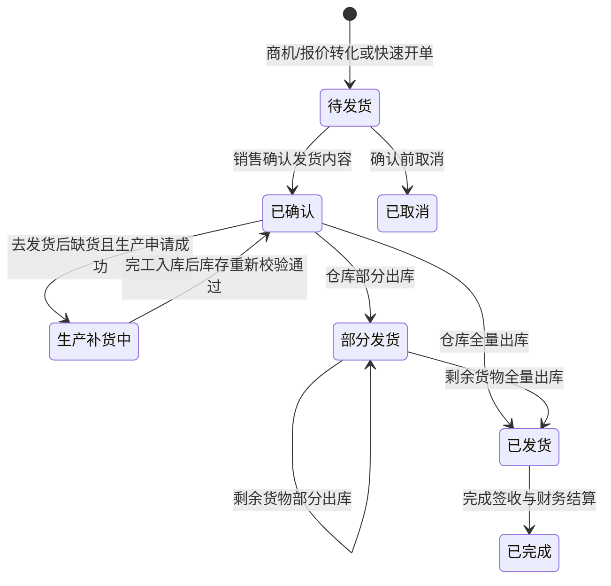

# 工业AI平台 V2.1.0 需求规格说明书（PRD）

# 1. 文档概览
## 1.1 文档目的
本文档用于定义《工业AI平台》V2.1.0 迭代版本的产品需求范围、业务规则、功能细节、权限体系、数据规则、非功能要求、埋点统计、接口依赖、验收标准和风险应对方案。文档面向研发、测试、设计、实施、运营和业务验收团队，作为需求评审、技术设计、测试用例编写、上线验收和后续运维培训的统一依据。

## 1.2 适用范围
本文档适用于 AI 工业 Web 端 V2.1.0 迭代，包括公共框架、工作台、AI 助手、AI智能中枢、AI数据分析、销售管理、生产管理、库存管理、采购管理、财务管理、人员管理、产业链管理、消息管理、平台管理，以及销售到财务结算的跨模块业务闭环。本文件不描述移动端原生 App、真实后端代码实现、数据库物理表设计和第三方系统私有协议细节。

## 1.3 预期阅读对象
| 阅读对象 | 阅读目的 | 重点章节 |
| --- | --- | --- |
| 产品经理 | 确认需求边界、业务规则、状态流转、验收口径 | 全篇 |
| 研发负责人 | 拆解前后端开发任务、确认接口和数据规则 | 第 5、6、7、9、12 章 |
| 测试负责人 | 编写功能、异常、权限、性能、兼容性测试用例 | 第 7、8、10、13 章 |
| UI/UX 设计师 | 确认页面结构、弹窗、提示、空状态、交互反馈 | 第 4、7、10 章 |
| 实施顾问 | 配置角色、组织、菜单、业务基础数据并支持上线 | 第 3、8、9、14 章 |
| 运营/业务管理员 | 理解使用流程、权限范围、待办处理和上线风险 | 第 2、4、5、11、15 章 |

## 1.4 文档修订记录
| 版本号 | 修订日期 | 修订人 | 修订内容 | 备注 |
| --- | --- | --- | --- | --- |
| V2.1.3 | 2026年7月28日 | 产品/研发协同 | 完善出库发货确认弹窗规格：正常发货弹窗补充全部产品明细行展示；部分发货弹窗可编辑条件修正为 availQty>0、新增已发货和剩余待发列、默认值和上限为 min(剩余待发,实际可用)、修复 shippedQty 累加和全量完成判断；新增已确认订单退回待发货编辑能力 | 验收以弹窗交互、状态回写和单元测试为准 |
| V2.1.2 | 2026年7月27日 | 产品/研发协同 | 补齐库存产品“补货申请”、库存物料发起采购申请、生产缺料发起物料出库三类执行入口；明确产品补货直接流转生产主计划，并补充来源追溯、数量校验、单据状态和跨模块回写 | 页面按钮必须生成可恢复的业务任务，不得仅显示 Toast 或监控舱建议 |
| V2.1.1 | 2026年7月27日 | 产品/研发协同 | 调整销售订单发货前置流程：待发货执行“确认订单”只确认销售发货内容并进入已确认；已确认订单执行“去发货”后才创建仓库发货任务。修复确认阶段提前调用出库、字段校验失败和订单 ID 不一致问题 | 以正式确认接口、状态机测试和页面复测为验收证据 |
| V2.1.0-PH1.1 | 2026年7月26日 | 产品/研发协同 | 依据 `BUG-WF-20260726-001~006` 补齐销售确认边界、正式 MPS/MRP/排程、完工后库存重校验、来源单据一致性、部分/剩余发货和生产需求来源追溯要求 | 不改变现有整体 UI 设计；缺陷关闭以代码、测试和 UAT 证据为准 |
| V2.1.0 | 2026年7月26日 | 产品/研发协同 | 增加库存域仓库、产品、物料主数据维护，以及按仓库查看产品/物料和库存数量的需求、校验、权限、异常及验收口径 | 先交付前端交互确认，再实施后端与联调 |
| V2.1.0-PH1 | 2026年7月26日 | 产品/研发协同 | 冻结首期销售—库存—生产—发货范围、库存公式、分批预留、WMS 权威、审批、撤回边界和角色权限口径；首期终点为已发货，采购和财务退出验收 | 详细契约见首期交付基线第 10、13~18 节 |
| V2.1.0 | 2026年7月26日 | 产品/研发协同 | 合并《销售管理.docx》需求，细化销售监控舱、产品报价、销售订单、客户管理、基础数据、产销库存联动、状态机、权限和异常验收口径；按销售订单实际页面和状态机补全待确认、已确认、生产补货中、部分发货、已发货、已完成和已取消的操作与风控口径；明确仓库缺货后手工发起生产申请、完工入库后恢复发货 | 销售状态机与仓库生产申请专项补充 |
| V2.1.0 | 2026年6月23日 | 产品经理 | 按 ToB 后台 PRD 标准重构需求规格说明书，补充公共功能、模块级功能、权限、数据、异常、埋点、接口、验收和风险章节 | 本次交付版本 |
| V1.0 | 2026年6月23日 | 项目交付组 | 形成项目交付版需求规格说明书 | 历史版本 |

## 1.5 术语与缩略词定义
| 术语 / 缩写 | 全称 | 详细解释 |
| --- | --- | --- |
| PRD | Product Requirement Document | 产品需求文档，描述需求背景、范围、功能规则、验收标准和上线依赖。 |
| MPS | Master Production Schedule | 主生产计划，用于根据订单、库存、产能形成生产排程。 |
| MRP | Material Requirements Planning | 物料需求计划，用于根据 BOM、库存和计划计算缺料与采购需求。 |
| PR | Purchase Requisition | 采购申请，由库存低水位、MRP 缺料或人工补货触发。 |
| PO | Purchase Order | 采购订单，采购申请审批后向供应商下达的正式订单。 |
| AR | Accounts Receivable | 应收款，仓库确认销售出库发货后形成的客户应收。 |
| AP | Accounts Payable | 应付款，采购入库或验收后形成的供应商应付。 |
| 业务闭环 | Business Closed Loop | 同一业务单据从销售发起，经库存、生产、采购、发货、财务结算完成的全链路状态闭环。 |
| AI 工业助手 | Industrial AI Assistant | 面向工业业务场景的智能问答与辅助分析入口，支持右侧抽屉对话。 |
| AI 数据员工 | AI Data Agent | 面向特定业务主题的自动分析能力，用于识别风险、生成建议和辅助运营。 |

# 2. 需求背景与目标
## 2.1 业务现状详细描述
上海万申信息股份产业有限公司当前需要通过统一 Web 平台承载制造型企业的经营监控、业务协同、AI 预警和平台治理能力。现有系统原型已具备左侧导航、顶部系统栏、工作台、业务模块、AI 助手和平台管理框架，但需求规格层面的颗粒度不足，无法直接支撑研发拆分、测试覆盖和上线验收。本次 V2.1.0 迭代将以“订单驱动的业务闭环”和“AI 辅助经营决策”为主线，将公共功能和各业务模块拆解到按钮、字段、弹窗、状态、异常、权限和验收标准。

## 2.2 现存痛点逐条拆解
| 痛点编号 | 现存问题 | 问题影响 | 数据支撑 / 观察依据 |
| --- | --- | --- | --- |
| P-001 | 销售、生产、库存、采购、财务模块之间缺少可执行级状态规则 | 研发难以判断按钮点击后应跳转哪个模块、生成什么状态、是否允许回退 | 当前原型有业务流节点，但文档未细化触发条件、前置限制、后续结果。 |
| P-002 | 需求文档停留在模块概述，字段、校验、弹窗、提示文案不足 | 测试无法编写完整用例，验收时容易出现口径争议 | 旧版需求文档仅列出功能点和少量说明。 |
| P-003 | 按钮行为未统一，有些只做 Toast，有些跳转或弹窗 | 用户无法形成稳定预期，运营培训成本增加 | 前期需求已明确按钮需支持弹窗页面、跳转页面、居中明显 Toast。 |
| P-004 | 平台管理和 AI 中枢属于高权限功能，但权限边界不清晰 | 上线后可能出现普通用户误操作配置、AI 数据越权展示 | 平台管理涉及组织、用户、角色、菜单按钮、审计等系统级能力。 |
| P-005 | AI 预警和业务待办之间缺少处理闭环 | 预警只能展示，无法追踪处理状态和责任人 | 工作台已有预警卡片和待办列表，但未定义处理状态和完成规则。 |

## 2.3 用户调研与诉求汇总
| 用户类型 | 核心诉求 | 典型原话归纳 | 转化需求 |
| --- | --- | --- | --- |
| 经营管理层 | 打开首页即可看到今日经营风险和关键指标 | 不希望进入多个系统才能判断今天哪里有问题 | 工作台展示四项指标、AI 预警、待办和实时业务流。 |
| 业务操作员 | 待办可直接跳转到处理页面 | 看到任务后要知道点哪里、处理完是否成功 | 待办、快捷入口和预警按钮必须绑定跳转、弹窗和明确反馈。 |
| 生产计划员 | 仓库提交的销售缺货申请能进入排产与缺料流程 | 不要靠微信群传缺料信息 | 定义仓库生产申请、MPS/MRP、PR/PO 状态流转。 |
| 仓库管理员 | 低库存、采购入库、成品入库、销售出库和缺货申请要有清晰入口 | 库存变化要能影响生产和发货 | 库存管理明确入出库字段、库存校验、生产申请、状态和回写规则。 |
| 财务人员 | 发货和采购入库后可以追溯应收应付来源 | 财务单据要知道从哪张业务单来的 | 财务模块要求 AR/AP 关联 SO、PO、出入库单。 |
| 系统管理员 | 权限要能按角色、菜单、按钮、数据范围配置 | 不能所有人都看到平台管理和配置按钮 | 平台管理权限矩阵和审计规则必须落地。 |

## 2.4 本次迭代核心目标
### 2.4.1 业务目标
- 建立销售订单到财务结算的跨模块业务闭环，确保每个节点有触发条件、处理人、状态和后续结果。
- 提升工作台经营可视性，使操作员和管理层在首屏识别营收、排产、库存、出勤、AI 预警和待办事项。
- 建立 AI 工业助手和 AI 数据员工的配置与使用入口，支撑工业业务问答、风险分析和经营洞察。
- 补齐平台管理能力，支撑组织、用户、角色、租户、菜单按钮、系统参数和审计治理。

### 2.4.2 产品目标
- 形成可直接交付研发、测试、运营团队的 PRD，所有页面具备字段、按钮、校验、弹窗、状态、异常和提示文案。
- 统一所有监控舱布局，保证用户在不同模块中获得一致的认知结构。
- 统一全局按钮反馈方式，按钮操作必须落到页面跳转、弹窗或居中 Toast，不允许无反馈。
- 统一品牌名称为工业AI平台，消除旧名称和旧图标残留。

### 2.4.3 可量化成功指标
| 指标名称 | 当前基线 | 目标值 | 统计口径 |
| --- | --- | --- | --- |
| 核心模块需求覆盖率 | 旧文档约 40% | 100% | 公共功能和 11 个模块均覆盖 7.1-7.11 子项。 |
| P0 功能验收通过率 | 未形成统一口径 | 100% | 第 13 章 Given-When-Then 用例全部通过。 |
| 工作台首屏信息完整率 | 部分区域已实现 | 100% | 标题、Logo、消息、AI 助手、四指标、预警、待办、动态均可见。 |
| 跨模块业务闭环完成率 | 演示链路存在但规则不完整 | 100% | 销售审批到财务结算所有节点具备状态和动作。 |
| 无权限误操作率 | 未定义 | 0 | 无权限账号不可见或不可操作受限按钮。 |
| 关键操作反馈覆盖率 | 不一致 | 100% | 新增、编辑、删除、审批、导入、导出、跳转均有明确反馈。 |

## 2.5 需求价值与收益说明
本次迭代的核心价值在于将现有 AI 工业 Web 端原型从“可展示”推进到“可落地”。研发团队可依据模块和状态拆分任务，测试团队可依据字段、校验、异常和验收标准编写用例，运营和实施团队可依据角色、权限、提示文案和流程规则开展培训与上线支持。业务层面，平台将减少跨部门信息断点，提高订单交付、库存补货、生产齐套、采购履约和财务结算的处理透明度。

# 3. 需求范围界定
## 3.1 需求范围总述
本期范围覆盖 AI 工业 Web 端的公共框架、工作台、全局 AI 助手、业务模块、平台管理、权限、数据、埋点、第三方依赖和验收标准。系统以 Web 页面为主要交互载体，以销售订单业务闭环为主线，以 AI 预警和待办为辅助，以平台管理承载权限和基础配置。

V2.1.0 全量目标范围与首期客户交付范围分层管理：首期 `V2.1.0-PH1.1` 仅以“销售订单待确认 → 库存校验/预留 → 缺货生产 → 完工入库 → 重新校验 → 部分/全量发货”为验收主线，终点为 `SHIPPED`。采购 PR/PO、财务结算、`COMPLETED`、完整主数据生产化和 AI 业务能力仍保留为 V2.1.0 目标需求，但不作为首期验收通过条件；首期范围和契约以《首期交付基线：销售—库存—生产—发货》为准。

## 3.2 P0 核心必做功能
| 功能 | 核心作用 |
| --- | --- |
| 公共导航与顶部栏 | 保证用户可进入授权模块，看到系统标题、搜索、AI 助手、消息提醒和用户信息。 |
| 工作台首页 | 集中展示经营指标、AI 预警、快捷功能、待办和实时业务动态。 |
| 全局 AI 助手抽屉 | 提供公共 AI 问答入口，支持输入、快捷问题、关闭和拖拽调整宽度。 |
| 销售管理 | 完成报价、订单、客户、订单复核/可配置审批；待发货确认销售发货内容后进入已确认，再由已确认订单去发货并移交仓库。 |
| 生产管理 | 承接库存不足后的 MPS/MRP、工单、报工、质检和成品入库。 |
| 库存管理 | 完成库存校验、低水位预警、采购入库、成品入库、销售出库、缺货阻断和仓库生产申请。 |
| 采购管理 | 完成 PR、审批、PO、供应商送货和缺料补货。 |
| 财务管理 | 完成应收、应付、收付款、发票和凭证状态展示。 |
| 消息管理 | 承载审批、系统通知、AI 预警和待办处理入口。 |
| 平台管理 | 维护组织、用户、角色、租户、菜单按钮、系统参数和审计日志。 |

## 3.3 P1 次要优化功能
| 功能 | 核心作用 |
| --- | --- |
| AI 数据员工配置 | 按业务域配置 AI 分析能力，辅助识别风险和输出建议。 |
| 监控舱趋势图 | 统一各模块趋势分析展示，提升经营分析可读性。 |
| 导入导出 | 提升业务批量处理效率，支持模板下载、预校验和结果导出。 |
| 异步导出任务 | 处理超过 5000 行的数据导出，避免页面长时间阻塞。 |
| 供应商寻源建议 | 采购晚交或高风险时提供备选供应商方向。 |

## 3.4 P2 后续规划功能（本期暂不实现）
| 规划功能 | 暂不实现原因 | 后续触发条件 |
| --- | --- | --- |
| 真实大模型私有化部署 | 需单独评估算力、模型、知识库和安全方案 | AI 中枢进入生产化阶段。 |
| ERP/MES/WMS 双向实时写回 | 依赖外部系统接口协议和主数据治理 | 接口规范和测试环境确认后。 |
| 原生移动端 App | 本期定位 Web 端 | 扫码报工、PDA 入库出库需求稳定后。 |
| 复杂工作流引擎 | 当前流程可通过状态机满足 | 审批分支和组织规则显著复杂化后。 |
| 银行直连与税控开票 | 涉及资质、安全和合规 | 财务系统对接范围扩大后。 |

## 3.5 本期明确不做范围
| 不做项 | 说明 | 规避原因 |
| --- | --- | --- |
| 不替代 ERP/MES/WMS | 本期聚焦 AI 工业平台前端和业务闭环原型 | 避免需求蔓延到核心生产系统重构。 |
| 不实现真实财务入账 | 仅定义财务单据展示与结算状态 | 真实入账需财务系统接口和合规审核。 |
| 不实现真实银行支付 | 不接入银行网银、银企直连、付款审批链 | 涉及资金安全与法务合规。 |
| 不实现移动端适配到生产可用 | 仅保证 Web 端主流分辨率 | 移动端需单独设计。 |
| 不开放无权限自助授权 | 用户无权限时只能申请或联系管理员 | 防止越权扩散。 |

# 4. 用户角色与场景分析
## 4.1 用户角色定义
| 角色名称 | 角色描述 | 核心诉求 | 使用频次 |
| --- | --- | --- | --- |
| 操作员 | 日常处理工作台待办和跨模块任务的一线用户 | 快速看到任务、进入页面、完成处理、获得反馈 | 每日多次 |
| 销售主管 | 负责客户、报价、订单审批和交付风险跟进 | 订单能及时审批并触发后续履约 | 每日多次 |
| 生产主管 | 负责排产、工单、报工、质检和产能协调 | 缺料、齐套、工单状态清晰可控 | 每日多次 |
| 仓库管理员 | 负责库存、入库、出库、调拨和盘点；销售出库缺货时核对缺口并发起生产申请 | 库存数量准确，缺货不误发，生产补货和恢复发货可追踪 | 每日多次 |
| 采购经理 | 负责采购申请审批、采购订单和供应商交付 | 缺料需求可转 PR/PO，晚交可预警 | 每日多次 |
| 财务会计 | 负责应收应付、收付款、发票和凭证状态 | 财务单据来源可追溯，逾期风险可识别 | 每日 |
| 系统管理员 | 负责组织、账号、权限、参数和审计 | 权限可控，操作可审计，配置可恢复 | 每周多次 |

## 4.2 核心业务场景
| 场景 | 场景描述 | 触发条件 | 用户目标 | 操作流程 |
| --- | --- | --- | --- | --- |
| 销售订单履约闭环 | 客户订单完成复核/审批后确认发货内容，再从已确认订单去发货；库存不足由仓库发起生产申请，再经过采购、生产和财务完成 | 销售订单复核/审批通过 | 确保订单可交付并完成结算 | 待发货确认订单→已确认去发货→仓库库存校验→缺货生产申请→MRP→PR/PO→入库→生产→成品入库→仓库发货→财务结算 |
| 库存低水位处理 | 物料低于安全库存后触发预警和采购补货 | 库存可用量小于安全库存 | 避免生产停线和交付延误 | 工作台预警→库存详情→生成 PR→采购审批→采购入库 |
| AI 助手问数 | 用户通过顶部 AI 助手咨询库存、排产、销售或财务问题 | 点击 AI 助手按钮 | 快速获取分析建议和下一步动作 | 打开抽屉→输入问题→查看回复→跳转模块处理 |
| 平台权限配置 | 管理员配置角色、菜单、按钮和数据范围 | 组织或岗位发生变化 | 保证用户只看见和操作授权数据 | 进入平台管理→选择角色→配置权限→保存→审计记录 |

## 4.3 次要业务场景
| 场景 | 说明 | 触发条件 | 处理方式 |
| --- | --- | --- | --- |
| 批量导入客户或物料 | 通过模板批量维护基础数据 | 业务数据初始化或批量调整 | 下载模板、上传文件、预校验、确认导入。 |
| 导出筛选结果 | 运营或管理人员导出当前查询结果 | 需要线下分析或汇报 | 按当前筛选条件导出，超过阈值转异步任务。 |
| 查看操作日志 | 管理员追溯权限或业务动作 | 发生争议、异常或审计要求 | 进入审计日志按人、模块、动作、时间查询。 |
| 处理系统通知 | 查看发布、备份、参数变更通知 | 系统产生通知 | 进入消息管理标记已读或查看详情。 |

## 4.4 边缘 / 异常场景
| 异常场景 | 触发条件 | 系统处理 | 用户处理 |
| --- | --- | --- | --- |
| 无权限访问 | URL 直达或点击无权限按钮 | 阻止访问并提示无权限 | 联系管理员申请权限。 |
| 重复提交 | 用户连续点击提交按钮 | 按钮置灰并拦截重复请求 | 等待请求完成。 |
| 状态被他人变更 | 多人同时处理同一单据 | 提示状态已变化并要求刷新 | 刷新后按最新状态处理。 |
| 关联数据冲突 | 删除或作废已被下游引用的数据 | 禁止删除并展示关联单号 | 先处理下游单据或改为作废。 |
| 网络异常 | 接口超时或断网 | 保留当前输入并提示重试 | 检查网络后重试。 |
| AI 无权限数据 | 问题涉及用户无权查看数据 | 不返回敏感数据并说明原因 | 申请权限或换有权限账号。 |

## 4.5 场景 - 功能对应关系
| 业务场景 | 对应功能 | 关键页面 | 验收点 |
| --- | --- | --- | --- |
| 销售订单履约闭环 | 订单复核/审批、发货申请、库存校验、MRP、PR/PO、入库、发货、财务结算 | 销售、库存、生产、采购、财务 | 状态按主流程推进且可追溯。 |
| 库存低水位处理 | AI 预警、库存详情、生成 PR、采购入库 | 工作台、库存、采购 | 低水位数量、PR、入库状态一致。 |
| AI 助手问数 | 右侧抽屉、快捷问题、问题输入、模块跳转 | 全局顶部栏、AI智能中枢 | 抽屉可打开、输入可提交、回复可查看。 |
| 平台权限配置 | 角色权限、菜单按钮权限、数据权限、审计 | 平台管理 | 权限变更即时生效并有审计。 |

# 5. 整体业务与系统流程
## 5.1 整体业务流转逻辑
系统以销售订单作为主业务线索。销售人员创建订单后总体状态进入待发货；若租户启用销售审批规则，须先提交审批并由销售主管审批，否则由授权销售人员直接复核。完成复核/审批后，销售人员在待发货列表执行“确认订单”，核对客户、产品、数量、价格、优惠和交期；确认成功只固化销售发货内容并将订单转为已确认，不创建仓库任务。销售人员随后在已确认列表执行“去发货”，系统才创建或恢复销售出库任务并移交仓库。库存不足时禁止超预留出库，由仓库管理员基于缺口显式发起生产申请，生产需求创建成功后销售订单进入生产补货中。正式生产需求必须依次经过校验/审批、正式 MPS/MRP、采购补料和正式排程候选后才能创建来源可追溯的工单。完工入库更新库存事实并触发原发货任务重新校验；满足时订单回到已确认并恢复出库，仍不足则继续阻断。仓库部分出库时订单进入部分发货，全量出库时进入已发货；全部履约和结算完成后进入已完成。每个节点均需记录稳定 ID、来源版本、责任人、操作时间、Correlation ID 和 Trace ID。

## 5.2 核心主流程步骤拆解
| 步骤 | 触发条件 | 前置限制 | 系统动作 | 后续结果 |
| --- | --- | --- | --- | --- |
| 1. 创建销售订单 | 销售录入客户需求或由有效报价转单 | 客户和产品有效 | 生成 SO 编号和订单快照 | 订单进入待确认。 |
| 2. 订单复核/审批 | 授权销售复核；启用审批时由销售主管审批通过 | 订单字段完整、金额大于 0 且版本未变化 | 记录独立的复核/审批状态、处理人和时间 | 订单总体状态仍为待发货，允许确认订单。 |
| 3. 确认销售发货内容 | 销售人员在待发货列表执行“确认订单” | 已完成复核/审批，客户、产品、数量、价格、优惠和交期有效 | 固化发货内容、交期、版本、审计和确认事件，不创建仓库任务 | 订单进入已确认，在已确认列表显示“去发货”。 |
| 4. 去发货与库存校验 | 销售在已确认列表执行“去发货”，仓库随后校验库存 | 订单为已确认，尚无冲突的活动发货任务 | 生成或恢复仓库任务，原子校验可用量并创建预留或计算缺口 | 足够则等待仓库出库；不足则禁止出库并展示生产缺口。 |
| 5. 仓库发起生产申请 | 仓库确认库存不足并执行“发起生产申请” | 库存事实有效，产品和操作权限有效 | 以来源订单行、缺口、库存事实版本和幂等键创建生产需求 | 生产需求创建成功后订单进入生产补货中，等待 MPS/MRP。 |
| 6. MPS/MRP 与排程 | 生产需求已接入且完成校验/审批 | 成品、BOM、工艺路线、库存事实、工厂和来源销售链路有效 | 以正式需求 ID 创建可查询任务，持久化 MPS 行、物料缺口、求解器版本和排程候选 | 只有成功结果覆盖目标需求时才能进入工单创建；任务受理不等于计算成功。 |
| 7. 采购申请 | MRP 产生缺料 | 供应商或采购策略可用 | 生成 PR 并提交审批 | 审批通过转 PO。 |
| 8. 采购入库 | 供应商到货 | PO 有效且未关闭 | 登记到货和入库 | 回写库存和齐套状态。 |
| 9. 生产执行与完工入库 | 物料齐套 | 工单引用覆盖来源需求的正式排程候选并已下达 | 记录开工、报工、质检、完工分配和成品入库 | 合格入库产生新库存事实并触发原销售出库任务重校验。 |
| 10. 仓库出库发货 | 已确认订单的出库任务处于待出库 | 订单未取消，库存预留有效 | 仓库管理员确认部分或全量出库 | 部分出库进入部分发货；全量出库进入已发货并触发财务应收。 |
| 11. 签收与财务结算 | 订单已发货 | 客户/供应商账期有效 | 记录客户签收，生成 AR/AP、收付款、发票、凭证 | 全部履约和结算完成后订单进入已完成。 |

## 5.3 分支流程说明
| 分支 | 触发条件 | 处理规则 | 回归主流程 |
| --- | --- | --- | --- |
| 库存足够 | 可用量 ≥ 本次发货申请量 | 原子创建库存预留和销售出库单，跳过 MPS/MRP 和采购，订单保持已确认 | 等待仓库出库作业。 |
| 库存不足但可调拨 | 其他仓库有可用库存 | 生成调拨单，调拨完成后更新可用量 | 库存满足后进入发货或生产。 |
| 库存不足需生产 | 可用量 < 本次发货量且无法及时调拨 | 禁止销售出库；仓库填写/确认缺口后发起幂等生产申请，销售订单进入生产补货中 | 完工入库后按新库存事实重新校验。 |
| 采购晚交 | 预计到货日 > 需求日期 | 生成 AI 预警，采购经理处理催交或寻源 | 到货后继续入库。 |
| 质检不合格 | 检验结果为不合格 | 阻止成品入库，生成返工、隔离或报废选项 | 返工合格后进入成品入库。 |
| 财务逾期 | 应收超过账期未收款 | 生成财务风险预警和催收待办 | 收款登记后关闭预警。 |

## 5.4 逆向流程（撤销、退回、作废、回退）完整规则
| 逆向动作 | 允许状态 | 触发角色 | 规则 | 后续结果 |
| --- | --- | --- | --- | --- |
| 撤销确认/审批 | 待确认且未发起发货 | 创建人/审批人 | 发起发货前允许撤销；保留审批历史 | 可编辑后重新复核或提交审批。 |
| 审批退回 | 待确认且审批中 | 审批人 | 必须填写退回原因 | 审批状态变为已退回，订单仍为待确认。 |
| 取消订单 | 待确认且未发起发货 | 有权销售人员/销售主管 | 客户反悔等发货前终止场景允许取消；必须填写原因 | 订单进入已取消，作为废单保留。 |
| 部分撤回（非首期） | 已确认且出库单已下发仓库 | 有权销售人员/销售主管 | 首期不提供撤回入口；异常必须通过仓库拦截、预留释放和双人审批补偿 | 后续如纳入，必须另行定义撤回状态和仓库结果契约。 |
| 采购退回 | PR 待审批 | 采购经理 | 必须填写拒绝原因 | 回到 MRP 缺料待处理。 |
| 生产返工 | 质检不合格 | 生产主管/质检员 | 记录不合格原因和返工数量 | 回到生产执行。 |
| 财务冲销 | 财务单据已生成 | 财务会计 | 必须关联原单据并记录原因 | 生成冲销记录，不删除原记录。 |

## 5.5 异常中断流程处理逻辑
| 中断类型 | 系统识别方式 | 处理逻辑 | 兜底方案 |
| --- | --- | --- | --- |
| 接口失败 | 接口返回超时或 5xx | 保留当前状态，展示重试入口，记录错误日志 | 管理员可手工刷新或恢复上一状态。 |
| 数据冲突 | 版本号或更新时间不一致 | 阻止提交，提示刷新最新数据 | 用户刷新后重新处理。 |
| 权限变更 | 操作中权限被收回 | 立即阻止后续动作 | 返回工作台并提示权限变化。 |
| 流程断点 | 下一节点未生成 | 提示流程异常并写入消息管理 | 系统管理员可在流程运维中重新触发节点。 |
| AI 服务不可用 | AI 接口失败或超时 | 提示 AI 暂不可用，不影响业务主流程 | 展示人工处理建议。 |

# 6. 产品功能架构
## 6.1 整体功能模块架构说明
| 一级模块 | 二级能力 | 说明 |
| --- | --- | --- |
| 公共功能 | 导航、顶部栏、搜索、消息、AI 助手、Toast、弹窗 | 所有模块共享的交互和反馈基础。 |
| 工作台 | 经营指标、AI 预警、快捷功能、待办、实时动态 | 用户进入系统后的运营中枢。 |
| 业务模块 | 销售、生产、库存、采购、财务、人员、产业链 | 承载订单履约和经营协同。 |
| AI 模块 | AI智能中枢、AI数据分析、AI 工业助手、AI 数据员工 | 承载智能问答、预警和数据分析。 |
| 消息模块 | 审批消息、系统通知、AI 预警、已归档 | 承载通知、待办和状态提醒。 |
| 平台管理 | 组织、用户、角色、租户、菜单按钮、参数、审计 | 承载后台治理和权限控制。 |

## 6.2 模块间关联关系
| 源模块 | 目标模块 | 关联数据 | 关联动作 |
| --- | --- | --- | --- |
| 销售管理 | 库存管理 | 已确认销售订单、订单行、本次发货数量、仓库、单位、交期 | 待发货订单确认内容并进入已确认后，执行“去发货”才生成或恢复仓库销售出库任务；不在销售侧执行库存校验和预留。 |
| 库存管理 | 销售管理 | 可用量、预留结果、事实版本、事实时间 | 返回库存事实和预留结果；库存变化时发布新版本事实事件。 |
| 库存管理 | 生产管理 | 销售订单、来源行、产品、缺口数量、单位、需求日期 | 仓库管理员确认缺口并执行“发起生产申请”后，幂等创建生产需求接入记录，由生产域继续 MPS/MRP。 |
| 生产管理 | 采购管理 | 缺料清单、需求日期 | MRP 生成 PR。 |
| 采购管理 | 库存管理 | PO、供应商、到货数量 | 采购入库回写库存。 |
| 生产管理 | 库存管理 | 质检结果、成品数量 | 质检合格后成品入库。 |
| 库存管理 | 销售管理 | 销售出库单、实际发货数量、发货结果 | 仓库重新校验库存并确认发货后，回写订单发货状态和已发数量。 |
| 库存管理 | 财务管理 | 出库单、入库单、金额 | 发货或入库触发财务单据。 |
| 所有业务模块 | 消息管理 | 待办、审批、预警 | 生成消息和待办。 |
| 所有业务模块 | AI数据分析 | 指标、状态、风险 | 生成看板和分析洞察。 |

## 6.3 数据流转链路说明
销售订单号是主链路的业务关联锚点，但各领域仍拥有独立稳定 ID 和数据所有权。所有下游单据必须保存租户、来源模块、来源单号、来源行、来源版本、Correlation ID、Trace ID、创建人和创建时间。业务动作在本领域事务内保存业务事实和 Outbox；其他领域通过 API 或 Inbox 消费事件形成自己的单据或只读投影，不得跨域直接写库。事件处理失败不得撤销已经合法提交的原业务事实，但必须按幂等策略重试，超过阈值后生成异常消息并进入人工补偿。

# 7. 详细功能需求
## 7.1 公共功能与全局框架
### 7.1.1 页面整体布局与结构说明
页面采用左侧固定主导航、顶部系统栏、主内容区、全局 Toast 层、全局弹窗层、右侧 AI 助手抽屉组成。左侧导航展示工作台、AI智能中枢、AI数据分析、销售管理、生产管理、库存管理、采购管理、财务管理、人员管理、产业链管理、消息管理、平台管理；顶部栏展示系统名称、当前模块标题、搜索框、AI 助手按钮、消息铃铛、用户头像与组织名称。

### 7.1.2 页面初始化规则
首次进入系统默认进入工作台；若 URL 或缓存中存在合法 activeModule，则进入对应模块；若无权限访问缓存模块，默认回退工作台并提示“当前账号无权访问该模块，已返回工作台”。顶部搜索框默认空值，消息铃铛展示未读数，AI 助手默认收起。

### 7.1.3 展示字段明细
| 字段名称 | 字段含义 | 数据来源 | 展示规则 | 格式要求 | 备注 |
| --- | --- | --- | --- | --- | --- |
| 系统名称 | 产品品牌名称 | 前端配置 | 固定显示“工业AI平台” | 文本 | 不可被用户编辑 |
| 当前模块标题 | 当前页面所在模块 | activeModule | 根据导航切换实时更新 | 文本 | 无权限模块不展示 |
| 全局搜索占位 | 搜索提示 | 前端固定文案 | 显示“在工作台中搜索...”或模块名称 | 文本 | 点击后聚焦输入框 |
| 消息未读数 | 未处理消息数量 | 消息列表 | 0 不显示红点，大于 99 显示 99+ | 数字 | 每 60 秒刷新一次 |
| 用户信息 | 当前登录人 | 登录态 | 显示头像、姓名、组织 | 文本/头像 | 未登录时跳登录页 |

### 7.1.4 操作按钮全量说明
| 按钮名称 | 展示位置 | 前置条件 | 操作效果 | 权限要求 |
| --- | --- | --- | --- | --- |
| 导航菜单 | 左侧导航 | 账号具备菜单可见权限 | 切换主内容区并高亮菜单 | 对应菜单可见权限 |
| AI 助手 | 顶部右侧 | 账号具备 AI 助手使用权限 | 打开右侧 AI 助手抽屉 | AI_ASSISTANT_USE |
| 消息铃铛 | 顶部右侧 | 账号具备消息查看权限 | 打开消息中心或消息弹窗 | MESSAGE_VIEW |
| 用户下拉 | 顶部右侧 | 已登录 | 展示个人信息、退出入口 | LOGINED |
| 关闭弹窗 | 弹窗右上角 | 弹窗处于打开状态 | 关闭弹窗；未保存内容需二次确认 | 当前弹窗查看权限 |

### 7.1.5 核心操作完整规则
- 导航切换：点击导航菜单后校验菜单权限，通过后更新 activeModule，并将页面滚动条归零。
- 搜索：输入关键词后按 Enter 触发模块内搜索；关键词去除首尾空格；空关键词不发起搜索并提示“请输入搜索关键词”。
- Toast：所有新增、保存、审批、跳转、异常操作必须通过居中 Toast 或弹窗反馈，不允许仅在控制台输出。
- 弹窗拦截：编辑类弹窗存在未保存内容时，点击关闭、遮罩、Esc 均弹出确认提示。
- 会话失效：任意操作返回 401 时清空本地登录态，跳转登录页，提示“登录已失效，请重新登录”。

### 7.1.6 输入项校验规则
| 输入项名称 | 是否必填 | 长度限制 | 格式要求 | 校验逻辑 | 报错文案 |
| --- | --- | --- | --- | --- | --- |
| 全局搜索关键词 | 否 | 1-50 字 | 中文、英文、数字、空格 | 去除首尾空格后长度为 0 则不搜索 | 请输入搜索关键词 |
| AI 助手问题 | 是 | 1-500 字 | 中文、英文、数字、常用标点 | 禁止只输入空格；禁止连续提交相同问题 | 请输入需要咨询的问题 |

### 7.1.7 筛选、搜索、排序、分页完整逻辑
公共框架不提供全局分页。搜索结果由当前模块接管；搜索关键词传入当前模块，模块按自身数据范围过滤。导航菜单按平台管理员配置的菜单顺序展示，隐藏无权限菜单。

### 7.1.8 弹窗规则说明
| 弹窗名称 | 标题 | 字段 | 按钮 | 关闭逻辑 |
| --- | --- | --- | --- | --- |
| 全局确认弹窗 | 确认操作 | 提示文案、取消按钮、确认按钮 | 取消、确认 | 点击取消/关闭图标/遮罩关闭；点击确认执行操作 |
| 无权限提示弹窗 | 无权限访问 | 无权限原因、申请权限指引 | 我知道了 | 点击按钮或关闭图标关闭 |

### 7.1.9 数据状态流转规则
| 状态名称 | 状态标识 | 触发条件 | 前置状态 | 后置状态 | 限制说明 |
| --- | --- | --- | --- | --- | --- |
| 正常 | normal | 页面资源加载完成 | 加载中 | 可操作 | 允许执行具备权限的操作 |
| 加载中 | loading | 页面初始化或接口请求中 | 任意状态 | 正常/异常 | 按钮置灰，显示加载反馈 |
| 无权限 | forbidden | 菜单或按钮权限校验失败 | 任意状态 | 正常 | 禁止进入模块或执行按钮 |
| 会话失效 | expired | 登录态过期或接口返回 401 | 任意状态 | 登录页 | 清空本地登录态 |

### 7.1.10 全量异常场景处理
| 异常场景 | 处理方式 | 兜底方案 |
| --- | --- | --- |
| 空数据 | 主内容区显示空状态图标与“暂无数据” | 保留筛选条件，允许重置筛选 |
| 无权限 | 展示“当前账号无权访问该功能” | 隐藏按钮或阻止操作 |
| 网络异常 | 展示“网络异常，请稍后重试” | 保留用户输入，允许重试 |
| 重复提交 | 同一按钮提交中置灰 | 请求结束后恢复按钮 |
| 数据超限 | 搜索词、输入内容超过限制时前端拦截 | 展示字段级错误 |
| 关联冲突 | 当前数据被其他流程占用时弹窗提示 | 引导用户查看占用业务单据 |

### 7.1.11 全量提示文案清单
| 提示类型 | 提示文案 | 触发时机 |
| --- | --- | --- |
| 成功 | 操作成功 | 通用保存、审批、提交成功时 |
| 错误 | 操作失败，请稍后重试 | 接口异常且无明确错误信息时 |
| 确认 | 当前内容尚未保存，确认关闭吗？ | 编辑弹窗关闭前 |
| 警告 | 当前账号无权执行该操作 | 按钮权限校验失败时 |

## 7.2 工作台首页
### 7.2.1 页面整体布局与结构说明
工作台首页由欢迎横幅、四项核心指标、AI 智能全域预警、常用快捷功能、我的待办事项、实时业务流动态组成。四项核心指标必须同一排展示，卡片按营收、排产、库存、出勤顺序排列；下方左侧展示 AI 预警和待办，右侧展示快捷功能和实时业务流。

### 7.2.2 页面初始化规则
默认加载当日数据，统计周期为自然月；待办默认展示未完成事项，按高危、时间倒序排列；实时动态默认展示最近 24 小时内最新 10 条；AI 预警默认展示风险等级最高的 3 条。

### 7.2.3 展示字段明细
| 字段名称 | 字段含义 | 数据来源 | 展示规则 | 格式要求 | 备注 |
| --- | --- | --- | --- | --- | --- |
| 日期标签 | 当前业务日期 | 系统日期 | 格式：YYYY年M月D日 星期X | 文本 | 固定展示 |
| 系统状态 | 系统运行健康状态 | 监控服务 | 正常显示绿色，异常显示红色 | 标签 | 默认文案：系统运行良好 |
| 本月全盘营收 | 本月预计营收 | 销售/财务汇总 | 千分位，单位万元 | 金额 | 展示较昨日趋势 |
| 排产达成率 | 计划排产完成率 | 生产计划 | 百分比一位小数 | 百分比 | 展示较昨日变化 |
| 低水位物料 | 低于安全库存的物料数量 | 库存 | 整数，单位项 | 数字 | 大于 0 红色预警 |
| 核心岗出勤率 | 关键岗位出勤率 | 人员管理 | 百分比一位小数 | 百分比 | 低于阈值预警 |
| 待办标题 | 待处理任务名称 | 消息/业务单据 | 显示模块标签、标题、时间 | 文本 | 高危待办显示红点 |

### 7.2.4 操作按钮全量说明
| 按钮名称 | 展示位置 | 前置条件 | 操作效果 | 权限要求 |
| --- | --- | --- | --- | --- |
| 召唤 AI 助手 | 欢迎横幅右侧 | 具备 AI 助手权限 | 打开右侧 AI 助手抽屉 | AI_ASSISTANT_USE |
| 进入决策舱 | AI 预警标题右侧 | 具备 AI 数据分析查看权限 | 跳转 AI 数据分析模块 | AI_ANALYSIS_VIEW |
| 立即排产干预 | 交付风险卡片内 | 具备生产计划处理权限 | 跳转生产管理并打开排产处理弹窗 | PROD_PLAN_EDIT |
| 生成调拨单 | 库存预警卡片内 | 具备库存调拨权限 | 跳转库存管理并打开调拨弹窗 | INV_TRANSFER_CREATE |
| 调整排班 | 人员风险卡片内 | 具备人员排班权限 | 跳转人员管理 | HR_SCHEDULE_EDIT |
| 快速开单 | 快捷功能区 | 具备销售开单权限 | 跳转销售管理并打开开单弹窗 | SALES_ORDER_CREATE |
| 手工入库 | 快捷功能区 | 具备入库权限 | 跳转库存管理并打开入库弹窗 | INV_INBOUND_CREATE |
| 提报 PR | 快捷功能区 | 具备采购申请权限 | 跳转采购管理并打开 PR 弹窗 | PUR_PR_CREATE |
| 扫码报工 | 快捷功能区 | 具备报工权限 | 跳转生产管理并打开报工弹窗 | PROD_REPORT_CREATE |

### 7.2.5 核心操作完整规则
- 查看指标：用户进入工作台后无需点击，系统自动展示核心指标；任一指标为异常时卡片展示红色或橙色趋势。
- 处理预警：点击预警处理按钮后跳转到对应模块，并携带预警 ID、来源单号、默认筛选条件。
- 处理待办：点击待办项后跳转对应模块；待办进入详情后状态不自动完成，必须由业务动作关闭。
- 快捷操作：点击快捷功能后打开对应模块的新增弹窗；若无权限，不跳转并提示无权限。
- 业务动态查看：实时业务流仅查看，不允许在工作台直接删除或编辑动态。

### 7.2.6 输入项校验规则
| 输入项名称 | 是否必填 | 长度限制 | 格式要求 | 校验逻辑 | 报错文案 |
| --- | --- | --- | --- | --- | --- |
| 工作台搜索关键词 | 否 | 1-50 字 | 中文、英文、数字 | 为空不搜索；输入后匹配待办、预警、动态标题 | 请输入搜索关键词 |

### 7.2.7 筛选、搜索、排序、分页完整逻辑
工作台默认不展示高级筛选。待办按优先级 P0、P1、P2 排序，同优先级按创建时间倒序；实时动态按发生时间倒序；若待办超过 5 条，首页展示前 5 条并提供进入消息管理查看全部。

### 7.2.8 弹窗规则说明
| 弹窗名称 | 标题 | 字段 | 按钮 | 关闭逻辑 |
| --- | --- | --- | --- | --- |
| 排产干预弹窗 | 排产干预 | 工单号、风险原因、建议动作、备注 | 取消、提交干预 | 未提交关闭不改变业务状态 |
| 库存调拨弹窗 | 生成调拨单 | 物料、源仓、目标仓、数量、备注 | 取消、生成 | 生成后跳库存管理查看 |
| 快捷开单弹窗 | 快速开单 | 客户、产品、数量、交期、备注 | 取消、保存草稿、提交 | 关闭前校验未保存内容 |

### 7.2.9 数据状态流转规则
| 状态名称 | 状态标识 | 触发条件 | 前置状态 | 后置状态 | 限制说明 |
| --- | --- | --- | --- | --- | --- |
| 待处理 | pending | 待办或预警生成 | 无 | 处理中/已完成 | 显示在工作台 |
| 处理中 | processing | 用户进入模块处理 | 待处理 | 已完成/已关闭 | 工作台显示处理中标签 |
| 已完成 | done | 来源业务动作完成 | 处理中 | 归档 | 不再进入待办列表 |
| 已关闭 | closed | 用户确认无需处理或业务作废 | 待处理/处理中 | 归档 | 需记录关闭原因 |

### 7.2.10 全量异常场景处理
| 异常场景 | 处理方式 | 兜底方案 |
| --- | --- | --- |
| 空数据 | 展示“暂无待办，今日业务运行平稳” | 仍展示指标和快捷功能 |
| 无权限 | 点击快捷入口提示“当前账号无权使用该快捷功能” | 不打开弹窗 |
| 网络异常 | 指标卡展示最近一次缓存值并标注更新时间 | 允许刷新重试 |
| 重复提交 | 快捷弹窗提交按钮置灰并显示“提交中” | 请求完成恢复 |
| 数据超限 | 待办超过首页容量时仅展示前 5 条 | 引导进入消息管理查看全部 |
| 关联冲突 | 待办对应单据已被他人处理时提示“该事项已处理，请刷新页面” | 刷新列表 |

### 7.2.11 全量提示文案清单
| 提示类型 | 提示文案 | 触发时机 |
| --- | --- | --- |
| 成功 | 已进入对应业务模块 | 快捷入口跳转成功 |
| 成功 | 处理动作已提交 | 预警处理提交成功 |
| 错误 | 工作台数据加载失败，请刷新重试 | 工作台初始化失败 |
| 确认 | 确认关闭当前处理弹窗吗？未保存内容将丢失 | 关闭编辑类弹窗 |
| 警告 | 该事项已由其他用户处理 | 待办状态冲突 |

## 7.3 销售管理
### 7.3.1 页面整体布局与结构说明
销售管理用于承载客户、报价、订单、发货协同和销售经营分析，是销售、库存、生产、仓储与财务闭环的业务发起域。页面包含销售监控舱、产品报价、销售订单、客户管理、基础数据五个页签；页面顶部展示模块标题和“快速开单”主操作，默认选中销售监控舱。

- 销售监控舱：展示商机、订单、回款指标，AI 风险预警和近 6 个月报价/成单趋势。
- 产品报价：维护报价表头、产品明细、折扣优惠、有效期及转销售订单动作。
- 销售订单：维护订单、发起发货、查看库存校验、生产补货、出库和应收进度。
- 客户管理：维护客户基本信息、联系人矩阵、归属销售、等级及合作状态。
- 基础数据：维护客户等级、行业字典和订单 SLA 自动触达规则。
- 快速开单：在当前页面打开居中弹窗，不切换页签；字段规则与销售订单新建一致。

### 7.3.2 页面初始化规则
默认进入销售监控舱。指标和高风险预警在页面加载时异步获取，预警每次进入监控舱时重新校验；加载失败时保留最近一次成功快照并标注更新时间，不得把缓存值展示为实时值。

- 报价列表默认展示草稿、生效中和已过期报价，按更新时间倒序；软删除/已作废记录仅在勾选“包含已作废”后展示。
- 订单列表默认展示近 90 天未取消订单，按更新时间倒序；交期临近且未发货订单优先标识风险。
- 销售订单页当前状态筛选入口为全部、待确认、已确认、生产中、已发货、已完成、已取消；其中前端“生产中”对应状态机“生产补货中”。“部分发货”是独立订单状态，在全部结果和订单状态列中展示。
- 客户列表按客户等级权重、更新时间排序，并受租户、组织和归属销售数据权限约束。
- 时间判断统一使用租户时区；金额使用十进制精度，展示币种符号和千分位。

#### 7.3.2.1 销售监控舱指标
| 指标 | 口径 | 展示说明 |
| --- | --- | --- |
| 生效商机数 | 报价状态为“生效中”且有效期至不早于当前日期的报价单数 | 标签“跟进中”，点击进入对应报价列表 |
| 异常停滞商机 | 生效报价剩余有效期 0-7 天，或已过期且未转订单的报价单数 | 标签“周期预警”，按剩余天数升序 |
| 商机转订单 | 本自然月发生“报价转销售订单”成功事件的订单数 | 标签“同步成功”，同一报价重复请求只计一次 |
| 订单转财务 | 本自然季度已确认的销售回款金额合计 | 单位万元；存在超过历史成交订单平均金额且未回款的大单时显示风险提示 |

#### 7.3.2.2 AI 预警与趋势分析
| 场景 | 触发条件 | 展示与动作 |
| --- | --- | --- |
| 报价临期/过期挽回 | 报价剩余有效期不超过 7 天，或已过期且未转订单 | 展示客户、报价单号、到期日和风险值；可生成关联原报价的新版本报价，或打开智能触达助手 |
| 客户资产盘点 | 联系电话或行业为空、合作互动超过 30 天未更新，或客户等级与近 12 个月实付金额不匹配 | 按客户等级权重和风险程度排序，展示客户数、资料缺口和激活建议 |
| 订单履约延期 | 订单处于待确认、已确认、生产补货中或部分发货，且距承诺交期不超过 3 天或已经逾期 | 穿透展示库存、生产和仓储阻塞节点；支持催产督办及生成客户沟通建议 |
| 待确认订单滞留 | 订单停留在待确认状态超过启用的 SLA 阈值 | 生成站内待办并按配置渠道通知归属销售；达到升级阈值时抄送销售主管 |

报价流失风险值按 `已持续天数 / 报价总有效天数 * 100%` 计算并限制在 0%-100%，仅作为排序和提示依据，不得直接改变报价或订单状态。智能触达支持企微/微信话术、电话话术切换；点击“复制去发送”后，服务端按租户、报价单、联系人和渠道记录 24 小时防重复时间窗。外部渠道未确认送达时展示“发送结果待确认”，不得标记为已送达。

趋势区展示近 6 个自然月：历史实线为每月生效报价金额合计，预测虚线为模型输出的预期成单金额。无可用模型时可采用“当前未发货订单金额 + 历史同期平均新增订单金额 - 历史平均取消/退货金额”的基线结果，并明确标识为规则预测。

### 7.3.3 展示字段明细
#### 7.3.3.1 产品报价字段
| 信息块 | 字段 | 规则 |
| --- | --- | --- |
| 基本信息 | 报价单号 | 系统生成 `QT-YYYYMMDD-流水号`，租户内唯一且只读 |
| 基本信息 | 关联客户 | 必填，只能选择当前数据范围内且未停用的客户 |
| 基本信息 | 报价日期 | 必填，默认当前日期，允许按权限修改 |
| 基本信息 | 有效期至 | 必填，默认报价日期加 30 天，不得早于报价日期 |
| 产品明细 | 产品、规格型号、单位、标准指导价 | 产品只能选择已上架产品；选中后从产品主数据带出 |
| 产品明细 | 数量、成交单价、行金额 | 数量默认 1 且大于 0；行金额为单价乘数量；允许删除未锁定明细行 |
| 金额信息 | 折扣率、优惠金额、报价总金额 | 折扣率默认 100%；总金额为 `明细金额合计 * 折扣率 / 100 - 优惠金额`，结果不得小于 0 |
| 附加信息 | 备注、商务条款 | 可填写交货周期、运费等说明，最多 1000 字 |

#### 7.3.3.2 销售订单字段
| 信息块 | 字段 | 规则 |
| --- | --- | --- |
| 基本信息 | 订单编号 | 系统生成 `SO-YYYYMMDD-流水号`，租户内唯一且只读 |
| 基本信息 | 来源报价单 | 报价转单时必填并保留来源报价版本；快速开单时为空 |
| 基本信息 | 客户、销售人员 | 客户必填；销售人员默认当前操作者或客户归属销售 |
| 基本信息 | 订单日期、承诺交期 | 必填；交期用于履约风险判断且不得早于订单日期 |
| 收货信息 | 收货人、联系电话、收货地址 | 发起发货前必填；待确认阶段允许修改 |
| 产品明细 | 产品、单位、可用库存、数量、单价、行金额 | 可用库存只读且标注事实时间；数量大于 0；单价修改受权限和折扣底线控制 |
| 金额信息 | 折扣率、优惠金额、订单总金额 | 计算规则与报价一致；金额使用十进制计算 |
| 履约信息 | 总体状态、确认/审批状态、发货状态、已发/未发数量 | 审批状态按租户规则启用；发货状态为未发货、部分发货、全部发货，按订单行汇总 |
| 财务信息 | 已确认应收、已回款、待核销金额 | 按实际发货金额和财务核销结果更新，不以订单总金额直接认定应收 |
| 追踪信息 | 来源单号、关联出库单、生产需求、应收单、版本、Trace ID | 详情页可追溯，业务编号不可替代稳定内部 ID |
| 附加信息 | 备注 | 可填写交货、开票、物流偏好，最多 1000 字 |

#### 7.3.3.3 客户档案字段
| 信息块 | 字段 | 规则 |
| --- | --- | --- |
| 基本信息 | 客户编码、客户名称、统一社会信用代码 | 编码系统生成；名称必填并做租户内查重；信用代码用于精确查重和开票 |
| 基本信息 | 所属行业 | 必填，选择已启用的行业字典叶子或允许选取的节点 |
| 地址信息 | 省/市/区、详细地址、经纬度 | 详细地址按业务配置必填；地图解析失败不阻断保存，但标识待补全 |
| 联系人 | 姓名、电话、职位、决策角色、是否主联系人 | 至少一个主联系人；支持一对多联系人矩阵 |
| 业务属性 | 归属销售、客户等级、合作状态 | 归属销售为空时进入公海池；合作状态为潜在、跟进中、合作中、已流失 |
| 审计信息 | 创建人、更新时间、停用原因 | 停用客户不可用于新报价和新订单，历史单据仍正常展示 |

### 7.3.4 操作按钮全量说明
| 按钮名称 | 展示位置 | 前置条件 | 操作效果 | 权限要求 |
| --- | --- | --- | --- | --- |
| 快速开单 | 页面顶部 | 客户、产品主数据可用 | 打开销售订单弹窗 | SALES_ORDER_CREATE |
| 新建报价 | 报价列表 | 具备创建权限 | 打开报价编辑页，支持保存草稿或生效 | SALES_QUOTE_CREATE |
| 编辑报价 | 报价行/详情 | 草稿、生效中或已过期 | 更新允许字段；已过期报价延期时生成新版本并保留来源 | SALES_QUOTE_EDIT |
| 作废报价 | 报价行/详情 | 草稿或生效中且未转订单 | 二次确认后软作废；已过期报价不得删除 | SALES_QUOTE_VOID |
| 转为销售订单 | 报价行/详情 | 报价生效、未过期、未转单 | 带入客户、产品、金额和来源版本生成待确认订单 | SALES_ORDER_CREATE |
| 智能触达 | 预警卡/报价详情 | 存在有效联系人且未处于防重复窗口 | 打开渠道和话术弹窗，记录触达任务 | SALES_OUTREACH_SEND |
| 提交复核/审批 | 订单行/详情 | 总体状态为待发货且字段完整 | 未启用审批时完成复核；启用审批时生成销售主管待办；不直接改变订单总体状态 | SALES_ORDER_REVIEW / SALES_ORDER_APPROVE |
| 确认订单 | 待发货订单行/详情 | 已完成所需复核/审批，客户、产品、数量、金额和交期完整 | 打开“确认销售发货内容”弹窗；确认后固化内容并进入已确认，不创建仓库任务 | SALES_ORDER_CONFIRM |
| 去发货 | 已确认订单行/详情 | 总体状态为已确认，尚无冲突的活动发货任务 | 生成或恢复仓库销售出库任务并跳转出库管理 | SALES_SHIPMENT_REQUEST |
| 部分撤回（后续） | 订单详情 | 不属于首期能力 | 首期隐藏或禁用；异常进入仓库拦截和补偿单，不允许直接修改明细或删除 | `SALES_SHIPMENT_WITHDRAW`（首期不授予） |
| 催产督办 | 订单详情/预警卡 | 生产补货中 | 向关联生产需求生成督办事件和待办 | SALES_PRODUCTION_EXPEDITE |
| 发起剩余发货 | 订单行/详情 | 总体状态为部分发货且存在未发数量 | 对未发部分生成或恢复仓库出库任务 | SALES_SHIPMENT_REQUEST |
| 取消订单 | 订单详情 | 待确认且无已完成发货、应收或不可逆下游动作 | 填写原因后取消；保留历史记录 | SALES_ORDER_CANCEL |
| 新增/编辑客户 | 客户列表/详情 | 具备对应权限 | 维护客户及联系人，执行重复和停用校验 | SALES_CUSTOMER_WRITE |
| 配置基础数据 | 基础数据页 | 系统管理员或销售主管 | 维护等级阈值、行业和 SLA 规则 | SALES_SETTINGS_MANAGE |
| 导入/导出 | 各列表顶部 | 具备权限 | 按模板预校验导入，或按当前筛选导出 | SALES_IMPORT / SALES_EXPORT |

销售专属角色口径如下：销售人员可查看监控舱，并在本人/授权数据范围内维护客户、报价和订单，但不可进入基础数据页；销售主管可查看本部门全量销售数据、执行订单审批和催产督办，仅可修改客户等级金额阈值、基础数据启停状态及订单 SLA 阈值，不得删除底层字典结构；系统管理员负责字典结构和系统级规则，操作业务数据时仍须显式授予销售业务权限。

### 7.3.5 核心操作完整规则
#### 7.3.5.1 报价转订单
1. 客户与销售经理在线下确认价格和商务条款后，由客户经理在产品报价单执行“审批确认并转订单”；线下沟通本身不直接改变系统单据状态，线上审批确认是可追溯的转单业务事实。
2. 用户仅可将“生效中且未过期”的报价转为销售订单；系统校验客户、产品、价格和数据权限。
3. 系统复制报价快照生成待确认订单，保存来源报价 ID、编号和版本；此时尚未发货，不得提前进入已确认、已发货或库存处理状态，报价后续变化也不得静默覆盖订单。
4. 同一报价默认只允许成功转单一次；重复请求返回首次结果。确需拆单时必须具备拆单权限并记录原因。
5. 转单与来源关系、状态历史、审计和 Outbox 必须在同一事务中保存。

#### 7.3.5.2 发货、库存与生产补货联动
1. 订单创建后总体状态为待发货。销售完成订单复核/审批后执行“确认订单”，系统打开“确认销售发货内容”弹窗，展示客户、销售人员、订单日期、产品明细、库存参考、数量、价格和优惠汇总；承诺交期必须填写且不得早于订单日期/租户当前日期。确认成功后订单进入已确认，但不创建仓库任务。销售随后从已确认列表执行“去发货”，系统才生成或恢复仓库销售出库任务并跳转出库管理；仓库读取最新权威库存事实。
2. 首期销售可履约库存口径为 `max(合格现存量 - 已分配/预留量 - 冻结量 - 安全库存, 0)`；在途量不得计入可履约库存，安全库存只能在库存域扣减一次。库存事实必须包含各组成数量、仓库、产品、单位、公式版本、事实版本和采集时间。
3. 所有订单行库存充足时，库存域以原子操作创建预留和销售出库单，销售订单保持已确认并等待仓库作业。业务事实、来源关系、状态历史、审计和 Outbox 在各自领域事务内一致提交。
4. 任一订单行库存不足时，系统按 `本次申请量 - 成功预留量` 计算缺口并阻止超预留出库。订单及行都允许分批时，库存域原子预留当前可用部分；任一层不允许分批时整次申请全量成功或零预留。仓库管理员核对产品、数量、可用量、缺口和需求日期后执行“发起生产申请”；服务端重新读取版本化库存事实，缺口仍存在时幂等创建销售订单需求接入记录和生产需求，成功后将零已发订单总体状态转为生产补货中；已有实际出库的订单保持部分发货。仅库存不足但未发起或未成功创建生产需求时，不得提前进入生产补货中。库存域不得直接写生产数据库或伪造工单，销售域不得绕过仓库出库职责自动确认发货。
5. 生产完工入库后，库存域以新版本库存事实重新校验原销售出库任务。缺口归零时创建预留和销售出库单，将订单总体状态转为已确认，由仓库管理员继续确认发货；仍缺货时继续保持生产补货中并阻断发货，不得仅凭“生产已完成”自动确认已发货。
6. 仓储完成部分出库后，订单发货状态变为部分发货，总体状态变为部分发货；全部订单行累计出库达到订购数量后，总体状态变为已发货，发货状态变为全部发货。
7. 已发货订单等待客户签收付款，明细触发财务域生成应收/结算单，金额以实际发货确权金额为准。应收创建、回款和核销结果通过事件回写销售只读投影；全部履约和结算完成后订单变为已完成。
8. 跨域请求必须携带租户、幂等键、Correlation ID、来源单号、来源行、来源版本和 Trace ID。同步调用超时或结果未知时保持处理中，通过 Outbox/Inbox 重试或人工补偿，不得把超时当成功。
9. 销售订单、发货申请、库存任务、预留、出库单和生产需求必须逐行保持来源稳定 ID、展示编号、产品、申请数量、单位和来源版本一致。无法解析正式订单/订单行，或下游数量与来源申请不一致的孤立任务不得发起生产、预留或出库；历史种子只能只读演示。

#### 7.3.5.3 客户与基础数据规则
- 客户名称和统一社会信用代码执行租户内重复校验；外部企业信息服务仅用于辅助匹配，其不可用时仍允许人工录入并进入待核验状态。
- 客户等级支持 VIP、A、B、C、D 等自定义值、名称、近 12 个月实付金额下限、状态和排序权重。修改阈值只影响建议等级，不自动覆盖存量人工等级。
- 每日 01:00 按租户时区统计近 12 个月已确认实付金额并生成升降级建议；任务失败进入重试和运维告警，不修改当前等级。
- 行业字典由系统管理员维护，支持树形新增、同级排序、新增子节点和停用。已被客户引用的节点禁止物理删除；停用后历史可见但新建/编辑不可选择。
- 订单 SLA 规则配置监听状态、超时阈值、通知对象、渠道、升级阈值和启停状态。每小时扫描待确认订单，命中后生成幂等通知任务；禁止直接向客户发送未经审批的 AI 内容。
- 导入支持模板下载、文件上传、预校验和错误行下载；存在错误行时不得整批入库。导出受数据权限和筛选条件约束，超过 5000 行转异步任务。

### 7.3.6 输入项校验规则
| 输入项名称 | 是否必填 | 校验逻辑 | 报错文案 |
| --- | --- | --- | --- |
| 客户 | 是 | 客户存在、启用且在当前数据权限内 | 请选择有效的客户 |
| 报价日期/有效期至 | 是 | 日期合法且有效期至不早于报价日期 | 有效期不能早于报价日期 |
| 订单日期/承诺交期 | 是 | 日期合法且承诺交期不早于订单日期 | 承诺交期不能早于订单日期 |
| 产品 | 是 | 产品已上架，单位与主数据一致 | 请选择已上架的产品 |
| 数量 | 是 | 十进制数，大于 0，精度按产品单位规则 | 请输入有效的数量 |
| 单价 | 是 | 十进制金额，不小于 0；低于折扣底线需额外审批 | 单价不符合当前价格权限 |
| 折扣率 | 是 | 0%-100%，默认 100%；超权限折扣需审批 | 折扣率须在 0%-100% 之间 |
| 优惠金额 | 否 | 不小于 0，且不得使总金额小于 0 | 优惠金额超过可优惠金额 |
| 收货信息 | 发起发货前必填 | 收货人、联系电话和地址完整；电话格式合法 | 请完善收货信息 |
| 客户名称 | 是 | 1-100 字，去除首尾空格后非空并通过重复校验 | 客户名称已存在或格式不正确 |
| 统一社会信用代码 | 否 | 填写时必须符合 18 位统一代码规则并查重 | 统一社会信用代码格式不正确或已存在 |
| 联系电话 | 是 | 手机号或座机号格式合法 | 请输入有效的联系电话 |
| 备注 | 否 | 最多 1000 字 | 备注不能超过 1000 字 |

### 7.3.7 筛选、搜索、排序、分页完整逻辑
- 报价：按报价单号、客户、状态、归属销售、报价日期、有效期和是否已转单筛选；默认按更新时间倒序，临期风险视图按剩余天数升序。
- 订单：按订单号、来源报价、客户、产品、总体状态、发货状态、销售人员、订单日期和承诺交期筛选；默认按更新时间倒序，履约风险视图按交期升序。
- 客户：按客户编码、名称、信用代码、行业、等级、合作状态、归属销售和资料完整性筛选。
- 关键词匹配编号、客户名称、产品名称和联系人；分页默认每页 10 条，可切换 20、50、100 条。筛选、排序和分页必须由服务端执行并受租户及数据权限约束。

### 7.3.8 弹窗规则说明
| 弹窗名称 | 标题 | 字段 | 按钮 | 关闭逻辑 |
| --- | --- | --- | --- | --- |
| 快速开单弹窗 | 新建销售订单 | 基本信息、收货信息、产品明细、优惠、备注 | 取消、保存并关闭、提交确认/审批 | 有未保存内容时二次确认 |
| 报价编辑页/弹窗 | 新建/编辑产品报价 | 表头、产品明细、金额、商务条款 | 取消、保存草稿、生效 | 提交中禁止关闭和重复提交 |
| 确认销售发货内容弹窗 | 确认销售发货内容 | 客户、销售人员、订单日期、必填交期、产品明细、库存参考、数量、单价、金额和优惠汇总 | 取消、确认订单 | 交期为空、早于订单日期或租户当前日期时禁止提交；成功后进入已确认，不生成仓库任务 |
| 取消/异常补偿弹窗 | 取消订单或异常拦截 | 影响单据、原因、证据附件 | 取消、确认 | 待确认订单满足守卫时可取消；已确认后首期只能走仓库拦截和双人审批补偿，不提供撤回 |
| 智能触达助手 | 客户触达 | 客户、金额、联系人、渠道、AI 建议话术 | 取消、重新生成、复制去发送 | 复制后进入 24 小时防重复窗口 |
| 详情抽屉 | 报价/订单/客户详情 | 基础信息、状态轨迹、关联单据、操作日志 | 关闭、授权操作 | 点击关闭；业务动作按状态控制 |
| 导入弹窗 | 导入销售数据 | 模板下载、文件上传、校验结果 | 取消、上传、确认导入 | 存在错误行时禁止确认导入 |

### 7.3.9 数据状态流转规则
#### 7.3.9.1 报价状态
| 状态 | 标识 | 进入条件 | 允许操作 | 限制 |
| --- | --- | --- | --- | --- |
| 草稿 | DRAFT | 新建或保存草稿 | 查看、编辑、作废、生效 | 未生效，不得转订单或对外作为正式报价 |
| 生效中 | EFFECTIVE | 字段完整且用户执行生效 | 查看、授权编辑、作废、转订单、触达 | 当前日期超过有效期后自动转已过期 |
| 已过期 | EXPIRED | 当前日期晚于有效期至 | 查看、生成新版本、触达 | 禁止删除和转订单，历史报价不可覆盖 |
| 已作废 | VOID | 草稿/生效中主动终止且未转订单 | 查看 | 软删除保留，禁止恢复；需新建或复制 |

报价转单结果通过 `convertedOrderId`、`convertedAt` 和来源关系记录，不覆盖报价状态；已转单报价禁止再次普通转单。

#### 7.3.9.2 销售订单状态

销售订单代表已确定的债权和履约义务。总体状态、复核/审批状态和发货状态必须分开保存；复核/审批通过不等于销售人员已经确认发货内容。总体状态及权限按下表执行：

| 总体状态 | 标识 | 状态定义与业务场景 | 允许的操作权限（前端呈现） | 权限与风控说明 | 后续状态 |
| --- | --- | --- | --- | --- | --- |
| 待发货 | PENDING_CONFIRMATION | 刚由报价转化或快速开单，等待销售确认本次发货内容。 | 查看、编辑、确认订单、取消；启用复核/审批时须先处理。 | “确认订单”只固化销售发货内容，不得创建仓库任务或执行库存出库。 | 已确认、已取消 |
| 已确认 | CONFIRMED | 销售发货内容和交期已确认，等待销售执行“去发货”或仓库处理已创建任务。 | 查看、去发货、退回编辑（仅出库状态为未发货时可用）；任务创建后只允许异常拦截。 | “去发货”后严禁修改明细；退回编辑仅允许在仓库未开始作业（出库状态为未发货）时执行，退回后订单恢复为待发货且可编辑，同时撤销已创建的出库任务。 | 待发货、生产补货中、部分发货、已发货 |
| 生产补货中 | REPLENISHING | 库存不足，仓库已成功发起生产申请，订单挂起等待车间排产交货。 | 查看、催产督办。 | 仅允许查看进度，或发起针对生产部门的系统级催办动作；不允许修改、删除或取消。 | 已确认 |
| 部分发货 | PARTIALLY_SHIPPED | 允许分批出库的订单，部分货物已发出。 | 查看、发起剩余发货。 | 禁止任何删改；只可继续对未发部分发起发货校验。 | 部分发货、已发货 |
| 已发货 | SHIPPED | 订单全量出库完毕，等待客户签收付款。 | 查看。 | 货物已发出，单据进入绝对锁定的只读状态，作为财务对账的确权唯一凭证。 | 已完成 |
| 已完成 | COMPLETED | 当前销售订单页已有业务状态；订单已完成全部履约，且签收与财务结算达到关闭条件。 | 查看。 | 只读归档，不得修改、删除或退回履约状态。 | 无 |
| 已取消 | CANCELED | 在发货前人为终止的订单。 | 查看。 | 作为废单保留在数据库中，用于归因分析；不得物理删除或恢复。 | 无 |

状态流转图如下：

当前页面将 `REPLENISHING` 呈现为“生产中”，业务含义和权限统一按“生产补货中”执行。首期已经决策不支持“部分撤回”：已确认后订单锁定，异常通过仓库拦截、预留释放和双人审批补偿处理；未来纳入撤回时必须另立状态与事件契约。状态推进必须使用版本号防并发覆盖；每次变化记录前后状态、操作者、原因、发生时间、关联单据和 Trace ID。

### 7.3.10 全量异常场景处理
| 异常场景 | 处理方式 | 兜底方案 |
| --- | --- | --- |
| 空数据 | 展示空状态和新增按钮；无新增权限时只展示空状态 | 允许调整筛选条件 |
| 无权限 | 隐藏无权限按钮；通过 URL 进入时提示无权限 | 返回工作台 |
| 库存事实缺失/过期 | 不创建预留、出库单或生产需求，返回可重试结果 | 刷新库存事实后按原幂等键重试 |
| 库存单位不一致 | 阻断发货并指出订单行、销售单位和库存单位 | 维护单位换算后重新校验 |
| 库存并发不足 | 原子预留失败，订单保持原状态 | 重新读取事实并提示可用量变化 |
| 生产服务超时/结果未知 | 订单保持“接入处理中”，不得重复生成需求 | Outbox 重试、Inbox 去重；超限后进入人工补偿中心 |
| 预留或出库准备失败 | 释放本次预留或由补偿任务释放，出库任务不得进入待出库 | 记录补偿单和告警，支持人工重试 |
| 重复提交 | 按幂等键返回首次处理结果 | 提交中禁用按钮，禁止生成重复单据 |
| 状态/版本冲突 | 返回最新版本和当前状态 | 刷新详情后由用户重新确认操作 |
| 外部触达失败 | 记录失败渠道和原因，不影响报价/订单主流程 | 自动重试或切换站内信，允许人工触达 |
| AI 服务异常 | 隐藏生成中结果并提示暂不可用 | 允许人工编辑话术，不阻断主流程 |
| 客户重复 | 标识疑似重复档案，不直接覆盖 | 由授权人员合并或确认继续建档 |
| 定时任务失败 | 不执行状态或等级错误变更 | 重试并通知管理员，保留上次成功时间 |
| 网络异常 | 保留筛选和未提交输入，展示重试按钮 | 用户重试；结果未知时先查询处理状态 |
| 数据超限 | 导出超过 5000 行转异步任务 | 消息中心通知下载 |
| 批量操作失败 | 展示成功数、失败数、失败原因下载 | 允许重新处理失败项 |

### 7.3.11 全量提示文案清单
| 提示类型 | 提示文案 | 触发时机 |
| --- | --- | --- |
| 成功 | 报价已保存 | 报价保存成功 |
| 成功 | 销售订单已生成 | 报价转订单或快速开单成功 |
| 成功 | 库存已预留，订单已确认，销售出库单已生成 | 仓库库存校验及预留成功 |
| 提示 | 库存不足，已生成生产补货需求 | 生产域确认接入缺口 |
| 提示 | 已完成部分发货，剩余数量可继续处理 | 部分出库回写成功 |
| 错误 | 库存事实不可用，请刷新后重试 | 库存事实缺失或过期 |
| 错误 | 生产补货接入结果待确认，请勿重复提交 | 同步调用超时或结果未知 |
| 错误 | 当前单据版本已变化，请刷新后重试 | 乐观锁或状态冲突 |
| 错误 | 当前报价已过期，不能转为销售订单 | 已过期报价点击转单 |
| 确认 | 确认作废该报价吗？作废后仅可查看 | 点击作废报价 |
| 确认 | 确认取消该订单吗？系统将检查并补偿下游资源 | 点击取消订单 |
| 警告 | 该联系人 24 小时内已触达，请稍后再试 | 命中防重复窗口 |

## 7.4 生产管理
### 7.4.1 页面整体布局与结构说明
生产管理承接销售缺货生产需求，形成需求、计划、排程、工单、执行、质量和完工入库的正式闭环。保持现有生产页面整体布局和视觉设计，可在原页签结构中补充正式作业入口；不得用旧版种子、组件状态或 `localStorage` 代替正式业务事实。

首期正式作业至少包含生产监控、需求池、计划任务、生产工单、报工、FQC、完工入库和任务结果。需求页必须直接展示来源销售订单和订单行，计划页必须区分任务已受理、执行中、成功、失败以及成功后的业务结果，工单页必须可追溯至覆盖该需求的正式排程候选。

### 7.4.2 页面初始化规则
默认展示生产监控；需求和工单数据从正式 API 加载并限定当前租户、工厂和数据范围。需求默认展示未终结状态，按阻断优先、优先级、承诺日期和更新时间排序；工单默认展示未关闭状态，按计划交期升序；计划任务默认展示近 30 天记录。

从销售或库存来源进入时使用稳定需求 ID、订单 ID 或发货任务 ID 定位，不传递完整业务对象。刷新、重新登录和跨页返回后必须从服务端恢复来源关系、任务结果和当前状态。正式数据加载失败时展示失败原因和重试入口，不回退显示同编号种子数据。

### 7.4.3 展示字段明细
| 对象 | 必须展示字段 | 规则 |
| --- | --- | --- |
| 生产需求 | 需求 ID/编号、来源类型、来源销售订单 ID/编号、订单行 ID/行号、发货申请/任务 ID、产品、缺口数量、单位、需求日期、工厂、库存事实版本、状态、版本 | 来源销售订单编号和订单行在列表或详情中直接可见；有权限时可导航回来源单据 |
| 来源追溯 | 来源系统、来源聚合、来源版本、Correlation ID、Trace ID、创建人、创建时间 | 展示编号不可替代稳定 ID；跨域敏感字段按权限脱敏 |
| MPS/MRP 任务 | 任务 ID、输入需求 ID 集、输入快照/版本、求解器版本、状态、进度、重试次数、开始/完成时间、错误码 | `SUCCEEDED` 才可展示为计算成功；`202/已受理` 不得展示成功 |
| MPS/MRP 结果 | MPS 行、需求 ID、产品、计划数量、单位、交期、仓库、物料缺口和能否进入排程 | 结果必须覆盖本次输入需求；不得混入无来源关系的种子计划 |
| 排程候选 | 候选 ID、覆盖需求 ID、工厂、仓库、计划开始/结束、发布状态、算法版本 | 只有已发布且覆盖工单全部需求的候选可被工单引用 |
| 生产工单 | 工单 ID/编号、需求关联、排程候选、产品、计划/投入/良品/不良/报废/入库数量、单位、工厂/工作中心、BOM/工艺/齐套快照、状态、版本 | 数量使用十进制字符串；来源需求可穿透 |
| 报工与 FQC | 报工编号、数量、操作者、时间、检验编号、样本、合格/不合格、处置和父子检验关系 | 原记录不可删除；更正和返工生成关联事实 |
| 完工入库 | 完工编号、工单、需求分配、数量、单位、仓库、库存幂等键、外部流水、库存事实版本、状态、失败信息 | `POSTED` 必须有唯一库存流水；完成分配可追溯至销售缺口 |

### 7.4.4 操作按钮全量说明
| 按钮名称 | 展示位置 | 前置条件 | 操作效果 | 权限要求 |
| --- | --- | --- | --- | --- |
| 查看来源 | 需求列表/详情 | 存在正式来源且有跨域只读权限 | 打开来源销售订单、订单行或发货任务 | `sales.fulfillment-trace.read` |
| 校验需求 | 需求行/详情 | `RECEIVED/BLOCKED` 且主数据已修复 | 调用正式校验命令，保存阻断原因或进入待审批 | `production.demand.create/review` |
| 审批需求 | 需求行/详情 | `PENDING_REVIEW` 且审批人与创建人分离 | 审批通过进入 `APPROVED`；拒绝保留原因 | `production.demand.approve` |
| 运行 MPS/MRP | 需求行/批量操作 | 所选需求均为 `APPROVED` 且来源完整 | 创建正式计划任务并进入任务详情 | `production.mrp.run` |
| 运行排程 | 需求行/计划结果 | 所选需求均为 `PLANNED` 且 MPS/MRP 成功 | 创建正式排程任务并保存候选 | `production.aps.run` |
| 创建工单 | 需求行/排程候选 | 成功候选覆盖全部需求，BOM/工艺/工厂有效 | 创建带需求分配和排程引用的正式工单 | `production.work-order.create` |
| 发起物料出库 | 工单齐套/车间工序卡 | 工单已下达，工序待领料，物料需求和领料仓库有效 | 创建来源工单、工序和物料可追溯的库存出库任务，生产状态进入领料处理中 | `production.material-issue.create`、`inventory.outbound.create` |
| 下达/开工/暂停/恢复 | 工单详情 | 满足对应状态守卫和数据范围 | 推进正式工单状态并保存历史、审计和 Outbox | 对应 `production.work-order.*` |
| 报工/更正 | 工单详情 | 工单执行中或存在可更正记录 | 保存正式报工；更正生成替代记录 | `production.work-order.report/report.correct` |
| FQC/返工/报废 | 质量页/工单详情 | 存在待检数量；处置满足职责分离 | 保存检验和处置事实 | `production.quality.inspect/disposition` |
| 完工入库/失败重试 | 工单详情/任务页 | FQC 合格且数量守恒；失败原因已修复 | 提交正式完工，使用原幂等键重查或重试 | `production.completion.post/retry` |
| 刷新任务 | 计划任务/完工任务 | 任务已受理、运行中、结果未知或失败 | 按任务 ID 查询服务端状态和结果 | 相应任务读取权限 |

### 7.4.5 核心操作完整规则
1. 仓库发起生产申请时，生产域以租户、来源订单行、来源版本和幂等键创建或恢复唯一正式需求；需求量等于服务端按最新库存事实重新计算的缺口，不接受页面手填量覆盖。
2. 需求来源必须保存销售订单、订单行、发货申请行、发货任务、产品、单位、库存事实版本和 Correlation/Trace。来源订单/行无法解析、产品或单位不一致、来源版本过期时需求进入阻断，禁止进入计划。
3. 需求校验/审批完成后才能运行正式 MPS/MRP。任务输入必须显式包含需求 ID，任务和结果持久化；请求返回 `202` 只代表受理，只有服务端任务 `SUCCEEDED` 且结果覆盖目标需求时才推进需求为 `PLANNED`。
4. 排程只接收 `PLANNED` 需求。工单创建必须引用覆盖全部 `demandLinks` 的已发布成功候选；缺少候选、候选来自种子数据或未覆盖需求时必须拒绝。
5. 工单下达前校验 BOM/工艺快照、排程候选、工厂/工作中心、物料齐套和权限。首期采购不在交付范围时，缺料转人工补料并保持阻断，不伪造 PR/PO 成功。
6. 报工、FQC、返工/报废和完工使用正式 API、数据库事务、幂等、乐观锁、状态历史和审计；任何按钮、Toast 或组件状态不得单独推进业务状态。
7. 完工 `POSTED` 必须产生唯一库存流水和需求分配，并通过 Outbox/Inbox 更新库存事实。新事实到达后自动触发关联发货任务重校验；自动失败时显示“重新校验”，人工操作复用原任务和幂等关系，不新建孤立出库任务。
8. 重校验缺口归零后创建或补足预留和正式出库单，销售订单进入已确认或保持部分发货；仍缺货时继续生产补货/部分发货状态并展示剩余缺口，不得因“生产完成”自动标记已发货。
9. 正式数据与历史种子并存时，以稳定来源关系区分。无法关联正式销售订单的种子需求、MPS/MRP、工单和出库任务只允许只读演示，所有业务写按钮禁用并明确标识“演示数据”。
10. 工单或工序缺料不得通过延时回调直接改为物料就位。生产发起物料出库后必须保存领料申请及库存出库任务，库存域复核可用量并完成出库后才能以唯一出库结果回写生产。库存不足、结果未知或出库失败时生产保持领料处理中/缺料状态，并允许在原任务上重试，不新建重复领料单。

### 7.4.6 输入项校验规则
| 输入项名称 | 是否必填 | 长度限制 | 格式要求 | 校验逻辑 | 报错文案 |
| --- | --- | --- | --- | --- | --- |
| 需求 ID 集 | 是 | 1-100 个 | 去重后的稳定 UUID | 全部属于当前租户和工厂，状态满足任务前置条件 | 请选择可计划的正式生产需求 |
| 来源销售订单/行 | 销售缺货需求必填 | 稳定 ID + 展示编号 | 与发货任务来源一致 | 无法解析、版本过期或跨租户时阻断 | 生产需求来源不完整，请返回发货任务核对 |
| 产品/单位/数量 | 是 | `numeric(18,6)` | API 十进制字符串 | 与来源订单行及缺口快照一致，数量大于 0 | 产品、单位或缺口数量与来源不一致 |
| 库存事实版本 | 销售缺货需求必填 | 正整数 | 单调版本号 | 不得低于创建需求所用版本；重校验使用更高版本 | 库存事实已过期，请重新校验 |
| 排程候选 ID | 创建来源工单时必填 | UUID | 已发布成功结果 | 覆盖工单全部需求，工厂和仓库一致 | 排程候选未覆盖当前生产需求 |
| 报工/FQC/完工数量 | 按动作必填 | `numeric(18,6)` | 大于 0 的十进制字符串 | 累计数量守恒，不超过投入和计划上限 | 数量超过可处理范围 |
| 幂等键/版本 | 写操作必填 | 1-160 字/正整数 | 请求头 | 相同键请求体一致；`If-Match` 等于当前版本 | 记录已变化，请刷新后重试 |
| 原因/备注 | 拒绝、返工、报废、失败重试必填 | 1-500 字 | 去除首尾空格 | 说明可审计且不得仅为空白字符 | 请填写处理原因 |

### 7.4.7 筛选、搜索、排序、分页完整逻辑
生产需求支持按需求编号、销售订单号、订单行、发货任务、产品、状态、工厂、交期、库存事实版本和 Correlation ID 筛选；计划任务支持按任务 ID、类型、状态、需求 ID、求解器版本和时间筛选；工单支持按工单号、需求/订单号、产品、状态、工作中心和交期筛选。关键词匹配使用服务端查询，不得拉取全租户后前端过滤。分页默认每页 20 条，可切换 50、100 条；排序字段使用稳定次序并增加 ID 作为最终排序键。

### 7.4.8 弹窗规则说明
| 弹窗名称 | 标题 | 字段 | 按钮 | 关闭逻辑 |
| --- | --- | --- | --- | --- |
| 需求详情 | 生产需求详情 | 需求、来源销售链路、状态轨迹、阻断、计划/工单/完工关系、审计 | 关闭、查看来源、执行当前合法动作 | 关闭不改变业务状态 |
| 运行 MPS/MRP | 创建计划任务 | 所选需求、来源、输入版本、求解器、影响说明 | 取消、创建任务 | 提交中禁用重复操作；成功后进入任务详情 |
| 运行排程 | 创建排程任务 | 已计划需求、工厂、仓库、时间范围、输入结果 | 取消、创建任务 | 前置结果变化时提示刷新，不使用旧快照提交 |
| 创建工单 | 从排程候选创建工单 | 候选、需求分配、产品、计划量、BOM/工艺、工厂/工作中心、齐套 | 取消、创建 | 关闭保留当前筛选；创建中禁用重复操作 |
| 任务详情 | 计划/完工任务详情 | 输入、状态、进度、结果、错误、重试、Trace | 关闭、刷新、按权限重试 | 关闭不终止后台任务 |
| FQC/处置 | 质量检验与处置 | 数量、结果、原因、返工/报废证据 | 取消、提交 | 原因和职责分离未满足时禁止提交 |
| 完工入库 | 提交成品入库 | 工单、FQC、数量、仓库、需求分配、追溯信息 | 取消、提交 | 结果未知时保留弹窗结果并引导任务查询 |

### 7.4.9 数据状态流转规则
| 聚合 | 状态流转 | 关键守卫 |
| --- | --- | --- |
| 生产需求 | `RECEIVED -> VALIDATING -> PENDING_REVIEW -> APPROVED -> PLANNED -> FULFILLED`；校验失败 `VALIDATING -> BLOCKED -> VALIDATING` | 只有 `APPROVED` 可进入 MPS/MRP；只有成功结果覆盖需求才进入 `PLANNED` |
| 计划任务 | `PENDING -> RUNNING -> SUCCEEDED`；失败可 `RETRY_WAIT -> RUNNING`；超限 `DEAD_LETTER -> MANUAL_INTERVENTION` | 任务状态和需求/工单状态分开；`RUNNING/已受理` 不算成功 |
| 工单 | `DRAFT/PLANNED -> SCHEDULED -> KITTING -> RELEASED -> IN_PROGRESS <-> PAUSED -> COMPLETED -> CLOSING -> CLOSED` | 下达前校验正式排程、BOM/工艺、齐套和职责权限 |
| 报工 | `SUBMITTED -> PROCESSING -> POSTED -> CORRECTING -> CORRECTED` | 更正生成新事实，原记录不可删除 |
| FQC | `CREATED/REINSPECTION -> INSPECTING -> PASSED`；失败经 `DISPOSITION_PENDING -> REWORK` 或 `SCRAP_PENDING -> SCRAPPED` | 未处置不合格量禁止完工 |
| 完工 | `SUBMITTED -> POSTING -> POSTED`；明确失败 `POSTING -> FAILED -> POSTING`；超时保持 `POSTING`/结果未知 | 只有唯一库存流水确认后进入 `POSTED`；不得把超时当成功 |

详细枚举和 API 状态以 `server/docs/openapi.yaml`、首期交付基线第 15 节及自动化测试为准；本节不再使用通用 `draft/pending/processing/done` 模板覆盖生产域正式状态。

### 7.4.10 全量异常场景处理
| 异常场景 | 处理方式 | 兜底方案 |
| --- | --- | --- |
| 来源订单/行无法解析 | 需求标记阻断，禁止计划和创建工单 | 返回关联发货任务核对；不得手工拼接新来源 |
| 来源产品、数量或单位不一致 | 拒绝生产申请或计划任务，返回差异字段 | 以正式销售订单和库存缺口重新生成同一来源版本结果 |
| 正式需求未进入计划结果 | 保持 `APPROVED` 并显示任务状态/错误 | 使用原任务或原幂等键重查、重试；不得切换旧版种子流程 |
| 计划任务超时或结果未知 | 不推进需求和工单，显示“结果待确认” | 按任务 ID 轮询或进入人工补偿 |
| 排程候选未覆盖需求 | 禁止创建工单并列出缺失需求 ID | 重新运行排程或选择正确候选 |
| 重复提交 | 返回首次业务结果，不重复创建任务、工单、报工或完工 | 提交中禁用按钮，按幂等键查询 |
| 版本冲突 | 返回 409/412，保留用户上下文 | 刷新最新详情和差异后重新确认 |
| FQC 不合格未处置 | 阻止完工 | 完成返工复检或审批报废 |
| 完工入库超时 | 完工保持 `POSTING`，不得显示已入库 | 原库存幂等键重查；对账后回写 |
| 完工事件未触发重校验 | 记录 Outbox/Inbox 重试和异常任务 | 仓库在原发货任务执行“重新校验” |
| 完工后仍缺货 | 原任务继续阻断并显示新事实版本和剩余缺口 | 按批准流程追加/调整需求，不自动发货 |
| 孤立种子数据 | 标识演示数据并禁用业务写动作 | 引导进入正式来源单据创建链路 |

### 7.4.11 全量提示文案清单
| 提示类型 | 提示文案 | 触发时机 |
| --- | --- | --- |
| 成功 | 生产需求已校验，等待审批 | 校验通过 |
| 成功 | 生产需求已审批，可运行 MPS/MRP | 审批通过 |
| 提示 | 计划任务已受理，请在任务详情查看结果 | 服务端返回任务 ID，尚未确认成功 |
| 成功 | MPS/MRP 已完成，生产需求已进入计划状态 | 成功结果覆盖目标需求 |
| 成功 | 排程已完成，可基于已发布候选创建工单 | 排程候选成功持久化 |
| 错误 | 生产需求来源不完整，不能进入计划 | 缺少销售订单、订单行或发货任务关联 |
| 错误 | 当前排程未覆盖全部生产需求，不能创建工单 | 候选与 `demandLinks` 不一致 |
| 提示 | 完工入库结果待确认，请勿重复提交 | 库存调用超时或状态未知 |
| 成功 | 完工已入库，关联发货任务正在重新校验 | 库存流水和新事实已确认 |
| 提示 | 自动重新校验未完成，请在原发货任务处理 | 重校验事件失败或超限 |
| 错误 | 该记录为演示数据，不能执行正式业务动作 | 孤立种子无正式来源关系 |

## 7.5 库存管理
### 7.5.1 页面整体布局与结构说明
库存管理页面包含库存监控舱、现存量、入库流水、出库管理，以及仓库、产品、物料三个基础资料页签。页面以“仓库 + 产品/物料 + 库位”为库存查询主维度。销售出库页只承接“销售已确认发货内容并在已确认列表执行去发货”的仓库任务；确认订单本身不得创建库存任务。库存足够时原子创建预留和销售出库单，订单保持已确认并允许仓库作业。库存不足时必须阻断超预留出库，并由仓库管理员核对缺口后显式发起生产申请。

本需求按阶段交付：第一阶段完成 PRD 和前端交互确认；第二阶段完成正式库存履约后端和参考集成；第三阶段完成客户 WMS/ERP 联调、权限、迁移、审计、性能和 UAT。仓库、产品、物料主数据仍按客户主数据责任边界实施。现有参考实现或浏览器持久化数据均不能替代客户真实系统联调和上线验收证据。

### 7.5.2 页面初始化规则
默认展示库存监控舱；库存列表默认展示全部启用产品和物料，低水位优先排序；入出库单默认展示近 30 天记录。仓库、产品、物料列表默认展示启用记录并按编码升序；用户进入仓库详情后，刷新和浏览器前进/后退应恢复仓库页签及当前仓库。从销售订单进入销售出库时，按来源订单号定位对应任务；缺货任务必须展示发货申请量、可用量、缺口数量、库存事实版本和生产申请状态。

### 7.5.3 展示字段明细
| 字段名称 | 字段含义 | 数据来源 | 展示规则 | 格式要求 | 备注 |
| --- | --- | --- | --- | --- | --- |
| 单据/记录编号 | 库存记录唯一标识 | 业务单据表 | 列表和详情均展示；不可编辑 | 文本 | INV-YYYYMMDD-序号 |
| 业务名称 | 库存记录名称或标题 | 用户录入/系统生成 | 超出 20 字省略，悬停展示全称 | 文本 | 必填 |
| 归属对象 | 仓库 | 主数据/组织数据 | 展示名称，点击可查看详情 | 文本 | 按数据权限过滤 |
| 业务类型 | 入出库 | 业务配置 | 枚举标签展示 | 标签 | 颜色按类型区分 |
| 状态 | 当前处理状态 | 流程状态机 | 状态标签展示 | 枚举 | 不同状态限制按钮 |
| 负责人 | 当前责任人 | 用户/角色 | 显示姓名和部门 | 文本 | 无责任人显示未分配 |
| 创建时间 | 记录创建时间 | 系统时间 | YYYY-MM-DD HH:mm | 时间 | 不可编辑 |
| 更新时间 | 最后业务动作时间 | 系统时间 | YYYY-MM-DD HH:mm | 时间 | 用于默认排序 |
| 来源销售订单 | 出库任务关联的 SO 及订单行 | 销售管理 | 销售出库列表和详情展示；可返回原订单 | 文本 | 不可编辑 |
| 发货申请量 | 本次订单行要求发货的数量 | 销售订单 | 与单位同时展示 | 十进制数量 | 必须大于 0 |
| 可用量/缺口量 | 当前库存可用量及本次缺口 | 库存事实投影 | 缺口大于 0 时高亮并禁止出库 | 十进制数量 | 附库存事实版本和时间 |
| 生产需求编号 | 缺货生产申请成功后关联的需求 | 生产管理 | 申请成功后展示，可查看详情 | 文本 | 库存充足时为空 |

#### 7.5.3.1 仓库主数据字段
| 字段 | 含义与规则 | 展示要求 |
| --- | --- | --- |
| 仓库编码 | 租户内唯一，创建后不可修改，建议格式 `WH-类型-序号` | 列表首列和详情标题展示 |
| 仓库名称 | 租户内不可与启用仓库重名 | 支持关键词搜索 |
| 仓库类型 | 原材料仓、半成品仓、成品仓、线边仓、中转仓或自定义字典值 | 枚举标签展示 |
| 所属组织/地址 | 仓库所属工厂、组织和详细地址 | 受组织与仓库数据权限过滤 |
| 负责人 | 负责仓库日常作业的启用员工 | 展示姓名；人员停用后提示重新指定 |
| 容量/已用容量 | 容量为正数；已用容量来源于库存事实汇总 | 同时展示数值和使用率，禁止已用量超过容量 |
| 状态 | 启用、停用 | 停用仓库不可用于新入库、预留、调拨和产品/物料默认仓分配 |
| 备注/更新时间 | 仓库用途、限制和最近变更信息 | 详情可查看 |

#### 7.5.3.2 产品主数据字段
| 字段 | 含义与规则 | 展示要求 |
| --- | --- | --- |
| 产品编码 | 租户内唯一，创建后不可修改 | 列表首列和库存关联展示 |
| 产品名称/规格型号 | 名称必填，规格型号用于销售、生产和库存识别 | 支持编码、名称和规格搜索 |
| 产品分类 | 成品、半成品或配置字典值 | 标签展示 |
| 基本单位 | 必填；已产生库存事实后修改需走单位变更流程 | 与所有数量同时展示 |
| 默认仓库 | 只能选择启用且允许存放该产品分类的仓库 | 新建入库和仓库详情使用 |
| 安全库存 | 大于等于 0，用于低水位预警 | 现存可用量低于该值时显示预警 |
| 追溯方式 | 不追溯、批次、序列号 | 入出库按该方式采集追溯信息 |
| 状态 | 启用、停用 | 停用后不可用于新报价、订单、生产需求和入库 |

#### 7.5.3.3 物料主数据字段
| 字段 | 含义与规则 | 展示要求 |
| --- | --- | --- |
| 物料编码 | 租户内唯一，创建后不可修改 | 列表首列和 BOM/库存关联展示 |
| 物料名称/规格型号 | 名称必填，规格用于采购、BOM 和仓储识别 | 支持编码、名称和规格搜索 |
| 物料类型 | 原材料、辅料、半成品、包装材料或自定义字典值 | 标签展示 |
| 基本单位 | 必填；已产生库存事实后不可直接修改 | 与库存、采购和生产数量同时展示 |
| 默认仓库 | 只能选择启用且允许存放该物料类型的仓库 | 新建入库和仓库详情使用 |
| 采购策略 | 外购、自制、委外 | MRP 和补货建议使用 |
| 安全库存 | 大于等于 0，用于低水位预警 | 可用量低于该值时显示预警 |
| 状态 | 启用、停用 | 停用后不可用于新 BOM、采购申请、生产需求和入库 |

#### 7.5.3.4 仓库库存内容视图
仓库详情顶部展示仓库编码、类型、负责人、地址、容量使用率、产品/物料种类数和可用量汇总。库存内容列表至少包含对象类型、编码、名称、规格、库位、现有总量、冻结/预留量、实际可用量、单位和库存健康度；支持按“全部、产品、物料”切换并按编码、名称和库位搜索。库存事实存在时以事实为准；仅配置默认仓库但没有库存事实时显示现有量、预留量和可用量均为 0，状态为“未入库”。

### 7.5.4 操作按钮全量说明
| 按钮名称 | 展示位置 | 前置条件 | 操作效果 | 权限要求 |
| --- | --- | --- | --- | --- |
| 新增 | 列表右上角 | 具备新增权限且模块未锁定 | 打开新增弹窗 | INV_CREATE |
| 编辑 | 行操作区/详情页 | 记录状态允许编辑 | 打开编辑弹窗并回显数据 | INV_EDIT |
| 删除 | 行操作区 | 草稿或未生效状态 | 二次确认后删除或作废 | INV_DELETE |
| 查看 | 行操作区 | 具备查看权限 | 打开详情抽屉或详情弹窗 | INV_VIEW |
| 导入 | 列表右上角 | 具备导入权限 | 打开导入弹窗，支持模板下载和文件上传 | INV_IMPORT |
| 导出 | 列表右上角 | 具备导出权限且查询结果不为空 | 导出当前筛选结果 | INV_EXPORT |
| 确认入库 | 行操作区/详情页 | 记录处于待处理状态且用户具备处理权限 | 执行核心业务动作并推进状态 | INV_APPROVE |
| 校验库存/重新校验 | 销售出库行操作区 | 待确认或部分发货订单已完成复核/审批并发起发货，收货信息、仓库和产品有效 | 原子读取最新库存事实并预留；满足时进入待出库，不足时记录成功预留和缺口 | `inventory.reservation.create` |
| 发起生产申请 | 销售出库行操作区 | 库存不足，仓库管理员已核对缺口和需求日期 | 服务端重新校验库存事实；仍缺货时幂等创建生产需求，不自动发货 | `inventory.production-request.create`；当前兼容接口另需 `production.demand.create` |
| 确认发货 | 销售出库行操作区 | 缺口为 0 且出库任务处于待发货/待出库 | 确认销售出库并回写发货结果 | 库存出库权限 |
| 新建仓库 | 仓库列表右上角 | 具备仓库主数据维护权限 | 打开仓库表单，保存后进入仓库列表 | `inventory.warehouse.create` |
| 查看仓库库存 | 仓库行/名称 | 具备仓库查看权限 | 进入仓库详情并展示产品、物料和库存数量 | `inventory.warehouse.read` |
| 编辑/停用仓库 | 仓库行操作区 | 仓库存在且用户具备维护权限 | 编辑允许字段或停用仓库；保留历史引用 | `inventory.warehouse.update` |
| 新建产品 | 产品列表右上角 | 具备产品主数据维护权限 | 创建产品并分配默认仓库 | `inventory.product.create` |
| 补货申请 | 产品列表、仓库产品内容和现存量产品行 | 产品启用；没有相同产品、仓库和库存快照的活动补货申请 | 打开产品补货确认弹窗；确认数量、需求日期和优先级后生成来源可追溯的 MPS 待展算计划，并流转到生产主计划 | `inventory.production-request.create`、`production.mps.create` |
| 编辑/停用产品 | 产品行操作区 | 产品存在且用户具备维护权限 | 编辑允许字段或停用产品 | `inventory.product.update` |
| 新建物料 | 物料列表右上角 | 具备物料主数据维护权限 | 创建物料并分配默认仓库 | `inventory.material.create` |
| 补货申请 | 物料列表、仓库物料内容和现存量物料行 | 物料启用且采购策略为外购/委外；可用量低于补货目标；没有相同来源的活动 PR | 打开采购申请确认弹窗，确认后生成待审批 PR 并进入采购申请列表 | `inventory.purchase-request.create`、`procurement.purchase-request.create` |
| 编辑/停用物料 | 物料行操作区 | 物料存在且用户具备维护权限 | 编辑允许字段或停用物料 | `inventory.material.update` |

### 7.5.5 核心操作完整规则
- 新增：点击新增后打开弹窗，用户填写必填项并提交；提交前执行字段校验、重复校验、权限校验。
- 编辑：仅草稿、待处理、退回状态允许编辑；已完成、已作废、已归档状态禁止编辑。
- 删除：业务已被下游单据引用时不允许物理删除，只允许作废并记录作废原因。
- 查看：详情页展示基础信息、状态记录、操作日志、关联单据和附件。
- 导入：支持下载模板、上传 Excel、预校验、错误行下载；存在错误行时不允许入库。
- 导出：导出内容必须受数据权限和当前筛选条件约束；超过 5000 行转为异步导出任务。
- 审核/处理：通过后进入下一状态；拒绝必须填写原因，系统记录处理人和处理时间。
- 销售出库库存校验：仓库打开销售出库任务后由库存域/WMS 原子读取最新事实并预留。可用量满足本次发货量时允许进入出库；可用量不足时按分批策略形成部分预留或零预留，任务进入“库存不足”并禁止超预留发货，此时不得自动创建生产需求。
- 缺货生产申请：只有仓库管理员核对产品、发货量、可用量、缺口和需求日期并点击“发起生产申请”后，系统才能创建生产需求。服务端须按最新库存事实重新计算缺口；库存已满足时不创建需求，待仓库继续出库。
- 完工入库后恢复发货：成品入库产生新版本库存事实后，系统按需求分配和 Correlation ID 定位原销售出库任务并自动重新校验可用量；事件失败进入重试/死信并在原任务保留“重新校验”人工入口。只有缺口为 0 时才创建或补足预留和正式出库单；仍缺货时继续保持阻断。人工重校验不得新建与原销售来源无关的任务。
- 来源一致性：销售订单、订单行、发货申请、库存任务、预留、出库单和生产需求中的稳定 ID、展示编号、产品、申请量、单位和来源版本必须一致。来源无法解析或数量不一致时禁止生产申请、预留和出库，并展示具体差异；不得使用种子编号或手工数量覆盖正式来源快照。
- 部分和剩余发货：确认出库数量必须 `> 0` 且不超过该行 `min(剩余待发量, 实际可用量)`。每次唯一出库流水只累计一次；部分过账后保留原来源关系并允许对未被活动申请占用的剩余量发起新申请，全量累计达到订购量后锁定为已发货。详见 7.5.10 节"部分发货确认弹窗规格"。
- 仓库主数据：新建时校验编码、名称、类型、组织、负责人、地址和容量。仓库已有库存、库位、未完成入出库单、预留或调拨任务时禁止删除，只允许停用；停用前必须处理活动任务，历史库存和流水仍可查询。
- 产品/物料主数据：新建时必须指定唯一编码、名称、分类/类型、基本单位、默认仓库和状态。已被订单、BOM、库存事实或业务单据引用时禁止物理删除；停用只影响新业务，历史单据继续显示原快照。
- 默认仓库联动：创建或编辑产品/物料后，仓库详情立即显示其归属；尚无库存事实时以零库存展示。默认仓库变更不代表实物调拨，不得自动搬移既有库存；原仓库存事实仍保留，需通过正式调拨流程处理。
- 仓库内容查询：按仓库 ID 查询并汇总库存事实，不以仓库名称关联。用户只能查看授权仓库；列表数量合计必须与现存量台账相同口径，点击产品/物料可查看主数据详情。
- 产品生产补货：产品页、仓库产品内容和现存量产品行均提供“补货申请”。默认建议量为 `max(安全库存 - 实际可用量, 最小补货量)`，用户确认数量、需求日期、默认仓库和优先级后，系统生成唯一库存补货申请并直接创建 MPS 待展算计划，随后进入生产管理的主生产计划列表并定位本次计划。MPS 必须保存库存对象、仓库、可用量与安全库存快照、来源申请号和操作人；相同产品、仓库和来源快照存在活动计划时返回原计划，不重复创建。该动作不同于销售出库缺货的“发起生产申请”，不经过销售订单缺货接入。
- 物料采购补货：物料页、仓库物料内容和现存量物料行均提供“发起采购”。外购物料默认建议量为 `max(安全库存 - 实际可用量, 最小采购量)`；提交后生成待审批 PR，保存物料、仓库、可用量、安全库存、申请量、需求日期和来源类型。自制物料不得发起采购，应引导发起生产；活动 PR 未终结时禁止重复创建。
- 生产领料出库：生产工序或工单显示缺料/待领料时提供“发起物料出库”。生产用户确认工单、工序、物料、需求数量、领料仓库和目标线边仓后生成库存出库任务，状态进入“待出库”，生产任务进入“领料处理中”。仓库完成出库后扣减物料库存并回写生产任务为“物料就位待产”；库存不足时保持阻断，不得用定时器或 Toast 直接标记领料成功。

### 7.5.6 输入项校验规则
| 输入项名称 | 是否必填 | 长度限制 | 格式要求 | 校验逻辑 | 报错文案 |
| --- | --- | --- | --- | --- | --- |
| 业务名称 | 是 | 1-50 字 | 中文、英文、数字、符号 | 去除首尾空格后不可为空 | 请输入业务名称 |
| 归属对象 | 是 | 下拉选择 | 必须来自有权限数据范围 | 选择值不存在或停用时报错 | 请选择有效的仓库 |
| 业务类型 | 是 | 枚举 | 从系统配置读取 | 不在枚举范围内禁止提交 | 请选择入出库类型 |
| 数量/金额 | 按场景必填 | 0-99999999.99 | 数字，最多两位小数 | 必须大于 0 | 请输入大于 0 的数值 |
| 日期 | 按场景必填 | 日期 | YYYY-MM-DD | 不得早于系统允许最小日期 | 请选择有效日期 |
| 备注 | 否 | 0-200 字 | 任意文本 | 超长禁止提交 | 备注不能超过 200 字 |
| 仓库编码 | 是 | 2-30 字 | 大写字母、数字和连字符 | 租户内唯一，创建后不可修改 | 仓库编码已存在或格式不正确 |
| 仓库名称 | 是 | 1-50 字 | 中文、英文、数字 | 租户内启用记录不可重名 | 仓库名称已存在 |
| 仓库容量 | 是 | 0.001-999999999 | 最多 3 位小数 | 必须大于 0且不小于已用容量 | 仓库容量必须大于已用容量 |
| 产品/物料编码 | 是 | 2-40 字 | 大写字母、数字、点和连字符 | 租户内跨产品/物料不可重复，创建后不可修改 | 编码已存在或格式不正确 |
| 产品/物料名称 | 是 | 1-100 字 | 中文、英文、数字、常用符号 | 去除首尾空格后不可为空 | 请输入产品或物料名称 |
| 基本单位 | 是 | 1-12 字 | 启用的计量单位字典值 | 已有库存事实时禁止直接修改 | 请选择有效的基本单位 |
| 默认仓库 | 是 | 下拉选择 | 必须为启用且在数据权限范围内的仓库 | 仓库不存在、停用或类型不兼容时禁止保存 | 请选择有效的默认仓库 |
| 安全库存 | 是 | 0-999999999 | 非负十进制数，精度跟随基本单位 | 不得小于 0 | 安全库存不能小于 0 |

### 7.5.7 筛选、搜索、排序、分页完整逻辑
库存台账支持按关键词、仓库、对象类型、库存健康度和是否零库存筛选。仓库列表支持按编码、名称、类型、负责人、组织和状态筛选；产品列表支持按编码、名称、规格、分类、默认仓库和状态筛选；物料列表支持按编码、名称、规格、类型、采购策略、默认仓库和状态筛选。关键词匹配编码、名称、规格和库位，默认按编码升序。分页默认每页 10 条，可切换 20、50、100 条；导出按当前筛选和数据权限执行。

### 7.5.8 弹窗规则说明
| 弹窗名称 | 标题 | 字段 | 按钮 | 关闭逻辑 |
| --- | --- | --- | --- | --- |
| 新增/编辑弹窗 | 新增库存管理 / 编辑库存管理 | 基础字段、业务字段、备注、附件 | 取消、保存草稿、提交 | 取消关闭；提交成功关闭并刷新列表 |
| 详情抽屉 | 库存管理详情 | 基础信息、状态轨迹、关联单据、操作日志 | 关闭、编辑、处理 | 点击关闭图标或遮罩关闭 |
| 导入弹窗 | 导入库存管理数据 | 模板下载、文件上传、校验结果 | 取消、上传、确认导入 | 存在错误行时禁止确认导入 |
| 拒绝原因弹窗 | 填写拒绝原因 | 原因类型、详细说明 | 取消、确认拒绝 | 原因必填，否则不可提交 |
| 缺货生产申请弹窗 | 库存不足，发起生产申请 | 销售订单/行、产品、发货申请量、可用量、缺口、需求日期 | 取消、发起生产申请 | 取消不创建需求；提交中禁用重复操作 |
| 产品补货生产弹窗 | 发起产品生产申请 | 产品、仓库、可用量、安全库存、建议数量、申请数量、需求日期、优先级 | 取消、生成 MPS | 数量和日期校验通过后生成待确认 MPS；重复申请返回已有计划 |
| 物料采购申请弹窗 | 发起物料采购 | 物料、采购策略、仓库、可用量、安全库存、建议数量、申请数量、需求日期 | 取消、生成采购申请 | 仅外购/委外物料可提交；成功后进入 PR 待审批 |
| 生产领料出库弹窗 | 发起物料出库 | 工单、工序、物料、申请数量、领料仓库、目标线边仓、需求日期 | 取消、生成出库任务 | 成功后跳转库存出库；仓库确认前生产任务不得变为物料就位 |
| 仓库表单 | 新建/编辑仓库 | 编码、名称、类型、组织、负责人、地址、容量、状态、备注 | 取消、保存 | 有未保存内容时二次确认；编辑时编码只读 |
| 产品表单 | 新建/编辑产品 | 编码、名称、规格、分类、单位、默认仓库、安全库存、追溯方式、状态 | 取消、保存 | 有未保存内容时二次确认；编辑时编码只读 |
| 物料表单 | 新建/编辑物料 | 编码、名称、规格、类型、单位、默认仓库、采购策略、安全库存、状态 | 取消、保存 | 有未保存内容时二次确认；编辑时编码只读 |
| 主数据停用确认 | 停用仓库/产品/物料 | 对象、引用数量、影响说明、停用原因 | 取消、确认停用 | 原因必填；存在阻断型活动任务时禁止确认 |

### 7.5.9 数据状态流转规则
| 状态名称 | 状态标识 | 触发条件 | 前置状态 | 后置状态 | 限制说明 |
| --- | --- | --- | --- | --- | --- |
| 草稿 | draft | 新增保存草稿 | 无 | 待提交/已作废 | 可编辑、可删除 |
| 待处理 | pending | 提交成功 | 草稿/退回 | 处理中/已拒绝 | 允许审核或处理 |
| 处理中 | processing | 核心动作开始执行 | 待处理 | 已完成/异常 | 禁止重复提交 |
| 已完成 | done | 业务动作全部完成 | 处理中 | 已归档 | 禁止编辑和删除 |
| 已拒绝 | rejected | 审核拒绝 | 待处理 | 退回/已关闭 | 必须记录拒绝原因 |
| 已作废 | void | 用户作废或系统回滚 | 草稿/待处理 | 归档 | 禁止恢复，需新建 |

仓库、产品和物料主数据统一使用“启用/停用”状态。新建默认启用；停用记录历史可见但不可进入新业务；重新启用前须重新校验组织、负责人、单位和默认仓库等依赖。主数据删除仅允许未被任何业务或库存事实引用的误建记录，其他情况必须停用。

销售出库任务状态单独按以下口径流转：

| 状态 | 进入条件 | 允许动作 | 限制 |
| --- | --- | --- | --- |
| 待发货 | 已确认订单执行“去发货”，任务已移交仓库 | 去发货/校验库存 | 确认订单阶段不得提前生成；不得跳过库存校验 |
| 库存不足 | 最新可用量小于发货申请量 | 发起生产申请、重新校验 | 禁止确认发货 |
| 生产申请中 | 缺货且生产需求已创建 | 查看生产申请、重新校验 | 仍缺货时禁止发货 |
| 待出库 | 重新校验后缺口为 0 | 确认发货 | 确认前再次校验权限和状态 |
| 已出库 | 仓库确认出库并生成出库结果 | 查看、返回销售订单 | 不得重复出库 |

### 7.5.10 全量异常场景处理
| 异常场景 | 处理方式 | 兜底方案 |
| --- | --- | --- |
| 空数据 | 展示空状态和新增按钮；无新增权限时只展示空状态 | 允许调整筛选条件 |
| 无权限 | 隐藏无权限按钮；通过 URL 进入时提示无权限 | 返回工作台 |
| 网络异常 | 列表保留当前筛选条件，展示重试按钮 | 用户点击重试 |
| 库存不足 | 禁止销售出库，展示可用量、缺口和“发起生产申请” | 仓库核对后手工发起，或库存更新后重新校验 |
| 生产申请重复提交 | 使用同一幂等键返回首次结果，不重复创建生产需求 | 查看已有生产申请 |
| 产品补货 MPS 重复 | 返回同一产品、仓库和库存快照下的活动 MPS | 跳转已有 MPS，不新建重复计划 |
| 物料采购申请重复 | 返回相同物料、仓库和来源快照下未终结 PR | 跳转已有 PR，不重复请购 |
| 自制物料发起采购 | 阻止提交并提示改走生产补货 | 返回物料页选择正确动作 |
| 生产领料库存不足 | 出库任务保持库存不足，生产任务保持领料处理中/缺料 | 补货后重新校验并完成出库 |
| 生产申请时库存已满足 | 不创建生产需求，任务转为待出库 | 仓库继续确认发货 |
| 完工入库后仍缺货 | 任务保持生产申请中/库存不足，不开放发货 | 展示剩余缺口并继续处理 |
| 重复提交 | 提交按钮置灰并显示提交中 | 请求完成前禁止再次点击 |
| 数据超限 | 导出超过 5000 行转异步任务 | 消息中心通知下载 |
| 关联数据冲突 | 提示冲突单据编号和原因 | 引导查看关联单据 |
| 批量操作失败 | 展示成功数、失败数、失败原因下载 | 允许重新处理失败项 |
| 主数据编码重复 | 阻止保存并定位编码字段 | 修改编码后重新提交 |
| 默认仓库已停用 | 阻止产品/物料保存或启用 | 选择其他启用仓库 |
| 仓库存在活动库存业务 | 禁止删除或停用并展示阻断任务数 | 完成/取消任务后重试 |
| 产品/物料已被引用 | 禁止物理删除并展示引用类型 | 使用停用保留历史关系 |
| 仓库库存汇总不一致 | 标记数据异常并禁止以错误汇总执行出库 | 重新拉取事实或进入库存核对任务 |

### 7.5.11 全量提示文案清单
| 提示类型 | 提示文案 | 触发时机 |
| --- | --- | --- |
| 成功 | 保存成功 | 新增或编辑提交成功 |
| 成功 | 处理成功，状态已更新 | 核心业务动作完成 |
| 提示 | 库存不足，已阻断发货 | 库存校验得到缺口 |
| 成功 | 生产申请已提交 | 生产需求创建成功 |
| 提示 | 库存已满足，未创建生产需求 | 提交生产申请时重新校验为充足 |
| 成功 | 库存再校验通过，可继续发货 | 完工入库后缺口归零 |
| 错误 | 提交失败，请检查必填项后重试 | 字段校验失败 |
| 错误 | 当前记录已被引用，不能删除 | 存在关联数据冲突 |
| 确认 | 确认删除该记录吗？删除后不可恢复 | 点击删除 |
| 确认 | 确认执行该操作吗？系统将推进业务状态 | 点击审核或处理 |
| 警告 | 当前记录状态已变化，请刷新后重试 | 重复提交或并发冲突 |
| 成功 | 仓库已创建 | 新建仓库保存成功 |
| 成功 | 产品已创建并分配默认仓库 | 新建产品保存成功 |
| 成功 | 物料已创建并分配默认仓库 | 新建物料保存成功 |
| 提示 | 当前仓库暂无库存，可先维护产品/物料或办理入库 | 仓库详情没有库存和默认分配对象 |
| 错误 | 当前记录已被业务引用，不能删除，可改为停用 | 删除已引用的仓库、产品或物料 |

### 7.5.12 出库发货确认弹窗规格

#### 7.5.12.1 场景定义

| 场景 | 触发条件 | 按钮文案 | 弹窗类型 |
| --- | --- | --- | --- |
| 场景一：正常发货 | 所有产品行 availQty ≥ 订单数量（allSufficient） | 去发货 | 正常发货确认弹窗 |
| 场景二：部分发货 | 部分产品行库存充足、部分缺货（partialSufficient） | 部分发货 | 部分发货确认弹窗 |
| 场景三：全量缺货 | 所有产品行缺货（allInsufficient） | 去生产 | 生产申请弹窗（不在本节范围） |

#### 7.5.12.2 正常发货确认弹窗（场景一）

库存全部充足时，出库管理列表展示“去发货”按钮。点击后弹出“确认销售发货”弹窗，展示全部产品明细行，允许仓库逐行核对并调整本次发货数量。

弹窗表格列定义：

| 列名 | 数据来源 | 可编辑 | 说明 |
| --- | --- | --- | --- |
| 产品编码 | 出库单产品行 | 否 | 蓝色可点击跳转 |
| 产品名称 | 出库单产品行 | 否 |  |
| 规格 | 出库单产品行 | 否 |  |
| 订单数量 | 出库单产品行 | 否 | 原始订购量 |
| 已发货 | 出库单 shippedQty 或销售订单逐行已发量 | 否 | 首次发货为0；剩余发货时展示历史累计已发量 |
| 剩余待发 | 订单数量 - 已发货 | 否 | 仓库判断本次可发上限的参考值 |
| 实际可用 | 库存台账 availQty | 否 |  |
| 单位 | 出库单产品行 | 否 |  |
| 本次发货 | 用户输入 | 是 | 默认值 = 剩余待发（库存充足时默认全量发货）；上限 ≤ min(剩余待发, 实际可用)；下限 > 0 |
| 单价 | 出库单产品行 | 否 |  |

确认后联动：
1. 库存台账扣减本次发货数量（stockQty 和 availQty 同步减少）。
2. 出库单状态更新为“已出库”。
3. 销售订单 shippedQty 累加本次发货总量。
4. 全部订单行累计出库达到订购数量时，销售订单状态变为“已发货”，出库状态变为“全部发货”；否则为“部分发货”。

#### 7.5.12.3 部分发货确认弹窗（场景二）

部分产品库存充足、部分缺货时，出库管理列表展示“部分发货”按钮。点击后弹出“部分发货确认”弹窗，展示全部订单行并允许仓库逐行调整本次发货数量。

弹窗表格列定义与 7.5.12.2 相同。

#### 7.5.12.4 “本次发货”输入规则

| 规则项 | 规格 |
| --- | --- |
| 可编辑条件 | availQty > 0（有可用库存即可编辑，含缺货行） |
| 不可编辑条件 | availQty === 0，显示“-”灰字 |
| 默认值 | min(剩余待发, 实际可用) |
| 上限校验 | ≤ min(剩余待发, 实际可用) |
| 下限校验 | > 0 |
| 超限处理 | 静默截断到 min(剩余待发, 实际可用) |
| 缺口提示 | 缺口 > 0 时在“实际可用”列括号标注红色“(缺口N)”，但该行仍可编辑发货 |
| 输入框样式 | 可编辑行为白底边框输入框；不可编辑行显示“-”灰字 |

#### 7.5.12.5 shippedQty 累加与全量完成判断

| 规则项 | 规格 |
| --- | --- |
| 累加逻辑 | 每次确认发货后，订单行 shippedQty = 历史已发量 + 本次发货量；订单级 shippedQty = 各行 shippedQty 之和 |
| 全量完成判断 | 全部订单行 shippedQty ≥ 订单数量时，订单状态变为“已发货”，出库状态变为“全部发货” |
| 部分完成判断 | 任一订单行 shippedQty < 订单数量时，订单状态保持“部分发货”，出库状态为“部分发货” |
| 库存扣减 | 仅扣减本次确认的发货数量，不预扣未确认部分 |

#### 7.5.12.6 已确认订单退回待发货编辑

已确认订单在出库状态为“未发货”（仓库尚未开始作业）时，允许执行“退回编辑”操作：

| 规则项 | 规格 |
| --- | --- |
| 触发条件 | 订单状态为“已确认”且出库状态为“未发货” |
| 允许动作 | 退回编辑 |
| 执行效果 | 订单状态恢复为“待发货”；撤销已创建的出库任务（标记为“已取消”）；订单明细恢复可编辑 |
| 限制 | 出库状态为“已移交仓库”或“待出库”时不允许退回；已发货或部分发货订单不允许退回 |
| 审计 | 记录退回操作人、时间和原因（可选填写） |

#### 7.5.12.7 验收标准

1. 正常发货弹窗展示全部产品明细行，每行“本次发货”默认为剩余待发量，可手动调小但不可超过 min(剩余待发, 实际可用)。
2. 部分发货弹窗展示全部产品明细行，availQty > 0 的行均可编辑，availQty = 0 的行显示“-”不可编辑。
3. 缺货行在“实际可用”列标注红色“(缺口N)”但仍可编辑发货。
4. 确认发货后 shippedQty 正确累加，不覆盖历史已发量。
5. 全部订单行累计出库达到订购数量时，订单状态自动变为“已发货”。
6. 已确认订单在出库状态为“未发货”时可退回待发货编辑，退回后出库任务被取消。

## 7.6 采购管理
### 7.6.1 页面整体布局与结构说明
采购管理页面包含采购监控舱、采购申请 PR、采购订单 PO、供应商送货、供应商管理和寻源建议。页面以 PR/PO 状态驱动采购履约。

### 7.6.2 页面初始化规则
默认展示采购监控舱；PR 默认展示待审批和已通过未转 PO；PO 默认展示未到货、部分到货和逾期订单。

### 7.6.3 展示字段明细
| 字段名称 | 字段含义 | 数据来源 | 展示规则 | 格式要求 | 备注 |
| --- | --- | --- | --- | --- | --- |
| 单据/记录编号 | 采购申请唯一标识 | 业务单据表 | 列表和详情均展示；不可编辑 | 文本 | PUR-YYYYMMDD-序号 |
| 业务名称 | 采购申请名称或标题 | 用户录入/系统生成 | 超出 20 字省略，悬停展示全称 | 文本 | 必填 |
| 归属对象 | 供应商 | 主数据/组织数据 | 展示名称，点击可查看详情 | 文本 | 按数据权限过滤 |
| 业务类型 | PR/PO | 业务配置 | 枚举标签展示 | 标签 | 颜色按类型区分 |
| 状态 | 当前处理状态 | 流程状态机 | 状态标签展示 | 枚举 | 不同状态限制按钮 |
| 负责人 | 当前责任人 | 用户/角色 | 显示姓名和部门 | 文本 | 无责任人显示未分配 |
| 创建时间 | 记录创建时间 | 系统时间 | YYYY-MM-DD HH:mm | 时间 | 不可编辑 |
| 更新时间 | 最后业务动作时间 | 系统时间 | YYYY-MM-DD HH:mm | 时间 | 用于默认排序 |

### 7.6.4 操作按钮全量说明
| 按钮名称 | 展示位置 | 前置条件 | 操作效果 | 权限要求 |
| --- | --- | --- | --- | --- |
| 新增 | 列表右上角 | 具备新增权限且模块未锁定 | 打开新增弹窗 | PUR_CREATE |
| 编辑 | 行操作区/详情页 | 记录状态允许编辑 | 打开编辑弹窗并回显数据 | PUR_EDIT |
| 删除 | 行操作区 | 草稿或未生效状态 | 二次确认后删除或作废 | PUR_DELETE |
| 查看 | 行操作区 | 具备查看权限 | 打开详情抽屉或详情弹窗 | PUR_VIEW |
| 导入 | 列表右上角 | 具备导入权限 | 打开导入弹窗，支持模板下载和文件上传 | PUR_IMPORT |
| 导出 | 列表右上角 | 具备导出权限且查询结果不为空 | 导出当前筛选结果 | PUR_EXPORT |
| 审批 PR | 行操作区/详情页 | 记录处于待处理状态且用户具备处理权限 | 执行核心业务动作并推进状态 | PUR_APPROVE |

### 7.6.5 核心操作完整规则
- 新增：点击新增后打开弹窗，用户填写必填项并提交；提交前执行字段校验、重复校验、权限校验。
- 编辑：仅草稿、待处理、退回状态允许编辑；已完成、已作废、已归档状态禁止编辑。
- 删除：业务已被下游单据引用时不允许物理删除，只允许作废并记录作废原因。
- 查看：详情页展示基础信息、状态记录、操作日志、关联单据和附件。
- 导入：支持下载模板、上传 Excel、预校验、错误行下载；存在错误行时不允许入库。
- 导出：导出内容必须受数据权限和当前筛选条件约束；超过 5000 行转为异步导出任务。
- 审核/处理：通过后进入下一状态；拒绝必须填写原因，系统记录处理人和处理时间。

### 7.6.6 输入项校验规则
| 输入项名称 | 是否必填 | 长度限制 | 格式要求 | 校验逻辑 | 报错文案 |
| --- | --- | --- | --- | --- | --- |
| 业务名称 | 是 | 1-50 字 | 中文、英文、数字、符号 | 去除首尾空格后不可为空 | 请输入业务名称 |
| 归属对象 | 是 | 下拉选择 | 必须来自有权限数据范围 | 选择值不存在或停用时报错 | 请选择有效的供应商 |
| 业务类型 | 是 | 枚举 | 从系统配置读取 | 不在枚举范围内禁止提交 | 请选择PR/PO类型 |
| 数量/金额 | 按场景必填 | 0-99999999.99 | 数字，最多两位小数 | 必须大于 0 | 请输入大于 0 的数值 |
| 日期 | 按场景必填 | 日期 | YYYY-MM-DD | 不得早于系统允许最小日期 | 请选择有效日期 |
| 备注 | 否 | 0-200 字 | 任意文本 | 超长禁止提交 | 备注不能超过 200 字 |

### 7.6.7 筛选、搜索、排序、分页完整逻辑
采购管理支持按关键词、状态、业务类型、负责人、创建时间、更新时间筛选。关键词匹配编号、名称、归属对象；默认按更新时间倒序。分页默认每页 10 条，可切换 20、50、100 条；导出时按当前筛选条件导出。

### 7.6.8 弹窗规则说明
| 弹窗名称 | 标题 | 字段 | 按钮 | 关闭逻辑 |
| --- | --- | --- | --- | --- |
| 新增/编辑弹窗 | 新增采购管理 / 编辑采购管理 | 基础字段、业务字段、备注、附件 | 取消、保存草稿、提交 | 取消关闭；提交成功关闭并刷新列表 |
| 详情抽屉 | 采购管理详情 | 基础信息、状态轨迹、关联单据、操作日志 | 关闭、编辑、处理 | 点击关闭图标或遮罩关闭 |
| 导入弹窗 | 导入采购管理数据 | 模板下载、文件上传、校验结果 | 取消、上传、确认导入 | 存在错误行时禁止确认导入 |
| 拒绝原因弹窗 | 填写拒绝原因 | 原因类型、详细说明 | 取消、确认拒绝 | 原因必填，否则不可提交 |

### 7.6.9 数据状态流转规则
| 状态名称 | 状态标识 | 触发条件 | 前置状态 | 后置状态 | 限制说明 |
| --- | --- | --- | --- | --- | --- |
| 草稿 | draft | 新增保存草稿 | 无 | 待提交/已作废 | 可编辑、可删除 |
| 待处理 | pending | 提交成功 | 草稿/退回 | 处理中/已拒绝 | 允许审核或处理 |
| 处理中 | processing | 核心动作开始执行 | 待处理 | 已完成/异常 | 禁止重复提交 |
| 已完成 | done | 业务动作全部完成 | 处理中 | 已归档 | 禁止编辑和删除 |
| 已拒绝 | rejected | 审核拒绝 | 待处理 | 退回/已关闭 | 必须记录拒绝原因 |
| 已作废 | void | 用户作废或系统回滚 | 草稿/待处理 | 归档 | 禁止恢复，需新建 |

### 7.6.10 全量异常场景处理
| 异常场景 | 处理方式 | 兜底方案 |
| --- | --- | --- |
| 空数据 | 展示空状态和新增按钮；无新增权限时只展示空状态 | 允许调整筛选条件 |
| 无权限 | 隐藏无权限按钮；通过 URL 进入时提示无权限 | 返回工作台 |
| 网络异常 | 列表保留当前筛选条件，展示重试按钮 | 用户点击重试 |
| 重复提交 | 提交按钮置灰并显示提交中 | 请求完成前禁止再次点击 |
| 数据超限 | 导出超过 5000 行转异步任务 | 消息中心通知下载 |
| 关联数据冲突 | 提示冲突单据编号和原因 | 引导查看关联单据 |
| 批量操作失败 | 展示成功数、失败数、失败原因下载 | 允许重新处理失败项 |

### 7.6.11 全量提示文案清单
| 提示类型 | 提示文案 | 触发时机 |
| --- | --- | --- |
| 成功 | 保存成功 | 新增或编辑提交成功 |
| 成功 | 处理成功，状态已更新 | 核心业务动作完成 |
| 错误 | 提交失败，请检查必填项后重试 | 字段校验失败 |
| 错误 | 当前记录已被引用，不能删除 | 存在关联数据冲突 |
| 确认 | 确认删除该记录吗？删除后不可恢复 | 点击删除 |
| 确认 | 确认执行该操作吗？系统将推进业务状态 | 点击审核或处理 |
| 警告 | 当前记录状态已变化，请刷新后重试 | 重复提交或并发冲突 |

## 7.7 财务管理
### 7.7.1 页面整体布局与结构说明
财务管理页面包含财务监控舱、应收、应付、收付款登记、发票、流水、凭证和现金风险。页面以来源业务单据追溯财务闭环。

### 7.7.2 页面初始化规则
默认展示财务监控舱；应收应付默认展示未结清单据，按到期日升序；现金风险默认展示未来 30 天。

### 7.7.3 展示字段明细
| 字段名称 | 字段含义 | 数据来源 | 展示规则 | 格式要求 | 备注 |
| --- | --- | --- | --- | --- | --- |
| 单据/记录编号 | 财务单据唯一标识 | 业务单据表 | 列表和详情均展示；不可编辑 | 文本 | FIN-YYYYMMDD-序号 |
| 业务名称 | 财务单据名称或标题 | 用户录入/系统生成 | 超出 20 字省略，悬停展示全称 | 文本 | 必填 |
| 归属对象 | 客户/供应商 | 主数据/组织数据 | 展示名称，点击可查看详情 | 文本 | 按数据权限过滤 |
| 业务类型 | AR/AP | 业务配置 | 枚举标签展示 | 标签 | 颜色按类型区分 |
| 状态 | 当前处理状态 | 流程状态机 | 状态标签展示 | 枚举 | 不同状态限制按钮 |
| 负责人 | 当前责任人 | 用户/角色 | 显示姓名和部门 | 文本 | 无责任人显示未分配 |
| 创建时间 | 记录创建时间 | 系统时间 | YYYY-MM-DD HH:mm | 时间 | 不可编辑 |
| 更新时间 | 最后业务动作时间 | 系统时间 | YYYY-MM-DD HH:mm | 时间 | 用于默认排序 |

### 7.7.4 操作按钮全量说明
| 按钮名称 | 展示位置 | 前置条件 | 操作效果 | 权限要求 |
| --- | --- | --- | --- | --- |
| 新增 | 列表右上角 | 具备新增权限且模块未锁定 | 打开新增弹窗 | FIN_CREATE |
| 编辑 | 行操作区/详情页 | 记录状态允许编辑 | 打开编辑弹窗并回显数据 | FIN_EDIT |
| 删除 | 行操作区 | 草稿或未生效状态 | 二次确认后删除或作废 | FIN_DELETE |
| 查看 | 行操作区 | 具备查看权限 | 打开详情抽屉或详情弹窗 | FIN_VIEW |
| 导入 | 列表右上角 | 具备导入权限 | 打开导入弹窗，支持模板下载和文件上传 | FIN_IMPORT |
| 导出 | 列表右上角 | 具备导出权限且查询结果不为空 | 导出当前筛选结果 | FIN_EXPORT |
| 登记收付款 | 行操作区/详情页 | 记录处于待处理状态且用户具备处理权限 | 执行核心业务动作并推进状态 | FIN_APPROVE |

### 7.7.5 核心操作完整规则
- 新增：点击新增后打开弹窗，用户填写必填项并提交；提交前执行字段校验、重复校验、权限校验。
- 编辑：仅草稿、待处理、退回状态允许编辑；已完成、已作废、已归档状态禁止编辑。
- 删除：业务已被下游单据引用时不允许物理删除，只允许作废并记录作废原因。
- 查看：详情页展示基础信息、状态记录、操作日志、关联单据和附件。
- 导入：支持下载模板、上传 Excel、预校验、错误行下载；存在错误行时不允许入库。
- 导出：导出内容必须受数据权限和当前筛选条件约束；超过 5000 行转为异步导出任务。
- 审核/处理：通过后进入下一状态；拒绝必须填写原因，系统记录处理人和处理时间。

### 7.7.6 输入项校验规则
| 输入项名称 | 是否必填 | 长度限制 | 格式要求 | 校验逻辑 | 报错文案 |
| --- | --- | --- | --- | --- | --- |
| 业务名称 | 是 | 1-50 字 | 中文、英文、数字、符号 | 去除首尾空格后不可为空 | 请输入业务名称 |
| 归属对象 | 是 | 下拉选择 | 必须来自有权限数据范围 | 选择值不存在或停用时报错 | 请选择有效的客户/供应商 |
| 业务类型 | 是 | 枚举 | 从系统配置读取 | 不在枚举范围内禁止提交 | 请选择AR/AP类型 |
| 数量/金额 | 按场景必填 | 0-99999999.99 | 数字，最多两位小数 | 必须大于 0 | 请输入大于 0 的数值 |
| 日期 | 按场景必填 | 日期 | YYYY-MM-DD | 不得早于系统允许最小日期 | 请选择有效日期 |
| 备注 | 否 | 0-200 字 | 任意文本 | 超长禁止提交 | 备注不能超过 200 字 |

### 7.7.7 筛选、搜索、排序、分页完整逻辑
财务管理支持按关键词、状态、业务类型、负责人、创建时间、更新时间筛选。关键词匹配编号、名称、归属对象；默认按更新时间倒序。分页默认每页 10 条，可切换 20、50、100 条；导出时按当前筛选条件导出。

### 7.7.8 弹窗规则说明
| 弹窗名称 | 标题 | 字段 | 按钮 | 关闭逻辑 |
| --- | --- | --- | --- | --- |
| 新增/编辑弹窗 | 新增财务管理 / 编辑财务管理 | 基础字段、业务字段、备注、附件 | 取消、保存草稿、提交 | 取消关闭；提交成功关闭并刷新列表 |
| 详情抽屉 | 财务管理详情 | 基础信息、状态轨迹、关联单据、操作日志 | 关闭、编辑、处理 | 点击关闭图标或遮罩关闭 |
| 导入弹窗 | 导入财务管理数据 | 模板下载、文件上传、校验结果 | 取消、上传、确认导入 | 存在错误行时禁止确认导入 |
| 拒绝原因弹窗 | 填写拒绝原因 | 原因类型、详细说明 | 取消、确认拒绝 | 原因必填，否则不可提交 |

### 7.7.9 数据状态流转规则
| 状态名称 | 状态标识 | 触发条件 | 前置状态 | 后置状态 | 限制说明 |
| --- | --- | --- | --- | --- | --- |
| 草稿 | draft | 新增保存草稿 | 无 | 待提交/已作废 | 可编辑、可删除 |
| 待处理 | pending | 提交成功 | 草稿/退回 | 处理中/已拒绝 | 允许审核或处理 |
| 处理中 | processing | 核心动作开始执行 | 待处理 | 已完成/异常 | 禁止重复提交 |
| 已完成 | done | 业务动作全部完成 | 处理中 | 已归档 | 禁止编辑和删除 |
| 已拒绝 | rejected | 审核拒绝 | 待处理 | 退回/已关闭 | 必须记录拒绝原因 |
| 已作废 | void | 用户作废或系统回滚 | 草稿/待处理 | 归档 | 禁止恢复，需新建 |

### 7.7.10 全量异常场景处理
| 异常场景 | 处理方式 | 兜底方案 |
| --- | --- | --- |
| 空数据 | 展示空状态和新增按钮；无新增权限时只展示空状态 | 允许调整筛选条件 |
| 无权限 | 隐藏无权限按钮；通过 URL 进入时提示无权限 | 返回工作台 |
| 网络异常 | 列表保留当前筛选条件，展示重试按钮 | 用户点击重试 |
| 重复提交 | 提交按钮置灰并显示提交中 | 请求完成前禁止再次点击 |
| 数据超限 | 导出超过 5000 行转异步任务 | 消息中心通知下载 |
| 关联数据冲突 | 提示冲突单据编号和原因 | 引导查看关联单据 |
| 批量操作失败 | 展示成功数、失败数、失败原因下载 | 允许重新处理失败项 |

### 7.7.11 全量提示文案清单
| 提示类型 | 提示文案 | 触发时机 |
| --- | --- | --- |
| 成功 | 保存成功 | 新增或编辑提交成功 |
| 成功 | 处理成功，状态已更新 | 核心业务动作完成 |
| 错误 | 提交失败，请检查必填项后重试 | 字段校验失败 |
| 错误 | 当前记录已被引用，不能删除 | 存在关联数据冲突 |
| 确认 | 确认删除该记录吗？删除后不可恢复 | 点击删除 |
| 确认 | 确认执行该操作吗？系统将推进业务状态 | 点击审核或处理 |
| 警告 | 当前记录状态已变化，请刷新后重试 | 重复提交或并发冲突 |

## 7.8 人员管理
### 7.8.1 页面整体布局与结构说明
人员管理页面包含人员概览、核心岗位出勤、排班、风险人员和慰问建议。页面以岗位、班次、出勤状态维度展示。

### 7.8.2 页面初始化规则
默认展示人员概览；人员列表默认展示在职人员；排班默认展示本周数据；风险人员默认展示近 30 天风险。

### 7.8.3 展示字段明细
| 字段名称 | 字段含义 | 数据来源 | 展示规则 | 格式要求 | 备注 |
| --- | --- | --- | --- | --- | --- |
| 单据/记录编号 | 人员记录唯一标识 | 业务单据表 | 列表和详情均展示；不可编辑 | 文本 | HR-YYYYMMDD-序号 |
| 业务名称 | 人员记录名称或标题 | 用户录入/系统生成 | 超出 20 字省略，悬停展示全称 | 文本 | 必填 |
| 归属对象 | 部门/岗位 | 主数据/组织数据 | 展示名称，点击可查看详情 | 文本 | 按数据权限过滤 |
| 业务类型 | 排班 | 业务配置 | 枚举标签展示 | 标签 | 颜色按类型区分 |
| 状态 | 当前处理状态 | 流程状态机 | 状态标签展示 | 枚举 | 不同状态限制按钮 |
| 负责人 | 当前责任人 | 用户/角色 | 显示姓名和部门 | 文本 | 无责任人显示未分配 |
| 创建时间 | 记录创建时间 | 系统时间 | YYYY-MM-DD HH:mm | 时间 | 不可编辑 |
| 更新时间 | 最后业务动作时间 | 系统时间 | YYYY-MM-DD HH:mm | 时间 | 用于默认排序 |

### 7.8.4 操作按钮全量说明
| 按钮名称 | 展示位置 | 前置条件 | 操作效果 | 权限要求 |
| --- | --- | --- | --- | --- |
| 新增 | 列表右上角 | 具备新增权限且模块未锁定 | 打开新增弹窗 | HR_CREATE |
| 编辑 | 行操作区/详情页 | 记录状态允许编辑 | 打开编辑弹窗并回显数据 | HR_EDIT |
| 删除 | 行操作区 | 草稿或未生效状态 | 二次确认后删除或作废 | HR_DELETE |
| 查看 | 行操作区 | 具备查看权限 | 打开详情抽屉或详情弹窗 | HR_VIEW |
| 导入 | 列表右上角 | 具备导入权限 | 打开导入弹窗，支持模板下载和文件上传 | HR_IMPORT |
| 导出 | 列表右上角 | 具备导出权限且查询结果不为空 | 导出当前筛选结果 | HR_EXPORT |
| 调整排班 | 行操作区/详情页 | 记录处于待处理状态且用户具备处理权限 | 执行核心业务动作并推进状态 | HR_APPROVE |

### 7.8.5 核心操作完整规则
- 新增：点击新增后打开弹窗，用户填写必填项并提交；提交前执行字段校验、重复校验、权限校验。
- 编辑：仅草稿、待处理、退回状态允许编辑；已完成、已作废、已归档状态禁止编辑。
- 删除：业务已被下游单据引用时不允许物理删除，只允许作废并记录作废原因。
- 查看：详情页展示基础信息、状态记录、操作日志、关联单据和附件。
- 导入：支持下载模板、上传 Excel、预校验、错误行下载；存在错误行时不允许入库。
- 导出：导出内容必须受数据权限和当前筛选条件约束；超过 5000 行转为异步导出任务。
- 审核/处理：通过后进入下一状态；拒绝必须填写原因，系统记录处理人和处理时间。

### 7.8.6 输入项校验规则
| 输入项名称 | 是否必填 | 长度限制 | 格式要求 | 校验逻辑 | 报错文案 |
| --- | --- | --- | --- | --- | --- |
| 业务名称 | 是 | 1-50 字 | 中文、英文、数字、符号 | 去除首尾空格后不可为空 | 请输入业务名称 |
| 归属对象 | 是 | 下拉选择 | 必须来自有权限数据范围 | 选择值不存在或停用时报错 | 请选择有效的部门/岗位 |
| 业务类型 | 是 | 枚举 | 从系统配置读取 | 不在枚举范围内禁止提交 | 请选择排班类型 |
| 数量/金额 | 按场景必填 | 0-99999999.99 | 数字，最多两位小数 | 必须大于 0 | 请输入大于 0 的数值 |
| 日期 | 按场景必填 | 日期 | YYYY-MM-DD | 不得早于系统允许最小日期 | 请选择有效日期 |
| 备注 | 否 | 0-200 字 | 任意文本 | 超长禁止提交 | 备注不能超过 200 字 |

### 7.8.7 筛选、搜索、排序、分页完整逻辑
人员管理支持按关键词、状态、业务类型、负责人、创建时间、更新时间筛选。关键词匹配编号、名称、归属对象；默认按更新时间倒序。分页默认每页 10 条，可切换 20、50、100 条；导出时按当前筛选条件导出。

### 7.8.8 弹窗规则说明
| 弹窗名称 | 标题 | 字段 | 按钮 | 关闭逻辑 |
| --- | --- | --- | --- | --- |
| 新增/编辑弹窗 | 新增人员管理 / 编辑人员管理 | 基础字段、业务字段、备注、附件 | 取消、保存草稿、提交 | 取消关闭；提交成功关闭并刷新列表 |
| 详情抽屉 | 人员管理详情 | 基础信息、状态轨迹、关联单据、操作日志 | 关闭、编辑、处理 | 点击关闭图标或遮罩关闭 |
| 导入弹窗 | 导入人员管理数据 | 模板下载、文件上传、校验结果 | 取消、上传、确认导入 | 存在错误行时禁止确认导入 |
| 拒绝原因弹窗 | 填写拒绝原因 | 原因类型、详细说明 | 取消、确认拒绝 | 原因必填，否则不可提交 |

### 7.8.9 数据状态流转规则
| 状态名称 | 状态标识 | 触发条件 | 前置状态 | 后置状态 | 限制说明 |
| --- | --- | --- | --- | --- | --- |
| 草稿 | draft | 新增保存草稿 | 无 | 待提交/已作废 | 可编辑、可删除 |
| 待处理 | pending | 提交成功 | 草稿/退回 | 处理中/已拒绝 | 允许审核或处理 |
| 处理中 | processing | 核心动作开始执行 | 待处理 | 已完成/异常 | 禁止重复提交 |
| 已完成 | done | 业务动作全部完成 | 处理中 | 已归档 | 禁止编辑和删除 |
| 已拒绝 | rejected | 审核拒绝 | 待处理 | 退回/已关闭 | 必须记录拒绝原因 |
| 已作废 | void | 用户作废或系统回滚 | 草稿/待处理 | 归档 | 禁止恢复，需新建 |

### 7.8.10 全量异常场景处理
| 异常场景 | 处理方式 | 兜底方案 |
| --- | --- | --- |
| 空数据 | 展示空状态和新增按钮；无新增权限时只展示空状态 | 允许调整筛选条件 |
| 无权限 | 隐藏无权限按钮；通过 URL 进入时提示无权限 | 返回工作台 |
| 网络异常 | 列表保留当前筛选条件，展示重试按钮 | 用户点击重试 |
| 重复提交 | 提交按钮置灰并显示提交中 | 请求完成前禁止再次点击 |
| 数据超限 | 导出超过 5000 行转异步任务 | 消息中心通知下载 |
| 关联数据冲突 | 提示冲突单据编号和原因 | 引导查看关联单据 |
| 批量操作失败 | 展示成功数、失败数、失败原因下载 | 允许重新处理失败项 |

### 7.8.11 全量提示文案清单
| 提示类型 | 提示文案 | 触发时机 |
| --- | --- | --- |
| 成功 | 保存成功 | 新增或编辑提交成功 |
| 成功 | 处理成功，状态已更新 | 核心业务动作完成 |
| 错误 | 提交失败，请检查必填项后重试 | 字段校验失败 |
| 错误 | 当前记录已被引用，不能删除 | 存在关联数据冲突 |
| 确认 | 确认删除该记录吗？删除后不可恢复 | 点击删除 |
| 确认 | 确认执行该操作吗？系统将推进业务状态 | 点击审核或处理 |
| 警告 | 当前记录状态已变化，请刷新后重试 | 重复提交或并发冲突 |

## 7.9 产业链管理
### 7.9.1 页面整体布局与结构说明
产业链管理页面包含上下游企业、供应链风险、交付协同、产业链地图和协同事项。页面以客户、供应商和订单链路展示。

### 7.9.2 页面初始化规则
默认展示产业链总览；协同事项默认展示未完成事项；风险列表按风险等级倒序。

### 7.9.3 展示字段明细
| 字段名称 | 字段含义 | 数据来源 | 展示规则 | 格式要求 | 备注 |
| --- | --- | --- | --- | --- | --- |
| 单据/记录编号 | 协同事项唯一标识 | 业务单据表 | 列表和详情均展示；不可编辑 | 文本 | CHAIN-YYYYMMDD-序号 |
| 业务名称 | 协同事项名称或标题 | 用户录入/系统生成 | 超出 20 字省略，悬停展示全称 | 文本 | 必填 |
| 归属对象 | 上下游企业 | 主数据/组织数据 | 展示名称，点击可查看详情 | 文本 | 按数据权限过滤 |
| 业务类型 | 风险协同 | 业务配置 | 枚举标签展示 | 标签 | 颜色按类型区分 |
| 状态 | 当前处理状态 | 流程状态机 | 状态标签展示 | 枚举 | 不同状态限制按钮 |
| 负责人 | 当前责任人 | 用户/角色 | 显示姓名和部门 | 文本 | 无责任人显示未分配 |
| 创建时间 | 记录创建时间 | 系统时间 | YYYY-MM-DD HH:mm | 时间 | 不可编辑 |
| 更新时间 | 最后业务动作时间 | 系统时间 | YYYY-MM-DD HH:mm | 时间 | 用于默认排序 |

### 7.9.4 操作按钮全量说明
| 按钮名称 | 展示位置 | 前置条件 | 操作效果 | 权限要求 |
| --- | --- | --- | --- | --- |
| 新增 | 列表右上角 | 具备新增权限且模块未锁定 | 打开新增弹窗 | CHAIN_CREATE |
| 编辑 | 行操作区/详情页 | 记录状态允许编辑 | 打开编辑弹窗并回显数据 | CHAIN_EDIT |
| 删除 | 行操作区 | 草稿或未生效状态 | 二次确认后删除或作废 | CHAIN_DELETE |
| 查看 | 行操作区 | 具备查看权限 | 打开详情抽屉或详情弹窗 | CHAIN_VIEW |
| 导入 | 列表右上角 | 具备导入权限 | 打开导入弹窗，支持模板下载和文件上传 | CHAIN_IMPORT |
| 导出 | 列表右上角 | 具备导出权限且查询结果不为空 | 导出当前筛选结果 | CHAIN_EXPORT |
| 发起协同 | 行操作区/详情页 | 记录处于待处理状态且用户具备处理权限 | 执行核心业务动作并推进状态 | CHAIN_APPROVE |

### 7.9.5 核心操作完整规则
- 新增：点击新增后打开弹窗，用户填写必填项并提交；提交前执行字段校验、重复校验、权限校验。
- 编辑：仅草稿、待处理、退回状态允许编辑；已完成、已作废、已归档状态禁止编辑。
- 删除：业务已被下游单据引用时不允许物理删除，只允许作废并记录作废原因。
- 查看：详情页展示基础信息、状态记录、操作日志、关联单据和附件。
- 导入：支持下载模板、上传 Excel、预校验、错误行下载；存在错误行时不允许入库。
- 导出：导出内容必须受数据权限和当前筛选条件约束；超过 5000 行转为异步导出任务。
- 审核/处理：通过后进入下一状态；拒绝必须填写原因，系统记录处理人和处理时间。

### 7.9.6 输入项校验规则
| 输入项名称 | 是否必填 | 长度限制 | 格式要求 | 校验逻辑 | 报错文案 |
| --- | --- | --- | --- | --- | --- |
| 业务名称 | 是 | 1-50 字 | 中文、英文、数字、符号 | 去除首尾空格后不可为空 | 请输入业务名称 |
| 归属对象 | 是 | 下拉选择 | 必须来自有权限数据范围 | 选择值不存在或停用时报错 | 请选择有效的上下游企业 |
| 业务类型 | 是 | 枚举 | 从系统配置读取 | 不在枚举范围内禁止提交 | 请选择风险协同类型 |
| 数量/金额 | 按场景必填 | 0-99999999.99 | 数字，最多两位小数 | 必须大于 0 | 请输入大于 0 的数值 |
| 日期 | 按场景必填 | 日期 | YYYY-MM-DD | 不得早于系统允许最小日期 | 请选择有效日期 |
| 备注 | 否 | 0-200 字 | 任意文本 | 超长禁止提交 | 备注不能超过 200 字 |

### 7.9.7 筛选、搜索、排序、分页完整逻辑
产业链管理支持按关键词、状态、业务类型、负责人、创建时间、更新时间筛选。关键词匹配编号、名称、归属对象；默认按更新时间倒序。分页默认每页 10 条，可切换 20、50、100 条；导出时按当前筛选条件导出。

### 7.9.8 弹窗规则说明
| 弹窗名称 | 标题 | 字段 | 按钮 | 关闭逻辑 |
| --- | --- | --- | --- | --- |
| 新增/编辑弹窗 | 新增产业链管理 / 编辑产业链管理 | 基础字段、业务字段、备注、附件 | 取消、保存草稿、提交 | 取消关闭；提交成功关闭并刷新列表 |
| 详情抽屉 | 产业链管理详情 | 基础信息、状态轨迹、关联单据、操作日志 | 关闭、编辑、处理 | 点击关闭图标或遮罩关闭 |
| 导入弹窗 | 导入产业链管理数据 | 模板下载、文件上传、校验结果 | 取消、上传、确认导入 | 存在错误行时禁止确认导入 |
| 拒绝原因弹窗 | 填写拒绝原因 | 原因类型、详细说明 | 取消、确认拒绝 | 原因必填，否则不可提交 |

### 7.9.9 数据状态流转规则
| 状态名称 | 状态标识 | 触发条件 | 前置状态 | 后置状态 | 限制说明 |
| --- | --- | --- | --- | --- | --- |
| 草稿 | draft | 新增保存草稿 | 无 | 待提交/已作废 | 可编辑、可删除 |
| 待处理 | pending | 提交成功 | 草稿/退回 | 处理中/已拒绝 | 允许审核或处理 |
| 处理中 | processing | 核心动作开始执行 | 待处理 | 已完成/异常 | 禁止重复提交 |
| 已完成 | done | 业务动作全部完成 | 处理中 | 已归档 | 禁止编辑和删除 |
| 已拒绝 | rejected | 审核拒绝 | 待处理 | 退回/已关闭 | 必须记录拒绝原因 |
| 已作废 | void | 用户作废或系统回滚 | 草稿/待处理 | 归档 | 禁止恢复，需新建 |

### 7.9.10 全量异常场景处理
| 异常场景 | 处理方式 | 兜底方案 |
| --- | --- | --- |
| 空数据 | 展示空状态和新增按钮；无新增权限时只展示空状态 | 允许调整筛选条件 |
| 无权限 | 隐藏无权限按钮；通过 URL 进入时提示无权限 | 返回工作台 |
| 网络异常 | 列表保留当前筛选条件，展示重试按钮 | 用户点击重试 |
| 重复提交 | 提交按钮置灰并显示提交中 | 请求完成前禁止再次点击 |
| 数据超限 | 导出超过 5000 行转异步任务 | 消息中心通知下载 |
| 关联数据冲突 | 提示冲突单据编号和原因 | 引导查看关联单据 |
| 批量操作失败 | 展示成功数、失败数、失败原因下载 | 允许重新处理失败项 |

### 7.9.11 全量提示文案清单
| 提示类型 | 提示文案 | 触发时机 |
| --- | --- | --- |
| 成功 | 保存成功 | 新增或编辑提交成功 |
| 成功 | 处理成功，状态已更新 | 核心业务动作完成 |
| 错误 | 提交失败，请检查必填项后重试 | 字段校验失败 |
| 错误 | 当前记录已被引用，不能删除 | 存在关联数据冲突 |
| 确认 | 确认删除该记录吗？删除后不可恢复 | 点击删除 |
| 确认 | 确认执行该操作吗？系统将推进业务状态 | 点击审核或处理 |
| 警告 | 当前记录状态已变化，请刷新后重试 | 重复提交或并发冲突 |

## 7.10 消息管理
### 7.10.1 页面整体布局与结构说明
消息管理页面包含全部消息、审批消息、系统通知、AI 预警消息和已归档消息。页面以消息类型、优先级、状态和来源模块筛选。

### 7.10.2 页面初始化规则
默认展示未读和待处理消息，按优先级和创建时间倒序；已归档消息默认不展示。

### 7.10.3 展示字段明细
| 字段名称 | 字段含义 | 数据来源 | 展示规则 | 格式要求 | 备注 |
| --- | --- | --- | --- | --- | --- |
| 单据/记录编号 | 消息唯一标识 | 业务单据表 | 列表和详情均展示；不可编辑 | 文本 | MSG-YYYYMMDD-序号 |
| 业务名称 | 消息名称或标题 | 用户录入/系统生成 | 超出 20 字省略，悬停展示全称 | 文本 | 必填 |
| 归属对象 | 来源模块 | 主数据/组织数据 | 展示名称，点击可查看详情 | 文本 | 按数据权限过滤 |
| 业务类型 | 通知 | 业务配置 | 枚举标签展示 | 标签 | 颜色按类型区分 |
| 状态 | 当前处理状态 | 流程状态机 | 状态标签展示 | 枚举 | 不同状态限制按钮 |
| 负责人 | 当前责任人 | 用户/角色 | 显示姓名和部门 | 文本 | 无责任人显示未分配 |
| 创建时间 | 记录创建时间 | 系统时间 | YYYY-MM-DD HH:mm | 时间 | 不可编辑 |
| 更新时间 | 最后业务动作时间 | 系统时间 | YYYY-MM-DD HH:mm | 时间 | 用于默认排序 |

### 7.10.4 操作按钮全量说明
| 按钮名称 | 展示位置 | 前置条件 | 操作效果 | 权限要求 |
| --- | --- | --- | --- | --- |
| 新增 | 列表右上角 | 具备新增权限且模块未锁定 | 打开新增弹窗 | MSG_CREATE |
| 编辑 | 行操作区/详情页 | 记录状态允许编辑 | 打开编辑弹窗并回显数据 | MSG_EDIT |
| 删除 | 行操作区 | 草稿或未生效状态 | 二次确认后删除或作废 | MSG_DELETE |
| 查看 | 行操作区 | 具备查看权限 | 打开详情抽屉或详情弹窗 | MSG_VIEW |
| 导入 | 列表右上角 | 具备导入权限 | 打开导入弹窗，支持模板下载和文件上传 | MSG_IMPORT |
| 导出 | 列表右上角 | 具备导出权限且查询结果不为空 | 导出当前筛选结果 | MSG_EXPORT |
| 标记已读 | 行操作区/详情页 | 记录处于待处理状态且用户具备处理权限 | 执行核心业务动作并推进状态 | MSG_APPROVE |

### 7.10.5 核心操作完整规则
- 新增：点击新增后打开弹窗，用户填写必填项并提交；提交前执行字段校验、重复校验、权限校验。
- 编辑：仅草稿、待处理、退回状态允许编辑；已完成、已作废、已归档状态禁止编辑。
- 删除：业务已被下游单据引用时不允许物理删除，只允许作废并记录作废原因。
- 查看：详情页展示基础信息、状态记录、操作日志、关联单据和附件。
- 导入：支持下载模板、上传 Excel、预校验、错误行下载；存在错误行时不允许入库。
- 导出：导出内容必须受数据权限和当前筛选条件约束；超过 5000 行转为异步导出任务。
- 审核/处理：通过后进入下一状态；拒绝必须填写原因，系统记录处理人和处理时间。

### 7.10.6 输入项校验规则
| 输入项名称 | 是否必填 | 长度限制 | 格式要求 | 校验逻辑 | 报错文案 |
| --- | --- | --- | --- | --- | --- |
| 业务名称 | 是 | 1-50 字 | 中文、英文、数字、符号 | 去除首尾空格后不可为空 | 请输入业务名称 |
| 归属对象 | 是 | 下拉选择 | 必须来自有权限数据范围 | 选择值不存在或停用时报错 | 请选择有效的来源模块 |
| 业务类型 | 是 | 枚举 | 从系统配置读取 | 不在枚举范围内禁止提交 | 请选择通知类型 |
| 数量/金额 | 按场景必填 | 0-99999999.99 | 数字，最多两位小数 | 必须大于 0 | 请输入大于 0 的数值 |
| 日期 | 按场景必填 | 日期 | YYYY-MM-DD | 不得早于系统允许最小日期 | 请选择有效日期 |
| 备注 | 否 | 0-200 字 | 任意文本 | 超长禁止提交 | 备注不能超过 200 字 |

### 7.10.7 筛选、搜索、排序、分页完整逻辑
消息管理支持按关键词、状态、业务类型、负责人、创建时间、更新时间筛选。关键词匹配编号、名称、归属对象；默认按更新时间倒序。分页默认每页 10 条，可切换 20、50、100 条；导出时按当前筛选条件导出。

### 7.10.8 弹窗规则说明
| 弹窗名称 | 标题 | 字段 | 按钮 | 关闭逻辑 |
| --- | --- | --- | --- | --- |
| 新增/编辑弹窗 | 新增消息管理 / 编辑消息管理 | 基础字段、业务字段、备注、附件 | 取消、保存草稿、提交 | 取消关闭；提交成功关闭并刷新列表 |
| 详情抽屉 | 消息管理详情 | 基础信息、状态轨迹、关联单据、操作日志 | 关闭、编辑、处理 | 点击关闭图标或遮罩关闭 |
| 导入弹窗 | 导入消息管理数据 | 模板下载、文件上传、校验结果 | 取消、上传、确认导入 | 存在错误行时禁止确认导入 |
| 拒绝原因弹窗 | 填写拒绝原因 | 原因类型、详细说明 | 取消、确认拒绝 | 原因必填，否则不可提交 |

### 7.10.9 数据状态流转规则
| 状态名称 | 状态标识 | 触发条件 | 前置状态 | 后置状态 | 限制说明 |
| --- | --- | --- | --- | --- | --- |
| 草稿 | draft | 新增保存草稿 | 无 | 待提交/已作废 | 可编辑、可删除 |
| 待处理 | pending | 提交成功 | 草稿/退回 | 处理中/已拒绝 | 允许审核或处理 |
| 处理中 | processing | 核心动作开始执行 | 待处理 | 已完成/异常 | 禁止重复提交 |
| 已完成 | done | 业务动作全部完成 | 处理中 | 已归档 | 禁止编辑和删除 |
| 已拒绝 | rejected | 审核拒绝 | 待处理 | 退回/已关闭 | 必须记录拒绝原因 |
| 已作废 | void | 用户作废或系统回滚 | 草稿/待处理 | 归档 | 禁止恢复，需新建 |

### 7.10.10 全量异常场景处理
| 异常场景 | 处理方式 | 兜底方案 |
| --- | --- | --- |
| 空数据 | 展示空状态和新增按钮；无新增权限时只展示空状态 | 允许调整筛选条件 |
| 无权限 | 隐藏无权限按钮；通过 URL 进入时提示无权限 | 返回工作台 |
| 网络异常 | 列表保留当前筛选条件，展示重试按钮 | 用户点击重试 |
| 重复提交 | 提交按钮置灰并显示提交中 | 请求完成前禁止再次点击 |
| 数据超限 | 导出超过 5000 行转异步任务 | 消息中心通知下载 |
| 关联数据冲突 | 提示冲突单据编号和原因 | 引导查看关联单据 |
| 批量操作失败 | 展示成功数、失败数、失败原因下载 | 允许重新处理失败项 |

### 7.10.11 全量提示文案清单
| 提示类型 | 提示文案 | 触发时机 |
| --- | --- | --- |
| 成功 | 保存成功 | 新增或编辑提交成功 |
| 成功 | 处理成功，状态已更新 | 核心业务动作完成 |
| 错误 | 提交失败，请检查必填项后重试 | 字段校验失败 |
| 错误 | 当前记录已被引用，不能删除 | 存在关联数据冲突 |
| 确认 | 确认删除该记录吗？删除后不可恢复 | 点击删除 |
| 确认 | 确认执行该操作吗？系统将推进业务状态 | 点击审核或处理 |
| 警告 | 当前记录状态已变化，请刷新后重试 | 重复提交或并发冲突 |

## 7.11 AI智能中枢
### 7.11.1 页面整体布局与结构说明
AI智能中枢页面包含工业助手配置、AI 数据员工、知识库配置、模型能力配置、调用监控。页面支持配置 AI 助手能力并从顶部公共入口调用。

### 7.11.2 页面初始化规则
默认展示工业助手配置；AI 数据员工按启用状态和业务域排序；知识库默认展示已启用知识源。

### 7.11.3 展示字段明细
| 字段名称 | 字段含义 | 数据来源 | 展示规则 | 格式要求 | 备注 |
| --- | --- | --- | --- | --- | --- |
| 单据/记录编号 | AI 助手配置唯一标识 | 业务单据表 | 列表和详情均展示；不可编辑 | 文本 | AI-YYYYMMDD-序号 |
| 业务名称 | AI 助手配置名称或标题 | 用户录入/系统生成 | 超出 20 字省略，悬停展示全称 | 文本 | 必填 |
| 归属对象 | 业务域 | 主数据/组织数据 | 展示名称，点击可查看详情 | 文本 | 按数据权限过滤 |
| 业务类型 | 助手/数据员工 | 业务配置 | 枚举标签展示 | 标签 | 颜色按类型区分 |
| 状态 | 当前处理状态 | 流程状态机 | 状态标签展示 | 枚举 | 不同状态限制按钮 |
| 负责人 | 当前责任人 | 用户/角色 | 显示姓名和部门 | 文本 | 无责任人显示未分配 |
| 创建时间 | 记录创建时间 | 系统时间 | YYYY-MM-DD HH:mm | 时间 | 不可编辑 |
| 更新时间 | 最后业务动作时间 | 系统时间 | YYYY-MM-DD HH:mm | 时间 | 用于默认排序 |

### 7.11.4 操作按钮全量说明
| 按钮名称 | 展示位置 | 前置条件 | 操作效果 | 权限要求 |
| --- | --- | --- | --- | --- |
| 新增 | 列表右上角 | 具备新增权限且模块未锁定 | 打开新增弹窗 | AI_CREATE |
| 编辑 | 行操作区/详情页 | 记录状态允许编辑 | 打开编辑弹窗并回显数据 | AI_EDIT |
| 删除 | 行操作区 | 草稿或未生效状态 | 二次确认后删除或作废 | AI_DELETE |
| 查看 | 行操作区 | 具备查看权限 | 打开详情抽屉或详情弹窗 | AI_VIEW |
| 导入 | 列表右上角 | 具备导入权限 | 打开导入弹窗，支持模板下载和文件上传 | AI_IMPORT |
| 导出 | 列表右上角 | 具备导出权限且查询结果不为空 | 导出当前筛选结果 | AI_EXPORT |
| 保存配置 | 行操作区/详情页 | 记录处于待处理状态且用户具备处理权限 | 执行核心业务动作并推进状态 | AI_APPROVE |

### 7.11.5 核心操作完整规则
- 新增：点击新增后打开弹窗，用户填写必填项并提交；提交前执行字段校验、重复校验、权限校验。
- 编辑：仅草稿、待处理、退回状态允许编辑；已完成、已作废、已归档状态禁止编辑。
- 删除：业务已被下游单据引用时不允许物理删除，只允许作废并记录作废原因。
- 查看：详情页展示基础信息、状态记录、操作日志、关联单据和附件。
- 导入：支持下载模板、上传 Excel、预校验、错误行下载；存在错误行时不允许入库。
- 导出：导出内容必须受数据权限和当前筛选条件约束；超过 5000 行转为异步导出任务。
- 审核/处理：通过后进入下一状态；拒绝必须填写原因，系统记录处理人和处理时间。

### 7.11.6 输入项校验规则
| 输入项名称 | 是否必填 | 长度限制 | 格式要求 | 校验逻辑 | 报错文案 |
| --- | --- | --- | --- | --- | --- |
| 业务名称 | 是 | 1-50 字 | 中文、英文、数字、符号 | 去除首尾空格后不可为空 | 请输入业务名称 |
| 归属对象 | 是 | 下拉选择 | 必须来自有权限数据范围 | 选择值不存在或停用时报错 | 请选择有效的业务域 |
| 业务类型 | 是 | 枚举 | 从系统配置读取 | 不在枚举范围内禁止提交 | 请选择助手/数据员工类型 |
| 数量/金额 | 按场景必填 | 0-99999999.99 | 数字，最多两位小数 | 必须大于 0 | 请输入大于 0 的数值 |
| 日期 | 按场景必填 | 日期 | YYYY-MM-DD | 不得早于系统允许最小日期 | 请选择有效日期 |
| 备注 | 否 | 0-200 字 | 任意文本 | 超长禁止提交 | 备注不能超过 200 字 |

### 7.11.7 筛选、搜索、排序、分页完整逻辑
AI智能中枢支持按关键词、状态、业务类型、负责人、创建时间、更新时间筛选。关键词匹配编号、名称、归属对象；默认按更新时间倒序。分页默认每页 10 条，可切换 20、50、100 条；导出时按当前筛选条件导出。

### 7.11.8 弹窗规则说明
| 弹窗名称 | 标题 | 字段 | 按钮 | 关闭逻辑 |
| --- | --- | --- | --- | --- |
| 新增/编辑弹窗 | 新增AI智能中枢 / 编辑AI智能中枢 | 基础字段、业务字段、备注、附件 | 取消、保存草稿、提交 | 取消关闭；提交成功关闭并刷新列表 |
| 详情抽屉 | AI智能中枢详情 | 基础信息、状态轨迹、关联单据、操作日志 | 关闭、编辑、处理 | 点击关闭图标或遮罩关闭 |
| 导入弹窗 | 导入AI智能中枢数据 | 模板下载、文件上传、校验结果 | 取消、上传、确认导入 | 存在错误行时禁止确认导入 |
| 拒绝原因弹窗 | 填写拒绝原因 | 原因类型、详细说明 | 取消、确认拒绝 | 原因必填，否则不可提交 |

### 7.11.9 数据状态流转规则
| 状态名称 | 状态标识 | 触发条件 | 前置状态 | 后置状态 | 限制说明 |
| --- | --- | --- | --- | --- | --- |
| 草稿 | draft | 新增保存草稿 | 无 | 待提交/已作废 | 可编辑、可删除 |
| 待处理 | pending | 提交成功 | 草稿/退回 | 处理中/已拒绝 | 允许审核或处理 |
| 处理中 | processing | 核心动作开始执行 | 待处理 | 已完成/异常 | 禁止重复提交 |
| 已完成 | done | 业务动作全部完成 | 处理中 | 已归档 | 禁止编辑和删除 |
| 已拒绝 | rejected | 审核拒绝 | 待处理 | 退回/已关闭 | 必须记录拒绝原因 |
| 已作废 | void | 用户作废或系统回滚 | 草稿/待处理 | 归档 | 禁止恢复，需新建 |

### 7.11.10 全量异常场景处理
| 异常场景 | 处理方式 | 兜底方案 |
| --- | --- | --- |
| 空数据 | 展示空状态和新增按钮；无新增权限时只展示空状态 | 允许调整筛选条件 |
| 无权限 | 隐藏无权限按钮；通过 URL 进入时提示无权限 | 返回工作台 |
| 网络异常 | 列表保留当前筛选条件，展示重试按钮 | 用户点击重试 |
| 重复提交 | 提交按钮置灰并显示提交中 | 请求完成前禁止再次点击 |
| 数据超限 | 导出超过 5000 行转异步任务 | 消息中心通知下载 |
| 关联数据冲突 | 提示冲突单据编号和原因 | 引导查看关联单据 |
| 批量操作失败 | 展示成功数、失败数、失败原因下载 | 允许重新处理失败项 |

### 7.11.11 全量提示文案清单
| 提示类型 | 提示文案 | 触发时机 |
| --- | --- | --- |
| 成功 | 保存成功 | 新增或编辑提交成功 |
| 成功 | 处理成功，状态已更新 | 核心业务动作完成 |
| 错误 | 提交失败，请检查必填项后重试 | 字段校验失败 |
| 错误 | 当前记录已被引用，不能删除 | 存在关联数据冲突 |
| 确认 | 确认删除该记录吗？删除后不可恢复 | 点击删除 |
| 确认 | 确认执行该操作吗？系统将推进业务状态 | 点击审核或处理 |
| 警告 | 当前记录状态已变化，请刷新后重试 | 重复提交或并发冲突 |

## 7.12 AI数据分析
### 7.12.1 页面整体布局与结构说明
AI数据分析页面包含经营看板、报表随心问、指标洞察、风险分析和穿透明细。页面面向管理层和数据分析员展示跨模块数据。

### 7.12.2 页面初始化规则
默认展示经营看板；指标默认使用本月周期；风险洞察默认展示 P0/P1 风险。

### 7.12.3 展示字段明细
| 字段名称 | 字段含义 | 数据来源 | 展示规则 | 格式要求 | 备注 |
| --- | --- | --- | --- | --- | --- |
| 单据/记录编号 | 分析报表唯一标识 | 业务单据表 | 列表和详情均展示；不可编辑 | 文本 | ANALYSIS-YYYYMMDD-序号 |
| 业务名称 | 分析报表名称或标题 | 用户录入/系统生成 | 超出 20 字省略，悬停展示全称 | 文本 | 必填 |
| 归属对象 | 指标 | 主数据/组织数据 | 展示名称，点击可查看详情 | 文本 | 按数据权限过滤 |
| 业务类型 | 报表 | 业务配置 | 枚举标签展示 | 标签 | 颜色按类型区分 |
| 状态 | 当前处理状态 | 流程状态机 | 状态标签展示 | 枚举 | 不同状态限制按钮 |
| 负责人 | 当前责任人 | 用户/角色 | 显示姓名和部门 | 文本 | 无责任人显示未分配 |
| 创建时间 | 记录创建时间 | 系统时间 | YYYY-MM-DD HH:mm | 时间 | 不可编辑 |
| 更新时间 | 最后业务动作时间 | 系统时间 | YYYY-MM-DD HH:mm | 时间 | 用于默认排序 |

### 7.12.4 操作按钮全量说明
| 按钮名称 | 展示位置 | 前置条件 | 操作效果 | 权限要求 |
| --- | --- | --- | --- | --- |
| 新增 | 列表右上角 | 具备新增权限且模块未锁定 | 打开新增弹窗 | ANALYSIS_CREATE |
| 编辑 | 行操作区/详情页 | 记录状态允许编辑 | 打开编辑弹窗并回显数据 | ANALYSIS_EDIT |
| 删除 | 行操作区 | 草稿或未生效状态 | 二次确认后删除或作废 | ANALYSIS_DELETE |
| 查看 | 行操作区 | 具备查看权限 | 打开详情抽屉或详情弹窗 | ANALYSIS_VIEW |
| 导入 | 列表右上角 | 具备导入权限 | 打开导入弹窗，支持模板下载和文件上传 | ANALYSIS_IMPORT |
| 导出 | 列表右上角 | 具备导出权限且查询结果不为空 | 导出当前筛选结果 | ANALYSIS_EXPORT |
| 生成分析 | 行操作区/详情页 | 记录处于待处理状态且用户具备处理权限 | 执行核心业务动作并推进状态 | ANALYSIS_APPROVE |

### 7.12.5 核心操作完整规则
- 新增：点击新增后打开弹窗，用户填写必填项并提交；提交前执行字段校验、重复校验、权限校验。
- 编辑：仅草稿、待处理、退回状态允许编辑；已完成、已作废、已归档状态禁止编辑。
- 删除：业务已被下游单据引用时不允许物理删除，只允许作废并记录作废原因。
- 查看：详情页展示基础信息、状态记录、操作日志、关联单据和附件。
- 导入：支持下载模板、上传 Excel、预校验、错误行下载；存在错误行时不允许入库。
- 导出：导出内容必须受数据权限和当前筛选条件约束；超过 5000 行转为异步导出任务。
- 审核/处理：通过后进入下一状态；拒绝必须填写原因，系统记录处理人和处理时间。

### 7.12.6 输入项校验规则
| 输入项名称 | 是否必填 | 长度限制 | 格式要求 | 校验逻辑 | 报错文案 |
| --- | --- | --- | --- | --- | --- |
| 业务名称 | 是 | 1-50 字 | 中文、英文、数字、符号 | 去除首尾空格后不可为空 | 请输入业务名称 |
| 归属对象 | 是 | 下拉选择 | 必须来自有权限数据范围 | 选择值不存在或停用时报错 | 请选择有效的指标 |
| 业务类型 | 是 | 枚举 | 从系统配置读取 | 不在枚举范围内禁止提交 | 请选择报表类型 |
| 数量/金额 | 按场景必填 | 0-99999999.99 | 数字，最多两位小数 | 必须大于 0 | 请输入大于 0 的数值 |
| 日期 | 按场景必填 | 日期 | YYYY-MM-DD | 不得早于系统允许最小日期 | 请选择有效日期 |
| 备注 | 否 | 0-200 字 | 任意文本 | 超长禁止提交 | 备注不能超过 200 字 |

### 7.12.7 筛选、搜索、排序、分页完整逻辑
AI数据分析支持按关键词、状态、业务类型、负责人、创建时间、更新时间筛选。关键词匹配编号、名称、归属对象；默认按更新时间倒序。分页默认每页 10 条，可切换 20、50、100 条；导出时按当前筛选条件导出。

### 7.12.8 弹窗规则说明
| 弹窗名称 | 标题 | 字段 | 按钮 | 关闭逻辑 |
| --- | --- | --- | --- | --- |
| 新增/编辑弹窗 | 新增AI数据分析 / 编辑AI数据分析 | 基础字段、业务字段、备注、附件 | 取消、保存草稿、提交 | 取消关闭；提交成功关闭并刷新列表 |
| 详情抽屉 | AI数据分析详情 | 基础信息、状态轨迹、关联单据、操作日志 | 关闭、编辑、处理 | 点击关闭图标或遮罩关闭 |
| 导入弹窗 | 导入AI数据分析数据 | 模板下载、文件上传、校验结果 | 取消、上传、确认导入 | 存在错误行时禁止确认导入 |
| 拒绝原因弹窗 | 填写拒绝原因 | 原因类型、详细说明 | 取消、确认拒绝 | 原因必填，否则不可提交 |

### 7.12.9 数据状态流转规则
| 状态名称 | 状态标识 | 触发条件 | 前置状态 | 后置状态 | 限制说明 |
| --- | --- | --- | --- | --- | --- |
| 草稿 | draft | 新增保存草稿 | 无 | 待提交/已作废 | 可编辑、可删除 |
| 待处理 | pending | 提交成功 | 草稿/退回 | 处理中/已拒绝 | 允许审核或处理 |
| 处理中 | processing | 核心动作开始执行 | 待处理 | 已完成/异常 | 禁止重复提交 |
| 已完成 | done | 业务动作全部完成 | 处理中 | 已归档 | 禁止编辑和删除 |
| 已拒绝 | rejected | 审核拒绝 | 待处理 | 退回/已关闭 | 必须记录拒绝原因 |
| 已作废 | void | 用户作废或系统回滚 | 草稿/待处理 | 归档 | 禁止恢复，需新建 |

### 7.12.10 全量异常场景处理
| 异常场景 | 处理方式 | 兜底方案 |
| --- | --- | --- |
| 空数据 | 展示空状态和新增按钮；无新增权限时只展示空状态 | 允许调整筛选条件 |
| 无权限 | 隐藏无权限按钮；通过 URL 进入时提示无权限 | 返回工作台 |
| 网络异常 | 列表保留当前筛选条件，展示重试按钮 | 用户点击重试 |
| 重复提交 | 提交按钮置灰并显示提交中 | 请求完成前禁止再次点击 |
| 数据超限 | 导出超过 5000 行转异步任务 | 消息中心通知下载 |
| 关联数据冲突 | 提示冲突单据编号和原因 | 引导查看关联单据 |
| 批量操作失败 | 展示成功数、失败数、失败原因下载 | 允许重新处理失败项 |

### 7.12.11 全量提示文案清单
| 提示类型 | 提示文案 | 触发时机 |
| --- | --- | --- |
| 成功 | 保存成功 | 新增或编辑提交成功 |
| 成功 | 处理成功，状态已更新 | 核心业务动作完成 |
| 错误 | 提交失败，请检查必填项后重试 | 字段校验失败 |
| 错误 | 当前记录已被引用，不能删除 | 存在关联数据冲突 |
| 确认 | 确认删除该记录吗？删除后不可恢复 | 点击删除 |
| 确认 | 确认执行该操作吗？系统将推进业务状态 | 点击审核或处理 |
| 警告 | 当前记录状态已变化，请刷新后重试 | 重复提交或并发冲突 |

## 7.13 平台管理
### 7.13.1 页面整体布局与结构说明
平台管理页面包含组织岗位、用户账号、角色权限、租户资源、菜单按钮、系统参数、审计日志。页面用于系统级配置和权限治理。

### 7.13.2 页面初始化规则
默认展示组织岗位页签；用户默认展示启用账号；审计日志默认展示近 7 天记录。

### 7.13.3 展示字段明细
| 字段名称 | 字段含义 | 数据来源 | 展示规则 | 格式要求 | 备注 |
| --- | --- | --- | --- | --- | --- |
| 单据/记录编号 | 平台配置唯一标识 | 业务单据表 | 列表和详情均展示；不可编辑 | 文本 | PLT-YYYYMMDD-序号 |
| 业务名称 | 平台配置名称或标题 | 用户录入/系统生成 | 超出 20 字省略，悬停展示全称 | 文本 | 必填 |
| 归属对象 | 组织/角色 | 主数据/组织数据 | 展示名称，点击可查看详情 | 文本 | 按数据权限过滤 |
| 业务类型 | 权限配置 | 业务配置 | 枚举标签展示 | 标签 | 颜色按类型区分 |
| 状态 | 当前处理状态 | 流程状态机 | 状态标签展示 | 枚举 | 不同状态限制按钮 |
| 负责人 | 当前责任人 | 用户/角色 | 显示姓名和部门 | 文本 | 无责任人显示未分配 |
| 创建时间 | 记录创建时间 | 系统时间 | YYYY-MM-DD HH:mm | 时间 | 不可编辑 |
| 更新时间 | 最后业务动作时间 | 系统时间 | YYYY-MM-DD HH:mm | 时间 | 用于默认排序 |

### 7.13.4 操作按钮全量说明
| 按钮名称 | 展示位置 | 前置条件 | 操作效果 | 权限要求 |
| --- | --- | --- | --- | --- |
| 新增 | 列表右上角 | 具备新增权限且模块未锁定 | 打开新增弹窗 | PLT_CREATE |
| 编辑 | 行操作区/详情页 | 记录状态允许编辑 | 打开编辑弹窗并回显数据 | PLT_EDIT |
| 删除 | 行操作区 | 草稿或未生效状态 | 二次确认后删除或作废 | PLT_DELETE |
| 查看 | 行操作区 | 具备查看权限 | 打开详情抽屉或详情弹窗 | PLT_VIEW |
| 导入 | 列表右上角 | 具备导入权限 | 打开导入弹窗，支持模板下载和文件上传 | PLT_IMPORT |
| 导出 | 列表右上角 | 具备导出权限且查询结果不为空 | 导出当前筛选结果 | PLT_EXPORT |
| 保存权限 | 行操作区/详情页 | 记录处于待处理状态且用户具备处理权限 | 执行核心业务动作并推进状态 | PLT_APPROVE |

### 7.13.5 核心操作完整规则
- 新增：点击新增后打开弹窗，用户填写必填项并提交；提交前执行字段校验、重复校验、权限校验。
- 编辑：仅草稿、待处理、退回状态允许编辑；已完成、已作废、已归档状态禁止编辑。
- 删除：业务已被下游单据引用时不允许物理删除，只允许作废并记录作废原因。
- 查看：详情页展示基础信息、状态记录、操作日志、关联单据和附件。
- 导入：支持下载模板、上传 Excel、预校验、错误行下载；存在错误行时不允许入库。
- 导出：导出内容必须受数据权限和当前筛选条件约束；超过 5000 行转为异步导出任务。
- 审核/处理：通过后进入下一状态；拒绝必须填写原因，系统记录处理人和处理时间。

### 7.13.6 输入项校验规则
| 输入项名称 | 是否必填 | 长度限制 | 格式要求 | 校验逻辑 | 报错文案 |
| --- | --- | --- | --- | --- | --- |
| 业务名称 | 是 | 1-50 字 | 中文、英文、数字、符号 | 去除首尾空格后不可为空 | 请输入业务名称 |
| 归属对象 | 是 | 下拉选择 | 必须来自有权限数据范围 | 选择值不存在或停用时报错 | 请选择有效的组织/角色 |
| 业务类型 | 是 | 枚举 | 从系统配置读取 | 不在枚举范围内禁止提交 | 请选择权限配置类型 |
| 数量/金额 | 按场景必填 | 0-99999999.99 | 数字，最多两位小数 | 必须大于 0 | 请输入大于 0 的数值 |
| 日期 | 按场景必填 | 日期 | YYYY-MM-DD | 不得早于系统允许最小日期 | 请选择有效日期 |
| 备注 | 否 | 0-200 字 | 任意文本 | 超长禁止提交 | 备注不能超过 200 字 |

### 7.13.7 筛选、搜索、排序、分页完整逻辑
平台管理支持按关键词、状态、业务类型、负责人、创建时间、更新时间筛选。关键词匹配编号、名称、归属对象；默认按更新时间倒序。分页默认每页 10 条，可切换 20、50、100 条；导出时按当前筛选条件导出。

### 7.13.8 弹窗规则说明
| 弹窗名称 | 标题 | 字段 | 按钮 | 关闭逻辑 |
| --- | --- | --- | --- | --- |
| 新增/编辑弹窗 | 新增平台管理 / 编辑平台管理 | 基础字段、业务字段、备注、附件 | 取消、保存草稿、提交 | 取消关闭；提交成功关闭并刷新列表 |
| 详情抽屉 | 平台管理详情 | 基础信息、状态轨迹、关联单据、操作日志 | 关闭、编辑、处理 | 点击关闭图标或遮罩关闭 |
| 导入弹窗 | 导入平台管理数据 | 模板下载、文件上传、校验结果 | 取消、上传、确认导入 | 存在错误行时禁止确认导入 |
| 拒绝原因弹窗 | 填写拒绝原因 | 原因类型、详细说明 | 取消、确认拒绝 | 原因必填，否则不可提交 |

### 7.13.9 数据状态流转规则
| 状态名称 | 状态标识 | 触发条件 | 前置状态 | 后置状态 | 限制说明 |
| --- | --- | --- | --- | --- | --- |
| 草稿 | draft | 新增保存草稿 | 无 | 待提交/已作废 | 可编辑、可删除 |
| 待处理 | pending | 提交成功 | 草稿/退回 | 处理中/已拒绝 | 允许审核或处理 |
| 处理中 | processing | 核心动作开始执行 | 待处理 | 已完成/异常 | 禁止重复提交 |
| 已完成 | done | 业务动作全部完成 | 处理中 | 已归档 | 禁止编辑和删除 |
| 已拒绝 | rejected | 审核拒绝 | 待处理 | 退回/已关闭 | 必须记录拒绝原因 |
| 已作废 | void | 用户作废或系统回滚 | 草稿/待处理 | 归档 | 禁止恢复，需新建 |

### 7.13.10 全量异常场景处理
| 异常场景 | 处理方式 | 兜底方案 |
| --- | --- | --- |
| 空数据 | 展示空状态和新增按钮；无新增权限时只展示空状态 | 允许调整筛选条件 |
| 无权限 | 隐藏无权限按钮；通过 URL 进入时提示无权限 | 返回工作台 |
| 网络异常 | 列表保留当前筛选条件，展示重试按钮 | 用户点击重试 |
| 重复提交 | 提交按钮置灰并显示提交中 | 请求完成前禁止再次点击 |
| 数据超限 | 导出超过 5000 行转异步任务 | 消息中心通知下载 |
| 关联数据冲突 | 提示冲突单据编号和原因 | 引导查看关联单据 |
| 批量操作失败 | 展示成功数、失败数、失败原因下载 | 允许重新处理失败项 |

### 7.13.11 全量提示文案清单
| 提示类型 | 提示文案 | 触发时机 |
| --- | --- | --- |
| 成功 | 保存成功 | 新增或编辑提交成功 |
| 成功 | 处理成功，状态已更新 | 核心业务动作完成 |
| 错误 | 提交失败，请检查必填项后重试 | 字段校验失败 |
| 错误 | 当前记录已被引用，不能删除 | 存在关联数据冲突 |
| 确认 | 确认删除该记录吗？删除后不可恢复 | 点击删除 |
| 确认 | 确认执行该操作吗？系统将推进业务状态 | 点击审核或处理 |
| 警告 | 当前记录状态已变化，请刷新后重试 | 重复提交或并发冲突 |

# 8. 权限体系设计
## 8.1 权限体系整体说明
系统采用“角色 - 菜单 - 按钮 - 数据范围”四层权限体系。菜单权限控制用户是否可见模块入口；按钮权限控制新增、编辑、删除、审批、导入、导出、配置等动作；数据权限控制用户可查看和操作的业务数据范围；特殊权限用于临时授权和高危操作审批。用户可同时拥有“操作员”和销售、生产等业务岗位角色，表中“销售角色是”表示仅向已授予销售人员岗位的操作员开放。所有权限判断必须同时在前端和后端执行，前端负责隐藏和拦截，后端负责最终校验。

## 8.2 菜单可见权限明细
| 菜单名称 | 操作员 | 销售主管 | 生产主管 | 仓库管理员 | 采购经理 | 财务会计 | 系统管理员 |
| --- | --- | --- | --- | --- | --- | --- | --- |
| 工作台 | 是 | 是 | 是 | 是 | 是 | 是 | 是 |
| 销售管理 | 是 | 是 | 只读 | 只读 | 只读 | 只读 | 是 |
| 生产管理 | 是 | 只读 | 是 | 只读 | 只读 | 只读 | 是 |
| 库存管理 | 是 | 只读 | 只读 | 是 | 只读 | 只读 | 是 |
| 采购管理 | 是 | 只读 | 只读 | 只读 | 是 | 只读 | 是 |
| 财务管理 | 只读 | 只读 | 只读 | 只读 | 只读 | 是 | 是 |
| 人员管理 | 只读 | 否 | 是 | 否 | 否 | 否 | 是 |
| 产业链管理 | 只读 | 是 | 只读 | 只读 | 是 | 只读 | 是 |
| 消息管理 | 是 | 是 | 是 | 是 | 是 | 是 | 是 |
| AI智能中枢 | 使用 | 使用 | 使用 | 使用 | 使用 | 使用 | 配置 |
| AI数据分析 | 只读 | 是 | 是 | 是 | 是 | 是 | 是 |
| 平台管理 | 否 | 否 | 否 | 否 | 否 | 否 | 是 |

## 8.3 按钮操作权限明细
| 按钮名称 | 所属页面 | 操作员 | 销售主管 | 生产主管 | 仓库管理员 | 采购经理 | 财务会计 | 系统管理员 |
| --- | --- | --- | --- | --- | --- | --- | --- | --- |
| 新建产品报价 | 销售管理 | 销售角色是 | 是 | 否 | 否 | 否 | 否 | 是 |
| 报价转销售订单 | 销售管理 | 销售角色是 | 是 | 否 | 否 | 否 | 否 | 是 |
| 新增销售订单 | 销售管理 | 销售角色是 | 是 | 否 | 否 | 否 | 否 | 是 |
| 订单复核 | 销售管理 | 销售角色是 | 是 | 否 | 否 | 否 | 否 | 是 |
| 订单审批 | 销售管理 | 否 | 是 | 否 | 否 | 否 | 否 | 是 |
| 发起发货 | 销售管理 | 销售角色是 | 是 | 否 | 否 | 否 | 否 | 是 |
| 部分撤回（后续） | 销售管理 | 首期否 | 否 | 否 | 否 | 否 | 否 | 否 |
| 发起剩余发货 | 销售管理 | 销售角色是 | 是 | 否 | 否 | 否 | 否 | 是 |
| 催产督办 | 销售管理 | 销售角色是 | 是 | 只读接收 | 否 | 否 | 否 | 是 |
| 销售基础数据配置 | 销售管理 | 否 | 仅阈值和启停 | 否 | 否 | 否 | 否 | 是 |
| 下达工单 | 生产管理 | 否 | 否 | 是 | 否 | 否 | 否 | 是 |
| 确认入库 | 库存管理 | 否 | 否 | 否 | 是 | 否 | 否 | 是 |
| 发起缺货生产申请 | 库存管理 | 否 | 否 | 否 | 是 | 否 | 否 | 是 |
| 确认销售出库发货 | 库存管理 | 否 | 否 | 否 | 是 | 否 | 否 | 是 |
| 审批 PR | 采购管理 | 否 | 否 | 否 | 否 | 是 | 否 | 是 |
| 登记收付款 | 财务管理 | 否 | 否 | 否 | 否 | 否 | 是 | 是 |
| 配置角色权限 | 平台管理 | 否 | 否 | 否 | 否 | 否 | 否 | 是 |
| 导出数据 | 各模块 | 否 | 是 | 是 | 是 | 是 | 是 | 是 |
| AI 助手提问 | 公共顶部栏 | 是 | 是 | 是 | 是 | 是 | 是 | 是 |

## 8.4 数据权限隔离规则
| 角色 | 可查看数据范围 | 可操作数据范围 | 限制说明 |
| --- | --- | --- | --- |
| 操作员 | 本人待办、授权模块的只读数据 | 本人待办相关记录 | 不可处理审批和系统配置。 |
| 销售人员 | 本人、所属团队或授权客户、报价、销售订单 | 授权范围内客户、报价、订单复核、发起发货、剩余发货和触达；首期不含撤回 | 不可审批本人订单或修改销售基础数据。 |
| 销售主管 | 本部门客户、报价、销售订单 | 本部门销售单据 | 不可查看其他部门敏感客户金额，除非授予跨部门权限。 |
| 生产主管 | 负责车间、产线、工单、质检 | 本车间生产单据 | 不可修改采购和财务单据。 |
| 仓库管理员 | 授权仓库库存、入库、出库、盘点和销售出库任务 | 授权仓库的库存操作及缺货生产申请 | 不可跨仓库操作；调拨需双仓权限；不得在未缺货或未核对缺口时创建生产需求。 |
| 采购经理 | 负责供应商、PR、PO、到货 | 采购相关单据 | 不可修改库存实际入库数量。 |
| 财务会计 | 授权财务主体应收应付、收付款、凭证 | 财务相关单据 | 不可修改销售订单和采购订单业务字段。 |
| 系统管理员 | 全量系统配置和审计 | 平台管理配置 | 业务数据默认只读，除非授予超级业务权限。 |

## 8.5 特殊权限与临时权限说明
| 权限类型 | 适用场景 | 申请规则 | 有效期 | 审计要求 |
| --- | --- | --- | --- | --- |
| 临时跨部门查看 | 管理层临时查看其他部门业务数据 | 由系统管理员授权，需填写原因 | 最长 7 天 | 记录授权人、被授权人、范围、原因。 |
| 高危配置权限 | 发布角色模板、修改系统参数 | 需二次确认并输入操作备注 | 按角色长期控制 | 必须记录前后值。 |
| 数据导出权限 | 导出客户、订单、财务数据 | 由角色授予或临时申请 | 最长 30 天 | 记录导出条件、行数、文件名。 |
| 超级管理员权限 | 紧急修复权限配置错误 | 仅系统负责人持有 | 长期但需定期复核 | 所有操作强审计。 |

# 9. 数据与存储规则
## 9.1 核心业务数据字段说明
| 数据对象 | 核心字段 | 字段规则 | 使用模块 |
| --- | --- | --- | --- |
| 客户 | 客户编号、客户名称、行业、信用等级、联系人、账期 | 客户编号唯一；客户名称同一组织内不可重复 | 销售、财务、产业链 |
| 物料 | 物料编码、名称、规格、单位、安全库存、BOM | 物料编码唯一；停用物料不可新增业务单据 | 库存、生产、采购 |
| 销售订单 | SO 编号、客户、产品、数量、金额、交期、状态 | SO 编号唯一；审批通过后关键字段锁定 | 销售、库存、财务 |
| 发货申请/库存任务 | 申请/任务 ID、SO/订单行、产品、申请/预留/缺口/过账数量、单位、仓库、来源版本、库存事实版本、四轴状态 | 同一来源行版本只有一个活动履约链路；数量逐行守恒；显示编号不可替代稳定 ID | 销售、库存、生产 |
| 生产需求来源 | 需求 ID、SO ID/编号、订单行 ID/行号、发货申请行、发货任务、产品、缺口、单位、库存事实版本、Correlation/Trace | 销售缺货需求字段必填且与来源快照一致；无法解析时阻断 | 库存、生产、销售 |
| 计划任务/结果 | 任务 ID、类型、输入需求 ID、输入快照、求解器版本、状态、进度、MPS/MRP 结果、排程候选、错误 | 任务和结果持久化；受理不等于成功；候选必须覆盖工单需求 | 生产 |
| 生产工单 | WO 编号、来源 SO、车间、计划数量、齐套状态、质检状态 | WO 编号唯一；已完工不可修改计划数量 | 生产、库存 |
| 采购申请 | PR 编号、物料、数量、需求日期、来源单号、状态 | PR 编号唯一；拒绝必须有原因 | 采购、生产、库存 |
| 采购订单 | PO 编号、供应商、物料、价格、交期、到货状态 | PO 编号唯一；已入库部分不可减少数量 | 采购、库存、财务 |
| 财务单据 | AR/AP 编号、来源单号、金额、账期、收付款状态 | 来源单号必填；已生成凭证不可删除 | 财务 |
| 消息待办 | 消息 ID、类型、来源模块、责任人、优先级、状态 | 消息 ID 唯一；已处理消息进入归档 | 消息、工作台 |

## 9.2 数据新增、编辑、删除的业务规则
| 动作 | 规则 |
| --- | --- |
| 新增 | 必须校验必填、格式、唯一性、权限、关联主数据有效性；新增成功记录创建人和创建时间。 |
| 编辑 | 仅允许在草稿、退回、待处理等可编辑状态修改；已完成、已作废、已归档禁止编辑。 |
| 删除 | 无下游引用的草稿数据允许删除；存在下游引用的数据禁止物理删除，只允许作废。 |
| 作废 | 必须填写作废原因；作废后不可恢复；作废记录保留在审计日志中。 |
| 批量操作 | 逐条校验，允许部分成功；失败项必须提供原因下载。 |

生产需求、计划任务、工单、报工、FQC、完工和销售出库任务使用各自正式状态机，不适用本表“草稿/待处理”的通用可编辑判断。跨域来源、数量和单位不一致时禁止用编辑覆盖，必须修复来源或创建受审计的新版本/补偿事实。

## 9.3 数据唯一性约束与关联约束
| 约束类型 | 约束对象 | 规则 |
| --- | --- | --- |
| 唯一性 | 客户编号、物料编码、SO、WO、PR、PO、AR/AP | 系统生成或导入时必须全局唯一。 |
| 关联性 | 销售订单与客户/产品 | 客户和产品必须启用。 |
| 关联性 | 生产工单与销售订单/BOM | 来源订单有效，BOM 不存在时禁止 MRP。 |
| 关联性 | 采购订单与供应商/PR | 供应商必须启用，PO 必须来源于审批通过 PR 或手工授权。 |
| 关联性 | 财务单据与业务单据 | AR/AP 必须关联 SO、PO、入库单或出库单。 |

## 9.4 数据归档、清理、保留周期规则
| 数据类型 | 归档条件 | 保留周期 | 清理规则 |
| --- | --- | --- | --- |
| 业务单据 | 状态完成且超过 24 个月 | 不少于 10 年 | 只归档不删除。 |
| 消息待办 | 已处理或已关闭超过 180 天 | 不少于 2 年 | 归档后默认不展示。 |
| 操作日志 | 生成即留存 | 不少于 180 天，建议 1 年 | 不可被普通管理员删除。 |
| 导出文件 | 用户下载后或生成超过 7 天 | 7 天 | 自动清理文件，保留导出记录。 |
| AI 对话记录 | 会话结束 | 按企业安全策略，默认 180 天 | 敏感数据需脱敏存储。 |

## 9.5 数据同步规则（与第三方系统的数据同步逻辑）
| 同步对象 | 方向 | 触发方式 | 失败处理 |
| --- | --- | --- | --- |
| 客户/供应商主数据 | ERP → 工业AI平台 | 定时同步或手工同步 | 失败记录任务，保留上次成功数据。 |
| 物料/BOM | ERP/MES → 工业AI平台 | 每日定时同步 | BOM 缺失时禁止 MRP 并提示。 |
| 生产工单 | 工业AI平台 ↔ MES | 工单下达和状态回写 | 回写失败生成消息给生产主管。 |
| 库存流水 | WMS → 工业AI平台 | 入库、出库、盘点事件触发 | 失败后进入补偿队列。 |
| 财务单据 | 工业AI平台 → 财务系统 | 发货、入库、收付款触发 | 失败时保留待同步状态并允许重试。 |

# 10. 非功能性需求
## 10.1 性能需求
| 性能项 | 目标值 | 说明 |
| --- | --- | --- |
| 首页首屏加载 | 生产环境 3 秒内可交互 | 不含首次 DNS 和外部网络异常。 |
| 列表查询接口 | 95% 请求 1 秒内返回 | 默认分页 10/20/50/100 条。 |
| 保存/审批接口 | 95% 请求 2 秒内返回 | 提交中按钮置灰防重复。 |
| 导入校验 | 1000 行以内 30 秒内完成预校验 | 超过阈值转后台任务。 |
| 导出任务 | 5000 行以内 30 秒内生成 | 超过 5000 行转异步导出。 |
| 并发用户 | 支持 200 并发在线用户 | 正式上线前按实际规模压测。 |

## 10.2 兼容性需求
| 兼容项 | 要求 |
| --- | --- |
| 浏览器 | Chrome、Edge 最新两个稳定版本。 |
| 操作系统 | Windows 10+、macOS 12+、主流 Linux 桌面环境。 |
| 分辨率 | 1280×720 及以上可用，1920×1080 最佳。 |
| 缩放比例 | 浏览器 90%-125% 下主要内容不重叠。 |
| 网络 | 企业内网、VPN 环境下可访问，弱网需给出加载和重试反馈。 |

## 10.3 安全性需求
| 安全项 | 规则 |
| --- | --- |
| 数据脱敏 | 手机号、身份证、银行账号等敏感信息按角色脱敏展示。 |
| 操作日志 | 新增、编辑、删除、审批、导入、导出、权限变更、参数保存必须记录。 |
| 权限校验 | 前端隐藏无权限入口，后端必须再次校验接口权限。 |
| 防重复提交 | 提交按钮请求中置灰，并通过请求 ID 防止重复写入。 |
| 敏感数据加密 | 密码、Token、密钥、财务敏感字段必须加密存储或传输。 |
| 防重放 | 关键接口使用 Token、时间戳或 nonce 校验，防止重复请求。 |

## 10.4 可用性与稳定性需求
- 页面加载、保存、审批、导入、导出均需提供明确加载态和结果反馈。
- 接口异常时不得清空用户已输入内容，除非保存成功或用户主动取消。
- 核心页面空数据必须展示空状态文案和可执行下一步。
- 系统关键错误需进入错误日志和消息通知，便于运维排查。
- AI 服务异常不得影响销售、生产、库存、采购、财务主流程。

## 10.5 可扩展性说明
系统需支持后续接入真实后端、统一身份认证、ERP/MES/WMS/财务系统、企业知识库和模型服务。模块间通过业务单号、状态事件和接口契约解耦，前端组件按模块边界维护，平台权限配置可扩展菜单、按钮和数据范围。

# 11. 埋点与数据统计需求
## 11.1 埋点整体说明
埋点用于统计用户访问、功能使用、流程转化、异常发生、AI 助手使用和权限拦截情况。埋点不得采集明文敏感数据；上报字段需包含用户 ID、角色、组织、页面、事件时间、事件 ID、业务单号、结果状态和错误码。

## 11.2 用户操作埋点清单
| 埋点事件 ID | 事件名称 | 触发时机 | 上报字段 | 所属页面 |
| --- | --- | --- | --- | --- |
| evt_page_view | 页面访问 | 进入任一模块页面 | user_id、role、module、timestamp | 全局 |
| evt_nav_click | 导航点击 | 点击左侧菜单 | user_id、from_module、to_module、result | 公共导航 |
| evt_ai_open | AI 助手打开 | 点击顶部 AI 助手 | user_id、module、entry | 公共顶部栏 |
| evt_ai_question_submit | AI 问题提交 | 发送 AI 问题 | user_id、question_length、module、result | AI 助手 |
| evt_todo_click | 待办点击 | 点击工作台待办 | todo_id、source_module、priority | 工作台 |
| evt_warning_action | 预警处理 | 点击 AI 预警处理按钮 | warning_id、warning_type、action | 工作台 |
| evt_quote_convert | 报价转订单 | 有效报价转单请求完成 | quote_id、quote_version、order_id、result | 销售管理 |
| evt_sales_outreach | 销售触达 | 用户复制话术或渠道任务提交 | quote_id、customer_id、channel、result、deduplicated | 销售管理 |
| evt_order_approve | 订单复核/审批 | 销售订单复核或审批提交 | order_id、approval_enabled、approve_result、duration | 销售管理 |
| evt_shipment_request | 发起发货 | 销售提交本次发货数量并生成仓库出库任务 | order_id、line_count、request_quantity、result | 销售管理 |
| evt_stock_check | 库存校验 | 发货申请进入库存事实校验 | order_id、stock_fact_version、stock_result、gap_count | 库存管理 |
| evt_replenishment_intake | 生产补货接入 | 库存缺口提交生产域 | order_id、line_id、shortage_quantity、result、deduplicated | 销售管理/生产管理 |
| evt_mrp_run | MRP 展算 | 触发 MRP | order_id、material_count、gap_count | 生产管理 |
| evt_pr_approve | PR 审批 | 采购申请审批 | pr_id、approve_result | 采购管理 |
| evt_finance_settle | 财务结算 | 收付款登记完成 | doc_id、amount_range、result | 财务管理 |
| evt_permission_block | 权限拦截 | 用户点击无权限按钮或页面 | user_id、permission_code、module | 全局 |

## 11.3 核心数据统计指标与维度
| 指标 | 统计维度 | 统计口径 |
| --- | --- | --- |
| 模块访问次数 | 模块、角色、日期 | 页面访问事件去重统计。 |
| AI 助手使用次数 | 角色、模块、问题类型 | AI 问题提交成功次数。 |
| 待办处理时长 | 模块、优先级、责任人 | 待办创建到完成的时间差。 |
| 业务闭环完成率 | 订单、客户、产品、日期 | 完成履约且结算关闭订单数 / 已完成确认（启用审批时为审批通过）订单数。 |
| 库存预警处理率 | 物料、仓库、负责人 | 已关闭低水位预警 / 低水位预警总数。 |
| 权限拦截次数 | 角色、模块、按钮 | 无权限操作拦截事件总数。 |

## 11.4 数据看板与报表需求
| 看板/报表 | 使用对象 | 展示内容 | 刷新频率 |
| --- | --- | --- | --- |
| 经营总览看板 | 管理层 | 营收、排产、库存、出勤、预警、待办 | 每 5 分钟或手动刷新 |
| 业务闭环报表 | 运营/实施 | 订单各节点状态、耗时、异常次数 | 每小时 |
| AI 使用报表 | AI 运营员 | 问题数量、命中率、无答案率、用户满意度 | 每日 |
| 权限审计报表 | 系统管理员 | 权限变更、导出记录、无权限拦截 | 每日 |

# 12. 第三方依赖与接口需求
## 12.1 依赖外部系统 / 服务清单
| 外部系统 / 服务 | 依赖内容 | 必要性 | 本期处理方式 |
| --- | --- | --- | --- |
| 统一身份认证 | 账号登录、组织、角色同步 | 高 | 本 PRD 定义对接要求，本期可使用模拟登录态。 |
| ERP | 客户、供应商、物料、销售订单、财务基础数据 | 高 | 定义接口字段和同步规则。 |
| MES | 生产工单、报工、质检、设备状态 | 中 | 定义工单状态回写规则。 |
| WMS | 库存现存量、入库、出库、盘点 | 高 | 定义库存事件同步规则。 |
| 财务系统 | 应收应付、发票、凭证、收付款 | 高 | 定义财务单据同步规则。 |
| AI 模型服务 | 问答、分析、预警建议 | 中 | 本期保留接口能力和降级提示。 |

## 12.2 核心接口说明
| 接口名称 | 对接系统 | 核心能力 | 入参关键字段 | 出参关键字段 |
| --- | --- | --- | --- | --- |
| 用户登录接口 | 统一身份认证 | 校验用户身份并返回权限 | 账号、Token、租户 | 用户 ID、角色、菜单权限、按钮权限 |
| 客户同步接口 | ERP | 同步客户主数据 | 更新时间、组织 | 客户编号、名称、信用等级、账期 |
| 物料同步接口 | ERP | 同步物料与 BOM | 更新时间、物料范围 | 物料编码、名称、BOM、单位、安全库存 |
| 库存同步接口 | WMS | 同步库存现存量和流水 | 仓库、物料、时间范围 | 现存量、冻结量、批次、库位 |
| 发货履约接口 | 平台销售/库存 | 发起发货、校验预留、生产申请、部分/全量出库和来源追踪 | 订单/行、申请量、仓库、来源版本、幂等键、If-Match | 任务、预留、缺口、出库单、累计已发、状态和 Trace |
| MPS/MRP 任务接口 | 平台生产 | 对已审批正式需求运行 Reference/客户求解器并查询结果 | 需求 ID 集、输入快照、幂等键 | 任务 ID、状态、MPS 行、物料缺口、求解器版本 |
| 排程与工单接口 | 平台生产 | 对已计划需求生成排程候选并创建工单 | 需求 ID、候选 ID、需求分配、BOM/工艺/工厂 | 候选、工单、来源关系、版本和 Trace |
| 完工重校验事件 | 生产 → 库存 | 完工入库后更新库存事实并恢复原发货任务 | 完工/工单/需求分配、仓库、产品、数量、库存流水、Correlation | Inbox 结果、事实版本、关联任务重校验结果 |
| 工单同步接口 | MES | 下发工单并回写状态 | WO、物料、数量、计划时间 | 工单状态、报工数量、质检结果 |
| 采购订单接口 | ERP/SRM | 同步 PO 与到货状态 | PO、供应商、物料 | 到货状态、预计到货、实际到货 |
| 财务单据接口 | 财务系统 | 生成 AR/AP、发票、凭证 | 来源单号、金额、客户/供应商 | 财务单号、凭证号、状态 |
| AI 问答接口 | AI 模型服务 | 提交问题并返回回答 | 问题、用户权限、上下文 | 回答内容、引用来源、建议动作 |

## 12.3 接口异常、重试、降级兜底逻辑
| 异常类型 | 处理规则 | 重试策略 | 降级方案 |
| --- | --- | --- | --- |
| 查询超时 | 提示请求超时，保留当前筛选 | 可按退避策略重试 | 展示最后成功数据并明确标注更新时间。 |
| 写入超时/结果未知 | 保持处理中或结果待确认，不推进下游状态 | 使用原幂等键查询或重试，禁止换键新建 | 进入任务中心、Outbox/Inbox 重试或人工补偿。 |
| 5xx 服务异常 | 记录错误日志并提示稍后重试 | 不自动连续重试，避免雪崩 | 保留待同步状态。 |
| 401/403 | 清空登录态或提示无权限 | 不重试 | 跳转登录或返回工作台。 |
| 业务校验失败 | 展示明确字段或业务错误 | 不重试 | 用户修改后重新提交。 |
| AI 服务不可用 | 提示 AI 暂不可用 | 30 秒内不重复请求同一问题 | 展示预置帮助文案。 |

## 12.4 依赖风险说明
| 风险 | 影响 | 应对方案 |
| --- | --- | --- |
| 外部系统接口未就绪 | 真实数据无法同步 | 使用模拟数据演示，接口就绪后联调。 |
| 主数据口径不一致 | 订单、库存、财务数据对不上 | 上线前建立主数据映射和校验规则。 |
| AI 模型输出不稳定 | 建议内容不可靠 | 关键业务动作仍需人工确认。 |
| 网络隔离 | 接口调用失败 | 通过内网网关或专线开放白名单。 |

# 13. 验收标准
## 13.1 功能验收标准
| Given | When | Then |
| --- | --- | --- |
| GIVEN 用户具备工作台权限 | WHEN 用户登录系统 | THEN 系统展示工业AI平台标题、Logo、顶部栏、四项指标、AI 预警、待办和实时动态。 |
| GIVEN 用户具备 AI 助手权限 | WHEN 点击顶部 AI 助手按钮 | THEN 右侧抽屉打开，输入框、快捷问题、关闭按钮可用。 |
| GIVEN 报价处于生效中、未过期且未转单 | WHEN 用户执行转为销售订单 | THEN 系统生成待确认订单并保存报价编号、版本和明细快照，重复请求返回同一订单。 |
| GIVEN 报价已过期 | WHEN 用户尝试转为销售订单 | THEN 系统阻止转单并允许基于原报价生成保留来源关系的新版本。 |
| GIVEN 报价剩余有效期不超过 7 天 | WHEN 用户进入销售监控舱 | THEN 系统展示临期预警、客户、报价单号、到期日和风险值。 |
| GIVEN 同一报价、联系人和渠道已在 24 小时内触达 | WHEN 用户再次执行复制去发送 | THEN 系统阻止重复触达并展示剩余防重复时间。 |
| GIVEN 新客户名称或统一社会信用代码与现有客户重复 | WHEN 用户保存客户 | THEN 系统提示重复记录且不覆盖原客户。 |
| GIVEN 行业节点已被客户引用 | WHEN 管理员删除该节点 | THEN 系统禁止删除并允许将节点停用。 |
| GIVEN 用户具备仓库主数据维护权限且编码、名称、组织、负责人、地址和容量合法 | WHEN 用户新建仓库 | THEN 系统创建启用仓库并可从仓库列表进入库存内容详情。 |
| GIVEN 产品或物料编码与任一仓库、产品或物料编码重复 | WHEN 用户保存主数据 | THEN 系统定位编码字段并阻止保存，不覆盖既有记录。 |
| GIVEN 用户新建产品或物料并选择启用的默认仓库 | WHEN 保存成功并进入该仓库详情 | THEN 列表展示该产品或物料；没有库存事实时数量均为 0且状态为未入库。 |
| GIVEN 仓库中存在产品、物料及库存事实 | WHEN 用户进入仓库详情并切换全部、产品或物料 | THEN 系统按仓库稳定 ID 展示对应编码、规格、库位、现有量、预留量、可用量、单位和健康度，汇总与现存量台账一致。 |
| GIVEN 启用产品的可用量低于补货目标且用户具备生产申请权限 | WHEN 用户从产品页、仓库内容或现存量行确认发起生产申请 | THEN 系统生成来源为库存补货的唯一 MPS 待确认计划，保存产品、仓库、库存快照、数量和交期并跳转生产主计划。 |
| GIVEN 启用外购物料的可用量低于补货目标且用户具备采购申请权限 | WHEN 用户从物料页、仓库内容或现存量行确认补货申请 | THEN 系统生成来源为库存补货的待审批 PR，保存物料、仓库、库存快照、数量和需求日期并跳转采购申请列表。 |
| GIVEN 生产工序处于待领料且存在物料需求 | WHEN 生产用户确认发起物料出库 | THEN 系统生成来源工单和工序可追溯的库存出库任务并跳转出库管理，生产任务进入领料处理中但不得提前标记物料就位。 |
| GIVEN 生产领料出库任务库存充足且仓库复核通过 | WHEN 仓库确认物料出库 | THEN 系统扣减对应物料库存、记录出库流水，并回写生产工序为物料就位待产；重复确认不得重复扣减。 |
| GIVEN 仓库、产品或物料已被库存事实或业务单据引用 | WHEN 用户尝试删除 | THEN 系统禁止物理删除并提示改为停用，历史单据和库存关系保持可查。 |
| GIVEN 仓库已经停用 | WHEN 用户创建或编辑产品、物料并选择默认仓库 | THEN 系统禁止保存并要求选择启用仓库。 |
| GIVEN 销售订单总体状态为待确认、字段完整且租户启用审批 | WHEN 销售主管审批通过 | THEN 系统记录独立的审批结果并允许发起发货，订单总体状态仍为待确认，且不提前执行库存预留。 |
| GIVEN 销售订单总体状态为待确认且已完成所需复核/审批 | WHEN 销售人员发起发货 | THEN 系统生成或恢复关联订单行的仓库销售出库任务，订单总体状态暂保持待确认，且不在销售侧校验库存、创建生产需求或确认发货。 |
| GIVEN 已确认订单已执行去发货，且仓库销售出库任务库存事实有效、可用量充足 | WHEN 仓库管理员执行库存校验 | THEN 库存域原子创建预留和销售出库单，销售订单保持已确认，出库任务进入待出库。 |
| GIVEN 销售订单已发起发货且库存可用量不足 | WHEN 仓库管理员执行库存校验 | THEN 系统按订单行计算并展示缺口，阻断销售出库并显示“发起生产申请”，但不自动创建生产需求或提前改为生产补货中。 |
| GIVEN 销售出库任务已显示库存缺口且仓库管理员具备生产申请权限 | WHEN 仓库管理员核对缺口并确认“发起生产申请” | THEN 服务端重新校验库存事实，仍缺货时幂等创建生产需求接入记录，成功后将订单总体状态变为生产补货中。 |
| GIVEN 销售订单、发货任务或生产需求中的来源订单号、订单行、产品、申请量、单位或来源版本不一致 | WHEN 用户尝试校验库存、发起生产申请、运行计划或确认出库 | THEN 系统阻止写操作，返回差异字段并保留原事实；不得用页面种子或手工值覆盖正式来源。 |
| GIVEN 正式缺货需求已校验并审批为 `APPROVED` | WHEN 计划员运行 MPS/MRP | THEN 系统创建包含该需求 ID 的正式任务，持久化任务输入、状态、MPS/MRP 结果和求解器版本；仅 `SUCCEEDED` 且结果覆盖该需求时将需求推进为 `PLANNED`。 |
| GIVEN MPS/MRP 任务仅已受理、仍运行、失败或结果不含目标需求 | WHEN 用户查看计划结果或尝试创建工单 | THEN 页面不得显示为业务成功且系统禁止创建工单，用户可按原任务 ID 查询或重试。 |
| GIVEN 正式需求为 `PLANNED` 且成功排程候选覆盖该需求 | WHEN 用户创建生产工单 | THEN 工单保存 `demandLinks` 和 `scheduleCandidateId`，其产品、数量、工厂、仓库和来源链路与需求一致。 |
| GIVEN 用户进入正式生产需求列表或详情 | WHEN 需求来源为销售缺货 | THEN 页面展示来源销售订单号、订单行、发货任务、库存事实版本、Correlation ID 和 Trace ID，并按权限提供来源导航。 |
| GIVEN 库存事实缺失、过期或单位不一致 | WHEN 仓库管理员执行库存校验或发起生产申请 | THEN 系统返回可重试错误且不创建预留、正式出库请求或生产需求。 |
| GIVEN 相同库存校验或生产申请已成功处理 | WHEN 客户端使用同一幂等键重试 | THEN 系统返回首次结果且不生成重复预留、出库请求或生产需求。 |
| GIVEN 生产完工入库使库存增加 | WHEN 原销售出库任务收到新版本库存事实 | THEN 系统重新校验可用量，缺口归零后预留库存、生成销售出库单、将订单总体状态转为已确认，由仓库管理员继续确认发货，不得自动确认已发货。 |
| GIVEN 完工入库已成功但自动重校验事件失败 | WHEN Outbox/Inbox 重试尚未恢复或已进入死信 | THEN 原销售出库任务保持可追溯阻断状态并向有权仓库用户提供“重新校验”；人工操作复用原任务和幂等关系。 |
| GIVEN 完工后新库存事实仍小于剩余申请量 | WHEN 系统自动或人工重新校验 | THEN 系统显示新事实版本和剩余缺口，继续保持生产补货中或部分发货，不自动进入已确认/已发货。 |
| GIVEN 销售订单总体状态为已确认 | WHEN 用户尝试编辑明细、删除或撤回 | THEN 系统阻止操作；首期异常只能走仓库拦截、预留释放和双人审批补偿并保留完整证据。 |
| GIVEN 销售出库任务为待出库且预留有效 | WHEN 仓库管理员确认发货 | THEN 系统生成出库结果并回写销售订单已发数量和发货状态。 |
| GIVEN 仅部分订单行或数量完成出库 | WHEN 仓储回写出库结果 | THEN 订单总体状态变为部分发货，准确展示已发和剩余数量，且仅允许查看或发起剩余发货。 |
| GIVEN 订单为部分发货且仍有未发数量 | WHEN 销售发起剩余发货 | THEN 系统只允许申请 `订购量 - 累计已发量 - 非终结申请占用量`，沿用原订单行来源并生成新的幂等发货申请。 |
| GIVEN 销售订单存在未发数量 | WHEN 仓储回写全部剩余数量已出库 | THEN 订单总体状态变为已发货，进入绝对锁定只读状态并等待客户签收付款。 |
| GIVEN 销售订单总体状态为已发货 | WHEN 客户签收且财务结算达到关闭条件 | THEN 订单总体状态变为已完成，仅允许查看并只读归档。 |
| GIVEN 销售订单总体状态为待确认且尚未发起发货 | WHEN 有权用户填写原因并取消订单 | THEN 订单总体状态变为已取消，废单继续保留用于归因分析。 |
| GIVEN MRP 生成缺料需求 | WHEN 用户提交采购申请 | THEN 系统生成 PR 并进入待审批状态。 |
| GIVEN PR 审批通过 | WHEN 采购经理生成 PO | THEN PO 状态为已下达并可登记到货。 |
| GIVEN PO 到货数量有效 | WHEN 仓库管理员确认入库 | THEN 库存可用量增加并回写生产齐套状态。 |
| GIVEN 工单质检合格 | WHEN 用户确认成品入库 | THEN 成品库存增加，关联仓库销售出库任务可按新库存事实重新校验。 |
| GIVEN 销售出库完成 | WHEN 财务模块接收发货事件 | THEN 按实际发货确权金额生成应收单据并关联销售订单及出库单。 |
| GIVEN 用户无平台管理权限 | WHEN 通过 URL 访问平台管理 | THEN 系统阻止访问并提示无权限。 |

## 13.2 性能验收标准
| 验收项 | 标准 |
| --- | --- |
| 首页加载 | 生产环境 3 秒内完成首屏可交互。 |
| 列表查询 | 95% 查询请求 1 秒内返回。 |
| 保存审批 | 95% 保存或审批请求 2 秒内返回。 |
| 导入校验 | 1000 行以内 30 秒内完成预校验。 |
| 并发访问 | 200 并发在线用户下核心页面无明显卡顿。 |

## 13.3 兼容性验收标准
| 验收项 | 标准 |
| --- | --- |
| 浏览器 | Chrome 和 Edge 最新稳定版功能一致。 |
| 分辨率 | 1280×720 下内容不重叠，1920×1080 下布局协调。 |
| 缩放 | 90%-125% 缩放下按钮文字不溢出。 |
| 刷新 | 任意模块刷新后不出现 404，回到对应模块或工作台。 |

## 13.4 边界与异常场景验收标准
| 场景 | 验收标准 |
| --- | --- |
| 空数据 | 展示空状态文案和可执行下一步，不显示空白页。 |
| 无权限 | 入口隐藏或操作拦截，提示文案明确。 |
| 重复提交 | 请求中按钮置灰，不产生重复单据。 |
| 关联冲突 | 禁止删除并展示关联单号。 |
| 网络异常 | 保留用户输入，展示重试入口。 |
| AI 不可用 | 业务主流程不受影响，AI 区域提示暂不可用。 |

## 13.5 安全验收标准
| 安全项 | 验收标准 |
| --- | --- |
| 菜单权限 | 无权限角色不可见受限菜单。 |
| 按钮权限 | 无权限角色不可执行受限按钮。 |
| 数据权限 | 用户只能查看授权组织、部门、仓库或财务主体数据。 |
| 操作日志 | 关键操作可追溯到人、时间、前后值和来源 IP。 |
| 敏感数据 | 手机号、账号、财务敏感字段按角色脱敏。 |
| 导出审计 | 每次导出记录导出人、条件、行数和文件名。 |

# 14. 风险与应对方案
## 14.1 业务风险与应对措施
| 风险 | 影响 | 应对措施 |
| --- | --- | --- |
| 业务口径未统一 | 指标和流程验收出现争议 | 上线前由业务负责人确认指标口径、状态和流程。 |
| 用户权限配置错误 | 用户看不到功能或越权操作 | 上线前导入权限模板并执行角色回归测试。 |
| 跨部门处理责任不清 | 待办无人处理或重复处理 | 每类待办必须配置责任角色和超时提醒。 |
| AI 建议被误当作最终结论 | 错误决策风险 | AI 输出标注辅助建议，关键动作需人工确认。 |

## 14.2 技术风险与应对措施
| 风险 | 影响 | 应对措施 |
| --- | --- | --- |
| 接口联调延期 | 真实数据不可用 | 保留模拟数据模式，接口就绪后逐步替换。 |
| 长表格和大数据性能问题 | 页面卡顿或导出失败 | 分页查询、异步导出、懒加载。 |
| 状态并发冲突 | 多人处理同一单据造成状态错乱 | 使用版本号或更新时间校验，冲突时要求刷新。 |
| AI 服务超时 | 问答体验下降 | 设置超时、降级文案和人工处理入口。 |

## 14.3 项目落地限制条件
- 需要业务方提供客户、物料、BOM、仓库、供应商、组织角色等基础资料。
- 需要技术方确认外部系统接口范围、数据字典和测试环境。
- 需要平台管理员确认角色、菜单、按钮、数据权限模板。
- 需要测试团队按本 PRD 输出完整测试用例并执行回归。

## 14.4 上线前置依赖项
| 依赖项 | 责任方 | 完成标准 |
| --- | --- | --- |
| 需求评审通过 | 产品/业务/研发/测试 | P0/P1 范围确认，待确认问题关闭或有决策。 |
| 权限模板确认 | 平台管理员 | 角色、菜单、按钮、数据权限模板完成。 |
| 测试环境部署 | 研发/运维 | Web 地址可访问，核心接口可用。 |
| 测试用例执行 | 测试团队 | P0 全通过，P1 无阻断缺陷。 |
| 上线回滚方案 | 运维/研发 | 具备上一版本备份和回滚步骤。 |

# 15. 待确认与首期已决策问题清单
| 问题编号 | 问题描述 | 影响范围 | 建议方案 |
| --- | --- | --- | --- |
| Q-001 | 客户真实 ERP/MES/WMS/财务连接参数尚未最终确认 | 接口设计、数据同步、测试用例 | 首期已冻结 WMS 权威、HTTPS JSON API + 版本化事件、幂等/回调/重查语义；实施期只补端点、认证、资源映射和 SLA。其他系统扩展另行评审。 |
| Q-002 | AI 工业助手是否接入企业真实知识库及权限过滤机制未确认 | AI 助手、AI 数据员工、安全验收 | 本期先按能力入口和模拟数据实现，生产化前补充知识库权限方案。 |
| Q-003 | 首期角色权限模板是否获得客户签批 | 平台管理、菜单按钮权限、测试账号 | 首期角色、资源动作权限、数据范围和职责分离已冻结在交付基线第 13 节；客户只确认人员映射和授权范围。 |
| Q-004 | 财务单据是否需要真实推送财务系统生成凭证号 | 财务管理、接口、验收 | 本期定义字段和状态，若需要真实推送需补充财务接口需求。 |
| Q-005 | 首期库存可用量公式 | 库存管理、生产补货和销售履约 | 已决策：`max(合格现存 - 已分配/预留 - 冻结 - 安全库存, 0)`；在途不计入，安全库存只扣一次，并传公式版本和事实版本。 |
| Q-006 | 导出数据是否需要水印、审批或下载次数限制 | 安全、审计、运营 | 对客户、财务、权限类敏感导出增加审计和水印。 |
| Q-007 | 上线初期是否允许业务人员手工修正流程状态 | 业务闭环、异常处理 | 首期已决策为禁止直接改状态；只能创建不可变补偿事实，并由业务确认、审批和执行三类职责受控完成。 |

# 16. 首期流程缺陷追踪与需求覆盖

本章依据 `docs/bugs/销售库存生产发货流程缺陷-20260726.md` 建立需求追踪。下表描述目标行为和验收口径，不直接代表缺陷已关闭；关闭必须同时具备正式代码、自动化测试和客户 UAT 证据。页面文案、Toast、本地种子或 `localStorage` 状态变化不能作为业务完成证据。

| 缺陷编号 | PRD 补充要求 | 主要章节 | 最低关闭条件 |
| --- | --- | --- | --- |
| `BUG-WF-20260726-001` | 复核/审批、发起发货和库存确认分离；预留及正式出库单成功前总体状态保持待确认 | 5.1、5.2、7.3.5.2、7.3.9.2、13.1 | 充足/缺货分支状态机和 API 测试通过，缺货时不出现提前确认 |
| `BUG-WF-20260726-002` | 正式需求进入正式 MPS/MRP、排程和工单；任务受理、任务成功与业务结果分开 | 5.2、7.4.3~7.4.11、13.1 | 任务输入含目标需求，结果可查且覆盖需求，工单引用成功排程候选 |
| `BUG-WF-20260726-003` | 完工入库更新库存事实并触发原任务重校验；自动失败可人工在原链路恢复 | 5.1、7.4.5、7.5.5、7.5.9~7.5.11、13.1 | 完工 Outbox、库存 Inbox、事实版本、自动/人工重校验及最终出库证据齐全 |
| `BUG-WF-20260726-004` | 全链路订单/行、产品、数量、单位和来源版本一致；孤立种子禁止写动作 | 5.1、6.3、7.3.5.2、7.4.5~7.4.10、7.5.5、13.1 | 一致性负例测试阻断错误来源，正式数据对账无编号或数量断链 |
| `BUG-WF-20260726-005` | 支持按行部分过账、累计已发、剩余申请和全量发货锁定 | 7.3.3、7.3.5.2、7.3.9.2、7.5.5、7.5.9、13.1 | 部分/剩余/全量出库测试通过，数量守恒且重复事件不重复累计 |
| `BUG-WF-20260726-006` | 生产需求页面直接展示并可导航至来源订单、订单行、发货任务和库存事实 | 7.4.1~7.4.3、7.4.7~7.4.8、13.1 | 来源字段、权限、刷新恢复和导航回归通过 |

首期回归数据至少包括库存充足、库存不足和允许分批三类正式销售订单；所有下游单据必须从同一正式来源链路产生。发现正式数据与历史种子并存时，正式数据优先，种子只读并明确标识为演示数据。

# 查漏补缺结果

| 检查项 | 结果 |
| --- | --- |
| 一级章节完整性 | 1-16 章均已输出正文内容。 |
| 第 7 章模块完整性 | 公共功能、工作台、销售、生产、库存、采购、财务、人员、产业链、消息、AI智能中枢、AI数据分析、平台管理均包含对应的页面、字段、操作、校验、状态、异常和提示子项。 |
| 按钮/字段/弹窗/状态/异常/提示 | 所有模块均以表格或清单明确列出。 |
| 权限/数据/埋点/接口/验收 | 均已独立成章并使用表格呈现。 |
| 边界场景 | 已补充空数据、无权限、网络异常、重复提交、数据超限、关联冲突、批量失败、AI 不可用等场景。 |
