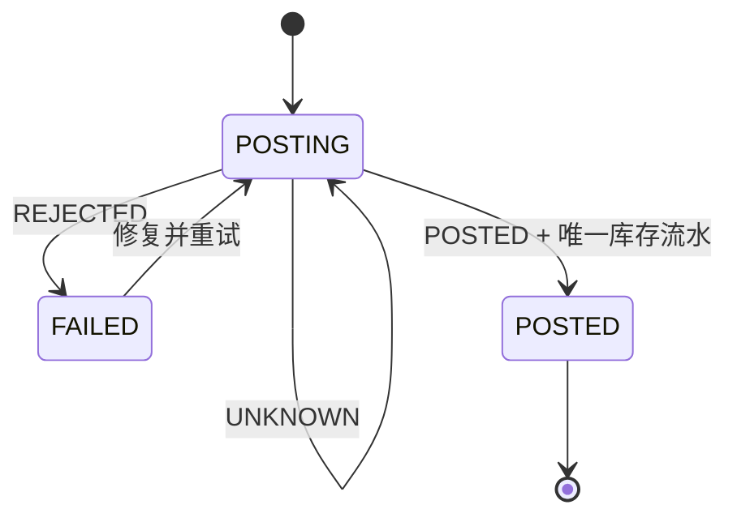

# 工业 AI 平台 API 接口文档

> 2026-10-14 权限环境补齐：角色页 snapshot 返回租户未初始化 404 时调用已有 `/api/v1/platform/tenants/self-provision` 幂等初始化，再重新读取真实授权。服务端只允许 `*` 或 `platform.role.manage`，校验 `X-Tenant-Id` 在签名租户范围内，不再始终初始化第一个租户；非管理员及跨租户返回 403。初始化不会覆盖已有授权。

> 2026-10-13 主计划权限变更：`production.mps.view` 菜单自动授予需求创建/校验/审批/接收、MRP/APS、建工单及规划任务查询，明确 action 拒绝优先。需求制单人可审批本人需求，`*` 为最高权限；不改变状态、版本、租户、审计及幂等检查。`GET /api/v1/production/readiness` 新增最终 `permissions`；已纳入平台管理的签名账号按真实岗位/角色重算，授权撤销下次请求生效。`PUT /api/v1/platform/roles/{id}/grants` 发布持久化授权并递增角色版本，支持 `If-Match` 冲突校验。普通需求支持 `sourceDescription` 和 `inventoryWarehouseId`。路由没有增加，原路由基线保持一致。

> 2026-10-13 生产修复：MRP 已按服务端 BOM 和履约库存计算缺料；齐套预留全部物料，开工消费预留并产生实际出库流水；完工请求由 Worker 写入库存后回写 POSTED，失败重试沿用原库存流水身份。返工完成生成复检，报废和结案要求异人审批。以下较早“固定无缺料/不能开工”记录已由本次修复更新；客户 MES/WMS、完整主数据维护和财务 AR/AP 尚未验收。见 [修复验收](tests/生产阻断修复验收-20261013.md)。

生产新增路径均以 `/api/v1/production` 为前缀；写操作使用 `X-Idempotency-Key`，齐套使用工单 `If-Match`。

| 方法 | 路径 | 行为与权限 |
| --- | --- | --- |
| POST | `/work-orders/{id}/kitting-check` | `production.work-order.release`；真实库存全行预留，缺料/缺事实返回 409，返回新工单版本 |
| POST | `/bom-snapshots` | `production.bom.manage`；保存产品、工艺快照关联和物料行；qtyPer 正十进制字符串，同仓库同物料唯一，更新校验已有版本 |
| POST | `/rework-orders/{id}/complete` | `production.work-order.report`；完成返工并创建 REINSPECTION；复检通过或报废后关闭原质量处置 |
| GET | `/completions` | 当前租户完工记录数组，可选 workOrderId，区分 POSTING/FAILED/POSTED |
| GET | `/work-order-closes` | 当前租户结案申请数组，支持刷新恢复异人复核 |

根检验批累计送检量不得超过报工良品与不良品之和，返工复检由返工完成动作创建。检验合格与失败量之和必须等于送检量；返工或报废覆盖全部失败量。`qualityRecoveredQty` 记录质量确认后恢复的报工不良品量，保留原报工数量和历史。完工累计量不得超过对应检验合格量及“报工良品 + qualityRecoveredQty”；失败任务占用额度，必须重试原任务。UNKNOWN 保持 POSTING，不增加库存。报工更正先撤销原量再加入替代量，已送检报工不能更正。

> 2026-10-13 五模块检查勘误：当前 Java MRP 固定无缺料，齐套未生成，开工/恢复状态机错误，下达未复用预检，完工事件存在误去重；采购入库未接生产齐套，出库/收货未生成财务 AR/AP。下文历史 Reference 闭环及强制齐套描述不能作为当前实现承诺。Java 采购和财务已有独立后端能力，见 [业务串联检查](tests/五模块业务串联检查-20261013.md)。

## 1. 文档范围

当前仓库的签名会话、生产管理 P0、销售订单、库存预留/出库，以及“销售缺货 -> MRP 缺料 -> PR/PO -> 采购入库 -> 生产完工 -> 库存重校验 -> 销售出库”的 Reference 履约链路具备可执行后端 API。权威机器可读契约为：

- OpenAPI 3.1：`server-java/docs/openapi/openapi.yaml`
- Java 路由实现：`server-java/src/main/java`
- 业务规则实现：`server-java/src/main/java` 各领域服务与仓储

本文描述已经实现的接口，并在末尾单独列出 PRD 规划但尚未实现的接口。规划接口不是可调用承诺。

## 2. 服务信息

| 项目 | 值 |
| --- | --- |
| 模块 | 本地签名会话、生产管理 P0、销售订单与库存履约、Reference 采购与物料齐套 |
| API 版本 | v1 |
| 本地地址 | `http://127.0.0.1:8081/api/v1/production` |
| 前端同源地址 | `/api/v1/production` |
| 生产部署模板端口 | `5185` |
| 内容类型 | `application/json` |
| 数量格式 | 非负或正数十进制字符串，最多 6 位小数 |

启动方式：

```bash
npm run dev:java-api
```

设置 `DATABASE_URL` 时使用 PostgreSQL；未设置时使用进程内仓储，只适合开发联调和自动化测试。

## 3. 请求上下文

### 3.1 请求头

| 请求头 | 必填条件 | 说明 |
| --- | --- | --- |
| `Authorization` | 除登录外所有请求 | `Bearer <accessToken>`；账号、权限和租户范围从签名声明读取 |
| `X-Tenant-Id` | 业务请求 | 当前选择的租户，必须属于令牌的 `tenantIds` |
| `X-Trace-Id` | 可选 | 调用方链路 ID；缺省时服务生成 |
| `X-Idempotency-Key` | 所有写操作 | 同一业务动作稳定且唯一的幂等键 |
| `If-Match` | 修改已有聚合时建议 | 查询响应的 ETag/版本，例如 `"3"` |
| `X-Production-Capability` | 可选 | `enabled`、`disabled` 或 `unavailable` |

`X-Production-Capability: disabled` 返回能力未开通错误；`unavailable` 表示平台校验依赖不可用，调用方可稍后使用同一幂等键重试。

浏览器提交的 `X-Actor-Id`、`X-Permissions`、`X-Permission-Version` 不参与正式鉴权；这些头只在自动化测试显式开启不安全兼容模式时可用。

### 3.2 本地会话

- `POST /api/v1/session/login`：非生产环境使用开发账号取得 8 小时签名访问令牌。
- `POST /api/v1/session/captcha`：获取服务端生成的一次性账号登录图形验证码，有效期 5 分钟。
- `GET /api/v1/session/me`：校验访问令牌和当前租户。
- 开发账号：`test01`、`reviewer`、`operator`、`inspector`；默认密码 `123456`。
- 生产环境禁用开发登录并强制配置 `AUTH_SECRET`。

当前会话基线没有刷新令牌、服务端撤销、密码治理、短信服务或企业 SSO/OIDC。令牌保存在浏览器 `sessionStorage`，关闭标签页后清除。

账号登录必须先请求图形验证码，提交 `captchaId` 和 `captchaCode`。验证码一次性有效；校验失败、过期或账号密码错误后，需要重新获取验证码并让用户重新输入。

### 3.3 响应头

| 响应头 | 说明 |
| --- | --- |
| `X-Trace-Id` | 本次请求的追踪 ID |
| `ETag` | 资源或命令结果的当前版本 |
| `X-Idempotent-Replay: true` | 本次响应来自既有幂等记录 |

## 4. 通用协议

### 4.1 数量

业务数量不使用 JSON number，统一使用字符串：

```json
{
  "plannedQty": "1200.000000",
  "goodQty": "25.5",
  "scrapQty": "0"
}
```

服务端使用整数缩放进行运算，避免浮点误差。要求正数的字段不能传 `"0"` 或全零小数。

### 4.2 幂等

- 首次命令成功后保存请求哈希和响应。
- 相同幂等键、相同请求体：返回原状态码和响应，并带 `X-Idempotent-Replay: true`。
- 相同幂等键、不同请求体：返回 `PRODUCTION_409_IDEMPOTENCY_CONFLICT`。
- 调用方超时后不得生成新键盲目重试，应先用原键重试或查询业务对象。

建议格式：`<client>-<command>-<business-id>-<uuid>`。

### 4.3 乐观锁

查询工单等聚合后保存 `ETag`，后续状态变更携带：

```http
If-Match: "3"
```

版本不一致返回 `PRODUCTION_409_VERSION_CONFLICT`。当前服务在未提供 `If-Match` 时仍允许提交，但正式客户端应始终携带最新版本。

### 4.4 分页

需求和工单列表支持：

| 参数 | 默认 | 限制 |
| --- | --- | --- |
| `page` | 1 | 大于等于 1 |
| `pageSize` | 20 | 1-200 |
| `status` | 无 | 精确状态筛选 |
| `factoryResourceId` | 无 | 工厂资源筛选 |
| `search` | 无 | 最多 100 字，匹配编号/名称 |

响应形态：

```json
{
  "items": [],
  "total": 0
}
```

### 4.5 错误响应

```json
{
  "error": {
    "code": "PRODUCTION_409_VERSION_CONFLICT",
    "message": "数据已被其他用户更新",
    "suggestion": "请刷新数据后重新确认本次操作",
    "retryable": false,
    "fieldErrors": [],
    "details": {
      "expectedVersion": 2,
      "currentVersion": 3
    },
    "traceId": "trace-..."
  }
}
```

主要错误码：

| 错误码 | HTTP | 含义 |
| --- | --- | --- |
| `PRODUCTION_400_INVALID_ARGUMENT` | 400 | 请求头、字段或业务输入非法 |
| `PRODUCTION_401_UNAUTHENTICATED` | 401 | 缺租户或操作者上下文 |
| `PRODUCTION_403_PERMISSION_DENIED` | 403 | 权限不足或违反双人复核 |
| `PRODUCTION_403_CAPABILITY_DISABLED` | 403 | 租户未开通生产能力 |
| `PRODUCTION_404_NOT_FOUND` | 404 | 对象不存在或不在租户数据范围 |
| `PRODUCTION_409_VERSION_CONFLICT` | 409 | 聚合版本冲突 |
| `PRODUCTION_409_IDEMPOTENCY_CONFLICT` | 409 | 幂等键冲突 |
| `PRODUCTION_409_ILLEGAL_STATE` | 409 | 当前状态不允许操作 |
| `PRODUCTION_422_QUANTITY_VIOLATION` | 422 | 数量守恒或上限校验失败 |
| `PRODUCTION_422_MASTER_DATA_MISSING` | 422 | BOM/工艺等主数据缺失 |
| `PRODUCTION_422_KITTING_BLOCKED` | 422 | 齐套条件阻断 |
| `PRODUCTION_423_RESOURCE_LOCKED` | 423 | 业务资源暂时锁定 |
| `PRODUCTION_424_DEPENDENCY_FAILED` | 424 | 外部依赖调用失败 |
| `PRODUCTION_429_TASK_RUNNING` | 429 | 同类任务正在运行 |
| `PRODUCTION_503_PLATFORM_UNAVAILABLE` | 503 | 平台能力校验不可用 |

具体 HTTP 状态以服务端 `ProductionError` 定义为准。未捕获异常统一返回 HTTP 500，响应错误码当前复用 `PRODUCTION_424_DEPENDENCY_FAILED`，应通过 Trace ID 排查。

## 5. 权限码

| 业务动作 | 权限码 |
| --- | --- |
| 创建/评审/审批/接收需求 | `production.demand.create/review/approve/claim` |
| 创建工单 | `production.work-order.create` |
| 下达/开工/暂停/恢复 | `production.work-order.release/start/pause/resume` |
| 报工/更正 | `production.work-order.report/report.correct` |
| 质检/质量处置 | `production.quality.inspect/disposition` |
| 完工提交/重试 | `production.completion.post/retry` |
| 库存回调 | `production.inventory.callback` |
| 库存可用量投影同步 | `production.inventory.sync` |
| 结案提交/复核 | `production.close.submit/approve` |
| MRP/APS 任务 | `production.mrp.run`、`production.aps.run` |

列表和部分读取接口当前只校验请求身份与租户，不单独调用权限函数。生产部署应由网关限制路由，并逐步补齐服务端读取权限和数据范围校验。

## 6. 接口目录

### 6.1 就绪与驾驶舱

| 方法 | 路径 | 说明 | 状态码 |
| --- | --- | --- | --- |
| GET | `/readiness` | 服务、仓储、Outbox 和平台能力就绪信息 | 200 |
| GET | `/dashboard/kpis` | 活跃/逾期工单、完成率、待处理需求、开放 FQC 和风险 | 200 |

### 6.2 生产需求

| 方法 | 路径 | 说明 | 权限/控制 |
| --- | --- | --- | --- |
| GET | `/demands` | 分页查询需求 | 租户上下文 |
| POST | `/demands` | 创建 `RECEIVED` 需求 | `demand.create`、幂等 |
| POST | `/demands/{id}/validate` | 校验产品、工厂、BOM、工艺 | `demand.review`、幂等、ETag |
| POST | `/demands/{id}/approve` | 审批需求，包括本人创建需求 | `demand.approve`（主计划菜单隐式授予）或 `*`、幂等、ETag |
| POST | `/demands/{id}/claim` | 计划员/MPS 负责人接收已审批需求 | `demand.claim`、幂等、ETag |

需求状态主线：

```text
RECEIVED -> VALIDATING -> PENDING_REVIEW -> APPROVED(待接收)
                         \\-> BLOCKED -> VALIDATING

APPROVED(待接收) + production.demand.claim -> APPROVED(待展算)
APPROVED(待展算) + MRP SUCCEEDED 且结果覆盖需求 -> PLANNED(已展算)
```

审批通过时记录 `approvedBy/approvedAt`，写入 `handlerRole=PRODUCTION_PLANNER` 的接收池并发布 `production.demand.approved.v1`；`claim` 记录 `handlerId/acceptedAt`。`production.mrp.run` 必须校验需求已接收，任务成功且 MPS 行覆盖目标需求后才写入 `PLANNED` 和 `mrpTaskId`。

### 6.3 生产工单与报工

| 方法 | 路径 | 说明 | 权限/控制 |
| --- | --- | --- | --- |
| GET | `/work-orders` | 分页查询工单 | 租户上下文 |
| POST | `/work-orders` | 创建工单和需求 pegging | `work-order.create`、幂等 |
| GET | `/work-orders/{id}` | 工单详情并返回 ETag | 租户上下文 |
| POST | `/work-orders/{id}/release-impact` | 查看下达阻断项，不改状态 | 读取 |
| POST | `/work-orders/{id}/release` | 下达工单 | `release`、幂等、ETag |
| POST | `/work-orders/{id}/start` | 开工 | `start`、幂等、ETag |
| POST | `/work-orders/{id}/pause` | 暂停，原因必填 | `pause`、幂等、ETag |
| POST | `/work-orders/{id}/resume` | 恢复 | `resume`、幂等、ETag |
| POST | `/work-orders/{id}/reports` | 提交报工 | `report`、幂等、ETag |
| POST | `/work-reports/{id}/corrections` | 保留原报工并生成更正 | `report.correct`、幂等 |

下达前必须同时满足：BOM 快照、工艺快照、已发布 APS 候选和 `READY` 齐套状态。

报工累计 `合格 + 不良 + 报废` 不得超过累计投入和工单计划上限。

### 6.4 FQC 与质量处置

| 方法 | 路径 | 说明 | 权限/控制 |
| --- | --- | --- | --- |
| GET | `/inspections?workOrderId=` | 查询 FQC | 租户上下文 |
| POST | `/inspections` | 创建 FQC/返工复检 | `quality.inspect`、幂等 |
| POST | `/inspections/{id}/result` | 提交检验结果 | `quality.inspect`、幂等 |
| POST | `/inspections/{id}/rework` | 创建返工事实 | `quality.disposition`、幂等 |
| POST | `/inspections/{id}/scrap` | 审批报废 | `quality.disposition`、幂等、检验处置分离 |

有失败数量的 FQC 进入 `DISPOSITION_PENDING`，只能返工复检或审批报废，不能直接完工。

### 6.5 完工、库存与销售分配

| 方法 | 路径 | 说明 | 权限/控制 |
| --- | --- | --- | --- |
| POST | `/work-orders/{id}/completion-allocation-preview` | 预览确定性需求分配 | 读取 |
| POST | `/work-orders/{id}/completions` | 创建 `POSTING` 完工和库存任务 | `completion.post`、幂等 |
| GET | `/completions/{id}` | 查询完工、库存结果和分配 | 租户上下文 |
| POST | `/completions/{id}/retry` | 修复明确拒绝并重试 | `completion.retry`、幂等 |
| POST | `/internal/completions/{id}/inventory-result` | WMS 结果回调 | `inventory.callback`、幂等 |

完工状态：



`POSTED` 时服务更新完工事实、工单 `postedQty`、确定性销售分配、任务状态、状态历史、审计和 Outbox。Reference WMS 联调实现消费完工事件后，还会幂等登记成品入库流水、推进可履约库存事实版本，并将同一生产需求关联的销售出库任务置为 `RECHECKING`；客户 WMS 上线时仍以其权威库存事件为准。

### 6.6 工单结案

| 方法 | 路径 | 说明 | 权限/控制 |
| --- | --- | --- | --- |
| POST | `/work-orders/{id}/close-check` | 检查 FQC、投退料、完工任务和入库事实 | 读取 |
| POST | `/work-orders/{id}/close-submit` | 提交结案复核 | `close.submit`、幂等、ETag |
| POST | `/work-order-closes/{id}/approve` | 不同账号复核并关闭 | `close.approve`、幂等、双人复核 |

### 6.7 MRP、APS 与任务

| 方法 | 路径 | 说明 | 当前限制 |
| --- | --- | --- | --- |
| POST | `/mrp-runs` | 对 `demandIds` 指定的已审批需求执行 `REFERENCE_MPS_MRP_V2`，按 Reference BOM 与物料库存固化 MPS 行和缺料结果 | 仅覆盖参考产品/物料，不是客户正式优化器 |
| POST | `/schedule-runs` | 对已计划且物料已齐套的需求执行 Reference APS，返回已发布 `scheduleCandidates` | 有缺料时返回 422；工单必须引用覆盖需求的成功候选 |
| GET | `/tasks/{id}` | 查询任务状态、进度、输入和结果 | 当前无任务列表；Reference 任务在请求事务内完成为 `SUCCEEDED` |

MRP 输入至少包含一个唯一 `demandId`。成功后需求从 `APPROVED` 进入 `PLANNED`。Reference 产品 `FG001` 按 `RM201 x 2` 计算需求，并读取 `WH-RM-01` 的权威物料可用量；缺料时结果返回 `canProceedToAps=false`，APS 和工单创建均由服务端阻断。采购入库同步新版物料库存事实后才可继续 APS；带 `demandLinks` 的工单如果绕过成功 APS 候选或伪造 `kittingStatus=READY`，服务端返回 422。该结果用于参考闭环和自动化验收，不代表复杂 BOM、替代料、在途/安全库存策略或客户求解器已经联调。

### 6.8 Reference 采购与物料入库

采购接口基地址为 `/api/v1/procurement`：

| 方法 | 路径 | 说明 | 权限/控制 |
| --- | --- | --- | --- |
| POST | `/purchase-requests` | 从成功 MRP 任务的指定缺料行创建 PR | `procurement.request.create`、幂等；校验 MRP/需求/物料稳定 ID |
| GET | `/purchase-requests` | 查询当前租户 PR | `procurement.request.read` |
| POST | `/purchase-requests/{id}/approve` | 审批 PR 并在同一事务生成 PO | `procurement.request.approve`、幂等、ETag、制单审批分离 |
| GET | `/purchase-orders` | 查询当前租户 PO | `procurement.order.read` |
| POST | `/purchase-orders/{id}/receipts` | 全量收货并过账采购入库 | `procurement.receipt.post`、幂等、ETag、外部流水唯一 |
| GET | `/purchase-receipts` | 查询采购入库单 | `procurement.receipt.read` |

采购收货在同一事务保存正式收货单、`PURCHASE_RECEIPT_INBOUND` 不可变库存流水、新版物料可用量、审计和 Outbox，并同步生产库存投影。当前是闭环所需的 Reference 基线：只支持一条缺料生成一张 PR/PO、指定参考供应商和 PO 全量收货；供应商主数据、询比价、合同、来料质检、分批/退货、价格税务和 ERP/SRM 对接仍未实现。

### 6.9 销售订单确认与去发货

2026-10-13 单位编码修复：同产品的单件计数单位 `PCS`、`件`、`台`、`个` 按 1:1 兼容。快速开单和历史订单转正式订单统一发送 `PCS`，不会把 `套` 或重量单位覆盖成 `PCS`；已有正式订单/任务保留原单位和数量，无需重建。预留、实际扣减、完工入库和采购入库采用同一兼容规则，库存事实和新库存流水使用 `PCS`。库存事件不允许直接把现有计量单位切换为不兼容单位；陈旧事件仍按原版本规则忽略。不兼容预留返回 422，错误详情包含 `productId`、`orderUom`、`inventoryUom`。前端阻断不兼容单位的发货并显示需核对换算，不将此问题当作生产缺货。未实现通用单位换算或包装系数；仓库详情仍展示库存事实单位。

2026-10-13 快速开单商务字段（OpenAPI 1.14.0）：`POST /api/v1/sales/sales-orders` 和既有 PATCH 支持可选 `orderDate`、`validUntil`、`remark`（最多 1000 字），产品行支持 `productName`、`specification`（最多 200 字）。日期必须有效，合并修改后的有效期不得早于开单日期；有效期独立于最终承诺交期。字段随订单、审计和幂等结果同事务持久化，列表及详情直接返回，旧订单不要求新增字段。前端 5175 代理至 Java 8081，清除销售缓存后仍可恢复全部开单内容；创建返回待确认、未申请发货，不生成仓库任务。

| 方法 | 路径 | 说明 | 状态约束 |
| --- | --- | --- | --- |
| POST | `/api/v1/sales/sales-orders/{id}/confirm` | 固化销售发货内容和交期，订单从待发货进入已确认 | 已完成复核/审批；不创建仓库任务 |
| POST | `/api/v1/sales/sales-orders/{id}/shipment-requests` | 已确认订单去发货，创建或恢复仓库任务 | 首次仅 `CONFIRMED`；剩余发货允许 `PARTIALLY_SHIPPED` |
| POST | `/api/v1/inventory/shipment-tasks/{id}/check-and-reserve` | 按最新仓库事实预留，创建或补足原出库单 | 来源版本、库存版本及未消费预留校验；保持原出库行 ID |
| POST | `/api/v1/inventory/outbounds/{id}/post` | 部分或全量出库，同事务回写销售 | 正数量、唯一行、单位、预留上限、禁止分批约束；返回权威 `task` 和 `order` |

确认接口要求幂等键和 `If-Match`，成功写入状态历史、审计和 `sales.order.confirmed.v1` Outbox。审批默认职责分离；制单人显式持有 `sales.order.review.self-approve` 后可审批本人订单，持有 `*` 的超管同样通过。前端不得在“确认订单”时调用发货申请；“去发货”也不得使用本地展示单号代替正式聚合 UUID。

2026-10-13 Java 实现验收：发货申请量为订单行剩余量减去活动申请占用量；已有活动申请可恢复，不再次提交空申请。库存校验合并本任务未消费预留与仓库新可用量，同产品多行只分配一次自由库存。部分发货后补货复用原出库单与行 ID，继续累加已发量，销售保持 `PARTIALLY_SHIPPED`，全量完成后进入 `SHIPPED` 并清零申请占用/未消费预留。

出库、不可变库存流水、库存事实、预留消费、仓库任务、发货申请、销售累计量、审计/历史、Outbox 和幂等结果在同一租户 JDBC 事务内保存。PostgreSQL 事务锁串行化同租户写入，命令执行前重读数据库事实，失败后回滚数据库并恢复缓存。销售、任务、出库及库存查询重新读取正式事实。出库响应的 `task`、`order` 为前端回写来源，不使用本地销售桥接替代正式结果。

`GET /api/v1/inventory/availability`（权限 `inventory.availability.read`）的 `warehouseId`、`productIds` 均可省略：无筛选返回当前租户全部库存事实，单仓筛选返回该仓全部事实，产品筛选最多 100 项。仓库编码和主数据 ID 解析到同一库存事实，响应统一返回服务端仓库 ID；查询、预留、出库扣减、完工入库共用该解析。旧编码事实在下一次有效更新时同事务迁移到 ID 键，不改变数量、不复制预置库存，版本陈旧的事件不覆盖。若编码及 ID 同时存在同产品记录则返回 `409 INVENTORY_409_WAREHOUSE_FACT_CONFLICT`，阻断查询和扣减并要求核对来源。

仓库详情和现存量显示 `qualifiedOnHandQty`、`allocatedReservedQty + frozenQty`、`fulfillableQty`，安全库存展示 `safetyStockQty`，在途不计入可用量。发货可用量还包含本任务未消费的预留，避免将已经归属本单的预留误判为缺货。缺事实的默认分配产品显示“未查询到库存记录”和 `-`，加载失败可重试且不回退种子数量。发货/主数据变更及窗口获得焦点后重读库存。接口路径未增加，`server-java/java-routes.json` 原路由基线保持一致并执行路由校验。

迁移 `028_inventory_fact_components.sql` 将历史数据库 `onHandQty/reservedQty` 补齐为现存/预留组成，缺省冻结和在途为 0，按现存减预留、冻结、安全库存重算可履约量，并推进事实版本。已有新版组成字段优先，未使用前端库存数量；历史“可用量未扣安全库存”的记录可能因此减少可履约量。

客户端保存出库请求键、时间、版本和数量包；网络中断后复用原请求重试。未知结果不提示发货成功。`FulfillmentOutboxWorker` 每 2 秒重试仓库移交；创建任务、Inbox、审计/历史和标记已消费原子保存，不支持的事件继续 `PENDING`，并不代表外部 MQ 已发布。可通过 `FULFILLMENT_WORKER_ENABLED` 与 `FULFILLMENT_WORKER_INTERVAL_MS` 配置。已验收真实 PostgreSQL/RLS、并发抢库存、回滚/重试及两种桌面尺寸真实浏览器，见 [销售到仓库出库开发验收](tests/销售到仓库出库开发验收-20261013.md)。客户 WMS 与生产/采购/财务完整闭环不属于该验收结论。

订单创建和编辑支持十进制字符串 `discountRate`（0 到 100，创建默认 100）、`discountAmount`（非负，创建默认 0）及可选 `expectedTotalAmount`。服务端保存 `originalAmount`、折扣率、优惠金额和 `totalAmount`，按 `max(含税原价合计 × 折扣率 / 100 - 优惠金额, 0)` 计算，最终四舍五入到两位小数；预期金额不一致返回 `422 FULFILLMENT_422_PRICE_MISMATCH`，不保存变更。编辑未传优惠或产品明细时保留原值。审批、确认和发货申请沿用持久化订单金额，同一订单在待发货和已确认列表及详情中展示相同总额。历史本地/报价转单在建立正式订单时完整传入优惠与预期金额，不能只传单价和数量。

### 6.10 销售订单与生产需求接入

| 方法 | 路径 | 说明 | 权限/控制 |
| --- | --- | --- | --- |
| POST | `/internal/inventory-availability-events` | 通过 Inbox 去重消费库存可用量事件，更新版本化库存事实投影 | `production.inventory.sync`；仅限可信库存 Adapter/Worker |
| POST | `/sales-order-intakes` | 仓库执行销售出库发现缺货后，重新校验库存事实并事务化创建生产需求和来源关系 | `production.demand.create`、幂等；调用人需具备仓库数据范围和生产申请权限 |
| GET | `/sales-order-intakes/{salesOrderId}` | 按订单行和来源版本恢复接入记录 | 租户上下文 |

`POST /sales-order-intakes` 是保留的兼容接入路径。首期正式链路使用 `/api/v1/sales/sales-orders/{id}/shipment-requests` 和 `/api/v1/inventory/shipment-tasks/{id}` 系列接口校验审批、订单/行版本、仓库、申请量、库存事实、生产需求及发货状态。兼容接口不接受调用方提供的可用库存或缺口；服务端始终按 `productId + inventoryWarehouseId` 重新读取库存事实投影并计算：

```text
shortageQty = max(orderedQty - availableQty, 0)
```

现有字段名 `orderedQty` 为兼容既有生产接入实现，按最新 PRD 应解释为“本次发货申请的订单行数量”，不能在部分发货场景直接使用订单生命周期总订购量。正式销售/库存接口评审时应拆分订单数量、累计已发数量、本次申请数量和剩余数量，并通过来源行版本防止重复申请。

- 缺货：创建 `SalesOrderIntake`、`Demand`、`DemandSource`、状态历史、审计、Outbox 和幂等结果。
- 库存充足：创建 `SalesOrderIntake`，决策为 `FULFILL_FROM_STOCK`，不创建生产需求。
- 库存事实缺失、过期或计量单位不一致：返回 424，不保存接入、需求、Outbox 或幂等成功记录；调用方使用同一幂等键重试。
- 同一库存 `eventId` 重复到达：Inbox 返回重复结果；较旧 `factVersion` 不覆盖新事实。

### 6.11 发货任务缺口转生产需求

| 方法 | 路径 | 说明 | 权限/控制 |
| --- | --- | --- | --- |
| POST | `/api/v1/inventory/shipment-tasks/{id}/production-requests` | 对已完成权威校验且存在缺口的发货任务创建或恢复生产需求 | `inventory.production-request.create`、幂等、`If-Match` |

请求只需要标识缺口行；服务端以发货任务行重算生产数量，并按优先级兜底工厂和交期：

```text
productionQty = max(shipmentRequestLine.requestedQty - shipmentRequestLine.postedQty - selectedWarehouseAvailability, 0)
factoryResourceId = request.line > shipmentTask > salesOrder
dueDate = shipmentTaskLine.promisedDate > request.line > salesOrder.requestedDeliveryDate
sourceRevision = request.line > shipmentTaskLine.sourceLineRevision > task.orderRevision > 1
```

调用方传来的 `sourceRevision`、`factoryResourceId` 和 `dueDate` 都是可选兜底提示；不能把缺口数量改大。服务端会重新校验 `replenishmentStatus=REQUIRED`、任务版本和租户来源关系。创建成功返回 `201`，需求关联已存在且没有新增需求时返回 `200`。响应中的 `restored` / `recovered` 表示恢复既有需求；`demands`、`links` 和更新后的发货任务包含需求编号、订单/行、仓库、工厂、交期、来源版本和库存事实版本。

同一发货任务和缺口行重复提交必须返回原需求，不重复写入生产需求、任务关联或 `production.demand.created.v1` Outbox。前端创建成功后使用 `focusMps=<demandCode>` 定位生产主计划草稿；库存满足时必须先提示“不需要创建生产需求”，不得创建零数量需求。

## 7. 典型调用

先在非生产环境取得访问令牌，并从响应中读取 `accessToken` 赋给 `ACCESS_TOKEN`：

```bash
# 1. 先调用验证码接口，向前端返回 captchaId 和 SVG 图片。
curl -X POST 'http://127.0.0.1:5185/api/v1/session/captcha'

# 2. 登录时提交用户识别出的图形验证码。
curl -X POST 'http://127.0.0.1:5185/api/v1/session/login' \
  -H 'Content-Type: application/json' \
  -d '{"account":"test01","password":"123456","captchaId":"<captchaId>","captchaCode":"<image-code>"}'
```

### 7.1 创建生产需求

```bash
curl -X POST 'http://127.0.0.1:5185/api/v1/production/demands' \
  -H 'Content-Type: application/json' \
  -H "Authorization: Bearer $ACCESS_TOKEN" \
  -H 'X-Tenant-Id: TENANT-SHWS' \
  -H 'X-Idempotency-Key: web-create-demand-SO-001-01' \
  -d '{
    "sourceType": "SALES_ORDER",
    "sourceSystem": "SALES",
    "sourceId": "SO-001",
    "productId": "FG001",
    "productName": "工业控制器",
    "qty": "500",
    "uom": "PCS",
    "dueDate": "2026-08-15",
    "factoryResourceId": "FAC-SH-01"
  }'
```

### 7.2 创建和推进工单

1. `POST /work-orders` 创建工单。
2. `POST /work-orders/{id}/release-impact` 获取阻断项。
3. 修复 BOM/工艺、APS 和齐套数据。
4. 读取详情获得 ETag。
5. 携带 ETag 调用 `/release`。
6. 依次调用 `/start`、`/reports`，需要时 `/pause`、`/resume`。

### 7.3 库存结果回调

成功：

```json
{
  "result": "POSTED",
  "externalTransactionId": "WMS-IN-20260725-0001"
}
```

明确拒绝：

```json
{
  "result": "REJECTED",
  "failureCode": "BIN_DISABLED",
  "failureMessage": "目标库位已停用"
}
```

结果未知：

```json
{
  "result": "UNKNOWN"
}
```

内部回调接口不能暴露给浏览器，必须由可信 WMS Adapter/Worker 调用。

### 7.4 仓库出库缺货发起生产申请

库存服务先发布可用量事实：

```bash
curl -X POST 'http://127.0.0.1:5185/api/v1/production/internal/inventory-availability-events' \
  -H 'Content-Type: application/json' \
  -H "Authorization: Bearer $ACCESS_TOKEN" \
  -H 'X-Tenant-Id: TENANT-SHWS' \
  -d '{
    "eventId": "inventory-FG001-v42",
    "productId": "FG001",
    "inventoryWarehouseId": "WH-FG-01",
    "availableQty": "8",
    "uom": "PCS",
    "factVersion": 42,
    "sourceSystem": "WMS",
    "asOf": "2026-07-25T10:00:00.000Z"
  }'
```

销售订单完成复核/审批并确认发货内容进入已确认后，由销售执行去发货并移交仓库；仓库在库存校验发现缺货时提交本次申请的订单行数量，服务端仍以库存事实为准：

```bash
curl -X POST 'http://127.0.0.1:5185/api/v1/production/sales-order-intakes' \
  -H 'Content-Type: application/json' \
  -H "Authorization: Bearer $ACCESS_TOKEN" \
  -H 'X-Tenant-Id: TENANT-SHWS' \
  -H 'X-Idempotency-Key: sales-intake:TENANT-SHWS:SO-20260508-001:1:1' \
  -d '{
    "salesOrderId": "SO-20260508-001",
    "sourceLineId": "1",
    "sourceRevision": 1,
    "productId": "FG001",
    "productName": "工业控制器顶配版",
    "orderedQty": "17",
    "uom": "PCS",
    "dueDate": "2026-08-01",
    "factoryResourceId": "FAC-SH-01",
    "inventoryWarehouseId": "WH-FG-01"
  }'
```

库存可用量为 `8` 时响应中的 `shortageQty` 为 `9`，并返回真实生产需求 UUID 和编号。

## 8. OpenAPI 维护规则

- 2026-10-13 销售审批新增 `sales.order.review.self-approve` 覆盖权限：默认制单人不得自审；显式授权或 `*` 超管可审批本人订单。平台权限目录同步补充该权限。
- 2026-10-13 库存产品/物料主数据新增 `unitPrice` 参考价格字段；JSON 主数据、前端 DTO、迁移 026/027 和 InventoryMaster OpenAPI 契约同步支持，更新接口校验非负 decimal，OpenAPI 版本升级为 1.10.0。
- 2026-10-11 发货仓库弹窗改为默认未选仓；`check-and-reserve` 补充可选 `warehouseId` 与期望库存事实版本契约。发货任务生产需求改为服务端重算缺口，工厂、交期和来源版本可由服务端兜底，响应补充 `restored` / `recovered`，OpenAPI 版本升级为 1.8.0。
- 2026-10-11 生产需求审批后新增计划员接收动作；`production.demand.claim`、审批路由字段和 MRP 接收校验进入契约，OpenAPI 版本升级为 1.9.0。
- 2026-07-26 按最新销售 PRD 修订 `/sales-order-intakes` 的业务触发说明；路径、Schema 和实现行为不变，因此 API 版本保持 1.3.0。
- 2026-07-26 实现销售—库存—生产—发货首期履约接口，OpenAPI 契约通过外部 Path Item 引用纳入 19 条销售/库存路径，版本升级为 1.4.0；Reference Adapter 只用于开发和自动化验证。
- 2026-07-26 对齐库存可用量和生产完工内部接口的统一事件信封；生产 `POSTED` 完工在本地事务写入 `production.completion.posted.v1`，参考转发 Worker 通过库存 Inbox 幂等记录入库流水。契约版本不变，本次修正实现偏差。
- 2026-07-26 增加生产需求来源追溯字段、Reference 完工库存事实推进和关联任务重校验；Reference MPS/MRP/APS 任务返回持久化成功结果，带需求工单强制校验 APS 候选，OpenAPI 版本升级为 1.5.0。Reference 能力不代表客户正式优化器或 WMS 已联调。
- 2026-07-27 增加 MRP V2 实际缺料、PR 制单审批分离、PO、采购入库、物料库存事实同步和服务端齐套阻断，OpenAPI 版本升级为 1.6.0；该 Reference 闭环不代表完整采购域或 ERP/SRM/WMS 已联调。
- 2026-07-27 增加销售订单确认接口，状态顺序调整为“待发货确认内容 -> 已确认去发货 -> 仓库任务”，OpenAPI 版本升级为 1.7.0；确认阶段不再调用出库接口。
- 2026-07-26 新增签名会话接口，生产 API 改为 Bearer Token 和令牌内租户/权限声明，OpenAPI 版本升级为 1.3.0。
- 2026-07-25 新增库存事实 Inbox 投影、销售订单接入和生产需求事务接口，OpenAPI 版本升级为 1.2.0。
- 路由、请求/响应契约、状态码或权限变化必须同步更新 `server-java/docs/openapi/openapi.yaml` 和 Java 路由基线。
- OpenAPI 的 `servers` 基地址已经包含 `/api/v1/production`，各 path 不再重复前缀。
- 新增写接口必须声明 `X-Idempotency-Key`；修改聚合的接口必须声明 `If-Match`。
- 数量字段引用 `Decimal` 或 `PositiveDecimal`，不得使用 `type: number`。
- 内部接口必须使用 `/internal` 路径并在网关层限制来源。
- API 测试应覆盖正常响应、Zod 字段错误、权限、幂等和版本冲突。

## 9. PRD 规划与首期实现状态

首期销售/库存目标路径、命令 DTO、错误语义和事件载荷冻结在 `server-java/docs/openapi/openapi-sales-inventory-draft.yaml` `0.2.0-development-baseline`。对应的正式迁移、领域服务、Reference WMS Adapter、履约 Worker、生产完工转发 Worker、销售确认命令及 Reference PR/PO/采购入库链路已迁移到 Java 后端，并由 `server-java/docs/openapi/openapi.yaml` 纳入已实现契约。该结论只表示开发与参考集成基线可执行，不能作为客户真实 ERP/SRM/WMS、OIDC、KMS、消息代理或 UAT 已通过的证据。

| 规划域 | 目标接口能力 | 依赖/说明 |
| --- | --- | --- |
| 企业统一身份 | OIDC/SSO、刷新与撤销、密码/短信治理、菜单/按钮/数据权限中心 | 已有本地签名会话基线；生产身份提供方和统一权限中心仍待建设 |
| 平台管理 | 租户、组织、岗位、资源、员工、账号、角色、授权、审批、参数、审计 | 当前只有前端 `localStorage` 原型 |
| 销售 | 首期：最小订单、审批、发货申请、部分/剩余发货和履约追踪；后续：客户/报价全面生产化、签收和结算投影 | `/api/v1/sales` 首期后端已实现；客户、报价和结算仍为后续范围 |
| 库存 | 首期：可用量组成与口径版本、原子预留、销售出库、流水、生产申请和完工重校验；扩展：Reference 采购入库物料事实 | `/api/v1/inventory` 后端和 Reference Adapter 已实现；调拨、盘点及客户真实 WMS 联调仍待完成 |
| 采购 | Reference PR、审批、PO 和全量到货已实现；供应商经营、寻源、价格、分批/退货为后续范围 | `/api/v1/procurement` 已形成闭环基线；完整能力仍需 ERP/SRM 接口 |
| 财务协同 | AR/AP、收付款、发票、凭证和冲销状态 | 不包含真实银行支付 |
| 消息 | 收件箱、待办、已读、路由、模板、通道和频控 | 需 Outbox Worker 和消息通道 |
| AI | 对话、引用、建议动作、审批、NL2SQL、归因和沙盘 | 需模型网关、语义层和权限过滤 |
| 导入导出 | 模板、上传、预校验、错误文件、异步导出和下载 | 需对象存储、任务和下载鉴权 |
| 外部同步 | ERP/MES/WMS/财务增量同步、回调和补偿 | 需字段字典、版本和联调环境 |

规划接口落地时应按业务域建立独立 OpenAPI tag 和模块代码，不能继续塞入生产 API 前缀。
