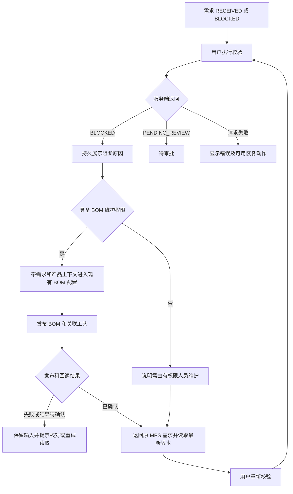

# ISSUE-019 原因分析与前端修改方案

> 日期：2026-10-17
>
> 关联问题：[ISSUE-024（原 ISSUE-019）](../issues/ISSUE-024-生产BOM阻断与Toast过短.md)。索引已统一编号，本方案保留原文件名以兼容已有引用。
>
> 状态：前端方案已实施，本地真实 UI/API/数据库闭环通过；原部署需求的数据根因待核实。
>
> 本轮范围：前端、PRD、技术文档、既有接口契约和测试；未修改后端代码，未操作原部署环境业务数据。设备下拉问题不在本轮范围内。验收记录见[实施报告](2026-10-17-issue-019-implementation-report.md)。

## 1. 结论与原问题描述修正

三个现象需要分别处理，不能统一归因为前端没有对接接口。

| 现象 | 已核实的原因 | 前端处理方向 |
|---|---|---|
| 校验提示“缺少服务端生效 BOM” | 服务端按当前租户和需求的 `productId` 查询 BOM，未命中则返回 `BLOCKED`；属于正式业务守卫 | 展示持久阻断原因，补齐跳转维护 BOM、返回原需求和重新校验的操作闭环；不能在前端强制通过 |
| “暂缓审批尚未开放” | 两处暂缓入口最终调用的 `handleHoldDemand` 仅弹 Toast，没有提交命令 | 暂缓入口禁用并说明原因；真正实现暂缓前，需先定义业务状态和正式接口 |
| Toast 很快消失 | 生产模块固定 3000ms，且新提示没有清理旧计时器；旧计时器可能提前关闭新提示 | 默认改为 5000ms，同时修复替换、手动关闭、卸载和身份切换时的计时器生命周期 |

原 ISSUE 以下描述不能直接作为修复依据：

1. “当前数据库中该产品没有 BOM”尚未经部署数据库验证。本轮只证实当前代码的查询条件和阻断逻辑，不能据此确认具体环境的记录情况。
2. 当前已有“发布生效 BOM”界面，发布会同时保存 BOM 和关联工艺快照，服务端直接返回 `EFFECTIVE`。不存在必须“先保存草稿，再单独发布”的现行接口流程。
3. 当前仓库未发现生产需求的 `hold/resume` 接口与对应状态规则；不能把猜测的 `/demands/{id}/hold` 当作已冻结契约。工单暂停/恢复不等于需求暂缓。
4. ISSUE 列举的 Toast 模块归属有误：当前 `App.tsx:4712` 属于生产管理，`:6478` 属于库存管理，`:9489` 属于消息管理。行号会随代码变化，应按组件和函数定位。
5. BOM 完成发布后仍须重新校验。只有服务端返回 `PENDING_REVIEW` 才能认为本次需求校验通过；不能承诺补齐一项后所有校验必然通过。

## 2. 代码证据与边界

以下路径均相对于仓库根目录，行号为分析时位置。

| 位置 | 当前行为 | 判断 |
|---|---|---|
| `backend/src/main/java/com/wanshen/platform/production/ProductionService.java:285`，`validateDemand` | 校验权限、需求状态、版本；查 BOM 与内嵌工艺，返回更新后的需求和 `blockReasons` | 后端守卫已有，本轮不修改 |
| `backend/src/main/java/com/wanshen/platform/production/ProductionStore.java`，`bom` | 以 `tenantId + productId` 定位 BOM | 发布与校验必须使用同一租户及稳定产品 ID |
| `backend/src/main/java/com/wanshen/platform/production/ProductionService.java:1432`，`listBoms/saveBom` | 有正式查询、发布、版本控制、权限控制和审计；物料与工序必填 | 基础 BOM 修复不依赖新增发布接口 |
| `frontend/src/App.tsx:4525`，`Prod_BomView` | 实际渲染 `FormalBomPanel` | 修改应落到现有正式组件，避免另建内存 BOM |
| `frontend/src/features/production/components/FormalBomPanel.tsx` | 发布后只更新自身列表，无目标需求上下文或发布回调 | 缺少发布后返回原需求的联动 |
| 同上，产品字段 | 标签写“产品编码”，输入值直接提交为 `productId`；物料、仓库、工作中心也依靠裸文本输入 | 存在业务编码与稳定 ID 混淆风险，但尚不能认定是部署问题的唯一根因 |
| `frontend/src/App.tsx:4026`，`Prod_MpsView` | 已在 `BLOCKED` 行展示 `blockReasons`，但缺维护导航，原因区域继承表格不换行规则 | 不能描述为“完全没有持久提示”；应改善可读性和后续动作 |
| `frontend/src/App.tsx:4838`，`handleValidateDemand` | 正确使用响应更新需求，但缺行级请求锁及异步身份隔离，异常主要靠 Toast | 需补重复提交、旧响应、错误详情和冲突恢复处理 |
| `frontend/src/api/production/operations.ts:96`，`validateDemand` | 请求写死四个 `productActive/factoryActive/bomEffective/routingEffective: true` | 前端不应声明未经权威查询证实的主数据事实；去除此处声明不会自动消除真实 BOM 阻断 |
| `frontend/src/App.tsx:5073`，`handleHoldDemand` | 只弹提示；需求池和 MPS 均有调用入口 | 确认为占位操作，与缺 BOM 校验不是同一命令 |
| `frontend/src/App.tsx:4710`，生产 `showToast` | 每次新增未清理的 3000ms 计时器 | 确认为前端时序缺陷 |
| `frontend/src/api/client.ts`，`ApiError` | 已提供 `code/suggestion/retryable/traceId/fieldErrors/details` | 复用现有错误模型，不另建一套请求层 |

PRD 依据为 `docs/01 需求规格说明书-工业AI平台-V2.1.0-PRD.md` 的 7.4.3～7.4.11、7.4.9.1，以及正式 BOM 默认空值和发布要求。需求状态包含 `RECEIVED/BLOCKED/PENDING_REVIEW/APPROVED/PLANNED/FULFILLED` 等流转，未冻结需求暂缓与恢复规则。

## 3. 先核查具体需求的数据原因

针对 ISSUE 中的 `DM-MVCBRHE4D10A`，实施前按以下顺序只读核查：

1. 在发生问题的同一环境和租户读取需求，取得真实 `id`、`productId`、`version`、`status` 和 `blockReasons`。显示编号不能替代需求 ID 或产品 ID。
2. 使用相同环境、租户和授权调用 BOM 列表，按该 `productId` 精确匹配，不按名称或显示编码匹配。
3. 有记录时核对 BOM 状态、版本、`routingSnapshotId` 与内嵌工艺 `id/productId/operations`，以及之前发布请求是否真正成功。
4. API 与页面不一致时，进一步核对部署版本、请求目标地址、租户及数据范围。获得数据库只读访问后，再按当前持久化实现核对 `bomSnapshot` 集合中的租户、产品及版本；不臆造独立关系表。
5. 输出核查结果：真实缺失、ID 不一致、环境/租户不一致、发布失败、工艺缺失，或其他待查原因。不通过清空数据库、补示例 BOM 或修改前端状态掩盖问题。

实施时已核对本地隔离测试租户中的 API 和 PostgreSQL。原需求不在该租户可见范围内，无法据此判断原部署数据库，具体需求的数据根因仍为待核实项；独立测试产品和需求的完整闭环已验证。

## 4. 前端目标流程

发布 BOM 只代表主数据已保存，不自动审批需求、不自动执行 MRP，也不在前端写入“校验通过”。需求未通过校验、审批和计划员接收时，继续保留后续操作守卫。

## 5. 前端修改设计

### 5.1 阻断原因与维护导航

修改 `App.tsx` 中的 `LegacyProductionManagement`、`Prod_MpsView`，以及需求池中复用的阻断入口：

- 保留行内 `blockReasons`，支持长中文换行和完整查看。HTTP 成功但业务为 `BLOCKED` 时，显示“校验未通过”，避免误判为接口调用失败。
- 为 BOM/工艺缺失提供“维护 BOM”动作，传递需求真实 ID、显示编号、`productId` 和返回位置；未知阻断原因只显示服务端原因，不猜测修复动作。
- 复用当前 `production=bom` 与 `production=mps` 导航；返回时保留原筛选、`focusMps` 及必要定位。上下文仅用于 UI 导航，不将需求状态或 BOM 事实写入 localStorage。
- 只读权限与写权限分开。`production.demand.review` 可查询 BOM，不代表具有 `production.bom.manage`；后者缺失时展示维护说明，不提供可提交的发布入口。
- 优先基于已存在的会话有效权限判断；权限未知或加载失败不能默认放行。后端 403 仍作为最终权限结果。

### 5.2 复用并补齐正式 BOM 维护组件

修改 `FormalBomPanel.tsx` 及其父级传参：

1. 增加可选目标产品、返回位置和 `onPublished` 回调。从需求进入时绑定其稳定 `productId`，显示产品名称/编码供识别；不允许把当前需求的 BOM 发布到另一个产品。
2. 普通新建时，产品、物料、仓库、工作中心优先使用已有正式查询数据选择，展示“编码/名称”，提交真实 ID。产品/物料/仓库复用 `inventoryApi`，工作中心复用平台资源查询，并遵循现有资源类型与授权范围。
3. 主数据分页、查询权限和实际资源类型须在实施前核对。不能把仅返回部分数据的首屏列表视为全集；也不能因无库存可用量查询权限而阻塞本可维护的 BOM。避免直接绑定包含额外库存事实依赖的整包加载逻辑。
4. 目标产品不在当前可见列表时保留需求提供的真实 ID 和原始标识，说明主数据无法核实的原因；不按相似名称替换、不生成虚假选项。尚无法确认的跨模块查询权限列入依赖清单。
5. 发布前镜像当前服务端约束：非空物料/工序、用量和工时大于零、物料按仓库与物料组合唯一、工序顺序为递增正整数且编码唯一、工艺与产品/关联编号一致。输入失败保留表单，错误显示在对应字段或表单内。
6. 发布入口按 `production.bom.manage` 控制。读取失败、空结果、加载中、发布中分别展示，纠正当前“失败后仍显示正在加载”的状态混淆。
7. 发布成功先使用服务端返回对象，再回读正式 BOM。回读失败显示“发布已成功，回读失败，请重试刷新”，不得提示发布失败并诱导重复提交。
8. 超时等结果不确定场景先核对服务端事实；同一提交内容重试保留幂等语义，不盲目换 key 发布新版本。修订版本冲突时保留输入并让用户核对最新版本，不静默覆盖。
9. 成功回调只通知父组件更新或刷新；回到 MPS 后刷新需求最新版本，等待用户主动重新校验。取消发布也可返回原需求，状态保持服务端结果。

不新增“草稿→审批→发布”生命周期，不另建旧 `bomData` 或 localStorage 业务副本。

### 5.3 校验请求、版本和错误处理

修改 `frontend/src/api/production/operations.ts` 和 `handleValidateDemand`：

- 先补齐契约说明，确认校验请求允许空对象；移除写死的四项 `true`，使用服务端校验结果。保留认证、租户、`If-Match`、现有幂等请求头及请求追踪逻辑。
- 当前服务端仍会读取显式传入的四项 `false` 作为额外阻断，但不能据此宣称产品/工厂启用状态已由后端独立校验完整；该事实来源另列待确认。
- 返回原需求时，通过现有需求列表能力读取并按真实 ID 定位最新版本；不假设存在单需求 GET 接口。当前 `listProductionDemands` 与 `productionOperationsApi.listDemands` 均请求 `/api/v1/production/demands`，都使用 `readAllPages`；应统一复用已有能力，不为本问题随意迁移其他接口。
- 对同一需求增加同步请求锁和按钮 pending，防止快速连点重复提交；请求只更新对应行。
- 使用租户、会话和请求序号隔离旧响应；切换租户、用户或卸载后不得用旧结果覆盖新页面。
- 401 使用既有会话失效流程；403 提示权限；409/412 刷新并展示最新版本，要求用户重新操作；字段错误就近展示。其他错误复用 `ApiError` 的真实 `suggestion/traceId`，无值时不伪造。
- 刷新失败不清空之前已确认的业务状态，也不展示“校验通过”。命令响应不确定时先读取核对，避免盲重放旧版本。

### 5.4 暂缓入口

修改需求池和 MPS 两处入口：

- 本方案推荐保留禁用入口，统一标注“暂缓暂未开放”，以相邻说明或可键盘访问的说明承载原因，不能只依靠禁用按钮的鼠标 title。
- 移除可点击但仅弹 Toast 的假操作路径，不调用猜测接口，不修改需求状态，不复用工单暂停命令。
- 不把“补 BOM”与“暂缓”串为自动动作；原有正式校验、审批、接收流程保持独立。

若要求真正开放暂缓，需业务与后端先明确：适用状态、暂缓原因、权限、恢复目标状态、审批/接收归属、已生成计划或工单的处理、任务与库存关联影响、版本/幂等及审计要求。完成契约后另立实施范围。

### 5.5 生产 Toast

本次只调整生产模块调用，不全局替换所有 `3000`：

- 默认自动关闭时间为 5000ms，使用组件内 `ref` 或小型 hook 管理唯一有效计时器。
- 展示新消息前清理旧计时器，并从新消息展示时重新计时；手动关闭、卸载、身份/租户变化均清理计时器。避免在 `window` 上新增全局计时器。
- 例：第 0 秒显示 A，第 2 秒显示 B，B 应在自身显示约 5 秒后关闭；A 的旧计时器不得在第 3 秒或第 5 秒关闭 B。
- 必须阅读的阻断原因留在行内/详情，不能只有一个 5 秒 Toast；关闭提示不清除行内原因。
- 补提示语义及关闭按钮可访问名称；如改动共享 `CenterToast`，验证两种既有入参结构兼容，避免改变其他模块时长。长文本与窄屏保持可读。
- 库存、消息等其他模块的计时器问题可单列后续同类修复，不夹带到本次范围；不改验证码、轮询、搜索防抖等时间参数。

## 6. 契约与后端依赖

| 内容 | 当前能力 | 本次处理 |
|---|---|---|
| BOM 查询/发布 | `GET/POST /api/v1/production/bom-snapshots` 已实现 | 复用；实施前补齐字段级 OpenAPI 与权限/版本/错误说明，不增加新发布流程 |
| 需求校验 | `POST /api/v1/production/demands/{id}/validate` 已实现 | 核对请求允许 `{}`、返回需求版本与阻断原因；不硬编码主数据通过 |
| 需求刷新 | 当前页面已有 `GET /api/v1/production/demands` 正式分页列表能力 | 复用已确认列表契约，按 ID 定位，不新增猜测路由 |
| 产品/物料/仓库/工作中心 | 已有库存与平台资源查询 client | 核对稳定 ID、分页、启停状态、资源类型和授权范围；权限不足明确呈现，不回退假数据 |
| 需求暂缓/恢复 | 当前仓库无正式契约或状态规则 | 属待确认依赖；本轮仅修复前端入口表达 |
| 部署数据根因 | 本地隔离租户不可见原需求，未核对原部署数据库记录 | 保留待核实；不把独立闭环成功等同于原数据已修复 |

核心前端修复无需先新增 BOM 发布或需求校验接口。不能将暂缓依赖混同于 BOM 主流程阻断；若现有资源查询授权或字段不满足选择器使用，应先提交明确缺口给后端，不在本轮直接修改后端代码。

## 7. 实施顺序

| 顺序 | 优先级 | 工作及主要文件 | 完成条件 |
|---|---|---|---|
| 1 | P1 | 核对第 3 节环境事实及字段契约，补充 `docs/openapi`、PRD 与技术文档中的对应流程说明 | 明确 productId、版本、权限、空请求与暂缓边界，不虚构状态或接口 |
| 2 | P1 | `App.tsx`、`FormalBomPanel.tsx`：阻断详情、维护导航、稳定 ID、权限、发布回读、返回原需求 | 能完成真实 BOM 维护并定位原需求，不自动改变需求状态 |
| 3 | P1 | `operations.ts`、`App.tsx`：去除四项硬编码声明、请求锁、版本刷新、身份隔离及错误恢复 | 请求基于最新真实需求版本，UI 只采纳正式响应 |
| 4 | P2 | `App.tsx`：禁用两处暂缓占位入口；生产 Toast 5000ms 与生命周期 | 暂缓不发请求不改状态；连续提示互不提前关闭 |
| 5 | 验收 | 在现有生产 API 单测基础上补关键交互、计时器和端到端回归，更新 ISSUE 与证据 | 满足第 8 节，才能把问题标记为已修复 |

以上是同一轮修复的实施先后，不代表分期删减需求。文档与契约先行，再做前端变更；涉及真正新增暂缓业务能力的部分仍需先确认需求。

## 8. 验收条件与验证方式

| 编号 | 场景 | 预期 |
|---|---|---|
| AC-019-01 | 当前产品确实无 BOM，执行校验 | 服务端返回 `BLOCKED` 和真实原因；行内可完整查看，MRP 等后续动作不可越过守卫 |
| AC-019-02 | 从阻断行进入维护，产品 `id` 与业务 `code` 不同 | UI 展示正确产品，发布 payload 使用需求真实 `productId`，不存在编码/ID 混用 |
| AC-019-03 | 发布合法 BOM/工艺并回读，返回原需求 | 能找到同一需求并取得最新版本；未重新校验前不能提前展示待审批 |
| AC-019-04 | 用户重新校验，其他校验条件也满足 | 服务端返回 `PENDING_REVIEW`，UI 同步服务端状态及版本；未满足其他条件仍展示新阻断原因 |
| AC-019-05 | BOM 存在但工艺关联错误或工序为空 | 保留服务端阻断；不因“存在 BOM”直接认为通过 |
| AC-019-06 | 只有校验/只读权限，无 BOM 管理权限 | 可查看允许的数据和说明；无法提交发布，不因进入 MPS 自动获得维护权限 |
| AC-019-07 | 列表读取失败、空列表、分页、无资源查询权限 | 四类情况可区分，不永久停留加载文案，不补假选项、不把首屏当全集 |
| AC-019-08 | 发布字段错误、403、409/412、断网或响应丢失 | 输入可保留，错误与恢复动作明确；不静默覆盖、不盲目重复发布新版本 |
| AC-019-09 | 快速连点校验，或请求期间切用户/租户 | 同一行防重复；旧结果不覆盖新身份页面，旧 pending 和 Toast 得到清理 |
| AC-019-10 | 需求池及 MPS 的暂缓入口 | 均禁用并提供原因；无暂缓 HTTP 请求、无本地状态变更 |
| AC-019-11 | 单条 Toast 和 A/B 连续替换 | 默认约 5 秒关闭；B 从自身展示重新计时，不被 A 的计时器关闭 |
| AC-019-12 | 手动关闭后新提示、卸载、重新进入生产页 | 旧计时器失效；无卸载后更新或跨页面提示泄漏，行内原因仍由需求事实决定 |
| AC-019-13 | 真实链路验证 | 以 UI 操作、请求/响应及数据库只读结果核对同租户产品的 BOM、工艺和需求状态/版本一致 |

验证分两层：

1. **受控前端验证**：单测/组件测试验证请求体、版本/幂等头、错误分支和计时器竞态；Playwright 验证导航、权限、表单、禁用入口、长原因及返回定位。Mock 只用于受控测试，不作为真实联调通过证据。
2. **真实端到端验证**：在获准的测试环境，页面完成“缺 BOM 校验→合法发布→回读→返回重新校验”，核对真实 API 和当前数据库持久化记录，保留关联 ID、版本及结果证据。不能只用页面文字或 200 响应代替数据库一致性验收；不在生产环境擅自创建示例数据。

实施后运行前端类型检查、构建和相关测试；只在新增失败或变更需要时扩大回归。审查 diff 后仅提交本任务文件，保留其他未提交修改。

## 9. 本轮交付与待确认项

- 已完成：BOM 正式主数据选择、维护/返回/重新校验、发布结果核对与版本恢复、行内错误、重复提交锁、身份隔离、暂缓占位入口禁用及生产 Toast 5 秒计时器修复；同步 PRD、技术文档、OpenAPI 和测试。
- 验证完成：类型检查、224 条单测、生产构建、受控 Playwright，以及本地真实 UI→API→PostgreSQL 的阻断、BOM/工艺保存、重新校验和强刷新一致性。完整证据和额外回归失败见实施报告。
- 未实施：后端代码修改、需求暂缓/恢复业务能力、原部署环境写操作。
- 待核实：原部署需求/BOM 的实际记录、发布与校验是否使用同一稳定产品 ID、租户及部署版本。
- 已确认的查询依赖：当前库存主数据为完整 `{items,total}`、平台资源为数组；工作中心筛选 `work_center/enabled`。跨模块权限不足时明确提示且不允许缺资料发布。
- 待确认：需求暂缓/恢复的业务规则和契约；生产维护角色是否授予上述跨模块查询权限；产品/工厂启用校验的后端权威事实来源。
