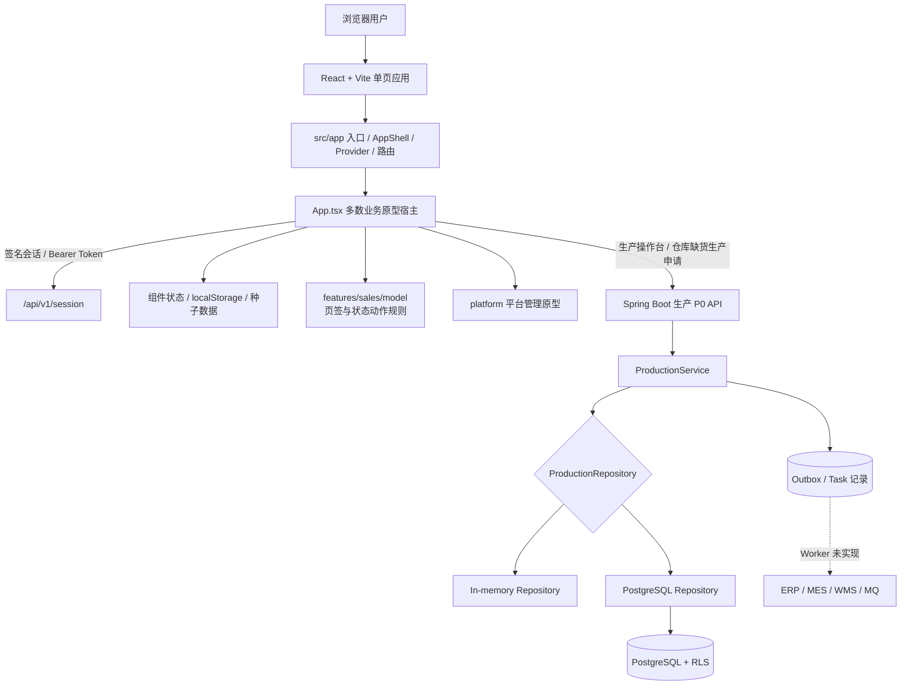
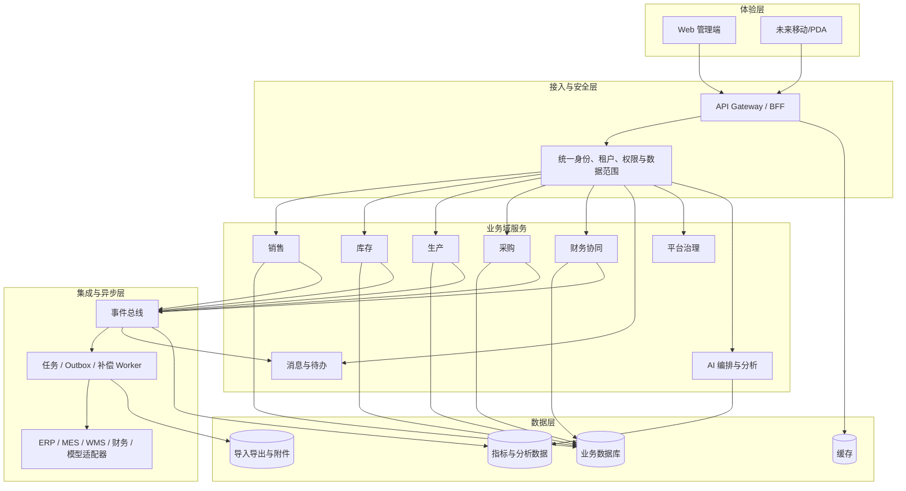
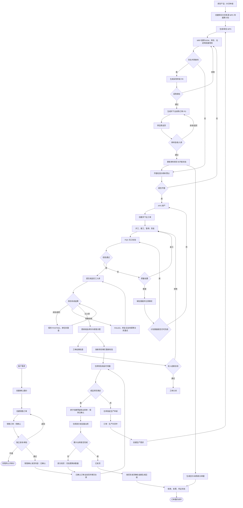
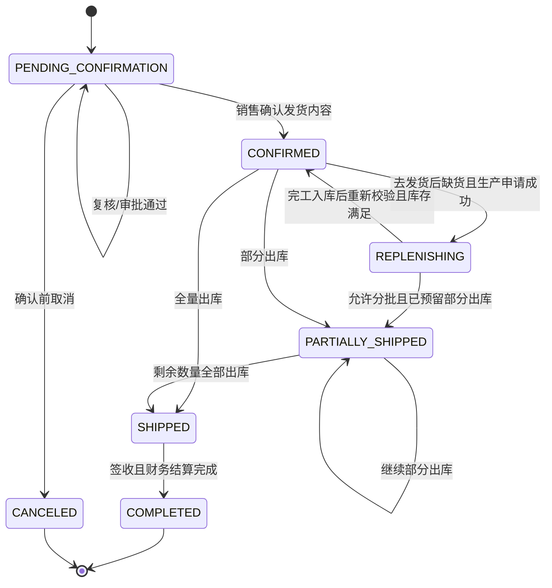
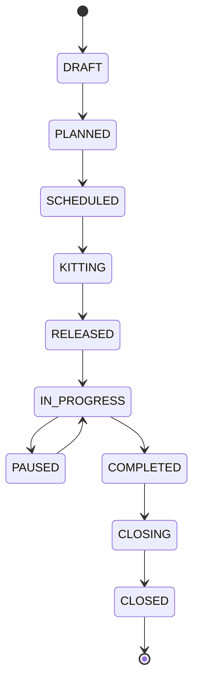

# 工业 AI 平台系统架构设计

> 2026-10-13 库存事实统一：`useFormalInventory.ts` 加载正式仓库主数据及履约库存事实，`formalInventory.ts` 将服务端仓库 ID 映射到显示编码，统一供仓库详情和现存量使用。发货按同一 availability 事实校验，预留和扣减在 `FulfillmentStore` 中统一解析编码/ID；旧编码事实下一次有效写入时事务迁移，重复别名事实返回冲突。页面预置数量不作为正式库存，异步请求按租户及请求序号隔离，发货后、主数据变更和窗口获得焦点时重读。

> 2026-10-13 五模块检查补充：完工 Worker 存在事件编号丢失及第二笔入库误去重，多产品缺货申请存在生产幂等冲突。MRP、生产齐套/开工、采购到生产、上游到财务均未形成完整链路。采购和财务 Java 独立接口已存在，不能沿用旧“无后端”描述或误报完整闭环，见 [本次检查及隔离复现](tests/五模块业务串联检查-20261013.md)。

> 2026-10-13 运行勘误：当前 Java 版本已暴露计划和执行 API，但前端生产闭环仍有库存事实映射、预置数据复合键和齐套状态生成阻断。MRP/APS 当前只返回简化 Reference 结果；预置车间报工/FQC 入库成功提示仍可来自本地状态。历史 TypeScript Reference 闭环描述不能直接作为 Java 迁移后的验收结果，详见 [前端实测](tests/生产模块前端操作与实测-20261013.md)。

## 1. 文档信息

| 项目 | 内容 |
| --- | --- |
| 架构基线 | 工业 AI 平台 V2.1.0 |
| 需求来源 | `01 需求规格说明书-工业AI平台-V2.1.0-PRD.md` |
| 代码基线 | 当前工作区，2026-07-26 |
| 文档性质 | 现状架构、目标架构与渐进拆分方案 |

本文严格区分“前端交互原型”和“可由后端执行或持久化的能力”。当前签名会话和生产管理 P0 具备服务端实现，其他业务模块主要用于验证信息架构和页面交互。

首期客户交付范围已确认为“销售—库存—生产—发货”，从销售订单待确认开始，到订单全量发货结束。架构实施优先建设销售订单聚合、库存预留/销售出库聚合、生产正式接入和可靠跨域事件；采购、财务结算和 AI 生产化不纳入首期退出条件。前端保持现有整体设计，只替换业务数据源、状态动作和异常恢复逻辑。详细业务基线见 `docs/首期交付基线-销售库存生产发货.md`，API 和数据开发基线见 `server-java/docs/openapi/openapi-sales-inventory-draft.yaml`、`docs/首期数据库设计-销售库存履约.md`，联合评审和开发默认值见 `docs/首期业务与技术联合评审记录-销售库存生产发货.md`、`docs/首期开发准入技术决策-销售库存生产发货.md`。六项开发 P0 已关闭，当前允许进入正式迁移和领域编码。

## 2. 架构目标

系统以销售订单履约为业务主线，以租户、组织、角色、资源和数据范围为治理底座，逐步形成销售、库存、计划、生产、采购、财务和 AI 协同平台。

架构目标如下：

- 多租户隔离：请求、数据、任务、审计和事件均带租户上下文。
- 业务可追溯：下游事实保留来源单据，关键状态变化留历史和审计。
- 一致性可控：本地事务保存业务事实与 Outbox，跨系统通过幂等和补偿实现最终一致。
- 前后端契约化：页面只依赖稳定 API/DTO，不依赖演示种子或后端表结构。
- 模块可拆分：按业务域拥有页面、应用服务、领域规则、数据和测试。
- AI 不阻断主流程：AI 只提供问数、归因、预警和建议，写操作必须人工确认并受权限控制。

## 3. 当前系统全景



### 3.1 当前前端

入口为 `src/main.tsx -> src/app/App.tsx -> AppRuntimeProvider -> src/App.tsx`。`src/app` 已承接 AppShell、集中运行时上下文、模块注册和 URL 路由；模块使用稳定英文 ID 写入 `module` 查询参数，刷新及浏览器前进/后退可恢复当前模块，并兼容原有 `production`、`platform` 深链接。

主导航进入或重复点击模块时统一回到第一个页面，有监控舱的模块回到监控舱。`navigateModule` 先写入清除旧页签和单据定位的默认 URL，再更新模块与 `moduleNavigationRevision`；租户业务内容的 React key 包含该版本，使 URL 未变化的模块也重新初始化内部页签。浏览器前进/后退同样重新初始化，但保留历史 URL 的明确目标；重复点击相同默认 URL 不增加重复历史记录。

后台计划恢复和跨模块 `businessFlow` 同步只更新业务数据，不选择页签。用户明确执行的业务跳转通过 `navigateModule` 的 `query` 参数声明目标，如采购申请、生产 MPS 或库存入出库；旧 `production=plan` 深链接兼容映射到 `mps`。路由与运行时单测，以及 [模块默认首页回归](tests/模块默认首页回归-20261013.md) 覆盖主导航、异步恢复和明确深链接之间的边界。

`src/App.tsx` 仍承载登录、工作台、跨模块演示流程、全局助手以及大多数业务模块，文件超过 9000 行。当前拆分只是应用基础设施落位，并不代表业务模块迁移完成。

已单独拆出的目录：

- `src/platform`：平台状态模型、权限/数据范围函数和平台管理 UI。
- `src/production`：新版生产 UI、租户隔离的原型状态和平台权限联动。
- `src/app`：应用入口、AppShell、模块注册、URL 路由、会话/租户/角色/模块运行时 Provider 和基础设施测试。
- `src/api`：统一 Bearer 会话、租户、幂等、ETag、错误处理，以及生产 API 客户端。
- `src/features/production/pages`：`ProductionOperations` 及其类型化 API 客户端保留，可读取正式生产 KPI、需求、工单、FQC 和计划任务，并提交 Reference MRP/APS、生产状态和完工命令；当前未挂载到主应用。
- `src/features/sales/model`：销售子页签 URL、报价有效期、订单状态动作规则，以及仓库发货/生产申请结果写回销售工作区的本地应用动作；销售页面本体仍在 `src/App.tsx`，尚未完成领域页面拆分。
- `src/features/inventory/model`：库存页签 URL、销售订单出库任务和仓库生产申请结果的本地桥接契约；库存页面本体仍在 `src/App.tsx`。

销售模块包含监控舱、报价、订单、客户和基础数据五个页签。正式订单采用“复核/审批 -> 待发货确认内容 -> 已确认去发货 -> 仓库库存校验”四阶段；确认内容不创建仓库任务，去发货才移交仓库。库存页读取正式任务并执行预留、缺货生产申请、部分或全量出库。

2026-10-13 快速开单：复用 `Sales_QuoteCreateModal` 的完整表单，以 `documentType="order"` 切换标题和提交目的。`quickSalesOrder.ts` 负责客户/仓库校验、逐行映射、折扣传递及稳定幂等键，只调用正式订单创建接口；成功后订单列表重置到待发货。有效期仍为商务信息，不作为承诺交期，创建接口使用不早于当前日期的参考日期，最终交期由后续确认内容命令固化。开单日期、有效期、备注及产品名称/规格快照已由 `FulfillmentService` 校验并随订单、审计和幂等结果同事务保存到 Java/JDBC JSONB 聚合，读取时直接返回；前端以服务端字段为准，租户工作区快照仅兼容历史订单。清除销售缓存后仍能恢复新订单全部字段，正式数量、价格、金额和状态始终来自 API。

2026-10-13 确认状态修复：报价转单/历史本地订单在确认时幂等创建正式聚合并保存原单号关联，按权限审批后以最新版本确认；`formalOrderWorkflow.ts` 管理确认版本链和列表合并。确认成功自动切换已确认筛选；去发货创建或恢复正式任务后只展示成功弹窗，保持销售页面，仅用户手动点击“进入出库管理”才携带来源订单导航，“我知道了”和关闭按钮仅关闭弹窗。该交互为用户明确要求保持的需求，订单行、更多操作、详情和剩余发货统一执行；旧缓存和跨模块业务流不能覆盖正式订单状态。

2026-10-13 销售到仓库出库开发验收：`formalShipmentStock.ts` 合并本任务未消费预留与新可用库存，同产品多行避免重复分配；`formalOutboundWorkflow.ts` 使用预留响应中新建的出库单，并直接应用过账返回的权威任务和销售订单。补货后保留原出库/行 ID 和累计已发量，正式销售状态不再由本地桥接写入。`JdbcJsonCollections` 的租户事务获取 PostgreSQL advisory transaction lock 后重读事实，异常时回滚并恢复缓存；出库、库存流水/事实、预留消费、任务、申请、销售、审计、历史、Outbox 和幂等结果同事务保存。`FulfillmentOutboxWorker` 重试移交，原子写入任务/Inbox 并标记已消费；未支持的事件保持待发布。真实数据库重载、并发库存竞争、回滚与重试及 1280×720/1920×1080 浏览器均通过，见 [开发验收](tests/销售到仓库出库开发验收-20261013.md)。Reference WMS 和隔离补货事实只证明该销售出库链路，不能作为客户 WMS 或生产/采购/财务全链路验收。

销售发货弹窗的“进入出库管理”入口同时检查宿主的库存模块访问权限和会话的 `inventory.shipment-task.read`（或 `*`）；无权限时隐藏并在导航处理再次阻断。销售发货申请及弹窗关闭流程继续可用。

最新 PRD 状态机已实现：复核/审批只更新独立状态；销售确认发货内容后进入已确认；已确认去发货后才创建仓库任务；缺货生产申请成功后进入生产补货中，完工事实唤醒原任务重校验；部分/全量出库分别进入部分发货/已发货。

2026-10-13 已发货记录同步：`shippedSalesOutboundSync.ts` 在历史本地销售订单保存为已发货时保存已完成出库记录，并在库存页面初始化时从租户销售工作区恢复遗漏记录。相同来源复用已有出库单，保留单号和日期，合计多产品数量；不执行库存扣减或正式履约命令。正式订单被排除，库存列表加载服务端任务时以正式来源覆盖本地兼容行，获得焦点和履约变化事件后重读；已完成记录提供凭证下载且不能再次发货。

订单金额以履约聚合的持久化 `totalAmount` 为准；创建和待确认编辑保存原价、折扣率与优惠金额，使用十进制计算并校验 `expectedTotalAmount`。审批和确认不重新定价，列表与详情统一读取服务端金额；报价/历史订单建立正式聚合时完整传递优惠，多行明细和交期编辑不得丢失价格事实。

主应用当前按用户要求渲染 `LegacyProductionManagement`，且旧版页签内不挂载整页 `ProductionOperations`。旧版除需求池查询外主要使用种子或 `localStorage`，不作为正式生产事实源。`ProductionOperations`、`ProductionManagementV2` 和正式生产 API 能力继续保留；未经用户明确批准不得整体替换当前生产模块。Reference 求解和开发环境 WMS 模拟回调不代表客户优化器或真实 WMS 已完成联调。

### 3.2 当前后端


职责边界：

| 层 | 当前文件 | 职责 |
| --- | --- | --- |
| 启动 | `IndustrialAiApiApplication` | 加载 Spring Boot、数据库迁移和业务模块 |
| HTTP | `@RestController` | 请求上下文、Bean Validation、路由、ETag、错误映射 |
| 应用服务 | `ProductionService` | 权限、幂等、状态流转、数量规则、事务和审计 |
| 仓储端口 | `ProductionStore` | 定义生产业务持久化能力 |
| 基础设施 | `JdbcProductionStore` | PostgreSQL 与 JSONB/关系表实现 |
| 领域类型 | `production` 包记录类型 | 生产聚合、任务、审计和事件 DTO |
| 数据库 | `server-java/src/main/resources/db/migrations` | PostgreSQL 表、索引、约束和 RLS |

## 4. 目标逻辑架构



目标架构不是要求立即拆成多个部署单元。近期可维持模块化单体，但代码、数据访问和事件契约必须先按业务域隔离，待吞吐、团队或部署边界明确后再独立服务化。

## 5. 核心完整业务流程

本节描述平台长期完整目标，所以包含采购和财务。首期仍不得以 AR/AP、结算或 `COMPLETED` 作为上线依赖；为修复缺料流程断点，当前已增加 Reference PR/PO/采购入库路径，物料不齐套时必须走该路径或由外部系统同步权威物料事实，服务端始终阻断未齐套的 APS/工单。



### 5.1 当前代码覆盖

- 正式后端已覆盖：销售订单/审批/发货申请、库存预留与销售出库、生产需求、Reference MRP V2 缺料、PR/PO、采购入库物料事实、APS 齐套阻断、工单、报工、FQC、完工入库、库存重校验、审计和可靠事件记录。
- Reference 采购当前位于 Java 履约/供应链模块，借用履约事务、仓储、审计和 Outbox 基础设施形成最小闭环；后续完整采购域应继续按业务域拆分 Java 服务与仓储，保持现有 DTO 和事件兼容。
- 前端已接入：在不替换 `LegacyProductionManagement` 的前提下，销售、库存、旧版生产页和采购页可沿同一正式事实执行 MRP、PR 审批、PO 收货、生产完工、库存重校验和销售出库。
- 仍属原型/未完成：报价、客户、供应商主数据、询比价、合同、价格税务、来料质检、分批收货/退货、复杂 MRP/APS、调拨盘点、AR/AP，以及客户 ERP/SRM/WMS/消息代理回写。
- Reference 闭环终点为销售订单 `SHIPPED`；不能据此宣称完整采购、库存、生产或财务域均已生产化。

## 6. 状态与一致性设计

### 6.1 销售订单目标状态主线



确认/审批状态和发货状态与总体状态分开保存。首期终点为 `SHIPPED`，不实施 `SHIPPED -> COMPLETED`。正式订单和出库任务以服务端聚合、版本、审计、历史和事件为事实源；历史原型的本地状态不得用于验收。

### 6.2 生产状态主线



实际服务允许的转换以 Java `ProductionService` 为准。新增状态必须同时更新领域类型、服务校验、数据库约束、OpenAPI、前端标签和测试。

### 6.3 一致性原则

- 数量通过最多 6 位小数的字符串传输，服务端转换为整数缩放运算。
- 命令请求使用 `X-Idempotency-Key`；相同键和相同请求返回原响应，不同请求体复用同一键必须拒绝。
- 聚合更新使用 `If-Match` 和版本号，避免覆盖并发修改。
- 业务事实、状态历史、审计快照、幂等响应和 Outbox 在同一事务提交。
- 外部系统超时等于结果未知，不能当作失败后创建第二笔事实。
- 每条 PostgreSQL 查询显式带 `tenant_id`，数据库同时启用 RLS 作为纵深防御。

## 7. 数据架构

初始迁移按以下数据域组织：

| 数据域 | 代表表 | 说明 |
| --- | --- | --- |
| 主数据 | `prod_bom`、`prod_routing`、`prod_calendar`、`prod_resource_profile` | BOM、工艺、日历、班次、技能和资源能力 |
| 计划 | `prod_demand`、`prod_mps`、`prod_mrp_run`、`prod_schedule_run` | 需求、MPS、MRP、APS 和 pegging |
| 物料 | `prod_kitting_check`、`prod_inventory_reservation`、`prod_material_transaction` | 齐套、预占和投退料 |
| 执行 | `prod_work_order`、`prod_work_order_operation`、`prod_work_report` | 工单、工序和报工更正 |
| 质量 | `prod_inspection`、`prod_nonconformity`、`prod_rework_order` | 检验、不合格和返工 |
| 完工 | `prod_completion`、`prod_completion_serial`、`prod_work_order_close` | 完工、追溯、销售分配和结案 |
| 可靠性 | `prod_operation_task`、`prod_event_inbox`、`prod_event_outbox` | 异步任务和可靠事件 |
| 治理 | `prod_idempotency_record`、`prod_audit_snapshot`、`prod_status_history` | 幂等、审计和状态轨迹 |
| 跨域接入 | `prod_inventory_availability`、`prod_sales_order_intake` | 版本化库存事实投影和销售订单履约决策 |

数据库结构覆盖范围大于当前服务实现范围。例如 BOM、工艺、日历、MPS/MRP 结果等表已建，但尚无完整 CRUD/求解 API。

## 8. 安全架构

### 8.1 当前实现

- 非生产环境支持本地账号登录并签发 HMAC 签名的 8 小时 Bearer Token；Token 保存在 `sessionStorage`。
- 服务端从签名声明读取账号、权限版本、权限码和授权租户；`X-Tenant-Id` 只能选择声明内租户，伪造账号/权限头会被拒绝。
- 生产环境禁用演示账号登录并强制配置 `AUTH_SECRET`；写操作还要求 `X-Idempotency-Key`。
- `X-Production-Capability` 可阻断未开通或平台校验不可用的租户。
- 数据层显式租户条件 + PostgreSQL RLS。
- 审计记录操作者、员工、权限版本、前后快照、Trace ID、IP 和 User-Agent。

### 8.2 上线前缺口

- 当前仅是本地签名会话基线，尚未接企业 OIDC/SSO、刷新令牌、服务端撤销、密码治理和可信短信服务。
- 开发账号使用共享演示密码且拥有通配权限，开发服务不能直接暴露公网。
- 平台管理状态存在 `localStorage`，没有服务端权限配置源。
- 敏感字段脱敏、密钥管理、限流、CSRF/CORS 策略和安全审计告警未完成。

## 9. UI 设计系统

### 9.1 视觉语言

| 要素 | 规则 |
| --- | --- |
| 应用背景 | `#F5F7FA`、`#F8FAFC` 等浅灰背景 |
| 面板 | 白色背景、Slate 100/200 边框、轻阴影 |
| 主操作 | Blue 600，悬停 Blue 700 |
| 成功 | Emerald 50/600/700 |
| 等待/警告 | Amber 50/600/800 |
| 错误/阻断 | Rose 50/600/700 |
| 正文 | Slate 600-900；次要说明 Slate 400-500 |
| 圆角 | 控件 8-12px，面板 12-16px，状态标签可使用全圆角 |
| 字体 | HarmonyOS Sans SC、MiSans、PingFang SC、系统字体 |

### 9.2 组件规则

- 页面使用应用壳、模块标题、紧凑页签、筛选区、表格/明细区和任务反馈层级。
- 主命令使用图标加文字；熟悉的纯图标操作必须带 Tooltip/无障碍名称。
- 表格数值启用 tabular numerals；移动端横向滚动，不压缩到不可读。
- 状态标签同时编码颜色、文字和必要图标。
- 空状态提供原因和下一步；无权限状态不泄露数据。
- Toast 用于结果，字段错误放在字段附近，复杂失败显示原因、建议和 Trace ID。
- 高危操作用确认弹窗说明影响对象、阻断项和审计要求。
- 动画仅用于状态过渡，并遵守 `prefers-reduced-motion`。

## 10. 前端拆分设计

### 10.1 拆分原则

1. 先抽应用壳和共享组件，再按模块搬迁，避免一次性重写业务行为。
2. 每次只迁移一个可验证模块，保留原入口的回归测试。
3. 种子数据与生产 API DTO 分离，禁止同一类型同时代表演示数据和服务响应。
4. 新版生产接入前先建立 API client 和适配层，再替换旧版入口。

### 10.2 目标目录

```text
src/
  app/
    App.tsx
    AppShell.tsx
    moduleRegistry.ts
    routing.ts
    AppRuntimeProvider.tsx
    tests/
  shared/
    api/
    components/
    hooks/
    model/
    utils/
  features/
    sales/
    production/
    inventory/
    procurement/
    finance/
    personnel/
    supply-chain/
    ai-hub/
    analytics/
    messages/
    platform/
```

### 10.3 推荐迁移顺序

1. 已完成基础部分：AppShell、模块菜单注册、URL 路由、签名会话客户端及会话/租户/角色/模块上下文；登录 UI 和全局反馈仍待从业务宿主搬出。
2. 将已独立的 `platform` 纳入统一模块注册和路由。
3. 已建立生产 P0 类型化 API client 和 `ProductionOperations`，但主入口已恢复旧版；重新启用或新增整页入口前必须取得用户明确批准并完成回归验收。
4. 生产主入口保持 `LegacyProductionManagement`；正式能力优先以不改变整体页面结构的局部增量方式接入，禁止未经批准整模块替换。
5. 依次拆销售、库存、采购、财务，优先保持业务流程 ID 和状态契约。
6. 拆人员、产业链、AI、消息和反馈。
7. 开启前端 strict，并逐模块清理 `any`。

## 11. 后端拆分设计

### 11.1 近期：模块化单体

```text
server-java/src/main/java/com/wanshen/platform/
  web/
  storage/
  production/
  platform/
  finance/
  message/
  personnel/
  supplychain/
  ai/
  auth/
  workbench/
```

推荐按既有 Java 包边界继续深化：

```text
  modules/
    production/
      api/
      application/
      domain/
      infrastructure/
    platform/
    sales/
    inventory/
    procurement/
    finance/
    messages/
  workers/
```

- `api`：Spring MVC controller/schema，只处理协议。
- `application`：用例编排、事务、权限和 DTO。
- `domain`：状态机、实体、值对象和不变量。
- `infrastructure`：PostgreSQL、外部系统 Adapter 和消息设施。
- `workers`：MRP/APS、Outbox 发布、Inbox 消费和补偿任务。

### 11.2 中长期：服务化触发条件

仅在出现独立团队、独立伸缩、独立数据合规或发布节奏差异时拆服务。建议候选顺序为任务/集成 Worker、AI 编排、消息中心，再评估库存、生产和财务域。服务化前必须先有稳定事件契约、可观测性和分布式幂等策略。

## 12. API 与集成设计

- 当前权威契约：`server-java/docs/openapi/openapi.yaml`。
- 生产 P0 使用 REST 命令接口；写操作通过幂等键，聚合更新通过 ETag。
- ERP/MES/WMS/财务集成应使用 Adapter，不在业务服务内直接拼接第三方请求。
- 业务事实提交后写 Outbox，由 Worker 发布；消费者使用 Inbox 去重。
- 当前库存可用量事件已经使用 `prod_event_inbox` 同步去重并更新投影；Outbox 仍只有事务记录，尚无发布 Worker。
- 事件至少包含 `eventId`、`eventType`、`eventVersion`、`tenantId`、聚合 ID/版本、`correlationId`、`traceId` 和发生时间。
- 契约升级保持向后兼容；破坏性变更发布新 API/事件版本。

## 13. 可观测性与运行设计

上线版本应补齐：

- 结构化日志：请求、Trace、租户、操作者、聚合和错误码。
- 指标：接口延迟/错误率、任务积压、Outbox 延迟、重试次数、库存回调等待时长。
- Trace：网关到服务、数据库、Worker 和外部适配器的关联追踪。
- 告警：任务死信、Outbox 堆积、库存长时间 POSTING、RLS/权限异常和高频幂等冲突。
- 健康检查：进程存活、数据库就绪、依赖能力状态分开暴露。

## 14. 测试策略

| 层级 | 当前状态 | 目标 |
| --- | --- | --- |
| 领域/服务单测 | 生产主流程由 API 测试间接覆盖 | 状态机和数量不变量独立测试 |
| API 集成测试 | 已覆盖生产租户、幂等、并发、FQC、库存、结案和仓库销售出库缺货接入 | 覆盖所有错误码、权限码和 PostgreSQL 仓储实现 |
| 数据库迁移测试 | 已有 PGlite 初始迁移、销售接入迁移和 RLS 测试 | 增加升级和回滚测试 |
| 前端组件测试 | 已有路由和模块注册基础设施单测；业务组件未实现 | 覆盖表单校验、权限状态和空/错/加载态 |
| E2E | 未实现 | 覆盖销售到结算主流程和生产正式 API |
| 性能/安全 | 未实现 | 验证 PRD 的延迟、并发、越权和脱敏要求 |

## 15. 架构决策与近期优先级

| 优先级 | 决策/任务 | 完成标准 |
| --- | --- | --- |
| P0 | 消除生产 UI 双轨 | 主入口只保留一个生产实现，回归用例通过 |
| P0 | 扩大前端生产 API 接入 | 仓库缺货生产申请和需求池已接入；继续替换工单、质量、完工等 `localStorage` 事实 |
| P0 | 模块化拆分 `App.tsx` | 应用壳和业务模块目录边界明确 |
| P0 | 建立可信身份与权限上下文 | 网关注入并签名/验证租户、操作者和权限 |
| P1 | 实现 Outbox/任务 Worker | 任务可执行、重试、死信、观测和人工补偿 |
| P1 | 补销售/库存/采购后端 | 销售审批到采购入库可真实流转 |
| P1 | 补财务协同与消息后端 | AR/AP 和待办有可追溯持久化事实 |
| P1 | 前端 strict 与自动化测试 | 新模块无隐式 `any`，核心交互有测试 |

需求级完成状态见 `需求功能清单.md`，用户行为和验收路径见 `usecase.md`。
