# 首期交付基线：销售—库存—生产—发货

## 1. 文档信息

| 项目 | 内容 |
| --- | --- |
| 基线编号 | `DELIVERY-BASELINE-20260726-02`（替代范围草案 `DELIVERY-BASELINE-20260726-01`） |
| 状态 | 八项业务决策和六项开发准入项 `JR-P0-001~006` 均已关闭，联合评审通过，当前开发准入为 `GO` |
| 范围来源 | 用户确认“销售—库存—生产—发货；先完成这个” |
| 目标 | 在保持现有前端整体设计的前提下，形成可持久化、可追踪、可重试、可验收的订单履约闭环 |
| 需求依据 | PRD V2.1.0 第 5 章、7.3 销售、7.4 生产、7.5 库存 |
| 当前事实依据 | 实际代码与测试、OpenAPI、架构、需求清单和用例 |
| 缺陷补充依据 | `docs/bugs/销售库存生产发货流程缺陷-20260726.md` 中 `BUG-WF-20260726-001~006` |
| 流程缺陷口径 | 本文已补齐六项缺陷的目标需求和关闭证据；缺陷台账状态须经回归后单独更新，不能因文档补充自动关闭 |

本文件是首期客户交付范围和开发就绪基线，不替代 PRD。发生冲突时，目标需求以确认后的本基线和 PRD 为准，当前行为仍以实际代码、自动化测试和 OpenAPI 为准。

## 2. 交付范围

### 2.1 本期必须完成

1. 销售订单创建、编辑、复核或审批、发起发货、取消和状态查询。
2. 销售订单行的订购数量、累计已发数量、本次申请数量和剩余数量管理。
3. 仓库接收发货任务、校验库存、原子预留、创建销售出库单和确认发货。
4. 库存不足时阻断发货，由仓库显式发起生产申请。
5. 生产需求校验/审批、正式 MPS/MRP 结果、正式排程候选、工单、开停复工、报工、FQC 和完工入库；计划任务已受理、已成功和业务结果必须分开记录。
6. 完工入库产生新库存事实后，自动或人工触发原发货任务重新校验。
7. 部分发货、剩余发货和全量发货。
8. 租户隔离、服务端权限、幂等、乐观锁、状态历史、审计和 Trace。
9. Outbox 发布、Inbox 去重、失败重试、死信和人工补偿的最小可靠链路。
10. 保留现有前端整体布局和视觉，仅补充正式数据、状态、校验、错误和恢复交互。

### 2.2 本期明确不包含

- 报价、客户经营和销售监控舱的全面生产化；只实现销售订单履约所需的最小客户/产品引用。
- 采购 PR/PO 正式闭环。首期试点产品必须具备可用物料，或由外部系统提供物料库存事实。
- 财务应收、收款、发票、凭证和结算闭环。
- 订单 `COMPLETED` 财务关闭条件；首期验收终点为 `SHIPPED`。
- 人员、产业链、AI 中枢、AI 数据分析和完整消息中心生产化。
- 复杂工作流引擎、移动端、PDA 和真实银行支付。
- 在首期同时兼容多种 ERP/MES/WMS 厂商私有协议；只落地一个试点适配模式。

不在本期范围的菜单必须通过租户能力开关隐藏或明确标识为原型，服务端不得暴露未完成写能力。

## 3. 目标业务流程

```mermaid
flowchart LR
  SO["销售订单：待确认"] --> REVIEW["复核/审批"]
  REVIEW --> REQUEST["销售发起发货"]
  REQUEST --> CHECK["仓库校验库存"]
  CHECK -->|"库存充足"| RESERVE["原子预留并创建出库单"]
  RESERVE --> CONFIRMED["订单：已确认"]
  CHECK -->|"库存不足"| SHORTAGE["任务：库存不足"]
  SHORTAGE --> APPLY["仓库发起生产申请"]
  APPLY --> REPLENISHING["订单：生产补货中"]
  REPLENISHING -->|"允许分批且已有预留"| OUTBOUND
  REPLENISHING --> DEMAND["生产需求校验/审批"]
  DEMAND --> MPS["正式 MPS/MRP 结果"]
  MPS --> APS["正式排程候选"]
  APS --> WO["工单下达与执行"]
  WO --> REPORT["报工"]
  REPORT --> FQC["FQC"]
  FQC -->|"合格"| COMPLETION["完工入库"]
  FQC -->|"不合格"| DISPOSITION["返工或报废"]
  DISPOSITION --> REPORT
  COMPLETION --> FACT["新库存事实"]
  FACT --> RECHECK["重新校验原发货任务"]
  RECHECK -->|"仍不足"| REPLENISHING
  RECHECK -->|"已满足"| RESERVE
  CONFIRMED --> OUTBOUND["仓库出库"]
  OUTBOUND -->|"部分数量"| PARTIAL["订单：部分发货"]
  PARTIAL --> REQUEST
  OUTBOUND -->|"全部数量"| SHIPPED["订单：已发货"]
```



## 4. 领域责任边界

| 领域 | 拥有的正式事实 | 不允许承担的职责 |
| --- | --- | --- |
| 销售 | 销售订单、订单行、复核/审批状态、发货申请、累计已发和只读履约投影 | 不直接扣库存、不直接创建工单、不直接确认仓库已发货 |
| 库存 | 库存余额组成、可用量、预留、销售出库单、出库行、库存流水和库存事实版本 | 不直接修改销售数据库、不直接写生产数据库 |
| 生产 | 生产需求、需求来源、工单、报工、FQC、返工/报废、完工和入库任务 | 不伪造库存成功、不直接把销售订单改成已发货 |
| 集成层 | Outbox/Inbox、Adapter、重试、死信、重查和人工补偿 | 不承载领域状态机，不用消息成功代替业务事实成功 |

跨域只允许通过版本化 API 或事件契约协作。页面、组件状态、`localStorage` 和 React 对象不能作为模块间正式数据载体。

## 5. 核心聚合

### 5.1 销售域

- `SalesOrder`：订单总体状态、确认/审批状态、发货状态、客户、仓库、收货信息、金额、版本。
- `SalesOrderLine`：产品、单位、订购数量、累计已发、剩余数量、允许分批标识。
- `SalesReview`：复核/审批结果、操作者、意见、版本和时间。
- `ShipmentRequest`：本次请求行数量、仓库、来源版本、处理状态和关联出库单。

### 5.2 库存域

- `InventoryAvailability`：合格现存、已分配/预留、冻结、安全库存、可用量、口径版本和事实版本。
- `InventoryReservation`：订单行、预留数量、状态、释放原因和有效期。
- `SalesOutbound`：来源订单、发货申请、仓库、状态、版本和实际发货时间。
- `SalesOutboundLine`：申请数量、预留数量、实际出库数量、批次/序列和单位。
- `InventoryTransaction`：不可变库存流水和外部系统流水号。

### 5.3 生产域

沿用已实现的 `Demand`、`OperationTask`、`WorkOrder`、`WorkReport`、`Inspection`、`Completion` 和 `WorkOrderClose` 聚合及状态机。`OperationTask` 的输入和结果必须持久化正式需求 ID、求解器/算法版本、MPS 行、物料缺口或排程候选；只有覆盖目标需求且状态为 `SUCCEEDED` 的计划结果才能用于创建工单。首期只补齐销售来源、库存事实、计划结果、完工库存结果和前端正式接入，不重写已经有自动化测试的生产规则。

## 6. 状态基线

### 6.1 销售订单总体状态

```text
PENDING_CONFIRMATION
  -> CONFIRMED             库存充足且预留/出库单创建成功
  -> REPLENISHING          缺货且生产申请创建成功
  -> CANCELED              发货前取消

REPLENISHING
  -> CONFIRMED             完工入库后重新校验并预留成功
  -> PARTIALLY_SHIPPED     允许分批且已预留部分实际出库

CONFIRMED
  -> PARTIALLY_SHIPPED     部分出库
  -> SHIPPED               全量出库

PARTIALLY_SHIPPED
  -> PARTIALLY_SHIPPED     剩余货物继续部分出库
  -> SHIPPED               累计全量出库
```

首期不实现 `SHIPPED -> COMPLETED`，但保留未来状态兼容。确认/审批通过只更新独立状态轴，不直接把总体状态改成 `CONFIRMED`。

### 6.2 发货申请状态

```text
workflow:      DRAFT -> REQUESTED -> PROCESSING -> ACTIVE -> COMPLETED
availability:  UNCHECKED -> CHECKING -> RESERVED | PARTIALLY_RESERVED | SHORTAGE
replenishment: NOT_REQUIRED | REQUIRED -> REQUESTED -> IN_PROGRESS -> AVAILABLE -> CLOSED
posting:       NOT_STARTED -> PARTIALLY_POSTED -> POSTED
```

四轴用于表达“部分已发、剩余补货中”等并行事实，详细守卫见第 15.3 节。同步调用超时或结果未知时，工作流使用 `PROCESSING_UNKNOWN`，通过原幂等键查询或补偿，不能当作失败后创建第二个申请。

### 6.3 生产状态

生产需求、计划任务、工单、报工、FQC 和完工状态以 `server/src/service.ts`、OpenAPI 和自动化测试为当前权威契约。PRD 7.4 已按本基线补充正式状态机；后续若再次冲突，仍按仓库约定的优先级处理并同步修正文档。

## 7. 跨域契约最小字段

所有命令和事件必须具备：

```ts
type CrossDomainContext = {
  eventId: string;
  eventType: string;
  eventVersion: number;
  tenantId: string;
  correlationId: string;
  traceId: string;
  sourceType: string;
  sourceId: string;
  sourceLineId?: string;
  sourceRevision: number;
  occurredAt: string;
};
```

核心事件：

下表的 PascalCase 名称是业务语义名；第 17 节的 `domain.aggregate.action.v1` 是消息总线规范名称和载荷权威契约。实现中不得同时发布两份语义相同但无法去重的事件。

| 事件 | 发布方 | 消费方 | 业务结果 |
| --- | --- | --- | --- |
| `SalesShipmentRequested` | 销售 | 库存 | 创建或恢复仓库发货任务 |
| `InventoryReservationCreated` | 库存 | 销售 | 回写预留和出库单；本次申请无缺口时订单进入已确认 |
| `InventoryShortageDetected` | 库存 | 销售 | 展示缺口但不自动创建生产需求 |
| `ProductionDemandCreated` | 生产 | 库存、销售 | 任务进入生产申请中，订单进入生产补货中 |
| `ProductionCompletionPosted` | 生产 | 库存 | 更新库存事实并触发原任务重校验 |
| `InventoryReservationReleased` | 库存 | 销售 | 回写释放原因并阻断出库 |
| `SalesOutboundPartiallyPosted` | 库存 | 销售 | 更新行累计已发和部分发货状态 |
| `SalesOutboundPosted` | 库存 | 销售 | 更新全量已发和锁定状态 |

事件发布成功不等于下游处理成功；消费结果必须可查询，失败进入重试、死信或人工补偿。

## 8. 前端实施原则

1. 保持现有导航、页签、页面布局、表格、颜色和主要弹窗结构。
2. 当前用户认可的旧版生产页面作为视觉基线；复用 `ProductionOperations` 和现有 API client 的正式调用能力，不强制替换成另一套视觉设计。
3. 页面只保留筛选、弹窗开关和未提交草稿等临时状态；业务单据和状态从 API 查询。
4. 销售、库存和生产动作进入各自 domain hook/store，不再继续堆入 `src/App.tsx`。
5. 所有写按钮具备提交中、重复点击保护、版本冲突、无权限、结果未知和重试状态。
6. URL 只传模块、页签和稳定业务 ID，不传完整业务对象。
7. 未接正式后端的按钮隐藏、禁用或标记为原型，禁止显示虚假成功。
8. 生产需求列表或详情必须展示来源销售订单号、订单行、发货任务、库存事实版本和 Correlation/Trace；缺少正式来源关联的孤立种子只能只读展示，不得进入计划、生产或发货动作。

## 9. PRD 开发就绪核查

| 核查项 | 当前结论 | 是否阻断 |
| --- | --- | --- |
| 首期起点和终点 | 已明确：订单待确认到全量发货 | 否 |
| 销售总体状态机 | PRD 已明确，代码未对齐 | 否，按基线实施 |
| 确认/审批独立状态 | 已冻结，见第 10、15、18 节 | 否 |
| 发货行数量口径 | 已冻结订购、累计已发、本次申请、在途申请和剩余数量，见第 14、18 节 | 否 |
| 库存可用量公式 | 已冻结组成项、安全库存扣减层和口径版本，见第 10、14、18 节 | 否 |
| 缺货时已有库存处理 | 已冻结为并发安全地预留可用部分，见第 10、18 节 | 否 |
| 多行订单部分满足 | 已冻结为按订单及行的允许分批配置处理，见第 10、18 节 | 否 |
| 库存/WMS 责任边界 | 已冻结为 WMS 实物账权威、平台履约投影和 Adapter，见第 10、16 节 | 否 |
| 生产状态和业务规则 | 后端实现和测试较完整，PRD 7.4 仍为通用模板 | 否，需同步文档 |
| 物料不足分支 | 已冻结为物料齐套试点或外部物料事实；不自动生成 PR/PO | 否 |
| 完工到库存事实 | 标准完工事件、生产 Outbox 转发 Worker、库存 Inbox 去重和流水投影已实现；客户消息代理仍待联调 | 否，参考链路已实现 |
| 部分/全量发货 | 库存出库聚合、部分/全量过账和销售状态回写已实现；客户 WMS 仍待联调 | 否，参考链路已实现 |
| 撤回成功后的订单状态 | 首期明确不支持撤回；异常走拦截和补偿台账 | 否 |
| 财务结算 | 明确退出首期，验收终点为已发货 | 否 |
| 租户、幂等、版本、审计 | 生产、销售和库存参考实现已复用统一规则；客户 IAM、OIDC 和密钥服务仍待联调 | 否，参考链路已实现 |
| 前端整体设计 | 已确认保持不变，仅做必要微调 | 否 |

当前结论：首期八项业务决策已经签批，`JR-P0-001~006` 已按 `FULFILLMENT-DEV-GATE-20260726-01` 全部关闭。销售/库存正式迁移、领域服务、参考 WMS、生产完工 Outbox 到库存 Inbox 的转发、关键前端动作和自动化闭环已经实现，可作为开发与参考集成基线。机器可读契约见 `server/docs/openapi-sales-inventory-draft.yaml`，数据库设计见 `docs/首期数据库设计-销售库存履约.md`。真实客户连接参数、消息代理、OIDC/KMS、真实 PostgreSQL 演练、性能测试和 UAT 仍是客户上线前置条件。

## 10. P0 业务决策

以下结论作为 `DELIVERY-BASELINE-20260726-02` 的首期默认决策冻结。客户如需改变，必须提交带影响分析和基线版本的新变更，不允许研发在实现中自行选择另一种口径。

| 编号 | 冻结结论 | 实施约束 | 状态 |
| --- | --- | --- | --- |
| `DLV-DEC-001` | 可履约量为 `max(合格现存 - 已分配/预留 - 冻结 - 安全库存, 0)`；在途不计入 | 库存域只扣一次安全库存；事件同时传组成项、`formulaVersion` 和 `factVersion`，禁止只保存不可审计汇总数 | 已冻结 |
| `DLV-DEC-002` | 允许分批时，缺货立即原子预留当前可用部分，剩余量形成缺口；不允许分批时整次申请全量成功或零预留 | 预留成功量以 WMS/库存事务结果为准；并发失败后重读事实，不能使用页面快照 | 已冻结 |
| `DLV-DEC-003` | 行级履约；订单及行都允许分批时，充足行可先发；任一层禁止分批时整次申请必须全量满足 | 已发生部分发货时总体状态优先为 `PARTIALLY_SHIPPED`，补货进度通过发货任务和生产关联展示 | 已冻结 |
| `DLV-DEC-004` | 首期采用 WMS 为实物库存权威源，平台保存可用量、预留、出库和流水投影 | 平台通过 Adapter 调用 WMS 原子预留/出库；没有 WMS 的客户不复用此基线冒充内置库存，需另立范围和迁移方案 | 已冻结 |
| `DLV-DEC-005` | 试点产品必须在开工前物料齐套；物料事实由 WMS/ERP 同步或实施导入 | 首期不生成 PR/PO；齐套不足阻断工单下达并转人工补料，不得把缺料工单当作可执行 | 已冻结 |
| `DLV-DEC-006` | 租户级配置审批开关；审批状态为 `NOT_REQUIRED/PENDING/APPROVED/REJECTED/RETURNED/CANCELED` | 开启审批时制单人与审批人分离；关闭时创建后为 `NOT_REQUIRED`，两者都只有 `APPROVED/NOT_REQUIRED` 可发起发货 | 已冻结 |
| `DLV-DEC-007` | 首期不支持销售或仓库撤回已受理的发货申请 | 订单被仓库受理、已预留、已创建生产需求或已出库后锁定；异常使用仓库拦截、释放预留和人工补偿单，均需原因与双人复核 | 已冻结 |
| `DLV-DEC-008` | 首期集成基线为 HTTPS JSON API + 版本化事件；WMS 权威，平台生产域权威，ERP 只提供所需主数据引用，MES 不作为首期成功路径依赖 | 写调用使用稳定业务幂等键；超时为未知并原键重查；回调验签；每个客户只配置端点、认证、资源映射和 SLA，不改变领域契约 | 已冻结 |

## 11. 开发批次

| 批次 | 目标 | 退出条件 |
| --- | --- | --- |
| A. 决策与契约 | 关闭第 10 节决策，评审聚合、状态和事件 | 无影响数据模型的 P0 未决项；OpenAPI 草案评审通过 |
| B. 销售最小后端 | 订单、行、复核/审批、发货申请 | 数据库、状态机、权限、幂等、版本、审计、Outbox 和 API 测试通过 |
| C. 库存履约后端 | 可用量组成、预留、销售出库、库存流水 | 充足、缺货、并发抢占、释放、部分/全量出库测试通过 |
| D. 生产衔接 | 正式生产 UI 接入、正式 MPS/MRP/排程结果、完工 Adapter、库存重校验 | 缺货需求能形成覆盖该需求的成功计划结果和工单；完工库存结果可追踪；结果未知可重试 |
| E. 前端接入 | 在现有界面上替换销售、库存、生产数据和动作 | 刷新不丢单；按钮按正式状态；无本地业务事实冒充成功 |
| F. 可靠事件 | Outbox/Inbox Worker、死信和人工补偿 | 重复、乱序、超时和下游宕机测试通过 |
| G. E2E 与试点 | 真实数据迁移、权限、安全、性能、UAT | 目标订单从待确认到已发货，全程可审计和对账 |

## 12. 首期验收场景

至少覆盖：

1. 库存充足，订单复核后发起发货，原子预留并全量发货。
2. 库存不足，仓库明确发起生产申请，需求、工单、报工、FQC、完工入库后重新校验并发货。
3. 部分发货后，对剩余数量再次发起发货并最终全量发货。
4. 两张订单并发抢占同一库存，仅合法预留成功，不出现负库存。
5. 重复点击发起发货、生产申请、报工和确认出库不产生重复事实。
6. 页面使用过期版本提交时返回冲突并要求刷新。
7. 生产或 WMS 调用超时时保持结果未知，使用原幂等键恢复。
8. 完工后仍缺货时继续阻断，不因生产完成自动标记已发货。
9. 租户、角色或仓库数据范围越权时，前端不可操作且后端返回 403。
10. 刷新、重新登录、跨页面跳转后，订单和关联单据仍能从服务端恢复。
11. 复核/审批和发起发货均不得提前把订单置为已确认；只有权威库存事务成功创建完整预留和正式出库单后才进入 `CONFIRMED`。
12. 正式缺货需求必须进入正式 MPS/MRP 与排程任务；任务输入包含该需求 ID，成功结果可查询并覆盖该需求，工单必须引用对应成功排程候选，Toast 或本地状态变化不计为结果。
13. 完工入库事件必须携带需求分配和新库存事实版本，系统自动触发关联发货任务重校验；自动触发失败时保留“重新校验”人工入口，且两种方式复用同一履约关系和幂等语义。
14. 销售订单、发货申请、库存任务、预留、出库单和生产需求的来源订单号、来源行、产品、数量与单位必须逐层一致；无法解析正式来源或来源版本过期时禁止计划、生产申请和出库。
15. 部分出库按行更新累计已发和剩余量；剩余发货只能申请尚未被活动申请占用的数量，全量过账后才能进入 `SHIPPED`。
16. 生产需求列表或详情展示来源订单号、订单行、发货任务、库存事实版本、Correlation ID 和 Trace ID，并能导航至有权限访问的来源单据。

每个场景必须同时具备 API/集成测试和客户 UAT 证据；页面 Toast、组件状态或 `localStorage` 变化不计为通过。

## 13. 权限矩阵

### 13.1 授权原则与角色

- 服务端默认拒绝；前端隐藏按钮只用于体验，不构成授权。
- 权限判断同时满足：租户能力、资源动作权限、数据范围、状态前置条件和职责分离。
- `TENANT_ADMIN` 只管理账号、角色和范围，不自动获得销售、库存或生产写权限；紧急授权必须限时并审计。
- 集成账号只能调用 `/internal` 契约，禁止交互登录和访问无关业务列表。

角色缩写：`SO` 销售专员、`SM` 销售主管、`WO` 仓库操作员、`WM` 仓库主管、`PP` 生产计划员、`PM` 生产主管、`OP` 车间操作员、`QI` 质检员、`QM` 质量主管、`IS` 集成服务、`AU` 审计员、`TA` 租户管理员。

### 13.2 角色 × 权限 × 数据范围

| 资源/动作 | 权限码 | SO | SM | WO | WM | PP | PM | OP | QI | QM | IS | AU | TA | 默认数据范围 |
| --- | --- | --- | --- | --- | --- | --- | --- | --- | --- | --- | --- | --- | --- | --- |
| 销售订单查询/详情 | `sales.order.read` | √ | √ | 关联只读 | 关联只读 | 关联只读 | 关联只读 | - | - | - | - | 审计只读 | - | `SELF/ORG`；跨域只看关联投影 |
| 创建订单 | `sales.order.create` | √ | √ | - | - | - | - | - | - | - | - | - | - | `SELF/ORG` |
| 编辑待确认订单 | `sales.order.update` | √ | √ | - | - | - | - | - | - | - | - | - | - | `OWNER/ORG` |
| 取消订单 | `sales.order.cancel` | √ | √ | - | - | - | - | - | - | - | - | - | `OWNER/ORG` |
| 提交审批 | `sales.order.review.submit` | √ | √ | - | - | - | - | - | - | - | - | - | - | `OWNER/ORG` |
| 审批/退回/拒绝 | `sales.order.review.decide` | - | √ | - | - | - | - | - | - | - | - | - | - | `ORG`，且不得审批本人单据 |
| 发起发货/剩余发货 | `sales.shipment-request.create` | √ | √ | - | - | - | - | - | - | - | - | - | - | `OWNER/ORG` |
| 履约全链路查询 | `sales.fulfillment-trace.read` | √ | √ | 关联只读 | 关联只读 | 关联只读 | 关联只读 | - | - | - | - | √ | - | 来源关联或审计范围 |
| 库存可用量查询 | `inventory.availability.read` | 摘要 | 摘要 | √ | √ | √ | √ | - | - | - | - | √ | - | `WAREHOUSE_SET` |
| 发货任务查询 | `inventory.shipment-task.read` | 关联只读 | 关联只读 | √ | √ | - | - | - | - | - | - | √ | - | `WAREHOUSE_SET` |
| 校验并预留 | `inventory.reservation.create` | - | - | √ | √ | - | - | - | - | - | IS | - | - | `WAREHOUSE_SET` |
| 释放预留 | `inventory.reservation.release` | - | - | - | √ | - | - | - | - | - | IS | √ | - | `WAREHOUSE_SET`，原因必填 |
| 发起生产申请 | `inventory.production-request.create` | - | - | √ | √ | - | - | - | - | - | - | - | - | `WAREHOUSE_SET` + 目标 `FACTORY_SET` |
| 销售出库查询 | `inventory.outbound.read` | 关联只读 | 关联只读 | √ | √ | - | - | - | - | - | IS | √ | - | `WAREHOUSE_SET` |
| 确认部分/全量出库 | `inventory.outbound.post` | - | - | √ | √ | - | - | - | - | - | IS | - | - | `WAREHOUSE_SET` |
| 库存流水查询 | `inventory.transaction.read` | - | - | √ | √ | - | - | - | - | - | - | √ | - | `WAREHOUSE_SET` |
| 库存事实同步 | `inventory.availability.sync` | - | - | - | - | - | - | - | - | - | IS | - | - | 服务账号资源映射 |
| 创建/校验生产需求 | `production.demand.create/review` | - | - | 仅 create | 仅 create | √ | √ | - | - | - | IS | - | - | `FACTORY_SET` |
| 审批生产需求 | `production.demand.approve` | - | - | - | - | √ | √ | - | - | - | - | - | - | `FACTORY_SET`，不得审批本人需求 |
| 创建/下达工单 | `production.work-order.create/release` | - | - | - | - | 创建 | √ | - | - | - | - | - | - | `FACTORY_SET` |
| 开工/暂停/恢复 | `production.work-order.start/pause` | - | - | - | - | - | √ | √ | - | - | - | - | - | `FACTORY_SET/ASSIGNEE` |
| 报工/更正 | `production.work-order.report/report.correct` | - | - | - | - | - | 更正 | 报工 | - | - | IS | - | - | `FACTORY_SET/ASSIGNEE` |
| FQC 检验 | `production.quality.inspect` | - | - | - | - | - | - | - | √ | √ | IS | - | - | `FACTORY_SET` |
| 返工/报废处置 | `production.quality.disposition` | - | - | - | - | - | - | - | - | √ | - | - | - | `FACTORY_SET`，报废审批人与检验人分离 |
| 完工提交/失败重试 | `production.completion.post/retry` | - | - | - | - | - | √ | - | - | - | IS | - | - | `FACTORY_SET` + `WAREHOUSE_SET` |
| 库存结果回调 | `production.inventory.callback` | - | - | - | - | - | - | - | - | - | IS | - | - | 仅可信 WMS Adapter |
| 工单结案提交/复核 | `production.close.submit/approve` | - | - | - | - | - | √ | - | - | - | - | - | - | `FACTORY_SET`，两人分离 |
| MRP/APS 任务 | `production.mrp.run/aps.run` | - | - | - | - | √ | √ | - | - | - | - | - | - | `FACTORY_SET`；首期非闭环退出条件 |
| 审计查询/补偿审批 | `audit.read` / `integration.compensation.approve` | - | - | - | 业务确认 | - | 业务确认 | - | - | - | 执行 | √ | - | `TENANT`，审批人与执行人分离 |
| 角色与数据范围配置 | `iam.role.manage` / `iam.scope.manage` | - | - | - | - | - | - | - | - | - | - | 审计只读 | √ | `TENANT`，不得自授业务权限 |

“摘要”只返回可承诺结果和事实时间，不返回其他订单的预留明细。组合权限中的每一个权限码必须独立校验，不能把表格中的 `/` 当作一个权限字符串。

### 13.3 数据范围和职责分离

| 范围码 | 过滤规则 |
| --- | --- |
| `SELF` | `owner_employee_id = 当前员工` |
| `ORG` | `owner_org_id` 属于当前组织及授权下级组织 |
| `WAREHOUSE_SET` | `warehouse_id` 属于令牌授权仓库集合 |
| `FACTORY_SET` | `factory_resource_id` 属于令牌授权工厂集合 |
| `ASSIGNEE` | 工单指派给当前员工，或当前员工属于授权班组 |
| `TENANT` | 仅限当前租户；仍不能越过字段脱敏和职责分离 |

强制职责分离：销售制单人不得审批本人订单；生产需求制单人不得审批本人需求；FQC 检验人不得审批该检验单报废；工单结案提交人与复核人必须不同；补偿执行人与补偿审批人必须不同。任何 `*` 权限都不能绕过这些业务不变量。

本节是首期目标授权契约，不是客户授权完成证明。现有生产写接口及销售/库存履约接口已校验相应领域权限和租户；部分生产读取接口仍只校验身份和租户，统一 IAM、客户角色映射、OIDC 和字段脱敏策略必须在首期上线前按本矩阵补齐并测试。

## 14. 字段级数据模型

### 14.1 通用类型和公共字段

| 项目 | 约束 |
| --- | --- |
| ID | 新聚合内部主键 `uuid`；`tenant_id` 及产品、仓库、工厂、组织、员工等平台/外部资源 ID 使用不透明稳定 `text`，与现有生产迁移兼容；展示编号 `varchar(50)`，租户内唯一且不可复用 |
| 数量/金额 | 数量数据库 `numeric(18,6)`、金额数据库 `numeric(20,6)`；API 均使用十进制字符串；数量非负，本次业务数量必须大于 0 |
| 日期时间 | 日期 `date`，时间 `timestamptz`，API 为 ISO 8601 UTC；页面按租户时区展示 |
| 枚举 | 数据库检查约束 + TypeScript 枚举 + OpenAPI enum 三处一致 |
| JSON | 仅用于不可变快照、外部扩展或证据，不用于替代可查询核心字段 |

所有聚合根必须包含：`id uuid PK`、`tenant_id text NOT NULL`、`version bigint NOT NULL DEFAULT 1`、`correlation_id uuid NOT NULL`、`created_by text NOT NULL`、`created_at timestamptz NOT NULL`、`updated_by text`、`updated_at timestamptz NOT NULL`。所有业务表启用 RLS；查询索引以 `tenant_id` 为首列。写命令另存幂等记录、状态历史、审计和 Outbox，不在聚合表中覆盖历史。

### 14.2 销售域

#### `sales_orders`

| 字段 | 类型/必填 | 规则 |
| --- | --- | --- |
| `order_no` | `varchar(50)`/是 | `unique(tenant_id, order_no)` |
| `customer_id` | `text`/是 | 客户必须启用且在数据范围内 |
| `customer_name_snapshot` | `varchar(200)`/是 | 下单时快照，不随客户改名覆盖 |
| `owner_employee_id`、`owner_org_id` | `text`/是 | 销售归属和数据权限锚点 |
| `fulfillment_warehouse_id` | `text`/是 | 首期单订单单履约仓；跨仓需拆申请 |
| `factory_resource_id` | `text`/是 | 缺货生产的目标工厂 |
| `currency` | `char(3)`/是 | ISO 4217 |
| `total_amount` | `numeric(20,6)`/是 | 等于有效行金额合计，不用浮点数 |
| `requested_delivery_date` | `date`/是 | 不早于下单日；变更提升版本 |
| `allow_partial_shipment` | `boolean`/是 | 订单级分批总开关 |
| `review_required`、`review_policy_version` | `boolean/varchar(40)`/是 | 保存创建时审批策略快照，后续配置变更不静默改旧单 |
| `overall_status` | `varchar(32)`/是 | 第 15.1 节枚举 |
| `review_status` | `varchar(24)`/是 | 第 15.2 节枚举 |
| `shipment_status` | `varchar(24)`/是 | `NOT_REQUESTED/REQUESTED/PARTIALLY_SHIPPED/SHIPPED` |
| `source_quote_id`、`source_quote_revision` | `uuid/bigint`/否 | 报价来源快照；首期可为空 |
| `recipient_name` | `varchar(100)`/是 | 发货前完整；详情按权限脱敏 |
| `recipient_phone_ciphertext`、`recipient_phone_key_id` | `text/varchar(100)`/是 | 信封加密保存并记录非敏感密钥版本；列表仅掩码，支持密钥轮换 |
| `delivery_address` | `jsonb`/是 | 固定结构：国家、省、市、区、详细地址、邮编 |
| `cancel_reason`、`canceled_by`、`canceled_at` | `varchar(500)/uuid/timestamptz`/否 | 仅 `CANCELED` 必填 |

#### `sales_order_lines`

| 字段 | 类型/必填 | 规则 |
| --- | --- | --- |
| `sales_order_id` | `uuid`/是 | FK；`unique(order_id, line_no)` |
| `line_no` | `integer`/是 | 大于 0，稳定不复用 |
| `product_id`、`product_code_snapshot`、`product_name_snapshot` | `text/varchar(80)/varchar(200)`/是 | 产品及下单快照 |
| `ordered_qty` | `numeric(18,6)`/是 | `> 0` |
| `uom` | `varchar(20)`/是 | 全链路一致；换算需显式版本化规则 |
| `unit_price`、`tax_rate`、`line_amount` | `numeric(20,6)`/是 | `line_amount` 按租户舍入规则计算 |
| `shipped_qty` | `numeric(18,6)`/是 | 累计已过账出库，不可手改 |
| `active_requested_qty` | `numeric(18,6)`/是 | 未终结发货申请占用量，不计为已发 |
| `reserved_qty` | `numeric(18,6)`/是 | 库存域成功预留投影，不得大于剩余量 |
| `remaining_qty` | `numeric(18,6)`/是 | 服务端维护：`ordered_qty - shipped_qty` |
| `allow_partial_shipment` | `boolean`/是 | 与订单开关同时为真才可分批 |
| `line_status` | `varchar(24)`/是 | `OPEN/RESERVED/PARTIALLY_SHIPPED/SHIPPED/CANCELED` |
| `promised_date` | `date`/是 | 缺货需求交期来源 |

#### 审批和发货申请

| 表/字段 | 类型/必填 | 规则 |
| --- | --- | --- |
| `sales_review_actions.id/order_id` | `uuid`/是 | 审批动作不可变记录 |
| `sales_review_actions.action` | `varchar(20)`/是 | `SUBMIT/APPROVE/REJECT/RETURN/CANCEL` |
| `sales_review_actions.from_status/to_status` | `varchar(24)`/是 | 必须符合第 15.2 节 |
| `sales_review_actions.actor_id/comment/acted_at` | `uuid/varchar(500)/timestamptz`/是 | 拒绝、退回原因必填 |
| `shipment_requests.request_no/order_id/warehouse_id` | `varchar(50)/uuid/text`/是 | 请求编号租户内唯一；订单和仓库版本快照 |
| `shipment_requests.workflow_status` | `varchar(32)`/是 | `DRAFT/REQUESTED/PROCESSING/ACTIVE/PROCESSING_UNKNOWN/MANUAL_INTERVENTION/COMPLETED` |
| `shipment_requests.availability_status` | `varchar(32)`/是 | `UNCHECKED/CHECKING/PARTIALLY_RESERVED/RESERVED/SHORTAGE/RECHECKING` |
| `shipment_requests.replenishment_status` | `varchar(32)`/是 | `NOT_REQUIRED/REQUIRED/REQUESTED/IN_PROGRESS/AVAILABLE/CLOSED/FAILED` |
| `shipment_requests.posting_status` | `varchar(24)`/是 | `NOT_STARTED/PARTIALLY_POSTED/POSTED` |
| `shipment_requests.order_revision` | `bigint`/是 | 创建时销售订单版本，防止陈旧移交 |
| `shipment_requests.inventory_fact_version` | `bigint`/否 | 每次校验使用的库存事实版本 |
| `shipment_requests.outbound_id/production_correlation_id` | `uuid/uuid`/否 | 关联库存出库和生产链路 |
| `shipment_requests.accepted_at/completed_at` | `timestamptz`/否 | 仓库受理及请求终结时间 |
| `shipment_requests.failure_code/failure_message` | `varchar(80)/varchar(500)`/否 | 失败或人工处理原因 |
| `shipment_request_lines.id/request_id/order_line_id` | `uuid`/是 | `unique(request_id, order_line_id)` |
| `shipment_request_lines.requested_qty` | `numeric(18,6)`/是 | `0 < requested_qty <= remaining_qty - 其他活动申请量` |
| `shipment_request_lines.reserved_qty/posted_qty/shortage_qty` | `numeric(18,6)`/是 | 均非负；以库存事实回写为准 |
| `shipment_request_lines.uom/source_line_revision` | `varchar(20)/bigint`/是 | 单位一致，来源版本用于去重 |

关键索引：`sales_orders(tenant_id, overall_status, updated_at desc)`、`sales_orders(tenant_id, owner_org_id, owner_employee_id)`、`sales_order_lines(tenant_id, sales_order_id)`、`shipment_requests(tenant_id, order_id, status)`；同一订单行同一来源版本只能有一个非终结请求。

### 14.3 库存域

| 聚合/字段 | 类型/必填 | 规则 |
| --- | --- | --- |
| `inventory_availability.product_id/warehouse_id` | `text`/是 | 联合主键的一部分，与现有库存投影兼容 |
| `qualified_on_hand_qty` | `numeric(18,6)`/是 | WMS 合格现存 |
| `allocated_reserved_qty` | `numeric(18,6)`/是 | 已分配与已预留合计 |
| `frozen_qty` | `numeric(18,6)`/是 | 冻结、质押、质检阻断量 |
| `safety_stock_qty` | `numeric(18,6)`/是 | 本口径仅扣一次 |
| `in_transit_qty` | `numeric(18,6)`/是 | 仅展示，不计入销售可履约量 |
| `fulfillable_qty` | `numeric(18,6)`/是 | 按第 18.1 节公式服务端复算并校验 |
| `uom/formula_version/fact_version` | `varchar(20)/varchar(40)/bigint`/是 | `fact_version` 对仓库+产品单调递增 |
| `source_system/source_event_id/as_of` | `varchar(40)/uuid/timestamptz`/是 | 事件来源、去重和时效证据 |
| `inventory_reservations.reservation_no` | `varchar(50)`/是 | 租户内唯一 |
| `inventory_reservations.shipment_request_id/order_id/order_line_id` | `uuid`/是 | 来源链路；请求行只能有一个活动预留 |
| `inventory_reservations.product_id/warehouse_id` | `text`/是 | 必须与请求行和数据范围一致 |
| `inventory_reservations.requested_qty/reserved_qty` | `numeric(18,6)`/是 | `0 < reserved_qty <= requested_qty` |
| `inventory_reservations.status` | `varchar(24)`/是 | `PENDING/PARTIAL/ACTIVE/CONSUMED/RELEASED/EXPIRED/FAILED` |
| `inventory_reservations.fact_version/formula_version` | `bigint/varchar(40)`/是 | 预留决策证据 |
| `inventory_reservations.external_reservation_id` | `varchar(100)`/否 | WMS 成功时必填且租户内唯一 |
| `inventory_reservations.expires_at/release_reason` | `timestamptz/varchar(500)`/否 | 自动释放需事件和审计 |
| `sales_outbounds.outbound_no` | `varchar(50)`/是 | 租户内唯一 |
| `sales_outbounds.shipment_request_id/order_id/warehouse_id` | `uuid/uuid/text`/是 | 一次请求对应一个活动出库单 |
| `sales_outbounds.status` | `varchar(32)`/是 | 第 15.5 节枚举 |
| `sales_outbounds.external_outbound_id` | `varchar(100)`/否 | WMS 单号，成功受理后唯一 |
| `sales_outbounds.posting_key` | `varchar(160)`/是 | WMS 写入幂等键，终身不变 |
| `sales_outbounds.posted_at/failure_code/failure_message` | 时间/文本/否 | 完成或失败证据 |
| `sales_outbound_lines.order_line_id/product_id` | `uuid`/是 | `unique(outbound_id, order_line_id)` |
| `sales_outbound_lines.requested_qty/reserved_qty/posted_qty` | `numeric(18,6)`/是 | `posted <= reserved <= requested` |
| `sales_outbound_lines.uom` | `varchar(20)`/是 | 与订单和预留相同 |
| `sales_outbound_lines.batch_allocations` | `jsonb`/否 | 仅保存 WMS 返回的批次/序列证据，不作为库存主账 |
| `inventory_transactions.transaction_no` | `varchar(50)`/是 | 平台流水号租户内唯一，不可变 |
| `inventory_transactions.external_transaction_id` | `varchar(100)`/是 | WMS 流水号租户内唯一 |
| `inventory_transactions.type` | `varchar(24)`/是 | 首期 `SALES_OUTBOUND/FG_COMPLETION_INBOUND/RESERVATION_RELEASE` |
| `inventory_transactions.warehouse_id/product_id/qty/uom` | `text/text/numeric(18,6)/varchar`/是 | 数量正数，方向由 type 决定 |
| `inventory_transactions.source_type/source_id/source_line_id` | 文本/uuid/uuid/是 | 可回溯订单、出库或完工 |
| `inventory_transactions.fact_version/occurred_at/payload_snapshot` | `bigint/timestamptz/jsonb`/是 | 过账后的库存版本和原始证据 |

预留表以 `unique(tenant_id, external_reservation_id)`、流水表以 `unique(tenant_id, external_transaction_id)` 防止 WMS 重放。库存余额不得通过销售事件直接增减，只能由权威库存结果或经批准的补偿事实更新。

### 14.4 生产域和跨域记录

生产域沿用当前代码字段，不另造不兼容模型。首期必须保留的字段级契约如下；`!` 表示必填，数量均为十进制字符串/API、`numeric(18,6)`/数据库：

| 聚合 | 字段级契约 |
| --- | --- |
| `Demand` | `id:uuid!`、`tenantId:text!`、`code:string!`、`sourceType:string!`、`productId:text!`、`productName:string?`、`qty:decimal!`、`uom:string!`、`dueDate:date!`、`priority:int!`、`factoryResourceId:text!`、`status:DemandStatus!`、`revision:int!`、`correlationId:uuid!`、`blockReasons:string[]!`、`createdBy:text!`、`version:int!`、`createdAt/updatedAt:timestamp!` |
| `DemandSource` | `demandId/sourceSystem/sourceType/sourceId/sourceRevision/qty/payloadSnapshot!`，销售缺货来源还必须提供 `salesOrderId/salesOrderNo/orderLineId/orderLineNo/shipmentRequestId/shipmentRequestLineId/shipmentTaskId/productId/uom/inventoryFactVersion/correlationId/traceId`；订单来源唯一键为租户+来源系统+来源行+来源版本，显示单号不得替代稳定 ID |
| `WorkOrder` | `code/productId/factoryResourceId/workCenterResourceId/plannedQty/inputQty/reportedGoodQty/reportedDefectQty/reportedScrapQty/postedQty/uom/dueDate/status/correlationId/parameterSnapshot/version!`；车间、产线、BOM/工艺/排程/齐套/负责人字段可空但下达前按规则转为必备 |
| `WorkOrderDemand` | `workOrderId/demandId/allocatedQty/priorityRank/customerLocked!`、`promisedDate?`；同工单分配合计等于计划量 |
| `WorkReport` | `workOrderId/goodQty/defectQty/scrapQty/inputQty/uom/status/reportedBy/reportedAt/source/version!`、`operationId/remark?` |
| `Inspection` | `code/workOrderId/inspectionType/sampleQty/passedQty/failedQty/status/createdBy/version!`、`parentInspectionId/inspectorId/inspectedAt/resultReason?` |
| `Completion` | `code/workOrderId/inspectionId/qty/uom/warehouseResourceId/inventoryWarehouseId/traceMode/serialNumbers/productionDate/allocationRevision/status/inventoryIdempotencyKey/taskId/createdBy/version!`；批次、库位、外部流水和失败字段按状态必填 |
| `CompletionAllocation` | `completionId/demandId/qty/rank/ruleEvidence/createdAt!`，用于完工到销售缺口的确定性分配 |
| `CloseRequest` | `workOrderId/status/checkSnapshot/varianceSnapshot/submittedBy/submittedAt/version!`，审批人/时间按状态必填 |
| `OperationTask` | `taskType/status/progress/retryCount/maxRetryCount/input/traceId/createdBy/createdAt/updatedAt!`；结果和错误字段按状态必填 |
| `SalesOrderIntake` | 保留现有兼容字段；其中 `orderedQty` 只解释为本次申请量。目标销售/库存聚合上线后由 `shipmentRequestLineId + sourceRevision` 驱动，不再把订单总量传入该兼容接口 |

## 15. 完整状态机

### 15.1 销售订单总体状态

| 当前状态 | 触发/守卫 | 后置状态 | 说明 |
| --- | --- | --- | --- |
| 新建 | 创建订单 | `PENDING_CONFIRMATION` | 同时初始化审批和发货独立状态 |
| `PENDING_CONFIRMATION` | 无活动申请/预留/生产/出库事实，填写原因取消 | `CANCELED` | 终态 |
| `PENDING_CONFIRMATION` | 本次申请全部预留成功、无缺口且尚未出库 | `CONFIRMED` | 审批通过或仅部分预留不触发 |
| `PENDING_CONFIRMATION` | 缺货且生产需求创建成功，累计已发为 0 | `REPLENISHING` | 仅成功建需后进入 |
| `REPLENISHING` | 新库存事实重校验并形成有效预留 | `CONFIRMED` | 仍缺货则保持原状态 |
| `REPLENISHING` | 允许分批且已预留部分实际出库 | `PARTIALLY_SHIPPED` | 剩余生产关系继续有效 |
| `CONFIRMED` | 首笔实际出库小于订单总量 | `PARTIALLY_SHIPPED` | 以过账流水为准 |
| `CONFIRMED` | 累计实际出库等于订单总量 | `SHIPPED` | 首期终态 |
| `PARTIALLY_SHIPPED` | 继续部分出库但仍有剩余 | `PARTIALLY_SHIPPED` | 即使同时补货，也不降级为 `REPLENISHING` |
| `PARTIALLY_SHIPPED` | 累计实际出库等于订单总量 | `SHIPPED` | 首期终态 |

状态优先级为 `SHIPPED > PARTIALLY_SHIPPED > REPLENISHING > CONFIRMED > PENDING_CONFIRMATION`。`CANCELED/SHIPPED` 只读；首期不存在 `COMPLETED` 转换。

### 15.2 销售审批状态

| 当前状态 | 动作 | 后置状态 | 守卫 |
| --- | --- | --- | --- |
| 新建 | 审批关闭/开启 | `NOT_REQUIRED` / `PENDING` | 租户审批配置快照入单 |
| `PENDING` | 通过 | `APPROVED` | 审批人有范围且非制单人 |
| `PENDING` | 退回 | `RETURNED` | 原因必填，可编辑后重新提交 |
| `PENDING` | 拒绝 | `REJECTED` | 原因必填，本版本终止 |
| `RETURNED` | 修改并重新提交 | `PENDING` | 订单版本提升 |
| `PENDING/RETURNED` | 取消订单 | `CANCELED` | 满足订单取消守卫 |

只有 `NOT_REQUIRED/APPROVED` 可创建发货申请。`REJECTED/CANCELED` 终结当前订单版本，不能直接恢复。

### 15.3 发货申请

允许分批时，同一申请可能同时“部分已预留/已发”和“剩余量生产中”，因此禁止用一个互斥枚举承载全部状态。申请使用四个正交状态轴：

| 状态轴 | 完整转换 | 守卫/说明 |
| --- | --- | --- |
| `workflowStatus` | `DRAFT -> REQUESTED -> PROCESSING -> ACTIVE -> COMPLETED`；外部超时 `PROCESSING/ACTIVE -> PROCESSING_UNKNOWN -> ACTIVE/COMPLETED`；超限进入 `MANUAL_INTERVENTION` | `COMPLETED` 要求本请求全部过账或经批准补偿终结；人工介入不等于成功 |
| `availabilityStatus` | `UNCHECKED -> CHECKING -> RESERVED/PARTIALLY_RESERVED/SHORTAGE`；补货事实到达后 `PARTIALLY_RESERVED/SHORTAGE -> RECHECKING -> RESERVED/PARTIALLY_RESERVED/SHORTAGE` | 不允许分批时只产生 `RESERVED/SHORTAGE`，不会产生部分预留 |
| `replenishmentStatus` | 无缺口为 `NOT_REQUIRED`；有缺口 `REQUIRED -> REQUESTED -> IN_PROGRESS -> AVAILABLE -> CLOSED`；建需明确失败为 `FAILED`，仍缺货保持 `IN_PROGRESS` | 每个缺口行保存生产需求关联；已部分发货不影响该轴继续推进 |
| `postingStatus` | `NOT_STARTED -> PARTIALLY_POSTED -> POSTED` | 仅唯一 WMS 出库流水推进；累计量不足时保持部分过账 |

页面可根据四轴派生“待校验、库存不足、生产申请中、部分发货、待出库、已出库”等标签，但不得把派生标签持久化为第五套事实。首期不提供用户撤回状态转换。

### 15.4 库存预留

```text
PENDING -> ACTIVE             全量预留
PENDING -> PARTIAL            部分预留
PENDING -> FAILED             明确拒绝且没有预留
PARTIAL -> ACTIVE             补货后追加预留至申请量
ACTIVE/PARTIAL -> CONSUMED    对应数量已出库
ACTIVE/PARTIAL -> RELEASED    经批准释放，原因必填
ACTIVE/PARTIAL -> EXPIRED     WMS 到期并产生释放事件
```

`CONSUMED/RELEASED/EXPIRED/FAILED` 为终态。释放和消费必须逐数量守恒，禁止直接删除预留。

### 15.5 销售出库与库存流水

```text
CREATED -> RESERVED -> POSTING
POSTING -> PARTIALLY_POSTED -> POSTING     继续过账剩余量
POSTING -> POSTED                           本出库单全量过账
POSTING -> PROCESSING_UNKNOWN               WMS 超时
PROCESSING_UNKNOWN -> POSTING/POSTED/PARTIALLY_POSTED
PROCESSING_UNKNOWN -> MANUAL_INTERVENTION   超过重查阈值
POSTING -> FAILED                           WMS 明确拒绝且无新增流水
FAILED -> POSTING                           修复后复用 posting_key
```

库存流水一旦 `POSTED` 即不可修改；冲正使用新的反向流水和原流水引用。首期销售出库不提供业务撤销，错发进入人工补偿，不回写删除原事实。

### 15.6 生产状态

| 聚合 | 完整首期转换 | 当前实现说明 |
| --- | --- | --- |
| `Demand` | `RECEIVED -> VALIDATING -> PENDING_REVIEW -> APPROVED -> PLANNED -> FULFILLED`；校验失败 `VALIDATING -> BLOCKED -> VALIDATING`；评审可 `REJECTED`；未产生工单事实前可 `CANCELLED`；合并为另一需求时 `MERGED` | 代码已实现校验/审批及 Reference MPS/MRP 推进至 `PLANNED`；`FULFILLED/REJECTED/CANCELLED/MERGED` 命令仍待补，不得在 UI 假推进 |
| `WorkOrder` | 创建为 `DRAFT/PLANNED`；补齐快照后 `DRAFT -> PLANNED`；排程/齐套可经 `SCHEDULED -> KITTING`；满足全部下达守卫后进入 `RELEASED -> IN_PROGRESS <-> PAUSED -> COMPLETED -> CLOSING -> CLOSED`；开工前允许 `CANCELLING -> CANCELLED` | 已实现创建、从 `PLANNED/SCHEDULED/KITTING` 下达、开停复工、完工入库达计划量后 `COMPLETED`、结案；补快照、排程/齐套推进和取消命令待补 |
| `WorkReport` | `SUBMITTED -> PROCESSING -> POSTED -> CORRECTING -> CORRECTED`；更正生成新的 `POSTED` 替代记录 | 已实现；原事实不删除 |
| `Inspection` | `CREATED/REINSPECTION -> INSPECTING -> PASSED`；不合格经 `FAILED -> DISPOSITION_PENDING -> REWORK` 或 `SCRAP_PENDING -> SCRAPPED`；返工完成后创建子检验 `REINSPECTION` | 已实现核心转换；父检验保留处置终态 |
| `Completion` | `SUBMITTED -> POSTING -> POSTED`；未知保持 `POSTING`；明确拒绝 `POSTING -> FAILED -> POSTING`；未来冲正 `POSTED -> REVERSING -> REVERSED` | 已实现提交、未知、失败重试和成功；冲正不在首期 UI，状态保留但命令待补 |
| `CloseRequest` | `SUBMITTED -> REVIEW_PENDING -> APPROVED/REJECTED` | 当前创建即进入 `REVIEW_PENDING`，已实现批准；拒绝命令待补 |
| `OperationTask` | `PENDING -> RUNNING -> SUCCEEDED`；可 `RUNNING -> RETRY_WAIT -> RUNNING`；超限 `DEAD_LETTER -> MANUAL_INTERVENTION`；未执行前可 `CANCELLED` | 当前 Reference MPS/MRP 与 APS 在事务内持久化 `SUCCEEDED` 任务及结果；这可作为首期参考闭环证据，但不代表客户正式求解器、产能日历或消息消费者已联调 |

生产计划链路必须满足：`Demand.APPROVED -> MRP_RUN.SUCCEEDED -> Demand.PLANNED -> SCHEDULE_RUN.SUCCEEDED -> WorkOrder(DRAFT/PLANNED)`。MRP 任务结果至少保存 `demandIds`、MPS 行、物料缺口、求解器版本和完成时间；排程结果至少保存候选 ID、覆盖的需求、工厂/仓库、计划起止时间和发布状态。工单创建时若成功候选未覆盖全部 `demandLinks`，必须拒绝。

### 15.7 Inbox、Outbox 和补偿

`Outbox: PENDING -> PUBLISHING -> PUBLISHED`，失败进入 `RETRY_WAIT`，超过 8 次进入 `DEAD_LETTER`，人工处理进入 `MANUAL_INTERVENTION -> PUBLISHED/ABANDONED`。`Inbox: RECEIVED -> PROCESSING -> PROCESSED`，业务暂时失败进入 `RETRY_WAIT`，不可恢复失败进入 `DEAD_LETTER`。当前参考实现已覆盖履约 Outbox 发布、失败重试/死信，以及 `production.completion.posted.v1` 从生产 Outbox 到库存 Inbox 的幂等转发；客户消息代理、规定的分级退避时序和人工补偿操作台仍待实施。

## 16. API 契约

### 16.1 通用协议

- 目标前缀：`/api/v1/sales`、`/api/v1/inventory`；现有生产接口继续使用 `/api/v1/production`。
- 所有请求使用 Bearer Token、`X-Tenant-Id`、`X-Trace-Id`；所有业务写命令必须使用 `X-Idempotency-Key`，修改聚合必须携带 `If-Match`。内部事件消费以签名信封中的 `eventId` 作为 Inbox 去重键，不额外生成业务幂等键。
- Bearer Token 中的 `tenantIds` 是租户授权权威来源；`X-Tenant-Id` 只选择本次操作租户，必须属于令牌授权集合，不能扩大权限。缺失时普通用户请求使用会话明确的默认租户；内部事件必须显式携带租户且纳入签名。越权选择返回 403，服务端不得信任客户端自报权限、操作者或数据范围。
- 查询返回 `ETag`；写成功响应包含 `id`、`version`、`status`、`traceId`。异步/外部结果未知返回 `202`，不能返回虚假 `200`。
- 列表统一 `page/pageSize/sort` 和业务筛选，返回 `{items,total,page,pageSize}`；不得先查全租户再由前端过滤。
- 以下销售/库存接口已形成首期参考实现，并纳入 `server/docs/openapi.yaml` 及 `server/docs/openapi-sales-inventory-draft.yaml`；客户 WMS、IAM 和运行环境联调完成前仍不得宣称客户生产可用。

### 16.2 销售目标接口

| 方法与路径 | 权限 | 请求/控制 | 成功结果 |
| --- | --- | --- | --- |
| `POST /sales-orders` | `sales.order.create` | `CreateSalesOrder`；幂等 | `201 SalesOrderDetail` |
| `GET /sales-orders` | `sales.order.read` | 状态、客户、负责人、日期、关键词分页 | `200 Page<SalesOrderSummary>` |
| `GET /sales-orders/{id}` | `sales.order.read` | 数据范围 | `200 SalesOrderDetail` + ETag |
| `PATCH /sales-orders/{id}` | `sales.order.update` | 仅待确认可编辑；幂等 + If-Match | `200 SalesOrderDetail` |
| `POST /sales-orders/{id}/review-submit` | `sales.order.review.submit` | 仅 `RETURNED -> PENDING` 的修改后重新提交；幂等 + If-Match | `200 reviewStatus=PENDING` |
| `POST /sales-orders/{id}/review-decisions` | `sales.order.review.decide` | `{decision,comment}`；职责分离 | `200 SalesOrderDetail` |
| `POST /sales-orders/{id}/shipment-requests` | `sales.shipment-request.create` | `CreateShipmentRequest`；幂等 + If-Match | `202 ShipmentRequestDetail` |
| `GET /sales-orders/{id}/fulfillment-trace` | `sales.fulfillment-trace.read` | 关联投影 | `200` 订单、申请、预留、需求、工单、完工、出库时间线 |
| `POST /sales-orders/{id}/cancel` | `sales.order.cancel` | `{reason}`；幂等 + If-Match | `200 overallStatus=CANCELED` |

```ts
type CreateSalesOrder = {
  customerId: string;
  ownerEmployeeId: string;
  fulfillmentWarehouseId: string;
  factoryResourceId: string;
  requestedDeliveryDate: string;
  allowPartialShipment: boolean;
  currency: string;
  recipient: { name: string; phone: string; country: string; province: string; city: string; district?: string; address: string; postalCode?: string };
  lines: Array<{ lineNo: number; productId: string; orderedQty: string; uom: string; unitPrice: string; taxRate: string; promisedDate: string; allowPartialShipment: boolean }>;
};

type CreateShipmentRequest = {
  warehouseId: string;
  lines: Array<{ orderLineId: string; sourceLineRevision: number; requestedQty: string; uom: string }>;
};
```

订单创建时，`orderDate` 取服务端租户日期；`ownerOrgId` 从负责人有效组织关系解析；客户/产品名称、编码、审批策略和金额均由服务端读取或计算后保存快照，客户端同名字段不得覆盖。`PATCH` 传入 `lines` 时表示待确认订单行的完整目标集合：以稳定 `lineNo` 匹配并保留既有行 ID，新行使用未使用过的行号，缺失行转为取消而不物理删除。已有活动发货申请或不可逆下游事实时禁止整行替换。

### 16.3 库存目标接口

| 方法与路径 | 权限 | 请求/控制 | 成功结果 |
| --- | --- | --- | --- |
| `GET /availability` | `inventory.availability.read` | `warehouseId + productIds + asOf` | `200 Availability[]` |
| `POST /internal/availability-events` | `inventory.availability.sync` | `InventoryAvailabilityChangedV1`；Inbox 去重 | `200 duplicate/projectionResult` |
| `GET /shipment-tasks` | `inventory.shipment-task.read` | 仓库、状态、订单、日期分页 | `200 Page<ShipmentTask>` |
| `GET /shipment-tasks/{id}` | `inventory.shipment-task.read` | 仓库范围 | `200 ShipmentTaskDetail` + ETag |
| `POST /shipment-tasks/{id}/check-and-reserve` | `inventory.reservation.create` | `CheckAndReserve`；幂等 + If-Match | `200 RESERVED/SHORTAGE` 或结果未知 `202` |
| `POST /shipment-tasks/{id}/production-requests` | `inventory.production-request.create` | 缺口行、工厂和交期；幂等 + If-Match | `201` 需求关联或 `200` 恢复既有结果 |
| `GET /reservations/{id}` | `inventory.outbound.read` | 数据范围 | `200 InventoryReservation` |
| `POST /reservations/{id}/release` | `inventory.reservation.release` | `{reason,compensationId}`；幂等 + If-Match | `202/200` |
| `GET /outbounds/{id}` | `inventory.outbound.read` | 数据范围 | `200 SalesOutboundDetail` + ETag |
| `POST /outbounds/{id}/post` | `inventory.outbound.post` | `PostOutbound`；幂等 + If-Match | `200/202` 部分或全量结果 |
| `GET /transactions` | `inventory.transaction.read` | 来源、仓库、产品、时间分页 | `200 Page<InventoryTransaction>` |
| `POST /internal/completion-results` | `inventory.availability.sync` | 生产完工 `POSTED` 结果；Inbox 去重 | `200` 更新事实并触发关联任务重校验 |

```ts
type CheckAndReserve = {
  shipmentRequestId: string;
  orderRevision: number;
  expectedFactVersions?: Array<{ productId: string; factVersion: number }>;
};

type PostOutbound = {
  lines: Array<{ outboundLineId: string; qty: string; uom: string }>;
  carrier?: string;
  trackingNo?: string;
  shippedAt: string;
};
```

`check-and-reserve` 必须在一个库存事务或一次 WMS 原子命令内完成“重读权威可用量、分配、预留、创建/恢复出库单”。页面快照仅用于显示，不能作为扣减依据。

### 16.4 生产现有接口与新增衔接

生产需求、工单、报工、FQC、完工、回调、结案和任务接口继续以 `server/docs/openapi.yaml` 为当前权威契约。现有 `POST /api/v1/production/sales-order-intakes` 是兼容接入接口：它只按库存投影决定是否创建生产需求，不拥有销售订单、预留或出库状态。目标库存编排上线后由库存服务调用或被等价的生产命令替代，并传递 `shipmentRequestLineId`、`orderLineId`、来源版本和统一 `correlationId`。

缺货生产链路必须使用正式接口及持久化结果，不得回落到本地种子或组件状态：

| 动作 | 当前/目标契约 | 必须满足的业务结果 |
| --- | --- | --- |
| 查询并追溯需求 | `GET /api/v1/production/demands` + 销售/库存履约投影 | 返回需求稳定 ID、来源订单/行、发货任务、库存事实版本和 Correlation/Trace；跨域详情按权限查询 |
| 校验/审批需求 | `POST /demands/{id}/validate`、`POST /demands/{id}/approve` | 仅正式持久化需求推进状态，失败保留阻断原因 |
| 运行 MPS/MRP | `POST /mrp-runs`、`GET /tasks/{id}` | 输入显式包含目标 `demandIds`；成功任务返回可审计 MPS/MRP 结果并将覆盖需求推进为 `PLANNED` |
| 运行排程 | `POST /schedule-runs`、`GET /tasks/{id}` | 仅接收已计划需求；结果包含覆盖目标需求的已发布排程候选 |
| 创建工单 | `POST /work-orders` | `demandLinks` 必须引用来源需求，`scheduleCandidateId` 必须来自覆盖这些需求的成功排程结果 |
| 完工恢复发货 | `POST /work-orders/{id}/completions`、生产 Outbox、库存 Inbox | 完工 `POSTED` 事件携带需求分配和库存流水，库存更新事实后自动或人工重校验原任务 |

### 16.5 错误语义

| HTTP | 统一语义 | 目标错误码示例 | 客户端处理 |
| --- | --- | --- | --- |
| 400 | 字段或请求头非法 | `COMMON_400_INVALID_ARGUMENT` | 保留输入，定位字段 |
| 401 | 未认证/令牌失效 | `COMMON_401_UNAUTHENTICATED` | 清理敏感状态并重新认证 |
| 403 | 权限、范围或职责分离失败 | `COMMON_403_PERMISSION_DENIED` | 不重试，显示所需权限 |
| 404 | 不存在或不在数据范围 | `COMMON_404_NOT_FOUND` | 刷新列表，不泄漏存在性 |
| 409 | 状态、幂等键或业务唯一性冲突 | `SALES_409_ILLEGAL_STATE`、`INVENTORY_409_IDEMPOTENCY_CONFLICT` | 查询原结果或按提示修复 |
| 412 | `If-Match` 版本过期 | `COMMON_412_VERSION_CONFLICT` | 刷新、展示差异、重新确认 |
| 422 | 数量、单位、齐套或规则违反 | `INVENTORY_422_QUANTITY_VIOLATION` | 修复业务输入，不盲重试 |
| 423 | 资源被同一履约链路处理 | `INVENTORY_423_RESOURCE_LOCKED` | 短暂等待后查询原任务 |
| 424 | WMS/主数据事实缺失或已过期 | `INVENTORY_424_DEPENDENCY_FAILED` | 同键重试或转人工 |
| 429 | 同类异步任务正在运行 | `COMMON_429_TASK_RUNNING` | 查询已有任务 |
| 503 | 权限中心、WMS 等依赖不可用 | `COMMON_503_DEPENDENCY_UNAVAILABLE` | 保持结果未知并原键重查 |

错误体统一为 `{error:{code,message,suggestion,retryable,fieldErrors,details,traceId}}`。跨域错误不得把数据库异常、第三方密钥或其他租户标识返回前端。

## 17. 事件契约

### 17.1 事件信封

```ts
type DomainEventV1<T> = {
  eventId: string;
  eventType: string;
  eventVersion: 1;
  tenantId: string;
  aggregateType: string;
  aggregateId: string;
  aggregateVersion: number;
  correlationId: string;
  causationId?: string;
  traceId: string;
  sourceSystem: string;
  occurredAt: string;
  payload: T;
};
```

`eventId` 全局去重；同一聚合按 `aggregateVersion` 有序消费；版本小于等于已处理版本视为重复或陈旧，不得回滚投影。破坏性字段变更必须发布新 `eventVersion` 或新事件类型。

| 事件类型 | `aggregateType` | `aggregateId` | `aggregateVersion` 来源 |
| --- | --- | --- | --- |
| `sales.shipment-request.requested.v1` | `SalesShipmentRequest` | `shipmentRequestId` | 发货申请版本 |
| `inventory.availability.changed.v1` | `InventoryAvailability` | `availability:{base64url(warehouseId)}:{base64url(productId)}` | `factVersion` |
| `inventory.reservation.created.v1` | `InventoryShipmentTask` | 库存发货任务 ID | 发货任务版本 |
| `inventory.shortage.detected.v1` | `InventoryShipmentTask` | 库存发货任务 ID | 发货任务版本 |
| `production.demand.created.v1` | `Demand` | `demandId` | 生产需求版本 |
| `production.completion.posted.v1` | `Completion` | `completionId` | 完工聚合版本 |
| `inventory.reservation.released.v1` | `InventoryReservation` | `reservationId` | 预留版本 |
| `inventory.sales-outbound.partially-posted.v1` | `SalesOutbound` | `outboundId` | 出库聚合版本 |
| `inventory.sales-outbound.posted.v1` | `SalesOutbound` | `outboundId` | 出库聚合版本 |

库存可用量的组合聚合 ID 由 Adapter 按上述规范生成，两个组成段分别 Base64URL 编码，禁止直接用未转义分隔字符串。事件信封版本与表中聚合/事实版本必须一致，重试不得提升版本或更换事件 ID。

### 17.2 核心事件载荷

| 事件类型 | 发布方 → 消费方 | `payload` 必填字段 | 消费结果 |
| --- | --- | --- | --- |
| `sales.shipment-request.requested.v1` | 销售 → 库存 | `shipmentRequestId, requestNo, salesOrderId, orderRevision, warehouseId, allowPartialShipment, recipientSnapshot{name,phoneCiphertext,phoneKeyId,phoneMasked,address...}, lines[{requestLineId,orderLineId,sourceLineRevision,productId,requestedQty,uom,allowPartialShipment,promisedDate}], requestedBy` | 幂等创建/恢复仓库任务；Outbox/Inbox 不保存明文电话 |
| `inventory.availability.changed.v1` | WMS Adapter → 库存/生产投影 | `warehouseId,productId,qualifiedOnHandQty,allocatedReservedQty,frozenQty,safetyStockQty,inTransitQty,fulfillableQty,uom,formulaVersion,factVersion,asOf` | 只接受更高事实版本；触发相关申请重校验 |
| `inventory.reservation.created.v1` | 库存 → 销售 | `shipmentRequestId,salesOrderId,warehouseId,factVersion,formulaVersion,reservations[{reservationId,orderLineId,requestedQty,reservedQty,shortageQty,uom}],outboundId` | 按唯一预留 ID 回写各行预留和缺口；无缺口才进入已确认，部分预留保持待确认/补货中 |
| `inventory.shortage.detected.v1` | 库存 → 销售 | `shipmentRequestId,salesOrderId,warehouseId,factVersion,lines[{orderLineId,productId,requestedQty,reservedQty,shortageQty,uom}]` | 展示阻断；不得自动假定生产申请成功 |
| `production.demand.created.v1` | 生产 → 库存/销售 | `demandId,demandCode,shipmentRequestId,requestLineId,salesOrderId,orderLineId,sourceRevision,productId,shortageQty,uom,dueDate,factoryResourceId,status` | 请求进入生产申请中；零已发订单进入补货中 |
| `production.completion.posted.v1` | 生产 → 库存 | `completionId,workOrderId,externalTransactionId,warehouseId,productId,qty,uom,productionDate,allocations[{demandId,qty}],inventoryFactVersion?` | 更新/等待权威库存事实并触发来源重校验 |
| `inventory.reservation.released.v1` | 库存 → 销售 | `reservationId,shipmentRequestId,salesOrderId,lines[{orderLineId,releasedQty,uom}],reasonCode,reason,compensationId?` | 减少预留投影并阻断未出库量 |
| `inventory.sales-outbound.partially-posted.v1` | 库存 → 销售 | `outboundId,externalTransactionIds,shipmentRequestId,salesOrderId,postedAt,lines[{orderLineId,postedQty,cumulativePostedQty,remainingQty,uom}]` | 原子累计行已发并进入部分发货 |
| `inventory.sales-outbound.posted.v1` | 库存 → 销售 | 同上，且每行 `remainingQty=0` 或本请求已全部过账 | 请求 `POSTED`；订单按累计量进入 `SHIPPED` |

### 17.3 发布、消费、重试和对账

1. 业务事实、状态历史、审计和 Outbox 在同一本地事务提交；发布 Worker 只搬运已提交事件。
2. 消费方先写 Inbox，再在同一事务更新投影；处理成功才标记 `PROCESSED`。
3. 重试间隔为 10 秒、30 秒、2 分钟、10 分钟、30 分钟、2 小时、6 小时、24 小时，最多 8 次；同一事件始终使用原 `eventId`。
4. 乱序事件暂存并请求缺失版本；超过 30 分钟仍缺失转人工，不跳版本覆盖。
5. 死信必须包含事件、错误码、最后错误、重试次数、首次/最后时间、Trace 和责任域；人工重放不得修改原载荷。
6. 每日按订单、预留、出库、完工和 WMS 流水执行对账；差异生成补偿单，禁止直接改库掩盖差异。

## 18. 业务规则、异常和补偿

### 18.1 数量与库存公式

| 规则 ID | 规则 |
| --- | --- |
| `BR-QTY-001` | `remainingQty = orderedQty - shippedQty`，始终满足 `0 <= shippedQty <= orderedQty` |
| `BR-QTY-002` | `requestableQty = remainingQty - sum(非终结发货申请 requestedQty)`；新申请每行 `0 < requestedQty <= requestableQty` |
| `BR-INV-001` | `grossAvailable = max(qualifiedOnHandQty - allocatedReservedQty - frozenQty, 0)` |
| `BR-INV-002` | `fulfillableQty = max(grossAvailable - safetyStockQty, 0)`；在途量不参与；安全库存只扣一次 |
| `BR-INV-003` | 允许分批时 `reservedQty = min(requestedQty, fulfillableQty)`；不允许分批时只有 `fulfillableQty >= requestedQty` 才预留全量，否则预留 0；`shortageQty = requestedQty - reservedQty` |
| `BR-INV-004` | 预留和出库必须由权威事务重读可用量并加锁/使用原子 WMS 命令；任何时刻不得产生负库存或超预留出库 |
| `BR-OUT-001` | 每行 `cumulativeShippedAfter = cumulativeShippedBefore + postedQty`；只有唯一外部流水首次消费时才能累计 |
| `BR-PROD-001` | 生产需求量等于确认时缺口；后续缺口变化通过新来源版本或补偿，不覆盖既有需求来源快照 |

### 18.2 订单、审批和履约规则

| 规则 ID | 冻结规则 |
| --- | --- |
| `BR-SO-001` | 复核/审批只改变 `reviewStatus`，不得直接把总体状态改为 `CONFIRMED` |
| `BR-SO-002` | 收货信息、仓库、交期、产品、单位和本次申请量完整，且审批为 `NOT_REQUIRED/APPROVED`，才可发起发货 |
| `BR-SO-003` | 仓库成功受理后，影响产品、数量、仓库、收货地址和分批策略的字段锁定；修改必须终结当前单据并新建版本，首期不提供撤回 |
| `BR-SO-004` | 订单和订单行都允许分批时可先发充足量；任一为 false 时本次申请只有所有行全量预留成功才可形成可出库单 |
| `BR-SO-005` | 有实际出库时总体状态至少为 `PARTIALLY_SHIPPED`；不得因剩余缺货降回 `REPLENISHING` |
| `BR-SO-006` | 全部订单行 `shippedQty = orderedQty` 才能进入 `SHIPPED`；页面按钮或 WMS 受理不构成已发货 |
| `BR-SO-007` | 取消只允许在无活动发货申请、预留、生产需求、出库流水和不可逆下游事实时执行，原因必填 |
| `BR-SO-008` | 同一来源行版本只能有一个活动履约链路；业务修改提升版本，网络重试复用幂等键而不是提升版本 |

### 18.3 生产和质量规则

- 试点工单下达前必须有有效 BOM/工艺快照、发布的排程候选和 `READY` 齐套结果；首期缺料转人工补料，不进入采购自动流程。
- 工单需求分配合计等于计划量；累计合格、不良、报废不得超过累计投入和计划上限。
- 有未处置不合格量时禁止完工；报废审批人与检验人分离。
- 完工 `POSTED` 必须有 WMS 唯一外部流水；`UNKNOWN/超时` 保持 `POSTING`，明确拒绝才 `FAILED`。
- 完工数量按已冻结排序规则分配到需求；相同优先级按承诺日期、需求 ID 稳定排序，重放结果一致。

### 18.4 节点异常和补偿责任

| 节点/异常 | 责任域 | 保持状态 | 自动恢复 | 人工补偿 |
| --- | --- | --- | --- | --- |
| 发货请求事件未送达库存 | 销售/集成 | 请求 `REQUESTED` | Outbox 原事件重试 | 事件重放，禁止重建申请 |
| WMS 预留超时 | 库存/集成 | `PROCESSING_UNKNOWN` | 原 `postingKey` 查询 | 对账后确认预留或释放，双人审批 |
| 并发库存不足 | 库存 | `SHORTAGE` | 重读更高事实版本 | 仓库确认生产申请 |
| 生产需求创建超时 | 库存/生产 | 请求 `SHORTAGE` 或结果未知 | 原幂等键查询 `/sales-order-intakes`/目标命令 | 恢复既有需求关联，不新建第二需求 |
| 生产齐套不足 | 生产 | 需求已批准、工单不下达 | 等待外部物料事实 | 人工补料并重跑齐套；首期不建 PR/PO |
| FQC 不合格 | 质量 | `DISPOSITION_PENDING` | 无 | 返工或审批报废 |
| 完工入库超时 | 生产/库存 | `Completion.POSTING` | 原库存键重查 | 对账外部流水后回调，不重复入库 |
| 完工后仍缺货 | 库存/销售 | 请求 `PRODUCTION_REQUESTED`；订单保持补货中或部分发货 | 新事实触发重校验 | 调整/追加需求须新来源版本和审批 |
| 部分出库事件重复/乱序 | 库存/销售 | 以已处理聚合版本为准 | Inbox 去重、等待缺失版本 | 按 WMS 流水对账，不手改累计量 |
| 错误释放/错发 | 仓库主管/审计 | 原流水不可变 | 无 | 新建补偿单和反向事实；不得删除历史 |

补偿单至少包含：`compensationId`、租户、业务类型、来源聚合和版本、原因码、影响数量、证据附件、发起人、业务确认人、审批人、执行人、前后快照、Trace、状态和时间。补偿关闭不等于原事件成功，必须明确记录最终业务状态。

## 19. 缺陷驱动的需求追踪与关闭口径

本节把 `docs/bugs/销售库存生产发货流程缺陷-20260726.md` 固化为基线约束。缺陷是否关闭以代码、API/集成测试和客户 UAT 证据为准；仅修改文档、页面文案、Toast、种子数据或 `localStorage` 不构成关闭。

| 缺陷 | 基线要求 | 对应验收 | 关闭证据 |
| --- | --- | --- | --- |
| `BUG-WF-20260726-001` | 复核/审批、发起发货、库存确认三步分离；总体状态只在预留和正式出库单创建成功后进入 `CONFIRMED` | 第 12 节场景 1、11 | 状态机/API 测试 + 缺货/充足 UAT 截图与审计记录 |
| `BUG-WF-20260726-002` | 正式需求进入正式 MPS/MRP、排程和工单链路，任务状态与业务结果分开 | 第 12 节场景 2、12 | 任务输入/结果、需求状态历史、工单来源和重试测试 |
| `BUG-WF-20260726-003` | 完工入库更新库存事实并触发原任务重校验；自动失败可人工原链路恢复 | 第 12 节场景 2、8、13 | 完工 Outbox、库存 Inbox、事实版本、重校验与最终出库证据 |
| `BUG-WF-20260726-004` | 全链路来源订单/行、产品、数量、单位和版本一致；孤立种子禁止写动作 | 第 12 节场景 14 | 契约校验、负例 API 测试和跨模块对账结果 |
| `BUG-WF-20260726-005` | 支持按行部分过账、累计已发、剩余发货和最终全量锁定 | 第 12 节场景 3、15 | 部分/全量出库测试、数量守恒和销售回写历史 |
| `BUG-WF-20260726-006` | 生产需求页展示并可追溯来源订单、订单行、发货任务和库存事实 | 第 12 节场景 16 | 页面回归、权限测试、刷新恢复和来源导航证据 |

回归时必须至少使用一张库存充足订单、一张库存不足订单和一张允许分批订单；测试数据只能由同一正式销售订单生成下游单据，不得手工拼接不一致编号或数量。发现旧种子与正式数据并存时，正式数据优先，旧种子写按钮必须禁用并标识为演示数据。
